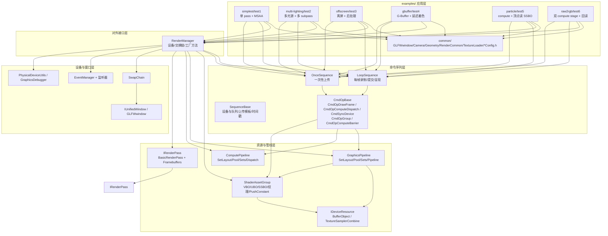
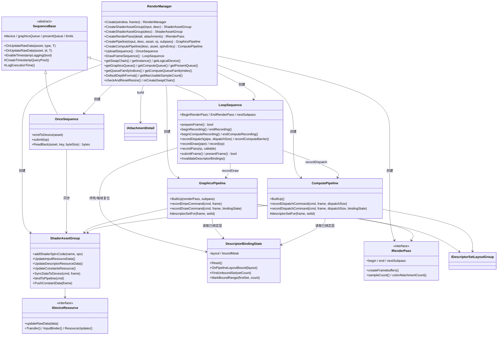
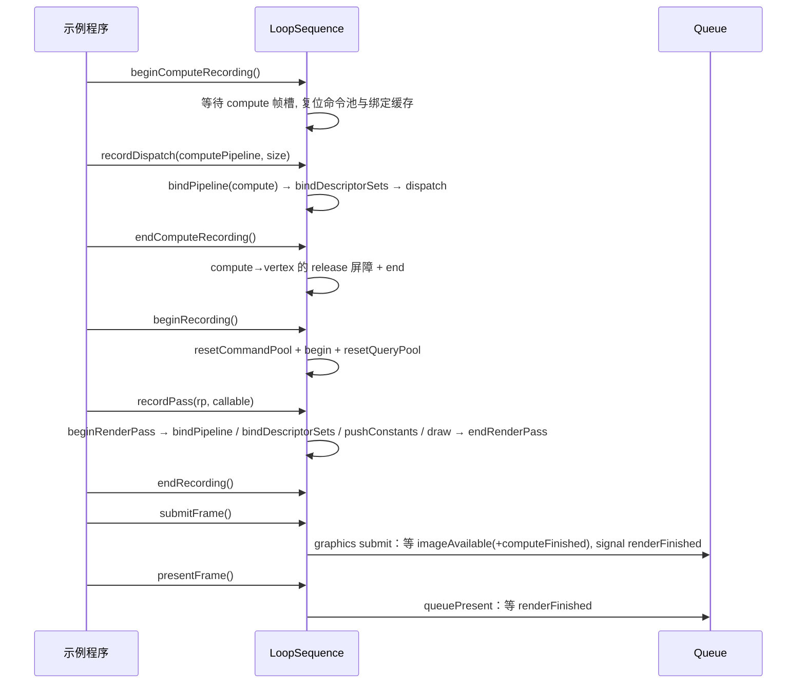
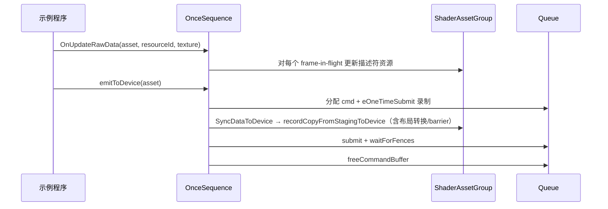
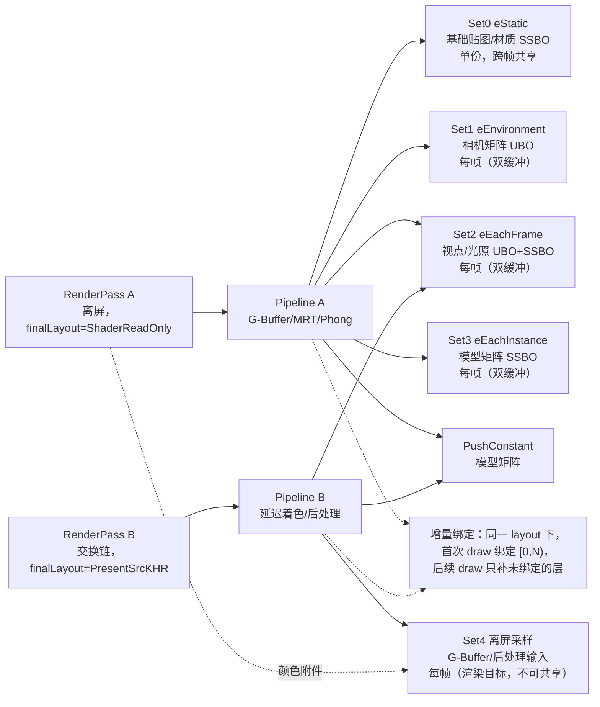
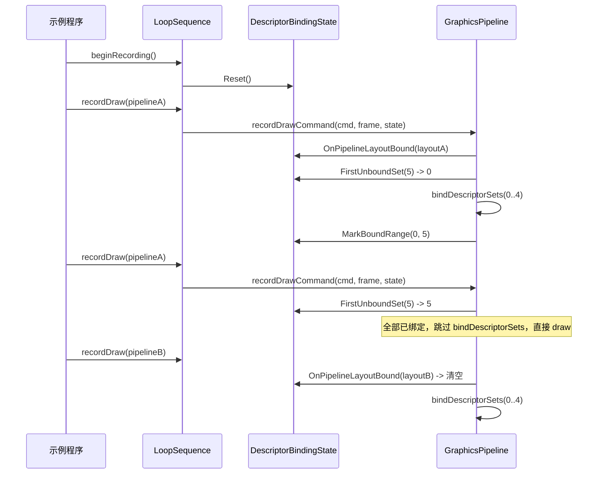
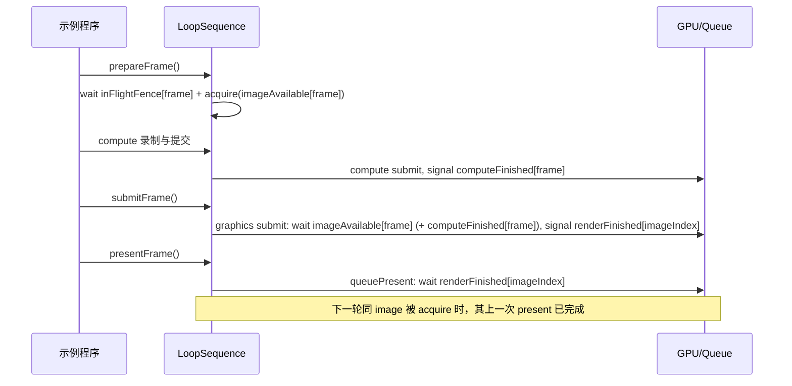

# render_demo 设计书

> 一个基于 **Vulkan 1.3 + C++20** 的最小渲染框架与示例集合。
>
> 框架目标：把「设备/交换链管理」「命令序列录制」「描述符与资源更新」「渲染通道组织」拆成互不耦合的几层，让新增一个示例只需要描述「用哪些资源、画多少个实例」，而不必重复写 Vulkan 样板代码。

---

## 1. 概览

| 项 | 内容 |
| --- | --- |
| 语言标准 | C++20（`concepts`、`requires`、`std::span` 风格接口、聚合初始化） |
| 图形 API | Vulkan 1.3，使用 `vulkan.hpp`；创建/查询接口统一显式检查 `vk::Result` |
| 窗口 / 输入 | GLFW（`IUnifiedWindow` 抽象，示例使用 `GLFWwindow`） |
| 数学库 | GLM |
| 资源加载 | `stb_image`（纹理）、`tiny_obj_loader`（示例模型，当前未启用） |
| 构建 | CMake ≥ 3.22，需 `glslangValidator` 编译着色器并转成 `*.hpp` 字节码头 |
| 目标产物 | `myEngine` 静态库 + `simplest` / `multi-lighting` / `offscreen` / `gbuffer` / `particle` / `raw2rgb` 六个可执行示例 |

依赖约定（由根 `CMakeLists.txt` 的 `globalConfig` 接口目标统一提供）：`src/`、`examples/common/`、`external/`、`external/glm/include`、`external/glfw/include`、`build_vs/generated`。

---

## 2. 目录结构

```text
render_demo/
├── CMakeLists.txt                  # 顶层：globalConfig 接口目标 + myEngine / example_common + 子目录
├── README.md
├── DESIGN.md                       # 本文档
├── cmake/
│   ├── vulkan_shader_compiler.cmake    # glslangValidator -> .spv -> .hpp
│   ├── bin_file_to_header.cmake
│   ├── check_vulkan_version.cmake
│   ├── set_package_info.cmake
│   └── ...
├── configuration/root_directory.h.in   # 生成 PROJECT_ROOT_PATH 宏
├── assets/
│   ├── textures/                   # 示例贴图
│   └── images/                     # raw2rgb 输入/输出
├── doc/                            # 设计讨论存档（当前为空）
├── external/                       # glm / glfw / stb_image / tiny_obj_loader / tinygltf（json.hpp + tiny_gltf.h）
├── data/models/                    # 迁移示例的 glTF 模型（suzanne / deer / sphere / armor / plane / cube / teapot / torusknot / samplebuilding + glass）
├── data/textures/                  # 迁移示例的 KTX 纹理（metalplate01 / yokohama cubemap / texturearray / rocks 颜色+法线高度 / colored_glass）
├── src/                            # ===== 引擎核心（静态库 myEngine）=====
│   ├── RenderManager.h/.cpp        # 对外唯一入口：设备、交换链、工厂方法
│   ├── SequenceBase.h/.cpp         # 序列公共基类：设备/队列/limits/上传模板/时间戳
│   ├── LoopSequence.h/.cpp         # 每帧命令序列（录制/提交/呈现）
│   ├── OnceSequence.h/.cpp         # 一次性上传命令序列
│   ├── CmdOpBase.h                 # 命令操作抽象
│   ├── CmdOpDrawFrame.h            # 绘制操作（可挂动态 stencil 状态，见 17.3）
│   ├── CmdOpStencilState.h         # 录制 setStencilReference / CompareMask / WriteMask（见 17.3）
│   ├── CmdOpClearStencil.h         # render pass 内 vkCmdClearAttachments 清 S8 平面（见 17.3）
│   ├── CmdSyncDevice.h             # staging -> device 同步操作
│   ├── CmdOpComputeDispatch.h      # compute 命令操作
│   ├── CmdOpGroup.h                # 把多个 CmdOp 合成一次提交（多 stage 计算链）
│   ├── CmdOpComputeBarrier.h       # compute -> 下一阶段的显式内存依赖
│   ├── SecondaryCommandBuffer.h    # secondary command buffer 录制器（多线程示例）
│   ├── ShaderAssetGroup.h/.cpp     # VBO/UBO/SSBO/纹理/PushConstant 的聚合与更新
│   ├── GraphicsPipeline.h/.cpp     # 图形管线（多 stage / topology / tessellation / spec 常量）
│   ├── ComputePipeline.h/.cpp      # 计算管线（spec 常量 / 间接派发 / 限额校验 / 增量绑定）
│   ├── DescriptorBindingState.h    # 增量绑定缓存（Bind Once）
│   ├── VulkanHandle.h              # Vulkan 句柄 RAII 包装
│   ├── IRenderPass.h               # 渲染通道抽象
│   ├── BasicRenderPass.h/.cpp      # 唯一的 RenderPass 实现（framebuffer/clear/viewport）
│   ├── IAttachmentDetail.h         # 附件/子通道/依赖的模板化描述
│   ├── IDescriptorSetDetail.h      # DescriptorSetDetailTemplate + IDescriptorSetLayoutGroup
│   ├── IVertexInputStateGroup.h    # 顶点输入状态抽象
│   ├── DeviceResource.h/.cpp       # IDeviceResource 基类 + 资源表
│   ├── DeviceMemoryAllocator.h/.cpp# 设备内存 sub-allocation（block + free list）
│   ├── BufferObject.h/.cpp         # VBO/IBO/UBO/SSBO 实现
│   ├── TextureImage.h/.cpp         # 纹理资源（2D/array/cube/3D，含 mip）
│   ├── TextureSamplerCombine.h/.cpp# combined image sampler
│   ├── InputAttachmentView.h/.cpp  # subpass 输入附件描述符（不拥有图像，见 16.2）
│   ├── ImageAttachment.h/.cpp      # 深度 / MSAA 附件
│   ├── ImageReadback.h/.cpp        # GPU -> 主机一次性回读（调试用；可按单 aspect 拷 S8，见 17.4）
│   ├── DeviceResourceUtils.h/.cpp  # createImage / createImageView 等
│   ├── SwapChain.h/.cpp            # swapchain + image views + acquire/present
│   ├── Event.h                     # EventManager / WindowEvent / SwapChainEvent
│   ├── IUnifiedWindow.h            # 窗口与 surface 抽象（唯一实现在 examples/common/GLFWwindow）
│   ├── PhysicalDeviceUtils.h/.cpp  # 物理设备选择、swapchain support、格式查询
│   ├── GraphicsDebugger.h/.cpp     # 校验层与 debug messenger
│   └── typedefs.h                  # ResourceId/ResourceKey/各类 Spec/枚举/资源表模板
├── examples/
│   ├── CMakeLists.txt              # add_render_example() 统一示例配置
│   ├── common/
│   │   ├── GLFWwindow.h/.cpp       # 窗口/输入/surface（示例侧实现）
│   │   ├── Camera.h
│   │   ├── Geometry.h
│   │   ├── RenderCommon.h
│   │   ├── TextureLoader.h/.cpp
│   │   ├── DescriptorLayoutConfig.h    # set0~set4 组件枚举与配置表 + subpass 输入附件表（见 16.4）
│   │   ├── ComputeLayoutConfig.h       # compute set0 组件表 + 单层 layout 模板
│   │   ├── AttachmentDetailConfig.h    # Simple/GBuffer/SubpassDeferred 附件配置 + DependencyPreset + StencilAttachmentSpec
│   │   ├── DebugViewMode.h             # 调试视图枚举 + push constant + 按键状态（见 13.2）
│   │   ├── ImageDump.h/.cpp            # 中间结果编码 + PPM 存盘 + --capture/--view 解析（见 13.4）
│   │   ├── GlTFLoader.h/.cpp           # tinygltf 之上的纯 CPU glTF 解析（见 14.2）
│   │   ├── KtxLoader.h/.cpp            # KTX 1.0 解析（RGBA8/R16，cube/array/3D，见 15.2）
│   │   └── VertexInputStateConfig.h    # Vertex / VertexInputAtlas
│   ├── simplest/{test1.cpp,shader/}
│   ├── multi-lighting/{test2.cpp,shader/}
│   ├── offscreen/{test3.cpp,shader/}
│   ├── gbuffer/{test4.cpp,shader/}
│   ├── particle/{test5.cpp,shader/}    # 计算管线 + 粒子渲染
│   ├── raw2rgb/{test6.cpp,Raw2RgbLayoutConfig.h,shader/{rawunpack.comp,raw2rgb_v2.comp}}
│   ├── geometryshader / tessellation / deferred / terraintessellation /
│   │   gltfloading / gltfscenerendering / multithreading  # 迁移示例（test7..test13，见 14）
│   ├── texture / texturecubemap / texturearray / parallaxmapping / texture3d
│   │                                                       # 纹理家族迁移（test14..test18，见 15）
│   ├── subpasses/{test19.cpp,shader/}                       # 三 subpass 延迟+透明（见 16）
│   └── stencil/{test20.cpp,shader/}                         # stencil 描边（见 17）
└── build_vs/                       # Visual Studio 构建目录（含各示例可执行程序）
```

> **说明**：顶层 `CMakeLists.txt` 通过 `file(GLOB ... CONFIGURE_DEPENDS "src/*.cpp")` 收集 `src/` 顶层源码，`examples/common/*.cpp` 同理——`CONFIGURE_DEPENDS` 会在构建时重新匹配，新增源文件无需手动 re-configure。历史 pass 实现（原 `src/legacy/`，37 个文件）、engine 侧未使用的 GLFW 桥接（`GLFWwindow.cpp` / `GLFWwindowUtils.h`，`window_utils` 命名空间函数从未被调用）以及根目录旧 shader 副本均已在代码卫生清理中删除，可从 git 历史（`Initial commit`）追溯。示例侧配置头（`*Config.h`）位于 `examples/common/`，而非引擎库内。调试存盘目录 `dump/`（见 13.4）由程序运行时创建，已在 `.gitignore` 中忽略。

---

## 3. 代码框图

### 3.1 分层架构



### 3.2 核心类关系



### 3.3 每帧时序（LoopSequence）



一次性上传（OnceSequence）的时序：



### 3.4 描述符分层与多 Pass 组合



> 层的排列顺序 = 更新频率由低到高。`DescriptorBindingState` 记录「当前 layout 下已绑定的层」，同一个 layout 连续绘制时只补绑缺失的层；切换布局才整体失效。

---

## 4. 核心设计框架分析

### 4.1 RenderManager —— 唯一对外入口

**职责**

1. 实例 / 调试层：`createInstance()` + `GraphicsDebugger`（Debug 构建启用校验层，当前只启用 synchronization validation，见 4.14）。
2. 物理设备与逻辑设备：`PhysicalDeviceUtils::select()` 选择图形 / 呈现 / 计算队列族，`createDevice()` 创建逻辑设备与队列。
3. 交换链与窗口生命周期：通过 `EventManager` 订阅 `WindowEvent::eCreate/eResize` 重建 `SwapChain`，订阅 `SwapChainEvent::eReCreate` 重建各 `IRenderPass` 的 framebuffer。
4. 工厂方法：`CreateShaderAssetGroup` / `CreateRenderPass` / `CreatePipeline` / `CreateComputePipeline` / `UploadSequence` / `DrawFrameSequence`。

**两阶段构造**：构造函数只挂事件监听，Vulkan 初始化放在 `RenderManager::Create()` 里。`getInstance()/getLogicalDevice()` 通过 `shared_from_this()` 返回句柄的 aliasing `shared_ptr`，而构造期间控制块还不存在，直接在构造函数里调用会抛 `std::bad_weak_ptr`；示例统一改用 `RenderManager::Create(window, framesInFlight)` 创建。

**避免自引用环**：`m_surface`（删除器捕获 instance）、`m_swapChain`（持有 device）、`m_debugger` 里的 debug messenger（删除器捕获 instance）都是 manager 自己的成员，若用 aliasing `shared_ptr` 就会形成「成员 → 句柄 → manager」的环，manager 永远不析构；这三处改用 `instanceView()/deviceView()` 提供的非拥有视图。对外（sequence、pipeline、render pass）仍用 aliasing 版本，由它们负责延长 manager 的生命周期。非拥有视图安全的前提是成员声明顺序：`m_surface`/`m_debugger` 在 `m_instance` 之后声明、`m_swapChain` 在 `m_device` 之后声明，析构时它们先被销毁，句柄仍然有效（详见 4.12）。

### 4.2 SequenceBase / LoopSequence / OnceSequence —— 命令序列层

**SequenceBase** 抽象两类序列的公共部分，消除重复：

| 能力 | 说明 |
| --- | --- |
| 设备与队列 | 构造时从 `RenderManager` 取 `vk::Device`、graphics/present queue、queueFamilyIndex |
| `OnUpdateRawData` 模板 | 用 `requires { data.data(); data.size(); }` 自动区分容器与普通结构体；派生出纯虚的 `(const void*, size_t)` 重载 |
| 时间戳 QueryPool | `CreateTimestampQueryPool()` 在设备不支持时间戳时返回 `nullptr`（不再抛异常），调用方直接判空 |
| `recordDraw(pipeline)` / `record(op)` | 通过 `CmdOpBase` 解耦「记录什么」与「谁记录」 |
| `recordPass(rp, callable)` | **作用域化**的 Begin/End，避免异常或提前 return 导致 render pass 未闭合 |
| `submitFrame()` | `queueSubmit`，等待 imageAvailable、signal renderFinished、关联 in-flight fence |
| `presentFrame()` | `queuePresent`；`OutOfDate/Suboptimal/窗口 resize` 统一走重建路径 |

资源布局：每个 frame-in-flight 各自持有 `CommandPool → CommandBuffer → QueryPool` + `imageAvailable/renderFinished Semaphore` + `Fence`。

**OnceSequence**

- 单命令池 + 单 fence，上传即同步（`waitForFences`），命令缓冲使用 `eOneTimeSubmit` 并在提交后释放。
- 描述符资源更新会遍历所有 frame-in-flight（静态资源被所有帧共享）。

**重构点**

- 命令缓冲由 `unordered_map<uint32_t, vector<shared_ptr<vk::CommandBuffer>>>` 简化为 `vector<shared_ptr<vk::CommandBuffer>>`（每帧一个 primary buffer），消除 `[i][0]` 这类间接访问。
- 删除未使用的 `vk::Result result` 变量、`steady_clock` 计时片段与注释掉的调试输出。
- 修正 `endRecording()`/`submitFrame()` 中复制自其他项目的错误异常文案。
- `m_operations` 在 `beginRecording()` 清空（原实现只增不减，长期运行会持续增长）。
- `prepareFrame/presentFrame` 标注 `[[nodiscard]]`，避免忽略「需要跳帧」的返回值。

### 4.3 ShaderAssetGroup —— 资源聚合与更新

**职责**：把「一个 draw 所需的全部资源」聚合为一个对象，屏蔽 `ResourceTypes/ResourceId` 的差异。

**重构点**

- `UpdateConstantsResource` 增加类型、帧索引、目标容量校验（原实现直接 `memcpy`，`size` 超过 `maxPushConstantsSize` 时会踩内存）。
- `SyncDataToDevice` 抽成单个 lambda，消除 VBO 与描述符两份重复循环。
- `SyncDataToDevice` 现在按**脏标记**跳过未变化的资源（`IDeviceResource::NeedsUpload/OnUploaded`），避免重复 `emitToDevice` 时把整份纹理/SSBO 再拷一次。
- `DescriptorResource(key)` 与 `UpdateDescriptorResourceData()` 对 frame1..N 找不到资源时回退到 frame0，以支持「静态层单份资源」。
- 构造期打印移除，避免每个资源组都刷屏。
- 新增 `AliasDescriptorResource(alias, target)`，让两个 `ResourceKey` 指向同一个 `IDeviceResource`（同一 `VkBuffer`），用于 compute 输出与顶点输入的 ping-pong 复用。

### 4.4 GraphicsPipeline —— 描述符集合与管线

**职责**

1. 依据 `IDescriptorSetLayoutGroup` 创建 `DescriptorSetLayout[]`、`DescriptorPool`、按帧分配 `DescriptorSet[][]`。配置通过 `SharedClone()` 由管线自己持有，调用方的 layout 对象可以先于管线销毁。
2. 通过 `ShaderAssetGroup::DescriptorResource(key)` + `IDescriptorUpdater::constructWriteDescriptorSet()` 完成 `updateDescriptorSets`（首次绑定即完成写入）；**共享层只写 frame0 的 set**。
3. 创建 `PipelineLayout`（含 push constant range）与 `GraphicsPipeline`，句柄统一由 `VulkanHandle` 管理。
4. `recordDrawCommand(cmd, frame, bindingState)`：`bindPipeline` → `pushConstants` → **增量** `bindDescriptorSets` → `bindVertex/IndexBuffer` → `draw/drawIndexed`（实例数来自 `drawInstanceCount()`）。

- `bindingState.OnPipelineLayoutBound(layout)`：布局变化则整体失效；
- `firstSet = FirstUnboundSet(setCount)`，只绑定 `[firstSet, setCount)`；
- `descriptorSetFor(frame, setId)`：共享层固定返回 frame0 的 set。

**约定**

- 空顶点输入时顶点数取 `VertexInputAtlas` 的 `drawVertexCount`：为 0 时画 3 个顶点（全屏三角形，shader 用 `gl_VertexIndex` 生成），大于 0 时按该数量绘制（SSBO 驱动的粒子，见 6.6）；实例数取 `drawInstanceCount()`，默认 1。
- 混合状态按 `renderPass->colorAttachmentCount()` 生成，天然支持 MRT。
- `multisampling.rasterizationSamples` 取自 `renderPass->sampleCount()`。

**重构点**

- ShaderModule 用局部 RAII guard 管理，`createGraphicsPipelines` 抛异常时不再泄漏。
- 校验 `vert`/`frag` 是否存在，缺失时给出明确错误而不是空指针解引用。
- 保存 `m_colorFormat/m_depthFormat/m_msaaSamples/m_colorAttachmentCount`、`m_hasDepthAttachment/m_depthAttachmentIndex/m_attachmentCount` 等派生信息。

### 4.5 BasicRenderPass —— 渲染通道与 framebuffer

`BasicRenderPass` 是 `IRenderPass` 的唯一实现，依据 `IAttachmentDetail` 产出的 `RenderPassBlueprint` 构建 `vk::RenderPass` 与 framebuffer。

- `createFramebuffers` 负责创建深度附件、MSAA 颜色附件，并按「交换链图像数量（或 frame-in-flight 数量）」创建 framebuffer。
- **framebuffer 索引规则（重要）**：`begin(cmd, frameIndex, ...)` 的 `frameIndex` 由调用方决定。对 swapchain-sized pass，framebuffer 数量等于交换链图像数，必须用 `acquireNextImage` 返回的 `imageIndex` 选择；对离屏 pass，framebuffer 按 frame-in-flight 数量创建，用帧号选择。`LoopSequence::recordPass()` 已按 `renderPass->isSwapChainSized()` 区分处理（见 4.14）。
- **附件暴露**：除采样用的 `offscreenViews()` 外，`IRenderPass` 还提供 `offscreenImages()` 与 `offscreenColorFormat(colorSlot)`（与视图同索引的 `vk::Image`、按 slot 重复的格式），供调试回读使用（见 13.3）。单采样颜色附件创建时统一带 `eTransferSrc`，因此可以被 copy 到 staging；MSAA transient 附件会去掉该用途（它只用于 resolve，不参与回读）。

**重构点**

- `clearValueCount` 由固定 `colorCount+1` 改为 `m_attachmentCount`，深度清屏值写到真实索引。原实现在 G-Buffer（3 color + depth）等场景下会触发校验层报错。
- 重建 framebuffer 前显式 `clear()`，避免重建期新旧句柄并存。
- 移除 framebuffer 删除器里多余的 `targetContext` 捕获。
- 修复 `ImageAttachment::multiSampleCreateInfo` 中 `extent.height` 误用宽度的赋值错误。

### 4.6 资源层（IDeviceResource 体系）


- 「能力接口」拆分让同一资源可以同时具备传输、绑定、描述符写入三种能力，而调用方各取所需。
- `ResourceObjectRepository<Key,T>` 用 `std::any` 包装 `shared_ptr<T>` 实现异构资源表，同时保留强类型 `findValue()`。
- `DeviceResourceVisitor` 用于从资源表中「反向取信息」，例如 `ImageViewCollector` 收集离屏附件的 image view。
- **队列族共享**：`BufferObject` 接受 `sharedQueueFamilies`，`RenderManager::sharedQueueFamilies()` 返回去重后的 `{graphics, compute}`。两个 family 不同时，primary buffer 用 `VK_SHARING_MODE_CONCURRENT` 创建，compute 队列写完、graphics 队列直接读无需 ownership transfer；只有 1 个 family 时退回 `eExclusive`。staging buffer 只被传输（graphics）队列访问，始终保持 exclusive。纹理/图像目前仍为 `eExclusive`——现有示例的纹理只在 graphics 侧使用；若将来 compute 要写图像，需要按同样方式把 `createImage` 的 sharingMode 改成 concurrent。

### 4.7 配置描述层（模板 + 常量表）

三个接口把「示例侧配置」与「引擎侧实现」解耦：

| 接口 | 实现 | 配置载体 |
| --- | --- | --- |
| `IVertexInputStateGroup` | `VertexInputAtlas` | `VertexComponent` 列表 + 属性表（format/offset/stride） |
| `IAttachmentDetail` | `SimpleAttachmentDetail` / `GBufferAttachmentDetail` | 组件枚举 + 附件规格表 |
| `IDescriptorSetLayoutGroup` | `DescriptorLayoutAtlas` | `SetDetailConfig{global, onDemand, perFrame, perObject, inputAttachment, pushconstant}` |

设计收益：

- 组件到「binding/location/role」的映射由 `constexpr std::tuple` 表在编译期决定，示例只写枚举。
- 描述符池大小由各配置表累加得出，新增组件不会漏配。注意 Vulkan-Hpp 中 `eUniformBuffer=6`、`eStorageBuffer=7`，池大小统计必须按实际 `vk::DescriptorType` 值建索引，不能用固定长度的小数组（曾因数组越界漏配 UBO/SSBO，见 4.14）。
- `DescriptorSetDetailTemplate<ComponentEnum, SetID, Table>` 固定 set 编号，天然对应「分层设计」。

### 4.8 Event / SwapChain / Window

- `IUnifiedWindow` 抽象窗口、surface、resize 标记；`GLFWwindow` 负责输入（WASD + 鼠标 + 滚轮）。
- `EventManager` 以类型名字符串索引监听器列表，`notify` 时拷贝列表再回调（避免回调中增删监听器导致迭代失效）。
- `SwapChain` 只做「选格式/模式/范围 → 创建 → 取图像 → 建 image view → acquire/present」。

### 4.9 生命周期与调用约定（重要）

1. `GraphicsPipeline` 以 `shared_ptr<const IVertexInputStateGroup>` / `shared_ptr<const IDescriptorSetLayoutGroup>` 持有配置（见 4.7 的 `SharedClone()`），示例侧配置对象不再需要与管线同生命周期。
2. `reCreateSwapChain()` 遍历 `RenderManager` 登记的**全部** render pass，仅对 `isSwapChainSized()==true` 的（`SimpleAttachmentDetail::eDirect/eMSAA` 生成）重建 framebuffer；离屏（offscreen / G-Buffer）pass 尺寸固定，跳过重建。

### 4.10 描述符分层的落地实现对照

对照 `doc/Descriptor set分层设计.txt` 的设计要求，逐条落到代码：

| 设计文档要求 | 实现位置 | 说明 |
| --- | --- | --- |
| 按更新频率划分 Set | `DescriptorLayoutAtlas::frequencyOfSet()` | set0 `eStatic`、set1 `eEnvironment`、set2 `eEachFrame`、set3 `eEachInstance`、set4 离屏输入 |
| 低频层只绑一次（Bind Once） | `DescriptorBindingState` + `LoopSequence::m_bindingState` | 每帧 `Reset()`；同一 layout 下只补绑未绑定的层 |
| 每层双缓冲 | `RenderManager::DescriptorResources(layout, maxFrameInFlight)` | 资源 key 为 `ResourceKey{ResourceId, frame}`，set 为 `m_descriptorSets[frame][setId]` |
| eStatic 层单份 | `DescriptorLayoutAtlas::makeSet(..., shared=true)` → `SetLayoutDetail::shared` / `isSetShared()` | 只创建 frame0 的资源与 set，所有帧绑定同一份 |
| 只更新变化的数据（MarkDirty/IsDirty） | `IDeviceResource::NeedsUpload()/OnUploaded()` | `SyncDataToDevice` 跳过未变化资源；首次上传行为保持不变 |
| 材质不单独占一个 Set | set0 内 `eMaterialProperty` SSBO + 贴图绑定 | 材质作为数据索引，避免按材质切 Set |
| 多实例用 Dynamic Offset | 未实现 | 当前用「一个实例 SSBO + `gl_InstanceIndex`」，同样避免 N 个 Set |
| Bindless 贴图数组 | 未实现 | 需要 `descriptorIndexing` 特性与 shader 改造，见第 8 章 |

增量绑定的执行过程：



约束与注意：

- 描述符绑定是 **command buffer 状态**，跨 `BeginRenderPass/EndRenderPass`、跨 `nextSubpass` 均有效，因此缓存可以在整帧内复用。
- 只有**切换 PipelineLayout** 才会使绑定失效（`OnPipelineLayoutBound` 用句柄比较实现）。
- 若自定义 `CmdOpBase` 直接调用了 `bindPipeline`/`bindDescriptorSets`，必须在之后调用 `LoopSequence::InvalidateDescriptorBindings()`，否则后续 `recordDraw` 可能跳过必要的绑定。

### 4.11 ComputePipeline 与多 compute stage

| 项 | GraphicsPipeline | ComputePipeline |
| --- | --- | --- |
| SPIR-V 入口 | `"vert"` / `"frag"` | `"comp"`（或 `CreateComputePipeline` 传入的 entry 名） |
| 录制 | `recordDrawCommand` | `recordDispatchCommand(cmd, frame, DispatchSize)` |

**提交链**（`LoopSequence`）：

```text
prepareFrame()                 // 等待 graphics 帧槽 + 获取交换链图像
beginComputeRecording()        // 等待 compute 帧槽，复位命令池与绑定缓存
recordDispatch(computePipeline, size)
endComputeRecording()          // release 屏障，结束录制
beginRecording() / recordPass(...)   // 图形录制
submitFrame()                  // 等待 imageAvailable(+computeFinished), signal renderFinished
presentFrame()                 // queuePresent
```

compute 优先选 **compute-only** 族以支持异步计算，找不到则回退 graphics 族；`createDevice` 为三者各申请 1 个队列（`std::set` 去重），`getComputeQueueFamilyIndex()` 与 compute 命令池、compute 提交使用同一个族（见 4.13）。

**跨管线共享缓冲**：`ShaderAssetGroup::AliasDescriptorResource(alias, target)` 让两个 `ResourceKey` 指向同一个 `IDeviceResource`（同一个 `VkBuffer`）。粒子示例用它表达 ping-pong：`input[frame] -> output[(frame+N-1)%N]`，这样 compute 读上一帧写的缓冲，而图形管线读 `output[frame]`，两条管线共用一份 `ShaderAssetGroup`（因此也是同一批 buffer），无需额外的拷贝。

**无顶点输入的绘制**：当 `IVertexInputStateGroup` 为空输入时，`GraphicsPipeline` 使用顶点数决定绘制量：为 0 时按全屏三角形画 3 个顶点；大于 0 时按该数量绘制，顶点数据由 shader 从 SSBO（`gl_VertexIndex` 索引）读取——计算输出直接作为顶点流使用。

**多 compute stage 共享一个 ShaderAssetGroup**：`CreateComputePipeline(descLayout, asset, spirvEntry)` 用 entry 名选择模块，因此一个 asset 可以同时存放 `"rawunpack"` 与 `"raw2rgb"` 两段 SPIR-V：两个管线共用同一套描述符布局、同一批 SSBO，多 pass 之间不需要拷贝或资源别名。描述符层用 `ComputeLayoutAtlasTemplate` 的 `sharedAcrossFrames` 选项可以关闭双缓冲（一次性图像处理不需要每帧一份）。

**GPU → CPU 回读**：`IDeviceResource::MappedData()/MappedByteSize()` 映射 device-local 资源；`DefaultBufferTransfer::recordCopyFromDeviceToStaging` 落地（含 `shaderWrite→transferRead`、`transferWrite→hostRead` 屏障）；`OnceSequence::ReadBack()` 完成提交 + fence 等待 + 拷贝。`OnceSequence::OnUpdateRawData` 也补齐了 push constant 分支（对所有 frame 槽位写入），这样一次性任务可以在上传阶段把 `width/height` 之类的参数写好。

**管线能力**（`ComputePipeline.h`）

| 能力 | 接口 | 说明 |
| --- | --- | --- |
| SPIR-V 入口选择 | 构造参数 `spirvEntry` | 一个 asset 可放多段 compute，按入口名各建一条管线 |
| 特化常量 | `ComputePipelineOptions::specializationConstants` / `addSpecializationConstant()` / `makeSpecializationConstant<T>(id, value)` | 值以 4/8 字节原始数据传入（GLSL 侧 `layout(constant_id = N) const ...`），未覆盖的常量用 shader 里的默认值；粒子示例用它把工作组宽度做成运行时可调 |
| 间接派发 | `recordDispatchCommand(cmd, frame, IndirectDispatch{buffer, offset}, state)` | 三个组数从 `VkDispatchIndirectCommand`（3×uint32）读取，用于「工作量由 GPU 决定」的场景 |
| 组数校验 | 构造时传入 `vk::PhysicalDeviceLimits`（`RenderManager` 自动传 `m_physicalDeviceProperties.limits`） | 超过 `maxComputeWorkGroupCount` 时抛异常并打印三轴上限；任一轴为 0 则跳过录制（空工作量是合法 no-op，不必占一条命令） |
| PSO 缓存 | `RenderManager::pipelineCache()` | 进程内共享，`CreateComputePipeline` 默认注入；仅内存复用，未做落盘序列化 |
| 幂等构建 | `builtUp()` / `built()` | 允许「先设置特化常量再构建」，重复调用是 no-op |
| 创建结果校验 | 内部 | `vkCreateComputePipelines` 返回逐管线结果时会检查该结果与句柄非空，报错信息带入口名 |

**描述符集索引必须用 setIndex**：`m_descriptorSets` 按 `[frameSlot][setIndex]` 布局（见 `allocateAndWriteSets`），而 `SetLayoutDetail::setId` 是逻辑编号。两者在单集合时同为 0，一旦集合重排或编号不连续就会取错集合，所以 `descriptorSetFor(frame, setIndex)` 一律用**下标**索引，并用 `details[setIndex].shared` 决定是否落到 frame 0。某个集合为空时按单个集合逐个绑定，避免把空句柄塞进连续绑定范围。

**多 stage 链式提交**（`CmdOpGroup` / `CmdOpComputeBarrier`）

```cpp
auto chain = std::make_shared<CmdOpGroup>();
chain->add(std::make_shared<CmdOpComputeDispatch>(unpackPipeline, sizeA));
chain->add(std::make_shared<CmdOpComputeBarrier>());          // compute -> compute
chain->add(std::make_shared<CmdOpComputeDispatch>(rgbPipeline, sizeB));
once->submit(chain, asset);                                   // 一次提交、一个 fence
```

提交顺序只保证**执行**顺序，不保证**内存可见性**：上一 stage 写入的 SSBO/纹理必须经过 `CmdOpComputeBarrier`（`eShaderWrite → eShaderRead|eShaderWrite`）才对下一 stage 可见。`LoopSequence::recordComputeBarrier()` 是帧内版本的同一件事。

### 4.12 句柄暴露与生命周期约定

`RenderManager` 用 `VulkanHandle` 拥有 `vk::Instance`/`vk::Device`，对外提供两组访问器：

| 访问器 | 实现 | 所有权 | 生命周期保证 | 可见性 |
| --- | --- | --- | --- | --- |
| `getInstance()` / `getLogicalDevice()` | `shared_ptr<T>(shared_from_this(), &handle)`（aliasing） | 与 `RenderManager` 共享控制块，强引用 +1 | 只要指针活着 manager 一定活着 → 句柄永远有效 | public |
| `instanceView()` / `deviceView()` | `shared_ptr<T>(&handle, [](T*){})`（空删除器） | 独立控制块，**不**持有 manager | 不保证，manager 先析构即悬空 | private |

判定规则：**接收方会不会被 manager 自己拥有？**

| 接收方 | 传什么 | 例子 |
| --- | --- | --- |
| 会被 manager 的成员保存（删除器捕获 / 成员字段） | view | `m_surface`（`createSurface` 的删除器）、`m_swapChain`（`SwapChain` 保存 device）、`m_debugger` 的 debug messenger |

成员声明顺序保证 `m_surface`/`m_debugger` 在 `m_instance` 之后、`m_swapChain` 在 `m_device` 之后声明，因此析构时 surface/messenger/swapchain 先被销毁，删除器拿到的句柄仍然有效（同时满足 Vulkan「debug messenger 必须先于 instance 销毁」的要求）。

**两阶段构造**：`getInstance()/getLogicalDevice()` 依赖 `shared_from_this()`，而构造期间控制块还不存在，在构造函数里调用会抛 `std::bad_weak_ptr`。因此构造函数只挂事件监听，Vulkan 初始化放在工厂里：

```cpp
auto manager = std::shared_ptr<RenderManager>(new RenderManager(window, framesInFlight)); // 控制块建立
manager->initVulkan();                                                                     // 之后才能 shared_from_this()
```

构造函数已私有，示例统一使用 `RenderManager::Create(window, framesInFlight)`。

**易踩的坑**

- 不要把 view 存进成员 / 静态变量 / 返回给外部 API；
- `view.use_count()==1`，`get().use_count()` 等于 manager 的强引用数，可用于排查生命周期；
- 销毁 view 不会销毁句柄；销毁最后一个 aliasing 指针才会真正销毁 manager 与句柄；
- 队列（`getGraphicsQueue()/getComputeQueue()/getPresentQueue()`）是 `make_shared<vk::Queue>(handle)` 的独立拷贝，与 manager 生命周期无关。

**关机顺序（shutdown）**

| 顺序 | 责任方 | 说明 |
| --- | --- | --- |
| 1 | 调用方栈变量 | 示例里 `mgr` 最先创建、最后销毁；pipeline/asset/render pass 先于 `mgr` 析构 |
| 2 | `~LoopSequence()` | 先 `device.waitIdle()`，再释放 fence/semaphore/command pool（否则 validation 报 "fence is in use"、"semaphore...in use"、"pCommandBuffers is in use"） |
| 3 | `~RenderManager()` | body 里 `waitIdle()` → 成员逆序销毁：swapchain → device → surface → instance |
| 4 | `~GLFWwindow()` | 最后 `glfwDestroyWindow()` + `glfwTerminate()`，此时 surface/instance 已释放 |

配套约定：

- **surface 由 `RenderManager` 独占**：`GLFWwindow::createSurface()` 只返回 `shared_ptr` 并保存 `weak_ptr`，因此 `vkDestroySurfaceKHR` 一定早于 `vkDestroyInstance` 与 `glfwTerminate()`（旧实现里 window 也持有强引用，surface 拖到 instance 之后才销毁，触发 VUID-vkDestroyInstance-instance-00629）；
- **时间戳按 `e64 | eWithAvailability` 读取**：每 query 占 16 字节，结果缓冲区需 `4 × uint64_t`、stride = 16；上一帧的时间戳可能还没写完，未就绪时直接跳过采样，避免 `vkGetQueryPoolResults` 返回 `VK_NOT_READY`（见 4.14）；
- 序列（fence/semaphore/command buffer 的所有者）必须在析构前等待设备空闲——`~OnceSequence` 早已如此，`~LoopSequence` 也补齐了这一步。

### 4.13 队列族选择与跨族资源共享

**选择策略（`PhysicalDeviceUtils::findQueueFamilies`）**

| 用途 | 规则 |
| --- | --- |
| graphics | 优先「graphics 且能 present」的族（present 尽量不跨族），否则第一个 graphics 族 |
| present | 能复用 graphics 族就复用，否则第一个可呈现族 |
| compute | 优先 **compute-only** 族（`eCompute && !eGraphics`，支持异步计算），找不到回退 graphics 族 |

实现上先缓存每个族的 surface 支持再决策，**不做 early break**——compute-only 族经常排在 graphics/present 之后，提前退出会导致永远选不到（旧实现的缺陷）。

**设备与队列（`RenderManager::createDevice`）**

```cpp
const uint32_t graphicsFamily = indices.graphicsFamily.value(); // isComplete() 保证
const uint32_t presentFamily  = indices.presentFamily.value();
const uint32_t computeFamily  = indices.computeFamily.value_or(graphicsFamily); // 不再 value()
std::set<uint32_t> uniqueQueueFamilies = {graphicsFamily, presentFamily, computeFamily}; // 去重
```

graphics==compute 时只创建一个队列，`getQueue` 拿到同一个 `VkQueue`；`getComputeQueueFamilyIndex()` 与 compute 命令池、compute 提交使用同一个族。

**跨族资源：buffer 用 `eConcurrent`**

`BufferObject` 接受 `sharedQueueFamilies` 参数，`RenderManager::sharedQueueFamilies()` 返回去重后的 `{graphics, compute}`：

| family 情况 | 共享模式 |
| --- | --- |
| 只有 1 个（集成显卡 / 无专用 compute 族） | `eExclusive`（与改造前一致，零额外开销） |
| 2 个（存在专用 compute 族） | `eConcurrent` + `setQueueFamilyIndices`，compute 写完 graphics 直接读，无需 ownership transfer |

staging buffer 只被传输（graphics）队列访问，始终保持 `eExclusive`。

**仍然 exclusive 的资源**

- 纹理 / 图像（`TextureImage`、`ImageAttachment`）：现有示例只在 graphics 侧使用；若将来 compute 要写图像，需要把 `imageInfo.sharingMode` 同样改成 concurrent；
- swapchain 图像：`SwapChain::createSwapChain` 在 graphics != present 时已使用 `eConcurrent`。

**异步 compute 的收益前提**：即使队列独立，粒子示例里 compute 每帧写、顶点着色器同帧读**同一块** SSBO，中间有信号量与屏障依赖，实际仍是串行；要获得并行收益需要双缓冲资源（compute 写 A、图形读 B）或拆分互不相关的资源集。

### 4.14 Validation 正确性与收尾修复（本轮）

在完成从单 exe demo 到分层框架的重构后，用 synchronization validation 跑通六个示例，定位并修复了以下问题。**硬性 VUID 与全部 `WRITE_AFTER_WRITE` / `READ_AFTER_WRITE` hazard 均已清零**（最终六个示例 VUID=0、hazard=0）。

| 编号 | 问题 | 根因 | 修复 |
| --- | --- | --- | --- |
| VUID-00869 | `dstAccessMask` 含 `SHADER_READ` 但 `dstStage=eBottomOfPipe` | eOffscreen 第二 dependency 的 stage 不支持 shader read | 目标阶段改为 `eFragmentShader \| eComputeShader` |
| VUID-06700 | 含 stencil 的 depth 附件 `initialLayout=UNDEFINED` 且 `stencilLoadOp=eLoad` | Vulkan-Hpp 默认 `stencilLoadOp=eLoad`，配置未显式设置 | 两处 depth 配置显式设 `stencilLoadOp/StoreOp=eDontCare` |
| VUID-01430（真 bug） | present 的图像仍是 `UNDEFINED`，画面未渲染 | swapchain-sized framebuffer 按 `imageIndex` 建，但 `recordPass` 传的是 in-flight 帧号，渲染写错图 | `recordPass()` 按 `isSwapChainSized()` 选 `imageIndex`/`frameIndex`，见 4.5 |
| VUID-00067 | 复用的 `renderFinished` 信号量仍被 present 占用 | 信号量按帧索引复用，present 持有时间可能跨帧 | 按 swapchain image 数分配，用 `m_renderFinished[m_imageIndex]` |
| 队列 stage 不兼容 | compute-only 队列用 `dstStage=eVertexInput` 的屏障 | `eVertexInput` 不是 compute 队列支持的 stage | release 屏障目标阶段改为 `eBottomOfPipe` |
| 信号量已 signaled | `vkAcquireNextImageKHR` 报 semaphore 处于 signaled | compute 链激活时只等 `computeFinished`，从不消费 `imageAvailable` | 始终等待 `imageAvailable`，compute 时**额外**等待 `computeFinished`（两个 wait） |
| VUID 内存对齐 | 图像内存 offset 非 1024 对齐 | 子分配对齐 256 不足 | `kSubAllocationAlignment` 提升到 1024 |
| transient usage | `eTransientAttachment` 与 `eTransferSrc` 同时设置非法 | 多采样附件 usage 组合不当 | transient 附件去掉 `eTransferSrc`/`eSampled` |
| 描述符池漏配 | `vkAllocateDescriptorSets` 报 pool 未含 UBO/SSBO | 池大小用长度 5 的数组按 enum 索引，而 UBO/SSBO 枚举值 > 4 | 改用 `std::map<uint32_t,uint32_t>` 按实际 `vk::DescriptorType` 统计 |
| Query 结果 stride | `dataSize 16 < 24`、`stride 8 < 16` | `eWithAvailability` 时每 query 占 16 字节 | 结果缓冲 4×uint64_t、stride 16，availability 在 [1]/[3] |
| device lost / 极慢 | GPU-assisted validation 触发异常性能与设备丢失 | 同时启用 GPU-AV + best-practices + synchronization | 只保留 synchronization validation |
| 输出路径错误 | raw2rgb 输出到 `./${CMAKE_SOURCE_DIR}/...` | `root_directory.h.in` 被写成字面量路径 | 模板恢复为 `#define PROJECT_ROOT_PATH "@PROJECT_ROOT_PATH@"` |
| shader 编译错误 | 全屏三角形缺 location；uniform block 误用 std430 | GLSL 语法问题 | 输出加 `layout(location=0)`；uniform block 去掉 `std430` |
| 编译警告 | `[[nodiscard]]` 返回值被忽略 | raw2rgb 中 `presentFrame()` 未接收 | 显式 `(void)sequence->presentFrame()` |
| WRITE_AFTER_WRITE（hazard） | `beginRenderPass` 的 layout transition 与前帧 `endRenderPass` 的 depth 写入冲突 | `eSwapChain` 的 `0→external` dependency 只 release 了 color，漏掉 depth（`eLateFragmentTests` / `eDepthStencilAttachmentWrite`）；**所有带 depth 的 pass 都受影响，不止 offscreen** | src 加入 `eLateFragmentTests` + `eDepthStencilAttachmentWrite`，dst 加入 `eColorAttachmentOutput`/`eEarlyFragmentTests` 及对应 access，见 4.14 后记 |
| 跨帧采样竞争（结构） | offscreen/GBuffer 的多个 in-flight frame 共享同一组附件图像 | `framebufferCount=2` 但 `createAttachments()` 只建一组 image；两个 framebuffer 引用同一 color/depth view | `m_attachmentSets[set][attachment]` 按帧分配独立附件组；`offscreenViews()` 改为 frame-major 排列并新增 `offscreenColorCountPerSet()`；offscreen/gbuffer 示例同步改用 `[set*colorCount+slot]` 索引 |

**4.14 后记：WRITE_AFTER_WRITE hazard 的真正根因**

对照实验：仅含单个 swapchain pass 的 `simplest`/`multi-lighting` 也报同样的 `DEPTH_STENCIL_ATTACHMENT_WRITE @ LATE_FRAGMENT_TESTS` 冲突，证明它并非 offscreen 独有，而是**所有带 depth 的 render pass 共有的 dependency 缺陷**。原 `eSwapChain` 的结束依赖只 release color 写入：

```cpp
// 修复前：srcStage=eColorAttachmentOutput，srcAccess=ColorRead|ColorWrite
0 → VK_SUBPASS_EXTERNAL
```

depth 写入发生在 `eLateFragmentTests`、access 为 `eDepthStencilAttachmentWrite`，不在 release 集合内，因此下一帧 `beginRenderPass` 的 layout transition 无法与之同步。修复后同时 release color + depth，并在 dst 侧补齐 consumer stage/access：

```cpp
srcStage = eColorAttachmentOutput | eLateFragmentTests
srcAccess = ColorRead | ColorWrite | DepthStencilAttachmentWrite
dstStage = eBottomOfPipe | eColorAttachmentOutput | eEarlyFragmentTests
dstAccess = MemoryRead | ColorRead | ColorWrite | DepthStencilAttachmentWrite
```

配合 offscreen/GBuffer 的每帧独立附件组，六个示例的 `WRITE_AFTER_WRITE` / `READ_AFTER_WRITE` 全部归零。

**最终验证结果**

- 干净构建：0 error / 0 warning。
- 六个示例冒烟：全部 VUID=0、hazard=0、fatal=0，GPU timestamp 正常出帧；五个窗口示例 `exit=124` 为 `timeout` 主动终止（表示程序持续渲染），`raw2rgb` `exit=0` 并产出正确文件（`P6 / 64 64 / 255` + 8192 B raw）。
- 详见第 7、11 章。

**4.15 设计文档对照审计（后续轮次）**

按本文档逐条核对实现，又定位并修复了以下缺陷：

| # | 问题 | 根因 | 修复 |
|---|---|---|---|
| 1 | `vkBindBufferMemory2`/`vkBindImageMemory2` offset 可能不满足资源 alignment（VUID-02857/02858） | `DeviceMemoryAllocator::allocate()` 丢弃 `memRequirements.alignment`，硬编码 1024；只在驱动恰好要求 ≤1024 时不报错 | `allocate()` 增加 alignment 参数，`createBuffer`/`createImage` 传入 `memRequirements.alignment`，内部按 `max(1024, alignment)` 对齐 offset/size，`DeviceMemorySlice` 记录实际 alignment 供 `free()` 精确归还 |
| 2 | gbuffer（及所有窗口示例）在窗口最小化/失焦时**间歇性挂起**（只出 0~8 帧后卡死） | `reCreateSwapChain()` 里 `while(width==0||height==0){ getFramebufferSize(); waitEvents(); }`：`waitEvents()` 阻塞直到有事件，而能修正尺寸的事件在线程被占住时不会到来 | 移除死等循环；`chooseSwapExtent()` 本就把 0 尺寸 clamp 到 `minImageExtent`，仅对 ≤0 兜底为 1，后续真实 resize 事件会重建为正确尺寸。修复后 gbuffer 连续 5 次稳定出 275~465 帧 |
| 3 | offscreen/GBuffer 的每帧附件组数量与 in-flight 帧数脱钩 | 示例配置硬编码 `framebufferCount=2`；若 `Create(window, N≠2)` 会取模复用别帧附件、重新引入跨帧竞争 | `RenderManager::CreateRenderPass()` 对非 swapchain pass 用 `m_maxFramesInFlight` 覆盖该值，示例里的 2 仅为占位 |
| 4 | `recordPass()` 异常时 render pass 未闭合 | catch 分支只 `reset()` 活动 pass 就 rethrow，漏了 `end()` | catch 内先 `end(cmd)` 再 rethrow，兑现 4.2 的作用域保证 |
| 5 | `CubeIndices()` 与 `CubeVertices()` 不匹配 | 前者是 24 顶点立方体索引表，后者是 36 顶点展开表；按文档使用会画出错面 | `CubeIndices()` 改为 0..35 恒等索引（当前示例走非索引绘制，属潜伏缺陷） |
| 6 | 粒子首帧分布与 shader 重生分布不一致 | 种子 y∈[0.2,1.2]、vy 用独立随机数；shader 重生 y∈[1.0,1.25]、vy 与 ry 相关 | `test5.cpp::makeParticles()` 用同一 `rx/ry/rz` 派生 position 与 velocity，首帧即喷泉形状 |
| 7 | 源文件名大小写错误，Linux/CI 下会找不到实现文件 | 实现文件名为 `DeviceResourceUtIls.cpp`（大写 I），头文件与文档均为 `DeviceResourceUtils`；Windows 大小写不敏感故本机未暴露 | 重命名为 `src/DeviceResourceUtils.cpp`，与头文件、目录树声明一致 |

同时修正了本文档中多处与实现不符的描述：目录树删除已不存在的 `render_demo设计书.txt` 与根目录 `shader/`，external 依赖校正为 `glfw/glm/stb_image/tiny_obj_loader`；6.1 删除虚构的 `SwapChainFramebuffers`/`MakeSwapChainAttachmentDetail` 并把 `sharedSets` 统一为真实的 `makeSet(..., shared=...)`；4.4 空输入绘制改为按 `drawVertexCount`/`drawInstanceCount()`；6.7 raw2rgb 同步流程改为两次 `OnceSequence::submit()`；11 章 graphics fence 复位时机改为 `submitFrame()`。

---

## 5. 重构改动点汇总

| 类别 | 位置 | 变更 |
| --- | --- | --- |
| 结构 | `src/SequenceBase.h/.cpp` | 新增公共基类，收敛设备/队列/limits/上传模板/时间戳 |
| 结构 | `src/LoopSequence.*` | 命令缓冲容器简化、`recordPass()` 作用域接口、死代码清理、`[[nodiscard]]`、按 imageIndex 选 framebuffer、compute 链双信号量等待 |
| 结构 | `src/OnceSequence.*` | 复用基类、`eOneTimeSubmit`、单 fence 同步流程整理 |
| 结构 | `src/ShaderAssetGroup.cpp` | 资源同步去重、push constant 边界校验、脏标记、`AliasDescriptorResource` |
| 结构 | `src/GraphicsPipeline.cpp` | RAII ShaderModule、必需 shader 校验、去除调试输出、增量绑定 |
| 结构 | `src/RenderManager.cpp` | 构造路径合并、采样数查询循环化、析构保护、两阶段构造、句柄视图拆分 |
| 结构 | `src/BasicRenderPass.*` | 附件索引/清屏值修正、重建前释放 framebuffer、transient usage 修正；附件改为按帧分组（`m_attachmentSets[set][attachment]`），offscreenViews 改 frame-major 排列并新增 `offscreenColorCountPerSet()` |
| 缺陷 | `src/ImageAttachment.cpp` | MSAA 附件高度误用宽度 |
| 缺陷 | `src/BasicRenderPass.cpp` | `clearValueCount` 超过附件数量 |
| 缺陷 | `src/ShaderAssetGroup.cpp` | push constant `memcpy` 越界 |
| 缺陷 | `src/IAttachmentDetail.h` | eOffscreen 依赖的 dstStage/dstAccess 不匹配（见 4.14） |
| 缺陷 | `src/DeviceMemoryAllocator.cpp` | 子分配对齐 256 → 1024 |
| 示例 | `examples/common/Geometry.h` | 立方体几何统一（原 4 份重复） |
| 示例 | `examples/common/TextureLoader.*` | 纹理加载统一（stb 实现只编译一次） |
| 示例 | `examples/common/RenderCommon.h` | 相机矩阵/旋转模型/视点/附件配置/ImageView 收集统一 |
| 示例 | `examples/common/AttachmentDetailConfig.h` | 引入 `DependencyPreset`，depth 显式设 stencil ops |
| 示例 | `examples/common/DescriptorLayoutConfig.h` | 描述符池大小按实际 `vk::DescriptorType` 统计 |
| 示例 | `test1..test4` | 统一录制风格（`recordPass`）、去除无效宏分支与重复数据 |
| 扩展 | `src/GraphicsPipeline.*` | `GraphicsPipelineConfig`：任意 stage（geom/tesc/tese）、topology/patch、polygonMode/cullMode、depth/blend 开关、按 stage 的 specialization constant |
| 扩展 | `src/typedefs.h` + `PhysicalDeviceUtils.cpp` + `RenderManager::createDevice` | `DeviceRequirement` 增加 geometryShader / tessellationShader / fillModeNonSolid / samplerAnisotropy，按需请求与筛选 |
| 扩展 | `src/SecondaryCommandBuffer.h` | `SecondaryRecorder`：per-thread command pool + secondary buffer + 独立绑定缓存 + viewport/scissor 设置 |
| 扩展 | `src/IRenderPass.h` + `BasicRenderPass` + `LoopSequence::recordPass` | 可选 `vk::SubpassContents`（默认 eInline），支持 secondary buffer 执行 |
| 缺陷 | `src/RenderManager::CreatePipeline` | index buffer 的 `elementType` 由 `eCustom` 改为 `vertexInput->indexType()`，修复索引绘制抛异常 |
| 示例 | `examples/common/GlTFLoader.*` | tinygltf 之上的纯 CPU glTF 解析（顶点/索引/节点矩阵/材质/纹理） |
| 示例 | `test7..test13` | 迁移 7 个示例：geometryshader / tessellation / deferred / terraintessellation / gltfloading / gltfscenerendering / multithreading（见 14） |
| 扩展 | `src/typedefs.h` | `TextureImageSpec` 增加 `depth/layers/faces/format/mipsInData/addressMode`，视图类型由维度推导（见 15.2） |
| 结构 | `src/TextureImage.h/.cpp`（原 `TextureImage2D`） | 泛化为 2D / 2D array / cube / cube array / 3D；上传分「GPU 生成 mip」与「按子资源拷贝预烘焙 mip」两条路径 |
| 结构 | `src/DeviceResourceUtils.*` | `createImageView` 支持 `baseArrayLayer/layerCount`；新增 `copyBufferToImageRegion` 按子资源拷贝 |
| 示例 | `examples/common/KtxLoader.*` | KTX 1.0 解析：未压缩 RGBA8 / R16，cube / array / 3D，预烘焙 mip 链 |
| 缺陷 | `examples/common/VertexInputStateConfig.h` | `eTangent` 属性声明 16 字节但字段只有 12 字节，最后一个顶点越界读 4 字节 |
| 缺陷 | `examples/common/Geometry.h` | `CubeVertices()` 的 -Z / +X / +Y 三面绕序与法线相反，开启背面剔除会丢三个面 |
| 缺陷 | `cmake/vulkan_shader_compiler.cmake` | 自定义目标名改为按输出完整路径唯一化，修复全新 configure 的 CMP0002 |
| 示例 | `test14..test18` | 纹理家族 5 个示例：texture / texturecubemap / texturearray / parallaxmapping / texture3d（见 15） |
| 资源 | `data/textures/` | 5 个 KTX 入库（21 MB），`data/models/` 追加 5 个轻量模型 |
| 扩展 | `src/IRenderPass.h` + `BasicRenderPass.*` + `GraphicsPipeline.cpp` | `colorAttachmentCount(subpass)`：混合状态按管线所属 subpass 取颜色附件数（修 VUID-06055，见 16.2） |
| 结构 | `src/IRenderPass.h` + `BasicRenderPass.*` + `GraphicsPipeline.*` | `attachmentGeneration()` + `RefreshDescriptors()`：framebuffer 附件重建（resize）后重写指向它们的描述符（见 16.2） |
| 结构 | `src/InputAttachmentView.h/.cpp`（新增） | subpass 输入附件描述符资源：`eInputAttachment` + `SHADER_READ_ONLY`，不拥有视图（见 16.2） |
| 扩展 | `src/IAttachmentDetail.h` | `OffscreenTargetSpec::extraUsage` 改为 `vk::ImageUsageFlags`，可叠加 `eInputAttachment` |
| 扩展 | `src/SwapChain.*` + `src/LoopSequence.h` | 交换链图像加 `eTransferSrc`，新增 `getImages()` / `getImageIndex()`，使合成后的帧可被 `--dump` 捕获 |
| 示例 | `test19` + `examples/common/{AttachmentDetailConfig,DescriptorLayoutConfig}.h` | 三 subpass 延迟渲染：`SubpassDeferredAttachmentDetail` + 三套 subpass 描述符表（见 16） |
| 示例 | 示例 CMake | `example_common` 静态库 + `add_render_example()`，shader 头显式依赖 |
| 缺陷 | test1/test2/test3 | 1x 采样设备下不再配置非法的 resolve 附件 |
| 结构 | `src/RenderManager.*` + `IRenderPass.h` + `BasicRenderPass.*` | **P0-#1 多 pass resize**：`reCreateSwapChain()` 去掉 `renderPass` 参数；`RenderManager` 在 `CreateRenderPass` 登记全部 render pass，`reCreateSwapChain` 遍历并仅对尺寸来自交换链的 pass 重建 framebuffer，离屏/G-Buffer 固定尺寸 pass 跳过 |
| 结构 | `src/GraphicsPipeline.*` + `IVertexInputStateGroup.h` + `IDescriptorSetDetail.h` + `examples/common/*Config.h` | **P0-#2 管线配置所有权**：`GraphicsPipeline` 以 `shared_ptr<const ...>` 持有配置；`CreatePipeline` 经 `SharedClone()` 取得独立副本，示例侧配置对象可先于管线销毁 |
| 结构 | `src/VulkanHandle.h` | **P0-#3 句柄工具**：新增 `VulkanHandle<Handle,Deleter>` 拥有式 RAII 包装（移动语义/`operator Handle()`/`explicit operator bool()`），统一替代散落的 `shared_ptr<vk::X>` + 自定义删除器模式 |
| 结构 | `src/RenderManager.*` + `ShaderAssetGroup.*` + `GraphicsPipeline.cpp` | **静态层单份**：共享层只创建 frame0 的资源与 descriptor set；查找/更新对 frame1..N 回退到 frame0；只写/绑 frame0 的 set |
| 结构 | `src/DeviceResource.*` + `TextureSamplerCombine.*` + `ShaderAssetGroup.cpp` | **脏标记上传**：`IDeviceResource` 新增 `NeedsUpload()/OnUploaded()`；`SyncDataToDevice` 跳过未变化资源 |
| 修复 | `examples/common/AttachmentDetailConfig.h` | `SimpleAttachmentDetail::build()` 设 `swapChainSized=true`，否则窗口 resize 时交换链 framebuffer 不会重建 |
| 修复 | `src/VulkanHandle.h` + `BasicRenderPass.cpp` | 补齐默认构造与 `getPtr()` const 重载；修正 `RenderPass()` 改返回值后的误用 |
| 构建 | 顶层 `CMakeLists.txt` | 历史 pass 实现先迁移到 `src/legacy/` 排除构建，最终在代码卫生清理中彻底删除，避免与 `BasicRenderPass+IAttachmentDetail` 双份维护 |
| 结构 | `src/ComputePipeline.h/.cpp` + `CmdOpComputeDispatch.h` | **计算管线**：复用 `IDescriptorSetLayoutGroup`/`ShaderAssetGroup`/`DescriptorBindingState`，提供 `BuiltUp()` 与 `recordDispatchCommand()`；`DispatchSize::FromInvocationCount()` 由元素数与局部尺寸换算工作组数 |
| 结构 | `src/DeviceResource.*` + `BufferObject.*` + `ShaderAssetGroup.*` + `OnceSequence.*` | **GPU→CPU 回读**：`MappedData()/MappedByteSize()`、`recordCopyFromDeviceToStaging`（含屏障）、`RecordDescriptorResourceReadback/ReadStagedDescriptorResource`、`ReadBack()` |
| 结构 | `examples/common/ComputeLayoutConfig.h` | 抽出 `ComputeLayoutAtlasTemplate<ComponentEnum,ComputeSetConfig...>`，供不同 compute 示例复用 |
| 示例 | `examples/particle/test5.cpp` + shader | 由 Sascha Willems 粒子样例重构：compute 更新粒子 SSBO，图形 pass 用 `gl_VertexIndex` 展开四边形绘制 |
| 结构 | `src/ComputePipeline.*` + `RenderManager.*` | **多 compute stage**：`spirvEntry` 参数允许一个 asset 存放多段 compute SPIR-V 并被多个管线共享 |
| 结构 | `src/LoopSequence.*` | **compute 内部屏障**：`recordComputeBarrier()`（compute→compute 的 shader write→read） |
| 结构 | `src/DeviceMemoryAllocator.*`（新增）+ `DeviceResourceUtils.*` + `BufferObject.*` + `RenderManager.*` | **设备内存 sub-allocation**：≤4MB 从 16MB block 切分（free list + 合并），>4MB 专用分配；`DeviceMemorySlice{memory,offset,size}` 统一绑定/映射/释放 |
| 结构 | `src/DeviceResource.*` + `ShaderAssetGroup.*` + `OnceSequence.*` + `BufferObject.*` | **staging 生命周期**：上传 fence 后释放 staging，回读前按需重建 |
| 修复 | `src/BufferObject.cpp` | 补齐 primary 的 `eTransferSrc` 与 staging 的 `eTransferDst` usage，修复 `ReadBack` 的 `vkCmdCopyBuffer` 违规 |
| 修复 | `examples/common/GLFWwindow.cpp` + `src/LoopSequence.cpp` | surface 创建自包含（解决 GLFW C struct 与示例类同名冲突导致的 LNK2019）；关机顺序与时间戳读取修正 |
| 修复 | `examples/common/RenderCommon.h` | `MakeSpinningModel()` 旋转轴 Z→Y 并叠加 -20° X 倾斜：绕 Z 旋转只是屏幕内翻滚，侧面投影面积恒为 0 |
| 修复 | `examples/offscreen/test3.cpp` + `shader/phong.*` | 相机 aspect 用显示尺寸；phong 顶点着色器改用世界空间法线与正确向量，frag 对插值法线重新归一化 |
| 构建 | `configuration/root_directory.h.in` | 恢复 `@PROJECT_ROOT_PATH@` 占位符，修复 raw2rgb 输出路径 |
| 结构 | `src/GraphicsDebugger.cpp` | 只启用 synchronization validation，关闭 GPU-assisted / best-practices |
| 扩展 | `src/IAttachmentDetail.h` | `StencilAttachmentSpec` + `RenderPassBlueprint::stencil` + `hasStencilAspect()`；`makeDependencies(preset, withStencil)` 精确补 `DEPTH_STENCIL_ATTACHMENT_READ`（见 17.2） |
| 扩展 | `src/BasicRenderPass.*` + `IRenderPass.h` | `hasStencil()` / `depthStencilImage(set)` / `depthStencilFormat()`；构造前校验附件格式带 S8，并把 stencil load/store、清值、依赖掩码一次性落进 blueprint（见 17.2） |
| 扩展 | `src/PhysicalDeviceUtils.*` + `RenderManager.*` | `findDepthStencilFormat()` + `DepthStencilFormat()`：默认 `findDepthFormat()` 首选 D32Sfloat（**无 stencil**），必须单独挑带 S8 的格式 |
| 结构 | `examples/common/AttachmentDetailConfig.h` | `SimpleAttachmentDetail` 新增可选 `StencilAttachmentSpec` 构造参数，旧调用零改动（见 17.2） |
| 扩展 | `src/GraphicsPipeline.h/.cpp` | `GraphicsPipelineConfig` 增加 stencilTestEnable / front / back + 三个 dynamic stencil 开关；`stencilTestEnable` 但通道无 S8 时在**建管线期**抛错（见 17.3） |
| 结构 | `src/CmdOpStencilState.h`（新增） + `CmdOpClearStencil.h`（新增） + `CmdOpDrawFrame.h` + `GraphicsPipeline::AfterBindHook` | 运行期 stencil 状态：三个 setStencil* 命令 + pass 内清 S8；状态挂在 draw 上，保证录在 `vkCmdBindPipeline` 之后（见 17.3） |
| 缺陷 | `src/ImageReadback.cpp` | 回读组合深度模板图像时 barrier 的 `aspectMask` 必须含 DEPTH\|STENCIL（VUID 03320），而 copy region 只能含一个 aspect（VUID 00188）；两者拆成独立参数 |
| 扩展 | `examples/common/ImageDump.h/.cpp` | `DumpResult::rgb8` 暴露写进 PPM 的字节，示例可直接做像素级断言 |
| 示例 | `test20` + `examples/stencil/shader/` | stencil 描边：两条管线共享一个 asset（四组 stage key），`--dump` 同时抓交换链帧与 S8 平面（见 17） |

---

## 6. 例子程序分析

### 6.1 公共层

| 文件 | 作用 |
| --- | --- |
| `GLFWwindow` | 窗口/输入/surface；ESC 退出，WASD 移动，鼠标转向，滚轮缩放 |
| `Camera` | 位置 / Front / Right / Up + `GetViewMatrix() const` |
| `Geometry` | `CubeVertices(color)`（36 顶点，按面复制法线/UV）、`CubeIndices()`（与 36 顶点匹配的恒等索引；各示例当前走非索引绘制，索引表仅备用） |
| `RenderCommon` | `MakeCameraMatrix`（含 Vulkan Y 翻转；有 `float` 与 `vk::Extent2D` 两个重载，后者按当前交换链尺寸算 aspect）、`MakeSpinningModel`（绕自身 Y 自转 + 固定 -20° X 倾斜，保证任意时刻能看到 3 个面）、`MakeEyePoint`、`SwapChainImageViews`。交换链 framebuffer 与附件配置已下沉到引擎（`BasicRenderPass` + `SimpleAttachmentDetail`），旧的 `SwapChainFramebuffers` / `MakeSwapChainAttachmentDetail` 已不存在 |
| `TextureLoader` | 以 `STBI_rgb_alpha` 解码，返回 `{pixels, width, height, channels=4, mipLevels}`；先试相对路径，失败回退 `PROJECT_ROOT_PATH` |
| `DescriptorLayoutConfig.h` | set0~set4 的组件枚举、静态配置表、`DescriptorLayoutAtlas`（含 `frequencyOfSet()` 与 `makeSet(..., bool shared)` 单份层声明）；`PushConstantDetail` 定义在引擎侧 `src/IDescriptorSetDetail.h` |
| `AttachmentDetailConfig.h` | `SimpleAttachmentDetail`（3 种依赖预设）与 `GBufferAttachmentDetail` |
| `DebugViewMode.h` | 调试视图枚举 / 32 B push constant / 数字键边沿触发状态；header-only 且不依赖 GLFW（按键查询以回调注入），详见 13.2 |
| `ImageDump.h/.cpp` | 中间结果 → PPM 的编码与存盘、`DumpResult` 统计量、`--capture` / `--view` 命令行解析，详见 13.4 |
| `GlTFLoader.h/.cpp` | tinygltf 之上的纯 CPU glTF 解析：顶点/索引/节点世界矩阵/材质/纹理，详见 14.2 |
| `VertexInputStateConfig.h` | `Vertex` 结构、`VertexComponent` 与属性表、`VertexInputAtlas` |

**纹理坐标约定（Vulkan）**：Vulkan 图像与 stb_image 都把第 0 行存在顶部，采样时 UV `(0,0)` 对应左上角 texel。因此 `loadTexture()` 不做垂直翻转，shader 里也不对 V 取反；`CubeVertices` 的 36 个顶点统一按「从面外看 `(0,0)` 在左上角」排布（±Z/±Y 面 V 向下增大，±X 面 U 沿 Z、V 沿 Y，−Y 面 +Z 为上）。若误用 OpenGL 风格 UV（V=0 在几何底部），贴图会上下颠倒；±X 面还会因 U/V 互换而旋转 90°。offscreen 的全屏三角形同样依赖这个约定：NDC `(−1,−1)`（屏幕左上）对应 `uv=(0,0)`，直接采样 offscreen attachment 的左上 texel，无需翻转。

**采样器设置（`TextureImage::createSampler()`）**：`magFilter/minFilter = eLinear`、`mipmapMode = eLinear`、各向异性 16、`maxLod = LOD_CLAMP_NONE`（配合 `TextureLoader` 生成的完整 mip 链），**地址模式是 `eClampToEdge` 而不是 `eRepeat`**。本项目所有网格每个面的 UV 都正好铺满 `[0,1]`，线性过滤下 `u=0`/`u=1` 落在 texel 边界上，`eRepeat` 会把对边的 texel 混进面的边缘，每个立方体棱上都会出现一条一 texel 宽的接缝（mip 级别越高越明显）；正交/透视放大时也会看到 `(0,0)` 处重复的图案。改成 clamp 后边缘取的是本面最外侧 texel，接缝消失。

**相机 aspect（所有交互示例）**：投影必须每帧按**当前**交换链尺寸重建——`const vk::Extent2D extent = *mgr->getSwapChain()->getExtent2D();` 后调用 `MakeCameraMatrix(*camera, extent)`。把启动时的尺寸存进局部变量只算一次，窗口 resize（交换链重建）后宽高比会停留在旧值，画面被横向/纵向拉伸。`MakeCameraMatrix` 对 `height == 0`（窗口最小化）做了保护，避免除零得到 NaN 投影。

### 6.2 simplest（test1）

- **Pass**：1 个，`color(MSAA) + depth + resolve → PresentSrcKHR`。
- **描述符**：set0 = baseColor 贴图；set1 = `CameraMatrix` UBO；push constant = 模型矩阵。
- **着色器**：`depth_buffer.vert/frag`。
- **数据**：立方体顶点 + `awesomeface.png`（set0 以 `makeSet(0, ..., shared=true)` 声明为单份层，贴图只保留一份）。
- **看点**：最小闭环——一个 pipeline、一次 draw，展示 MSAA、深度、UBO 与 push constant 的组合。

### 6.3 multi-lighting（test2）

- **Pass**：1 个 render pass、**2 个 subpass**，`color(MSAA) + depth + resolve`。
- **Pipeline A（subpass 0）**：`lighting.vert/frag`
  - set0：baseColor / specular 贴图 + 材质表 SSBO
  - set1：相机 UBO
  - set2：视点 UBO + 方向光 UBO + 点光源 SSBO + 聚光 UBO
  - set3：实例矩阵 SSBO（10 个立方体，`gl_InstanceIndex` 索引）
- **Pipeline B（subpass 1）**：`light_cube.vert/frag`，set1 + set3（4 个光源立方体）。
- **上传**：顶点、两张贴图、材质表、4 个点光源（静态 SSBO）、两套实例矩阵。
- **每帧更新**：相机矩阵、视点、方向光、跟随相机的聚光灯。
- **共享层**：`sceneSets` 用 `makeSet(0, ..., shared=true)` 声明 set0 单份，两张贴图与材质表只上传一次，两个 frame-in-flight 绑定同一份 set。
- **看点**：多 subpass 与「同一渲染通道内两套管线/描述符布局」的配合；切换 subpass 后布局变化，绑定缓存会整体失效并重新绑定第二套 layout。
- **模型矩阵**：10 个立方体是**静态**实例（`translate(1.4*列-2.8, 1.4*行-0.7, 0) + rotate(20°*i,(1,0.3,0.5))`），3/4 视角靠旋转角度而非动画获得；每帧上传的 push constant `model` 两段 shader 都没有使用（历史遗留，可清理）。
- **取景**：相机 `(0, 1.2, 8.5)`、yaw −90°、pitch −8°（视线正好落在原点），5×2 棋盘与 4 个光源立方体都在 45° 视锥内：z=0 处可见半宽 `8.6·tan22.5°·4/3 ≈ 4.75`，大于 `2.8 + 0.87`（旋转后立方体包围半径）。早期用 3.0 距离 + 1.6 间距，两列立方体被窗口边缘切掉、光源立方体完全在视野外。

### 6.4 offscreen（test3）

- **Pass A（离屏 512×512）**：`color(R8G8B8A8Unorm) + depth → ShaderReadOnly`，`DependencyPreset::eOffscreen`。
- **Pass B（交换链）**：`color + depth → PresentSrcKHR`。
- **Pipeline A**：`phong.vert/frag`，set0 baseColor 贴图、set1 相机、set2 视点/光源、push constant 模型矩阵。
- **Pipeline B**：`quad.vert/frag`，空顶点输入（全屏三角形），set0 采样 Pass A 的颜色目标。
- **关键点**：离屏 pass 的 framebuffer 用 frame-in-flight 索引；`finalLayout=ShaderReadOnlyOptimal` 触发按帧取 framebuffer。后处理 pass 的 set0 是离屏颜色目标，属于按帧创建的可写图像，**不能**声明为单份层（`makeSet(..., shared=false)`），否则两个 in-flight 帧会写同一张图。
- **相机 aspect**：离屏图像最终被全屏铺到窗口，所以投影必须用**显示**尺寸（每帧读取的交换链 extent）；若用 512×512 的 1:1 aspect，合成时会被横向拉伸 4:3。反过来，pass A 里被 4:3 投影横向压扁的画面，正好被 pass B 把正方形目标铺满窗口时的横向拉伸抵消，任何窗口尺寸下立方体都不会变形。
- **世界空间向量**：`phong.vert` 输出世界空间法线（`transpose(inverse(model))`）、`fragPos`、`fragTexCoord`、`fragAlbedo`；`phong.frag` 里 `Eye=normalize(-(fragPos-eye))` 并对插值后的法线重新归一化。
- **贴图**：pass A 采样 `awesomeface.png`（set0，单份层语义与 simplest 相同），albedo = `texture(baseColorSampler, uv).rgb * fragAlbedo`，因此离屏目标里就是带贴图的结果，pass B 原样显示——这也是「渲染到纹理」这个例子的目的。早期 set0 是空布局、frag 只用光照颜色，立方体呈现为纯灰色。
- **模型**：立方体用 `MakeSpinningModel()`（绕 Y 自转 + -20° X 倾斜）。
- **调试**：`quad.frag` 用 32 B push constant 切出 `eUv`（采样方向 / V 轴）、`eLuminance`（曝光）、`eNativeScale`（1:1 像素）三个视图，按键 `0..3`；`P` 把 512×512 的离屏颜色目标回读成 `dump/NNNN_offscreen-color.ppm`——这是 pass B 采样到的原图，方向/比例问题在这里看得最清楚，详见 13.3。

### 6.5 gbuffer（test4）

- **Pass A（G-Buffer 2048×2048）**：`position(R32G32B32A32Sfloat) + normal(R32G32B32A32Sfloat) + albedo(R8G8B8A8Unorm) + depth`，全部 `ShaderReadOnly`，`DependencyPreset::eOffscreen`。
- **Pass B（交换链）**：延迟着色 + 全屏合成。
- **Pipeline A**：`mrt.vert/frag`，MRT 写 3 张 G-Buffer 目标。
- **Pipeline B**：`deferred.vert/frag`，采样 G-Buffer 做光照。
- **相机 aspect**：仍用显示尺寸（每帧读取的交换链 extent）；中间目标的宽高比只影响采样密度，不影响最终画面比例（与 6.4 相同的抵消关系）。
- **模型**：3 个立方体是静态实例，间距 1.4、相机在 z = 4.5，`mrt.vert` 从实例 SSBO 读取模型矩阵；每帧 push constant 上传未被使用（历史遗留）。早期间距 1.8 + 相机 z = 3.0 时，z=0 处可见半宽只有 `3·tan22.5°·4/3 ≈ 1.66`，左右两个立方体被窗口边缘裁掉。
- **albedo**：`mrt.vert` 直接把顶点色写入 G-Buffer albedo（`fragAlbedo = inColor`）；早期的 `mix(inColor, 橙色, step(...)*step(...))` 里两个 `step()` 之积恒为 0，是永远取不到分支的死代码。
- **光照**：`mrt.vert` 用 `transpose(inverse(mat3(model)))` 把法线转到世界空间，`deferred.frag` 用世界空间位置/法线与世界空间光源计算，二者一致。
- **调试**：`deferred.frag` 在光照之前按 push constant 切出 albedo / normal / position / linear-depth / lighting-only 五个通道视图（按键 `0..5`，回车即生效，不需要重建管线）；`P` 一次回读三张 G-Buffer 目标，产出 4 张 2048×2048 PPM（第 4 张是由 position 反推的线性深度），日志同时打印覆盖率、通道均值与法线平均长度。逐通道的期望值与异常表征见 13.5 的校验清单。

### 6.6 particle（test5）

由 Sascha Willems 的粒子样例重构而来（原始样例文件已移除）。

- **管线**：`ComputePipeline`（`particle.comp`）+ `GraphicsPipeline`（`particle.vert/frag`），两者共用同一个 `ShaderAssetGroup` 与同一套描述符布局。
- **描述符（set0）**：`binding0` 参数 UBO（`{float deltaTime; uint particleCount; uint pad0; uint pad1;}`，16 B）、`binding1` 粒子 SSBO（输入）、`binding2` 粒子 SSBO（输出，额外声明 vertex stage 供顶点着色器读取）。
- **数据**：8192 个粒子（位置/速度/颜色）。工作组宽度由 `--local-size`（默认 256）经**特化常量 0** 传入，派发组数由 `DispatchSize::FromInvocationCount(8192, localSize)` 算出（256 → 32 组、96 → 86 组、1024 → 8 组）。
- **越界保护**：`particle.comp` 先判 `gl_GlobalInvocationID.x >= params.particleCount` 直接 return，因此任何工作组宽度（包括不能整除 8192 的 96）都不会读写越界——这是本地工作组宽度可特化的前提。
- **ping-pong**：`AliasDescriptorResource` 把 `input[frame]` 指向 `output[(frame+N-1)%N]`。
- **图形绘制**：空顶点输入 + `PARTICLE_COUNT*6` 个顶点，顶点着色器按 `gl_VertexIndex` 取出粒子并展开成四边形。
- **push constant（128 B）**：`{ mat4 view; mat4 proj; }`。billboard 需要相机基向量，单传 `view*proj` 无法还原；`particle.vert` 用视图矩阵的第 0/1 行（glm 列主序下写作 `view[0][0],view[1][0],view[2][0]`）作为世界空间 right/up，把 quad 角点摆到 `pos + (right*cx + up*cy)*size`。早期用 `vec3(corner*0.02, 0)` 只在世界 XY 平面展开，相机一转就变成纸片。128 B 正好是规范保证的 `maxPushConstantsSize` 下限。
- **模拟**：`particle.comp` 用真实帧间隔（clamp 到 0.1 s）积分，重力 −1.8；落到 y < −1.2 时用整数哈希就地重生到顶部，形成持续喷泉。重生点是一根**窄柱**（x∈±0.25、z∈±0.4、y∈[1.0,1.25]，初始向上速度 0.6~1.2），水平速度与重生横向偏移成正比（`vx = rx*0.5`），于是粒子一边下落一边向外扩散成锥形，`test5.cpp` 的 `makeParticles()` 用同一分布播种，启动第一帧就是喷泉形状。早期是「弹跳 + 速度衰减 0.6」，所有粒子几秒内收敛成一条细带并掉到画面外，最终几乎没有可见粒子；重生范围若是整个视锥（x∈±1.1），画面会被均匀铺满成「彩色墙纸」，没有任何形状。
- **粒子尺寸**：`particle.vert` 的 `PARTICLE_HALF_SIZE = 0.015`（世界单位半边长）。z≈0 处可见半高约 `3·tan22.5° ≈ 1.24`，600 px 高的窗口下 1 世界单位 ≈ 242 px，所以一个粒子直径约 7 px；半边长 0.025 时是 12 px，8192 个叠在一起会糊成一片。
- **参数 UBO**：按 16 B 结构体一次上传（`float deltaTime` + `uint particleCount` + 2 个 pad），padding 不会是未初始化内存。
- **交互与脚本化**：`Space` 暂停（`deltaTime = 0`，仍照常派发以保持 ping-pong 一致）；`--frames <n>` 跑完 n 帧退出；`--verify` 在最后一帧后回读 binding2 的 SSBO，统计「从未被写过」的粒子数（与播种数据逐字节比较）、y 的取值范围与均值。工作组宽度若被驱动忽略，尾部粒子会停在播种位置，`untouched` 立刻非 0——这是特化常量真正生效的直接证据（实测 256/96/1024 三种宽度均为 `untouched 0 / 8192`）。
- **同步**：`computeFinished` 信号量 + `submitFrame()` 中的 `VertexInput` 等待阶段；compute 命令缓冲末尾追加 shader write → vertex input read 的 release 屏障（目标阶段 `eBottomOfPipe`，见 4.14）。**同时始终等待 `imageAvailable`**，否则 acquire 信号量一直处于 signaled 状态。
- **与原始样例的差异**：① compute 走独立的 compute 队列；② 不做 SSBO→顶点缓冲的绑定，改为顶点着色器直接读 SSBO；③ 补齐 compute 与后续提交之间的屏障与双信号量同步；④ 用 billboard 四边形代替 `gl_PointSize` 点精灵（点大小是驱动相关量，且 `gl_PointCoord` 在部分实现上对 MSAA/裁剪行为不一致），并把工作组宽度做成特化常量。

### 6.7 raw2rgb（test6）

离线图像处理：RAW12 原始数据经 `rawunpack` 解包、再经 `raw2rgb_v2` 去马赛克，结果回读到主机、与 CPU 参考实现逐值比对后存盘。

- **输入**：默认程序生成的 64×64 合成 RGGB 图案（`makeSyntheticRaw12()`，6144 B 紧凑 RAW12）；`--input <file>` 可指定真实 RAW12 转储，`--width/--height` 可按需放大（两者必须为偶数且 ≥ 4）。
- **输出**：`<out>/output_unpack_raw16_<W>x<H>.raw` 与 `<out>/output_rgb_<W>x<H>.ppm`（P6，头部 `#` 注释记录来源、布局、最大误差）；合成输入还会另存 `input_raw12_<W>x<H>.raw`，可再用 `--input` 灌回验证往返一致。
- **同步**：两段 compute 用 `CmdOpGroup` 合成**一次提交**，中间夹 `CmdOpComputeBarrier`。之前的实现是两次 `OnceSequence::submit()` + 两次 fence 等待：既多一次往返，又只靠提交顺序提供执行顺序，SSBO 的内存可见性其实没有保证。一次提交 + 显式屏障两者都解决。
- **回读与存盘**：unpack 输出为 raw16（两个 16-bit 样本打包在一个 uint32，左对齐）；RGB 输出为 3 个 float/像素。PPM 走 `WritePpmRgb8()`（与第 13 章调试存盘同一个写入器），所以头部注释格式一致。
- **自校验**：`unpackReference()` 与 `demosaicReference()` 逐运算复刻两个 shader（同样的 4-tap 绿通道估计、同样的 RGGB 相位、同样的 `word` 拆包），比较后打印
  `unpack: N / M words differ`、`demosaic: max |gpu-cpu| = ..., rms = ...`。实测 unpack 逐字相同、去马赛克最大误差 ≈ 6e-8（float 舍入）。unpack 有任何不一致、或去马赛克误差 > 1e-3 时程序以非零码退出，CI 里不必看图就能判定。
- **缓冲大小约束**：RGB 输出采用 3 个 float/像素（64×64 约 49 KB）而不是 RGBA，因为 `maxStorageBufferRange` 最低保证 128 MB；原始 3648×2736 版本需 119 MB（RGB）而非 152 MB（RGBA）。
- **窗口**：`RenderManager` 需要一个窗口/交换链，因此仍创建窗口并录制一个空 render pass（只清屏）用于 present。

---

## 7. 构建与运行

```bash
# 需要：CMake >= 3.22、Vulkan SDK、glslangValidator、GLFW/GLM（已内置 external）
cmake -S . -B build -DCMAKE_BUILD_TYPE=Debug
cmake --build build -j

./build/examples/simplest/simplest
./build/examples/multi-lighting/multi-lighting
./build/examples/offscreen/offscreen
./build/examples/gbuffer/gbuffer
./build/examples/particle/particle
./build/examples/raw2rgb/raw2rgb

# 迁移示例（见 14）
./build/examples/geometryshader/geometryshader        # G 键切换法线可视化
./build/examples/tessellation/tessellation            # PN-triangles 细分
./build/examples/deferred/deferred                    # MRT + 延迟光照
./build/examples/terraintessellation/terraintessellation --wireframe
./build/examples/gltfloading/gltfloading              # --model <path> 换模型
./build/examples/gltfscenerendering/gltfscenerendering
./build/examples/multithreading/multithreading        # --threads N

# 纹理家族（见 15）：KTX 资源在 data/textures/，采样器与视图类型由 TextureImageSpec 决定
./build/examples/texture/texture                      # 512² × 10 mip，+/- 调 LOD 偏差
./build/examples/texturecubemap/texturecubemap        # cube map 天空盒 + 反射，+/- 调 LOD
./build/examples/texturearray/texturearray            # sampler2DArray，7 层一次 instanced draw
./build/examples/parallaxmapping/parallaxmapping      # 1/2/3/4 切换四种映射模式，+/- 调高度
./build/examples/texture3d/texture3d                  # 64³ 体积光线步进，+/- 调密度增益

# 多 subpass（见 16）：一条通道里 G-Buffer -> 延迟合成 -> 前向透明
./build/examples/subpasses/subpasses                  # R 键重新随机 64 盏灯
./build/examples/subpasses/subpasses --dump           # 抓 G-Buffer 三通道 + 合成后的交换链帧
./build/examples/subpasses/subpasses --resize-after 30  # 第 30 帧改窗口尺寸，验证附件重建 + 描述符刷新

# stencil 描边（见 17）：--dump 同时输出 0000_stencil-frame.ppm 与 0001_stencil-mask.ppm
./build/examples/stencil/stencil                        # F/C/R/+/- 键切换动态 stencil 状态与轮廓宽度
./build/examples/stencil/stencil --dump                # 打印 marked texels / outline pixels 并退出
./build/examples/stencil/stencil --dump --no-fill      # 运行期把 fill 的 writeMask 设 0，轮廓变成整个放大壳
./build/examples/stencil/stencil --dump --clear-mid    # 两次 draw 之间清 S8，效果同 --no-fill
./build/examples/stencil/stencil --dump --ref 2        # 改 dynamic reference，NOT_EQUAL 全部通过
./build/examples/stencil/stencil --dump --resize-after 20 --dump-after 45  # resize 后再抓，验证附件重建

# 调试：数字键切换通道视图，P 存盘；也可脚本化（见 13.6）
./build/examples/gbuffer/gbuffer --view 2            # 直接进 normal 视图
./build/examples/gbuffer/gbuffer --capture 30        # 跑 30 帧后存盘并退出

# compute 示例的开关
./build/examples/particle/particle --frames 30 --verify          # 30 帧后回读并检查覆盖
./build/examples/particle/particle --local-size 128              # 特化工作组宽度
./build/examples/raw2rgb/raw2rgb --width 128 --height 96         # 换尺寸并自校验
./build/examples/raw2rgb/raw2rgb --input assets/images/input_raw12_64x64.raw
```

调试产物默认写到**当前工作目录**下的 `dump/`（已加入 `.gitignore`），文件名形如
`0000_gbuffer-albedo.ppm`、`0001_gbuffer-normal.ppm`；PPM 为二进制 P6，可用任何看图工具
或 `ffmpeg` / `ImageMagick` 转换。`--dump` 也能抓交换链图像本身（如
`0003_subpasses-frame.ppm`），前提是该图像的 usage 含 `eTransferSrc`（引擎已为交换链打开）。
stencil 示例还会单独抓一张 `0001_stencil-mask.ppm`：它是 depth-stencil 附件的 S8 平面，
按单 aspect 回读（barrier 用 DEPTH\|STENCIL、copy region 只用 STENCIL，见 17.4）。

构建结构：

- `globalConfig`：唯一提供 include 目录与 glfw/Vulkan 链接的接口目标。
- `myEngine`：`src/*.cpp`（GLOB）静态库，历史实现已从构建中排除。
- `example_common`：`GLFWwindow.cpp`、`TextureLoader.cpp`、`GlTFLoader.cpp`（唯一编译 stb/tinygltf 实现的 TU）、`KtxLoader.cpp`（KTX 解析，见 15.2）、`ImageDump.cpp`、`glm.cpp`（只编译一次）。
- `add_render_example(target source shader_target [generated headers...])`：统一示例可执行配置，生成的 shader 头显式列为依赖，保证干净构建目录也能触起着色器编译。
- `cmake/vulkan_shader_compiler.cmake`：自定义目标名按输出 `.spv` 的完整路径唯一化（曾因两个示例都编译 `shader/mesh.vert` 而让全新 configure 失败，见 15.5）；`glslangValidator` 编译 `.vert/.frag/.comp/.geom/.tesc/.tese` → `.spv`，再由 `bin_file_to_header.cmake` 转成 `.hpp`。这两步写在**同一条** `add_custom_command` 里（`.spv` 与 `.hpp` 同时是 OUTPUT），因为 CMake 生成器（MSBuild）在同一轮构建里先判定 `CustomBuild` 批次的输出是否最新：拆成两条链式命令时，头文件的新旧判定发生在 `.spv` 被重写之前，于是改完 shader 需要**构建两次**头文件才会更新——第一次只重编 `.spv`，可执行文件里仍是旧 SPIR-V，表现为「改了 shader 但画面完全没变」（本轮排查 offscreen 的灰色立方体、particle 的空画面就是这个坑）。

> **构建配置**：默认配置在顶层 `CMakeLists.txt` 里确定——**仅在用户未指定时**设为 `Debug`；`examples/CMakeLists.txt` 不再强制 `CMAKE_BUILD_TYPE` 或 `-g -O0`。因此 `cmake -S . -B build -DCMAKE_BUILD_TYPE=Release` 会得到真正的 `-O3 -DNDEBUG` 构建：性能对比用 Release，调试断点用 Debug。

> **Windows / MSBuild 注意**：若环境变量中同时存在 `HTTPS_PROXY` 与 `https_proxy`（大小写不同），MSBuild 调用 `CL.exe` 会因字典键重复报 `MSB6001: 已添加项`。构建前需清除：
> ```powershell
> Remove-Item Env:\https_proxy, Env:\http_proxy, Env:\HTTPS_PROXY, Env:\HTTP_PROXY -ErrorAction SilentlyContinue
> cmake --build build_vs --config Debug --parallel 4
> ```

---

## 8. 已知限制与后续演进

| 项 | 说明 / 建议 |
| --- | --- |
| 队列 | graphics 与 present 属于不同队列族时，swapchain 采用 `Concurrent` 共享模式，未做显式 queue ownership transfer |
| 每帧命令缓冲 | 每帧 1 个 primary buffer；多线程录制时由 `SecondaryRecorder` 提供 per-thread secondary buffer，primary 通过 `LoopSequence::executeSecondaries()` 聚合执行（见 14.2） |
| 绑定缓存 | 缓存以「command buffer + pipeline layout」为粒度；自定义 `CmdOpBase` 若直接绑定 layout，需调用 `LoopSequence::InvalidateDescriptorBindings()` |
| 多线程录制 | ✅ 已实现：`SecondaryRecorder` 为每个线程建独立 command pool 与 `DescriptorBindingState`，secondary 带 render-pass 继承信息；见 14.2 / 14.5 的线程安全约定 |
| 引用生命周期 | ✅ 已解决（P0-#2）：`GraphicsPipeline` 改为 `shared_ptr<const...>` 持有配置并 `SharedClone()` |
| 采样法线 | G-Buffer 的 normal 直接写顶点法线，`mrt.frag` 中 TBN 计算未启用 |
| 历史实现 | `MyRenderPass`/`GBufferRenderPass`/`OffscreenRenderPass`/`PostProcessRenderPass` 已由 `BasicRenderPass + IAttachmentDetail` 取代，旧源码已删除（可从 git `Initial commit` 追溯） |
| 时间戳 | 仅统计「一帧总耗时」；`e64 \| eWithAvailability`、stride 16，未就绪时跳过。分 pass 统计需扩展 QueryPool |
| compute 队列 | 优先 compute-only 族，无专用族时回退 graphics；跨族 buffer 用 `eConcurrent`，不需要 ownership transfer。异步 compute 与 graphics 争抢同一 buffer 时仍靠信号量/屏障保证顺序，真正并行收益取决于负载划分 |
| compute 工作组 | 工作组宽度已可特化（`layout(local_size_x_id = 0)` + `ComputePipelineOptions`），默认仍为 256；示例用 `--local-size` 选择，shader 内的 `particleCount` 越界保护是任意宽度可用的前提 |
| compute 描述符 | compute 的 UBO/SSBO 仍按「建管线时写一次」；若需要每帧替换缓冲对象，需重新 `updateDescriptorSets` 或使用 dynamic offset |
| 间接 dispatch | ✅ 已实现（`IndirectDispatch{buffer, offset}` → `vkCmdDispatchIndirect`）；尚无示例使用，GPU 决定工作量的场景需自行保证 `VkDispatchIndirectCommand` 的可见性（写它的 pass 之后要有屏障） |
| PSO 缓存 | 进程内共享（`RenderManager::pipelineCache()`），未落盘；跨进程复用需读取 `vkGetPipelineCacheData` 并在下次启动时传给 `vkCreatePipelineCache` |
| 组数超限 | 仅在 host 知道组数时报错（`maxComputeWorkGroupCount` 校验）；间接派发的组数由 GPU 决定，host 侧无法预检，越界仍是未定义行为 |
| 大缓冲 | 单个 SSBO 不得超过 `maxStorageBufferRange`（最低保证 128 MB）；更大图像需要分块处理 |
| 回读开销 | `OnceSequence::ReadBack` 是同步阻塞的（提交 + 等 fence + 全量拷贝），只适合离线/测试；实时回读应改为环形 staging + 多帧延迟读取 |
| 图像跨族 | 纹理/图像仍为 `eExclusive`，仅 graphics 使用；compute 若需写图像，要按 buffer 方式给 `createImage` 加 concurrent 共享 |
| 异步 compute 收益 | 队列已独立，但示例 compute 与图形共用同一块 SSBO 且存在信号量依赖，实际并行度有限；需要双缓冲资源才能体现收益（见 4.13） |
| 构造入口 | `RenderManager` 构造函数已私有，新增示例/工具必须使用 `RenderManager::Create(window, framesInFlight)` |
| 代码卫生清理 | 已删除 `src/legacy/`（37 个历史文件）、engine 侧 `GLFWwindow.cpp`/`GLFWwindowUtils.h`（`window_utils` 从未被调用）、根目录旧 shader 副本（`shader/{lighting,mrt,deferred}.*`）；示例遗留的 `triangle`/`texture_triangle`/`mirror` shader 本就不存在。全部可从 git `Initial commit` 追溯 |
| Validation 状态 | VUID 与 `WRITE_AFTER_WRITE`/`READ_AFTER_WRITE` hazard 全部为 0；offscreen/GBuffer 每帧独立附件组，`eSwapChain` 依赖已覆盖 depth 写入，见 4.14 |
| 调试视图覆盖 | 仅 gbuffer / offscreen 接入 `DebugViewState`；其余示例可在各自 fragment shader 里按 13.2 的约定加分支 |
| 交换链图像回读 | ✅ 已实现（见 16.2 / 17）：swapchain 申请了 `eTransferSrc`，`LoopSequence::getImageIndex()` 定位当前帧，`--dump` 可抓合成后的交换链帧；S8 平面回读见 17.4 |
| 深度通道导出 | G-Buffer 与 offscreen 的深度 `storeOp = DontCare`，内容不留存，因此没有深度 PPM；深度用 position 通道反推（`eLinearDepth`） |
| 回读阻塞 | `ImageReadback::capture()` 提交后同步等 fence，一次 capture 会停顿一个 copy 的时长（2048² RGBA32F 约 64 MB），仅适合手动/脚本触发的调试 |

---

## 9. 代码现状、优化与扩展指引

### 9.1 规模与职责

| 层 | 文件 | 主要职责 | 关键文件 |
| --- | --- | --- | --- |
| 设备与窗口 | 6 组 | 实例/设备/队列/swapchain/事件/调试 | `RenderManager`、`SwapChain`、`PhysicalDeviceUtils`、`Event.h`、`IUnifiedWindow`、`GraphicsDebugger` |
| 命令序列 | 11 组 | 基类/循环/一次性/绘制/上传/组合/屏障/动态 stencil/绑定缓存/secondary 录制 | `SequenceBase`、`LoopSequence`、`OnceSequence`、`CmdOpBase`、`CmdOpDrawFrame`、`CmdOpGroup`、`CmdOpComputeBarrier`、`CmdOpStencilState`、`CmdOpClearStencil`、`DescriptorBindingState`、`SecondaryCommandBuffer` |
| 资源与管线 | 9 组 | 资源聚合/两种管线/渲染通道/句柄 | `ShaderAssetGroup`、`GraphicsPipeline`、`ComputePipeline`、`BasicRenderPass`、`VulkanHandle` |
| 设备资源 | 9 组 | 分配器/缓冲/纹理/输入附件/附件/工具 | `DeviceMemoryAllocator`、`BufferObject`、`TextureImage`、`TextureSamplerCombine`、`InputAttachmentView`、`ImageAttachment` |
| 配置接口 | 4 个 | 顶点/附件/描述符/compute 配置抽象 | `IVertexInputStateGroup`、`IAttachmentDetail`、`IDescriptorSetDetail`、`ComputeLayoutConfig.h` |
| 示例公共 | 18 个 | 窗口/相机/几何/纹理/KTX/配置表/glTF 加载 | `examples/common/*`（含 `GlTFLoader`、`KtxLoader`） |

### 9.2 已实施的优化

| 类别 | 内容 | 位置 |
| --- | --- | --- |
| 提交/同步 | 2 帧 in-flight + fence 限流；compute→graphics 用信号量串联（imageAvailable 必等、computeFinished 附加）；compute 命令缓冲内部屏障 | `LoopSequence` |
| 描述符 | 频率分层（static/environment/per-frame/per-instance）+ 共享层单份；增量绑定（Bind Once）只发未绑定的尾部 set | `DescriptorLayoutConfig`、`DescriptorBindingState` |
| 资源 | 脏标记上传（`NeedsUpload()` 跳过未变化资源）；纹理 mipmap 生成；UBO 走 host-visible 映射；16MB sub-allocation | `DeviceResource`、`ShaderAssetGroup`、`TextureImage`、`DeviceMemoryAllocator` |
| 命令 | 命令池复用（`resetCommandPool` 而非重建）；`recordPass` 作用域化避免未闭合 | `LoopSequence` |
| 计算 | 图形/计算共用 `ShaderAssetGroup` 与描述符层；一个 asset 多段 SPIR-V（`spirvEntry`）；跨队列族 buffer 用 `eConcurrent`；专用 compute 队列（缺失回退 graphics）；特化常量、间接派发、组数上限校验、进程内 PSO 缓存；多 stage 链用 `CmdOpGroup` + `CmdOpComputeBarrier` 合成一次提交 | `ComputePipeline`、`CmdOpGroup`、`CmdOpComputeBarrier`、`BufferObject`、`PhysicalDeviceUtils` |
| 生命周期 | 两阶段构造（`RenderManager::Create`）避免 `bad_weak_ptr`；非拥有视图消除自引用环；关机前 `waitIdle`；surface 由 manager 独占 | `RenderManager`、`LoopSequence`、`GLFWwindow` |
| 构建期 | 着色器编译期转 `*.hpp`；配置对象 `SharedClone()` 解耦生命周期；`VulkanHandle` RAII 统一句柄管理 | `cmake/`、`GraphicsPipeline`、`VulkanHandle` |

### 9.3 优先级扩展表

| 优先级 | 项 | 当前状态 | 建议 |
| --- | --- | --- | --- |
| P2 | 图像内存 | 纹理/附件仍是专用分配（`createImage` 未接入池） | 把 `createImage` 也接到 `DeviceMemoryAllocator`（同一套 Slice 接口） |
| P2 | 描述符池 | 每个 pipeline 一个 `vk::DescriptorPool` | 合并为全局/每帧一个池 |
| P2 | PipelineCache | 未使用 `vk::PipelineCache` | 传入缓存，降低启动与重建时的编译开销 |
| P2 | 上传批处理 | 每次上传新建 staging buffer，逐 mip 插 barrier | 复用 staging ring + 批量 copy |
| P3 | Bindless | 材质切换仍靠换 set | `descriptorIndexing` + 贴图数组 |
| P3 | 多线程录制 | 单份绑定缓存 | per-thread secondary command buffer + 聚合 |
| P3 | 间接绘制/dispatch | 未实现 | `vkCmdDrawIndirect` / `vkCmdDispatchIndirect` |
| P3 | async compute 收益 | 队列已独立，但示例 compute 与图形共用同一 SSBO | 双缓冲资源 + 拆分互不相关的负载 |

### 9.4 代码卫生

**已清理**（本轮完成，旧文件可从 git `Initial commit` 追溯）：

| 已删除 | 原因 |
| --- | --- |
| `src/legacy/`（37 个文件） | 历史 pass 实现，已被 `BasicRenderPass + IAttachmentDetail` 取代且排除构建 |
| `src/GLFWwindow.cpp` + `src/GLFWwindowUtils.h` | engine 侧 GLFW 桥接，`render_demo::window_utils` 命名空间函数从未被调用；唯一窗口实现在 `examples/common/GLFWwindow` |
| 根目录 `shader/{lighting,mrt,deferred}.*` | 旧 shader 副本，各示例均有独立 `shader/` 目录，根目录副本不参与编译。删除后同步移除了 `examples/common/GLFWwindow.cpp` 中对应的 `#include "GLFWwindowUtils.h"` |
| 构建残留 `build/`（5.5G）、`build2/`、`build_vs17/` | 历史配置（含失败的 Ninja/VS17 尝试），均被 `.gitignore` 忽略；保留当前使用的 `build_vs/` |

**仍待优化**（非死代码，属改进项）：

| 位置 | 内容 |
| --- | --- |
| `examples/multi-lighting/test2.cpp`、`examples/gbuffer/test4.cpp` | 每帧上传的 push constant `model` 两段 shader 都不读（死代码）；gbuffer 的 deferred 布局另有一个 32 B 的调试用 push constant 范围，二者属于不同 asset，`ePushConst` 只会写进对应 asset 的存储 |

### 9.5 新增一个示例的步骤

1. 新建 `examples/<name>/`，放 `testN.cpp` 与 `shader/`；
2. `CMakeLists.txt` 里对每个着色器调用 `vulkan_compile_shader(INFILE ... OUTFILE ... NAMESPACE "shader")`，再 `add_render_example(<target> testN.cpp shader_<target> <生成的.hpp...>)`；
3. 在 `examples/CMakeLists.txt` 追加 `add_subdirectory(<name>)`；
4. 代码骨架：`GLFWwindow` → 描述符配置（`DescriptorLayoutAtlas` / `ComputeLayoutAtlas`）→ `RenderManager::Create()` → `CreateRenderPass` / `CreatePipeline` → `UploadSequence` 上传静态数据 → `DrawFrameSequence` 逐帧录制；
5. 若 pass 的输出需要被其它 pass 采样，用 `TextureSamplerCombine` 包装 `offscreenViews()`，且该层必须 `makeSet(..., shared=false)`（按帧双缓冲）。视图按 frame-major 排列，索引为 `frame * offscreenColorCountPerSet() + colorSlot`（MRT 时 `colorSlot` 为 0..N-1，单附件为 0）；这样每个 in-flight frame 采样自己渲染的附件组，见 4.14。

### 9.6 设备内存 sub-allocation 与 staging 生命周期

**分配器策略（`DeviceMemoryAllocator`）**

| 项 | 内容 |
| --- | --- |
| 小块 | ≤4MB 从 16MB block 切分（free list + 相邻合并），子分配对齐 1024 |
| 大块 | `size > 4MB` 专用 `vkAllocateMemory`（raw2rgb 的大缓冲走这条，避免池被单用户占满） |
| 分配句柄 | `DeviceMemorySlice{memory, offset, size}`，`shared_ptr` 持有，析构自动 free |
| 绑定/映射 | `bindBufferMemory(buffer, slice.memory, slice.offset)`、`mapMemory(slice.memory, slice.offset, size)`——**不能再假设 offset == 0** |
| 线程安全 | 内部 `std::mutex`（当前单线程录制，为将来预留） |

接入点：`DeviceMemoryProperty` 增加 `std::shared_ptr<DeviceMemoryAllocator> allocator`，`BufferObject` 的 primary buffer 使用它；staging buffer 与图像仍走旧的专用分配路径。分配器由 `RenderManager` 持有（`getMemoryAllocator()`），创建时传入 `deviceView()`，因此不会形成自引用环。

**staging 生命周期**

```text
updateRawData() → EnsureStaging()：按需创建/映射 staging，写入 CPU 数据
SyncDataToDevice() → 录制 staging → primary 拷贝（仅脏资源）
OnceSequence::submit() → 提交 + 等 fence
emitToDevice() → ShaderAssetGroup::OnUploadCompleted()
  → 每个资源 OnUploadCompleted() → BufferObject 释放 staging（unmap + free buffer/memory）
ReadBack() → PrepareReadback(key) → OnReadbackRequested() → 重建 staging 并映射
  → 录制 primary → staging 拷贝、等 fence、读 map 内存 → OnUploadCompleted() 再次释放
```

效果：raw2rgb 三个大缓冲上传后立即释放 host 侧副本，回读时只按需重建当前那一个资源。顺带修掉两处 usage 标志错误：primary buffer 缺少 `eTransferSrc`、staging buffer 缺少 `eTransferDst`，都会让 `vkCmdCopyBuffer` 违反 buffer usage 校验。

---

## 10. 配置组件全表

所有配置都在 `examples/common/*Config.h`（raw2rgb 额外有 `examples/raw2rgb/Raw2RgbLayoutConfig.h`），示例只写枚举，binding/location/role 由 `constexpr` 表在编译期决定。

### 10.1 顶点输入（`VertexInputStateConfig.h`）

`VertexInputAtlas(binding, {components...})`：**location 按列出顺序从 0 递增**，binding 固定、stride = `sizeof(Vertex)`、`inputRate=eVertex`。只列出用到的属性，未列出的不影响。

| 组件 | Vulkan 格式 | `Vertex` 字段 |
| --- | --- | --- |
| `ePosition` | `R32G32B32_SFLOAT` | `position`（vec3） |
| `eColor` | `R32G32B32_SFLOAT` | `color`（vec3） |
| `eUV` | `R32G32_SFLOAT` | `texCoord`（vec2） |
| `eNormal` | `R32G32B32_SFLOAT` | `normal`（vec3） |
| `eTangent` | `R32G32B32A32_SFLOAT` | `tangent`（vec4） |

### 10.2 描述符分层（`DescriptorLayoutConfig.h`）

| Set | 更新频率 | 组件配置 | 绑定内容 |
| --- | --- | --- | --- |
| 0 | `eStatic` | `GlobalComponentTable` | 基础贴图 / 材质 SSBO（单份，跨帧共享） |
| 1 | `eEnvironment` | `EnvironmentComponentTable` | `eCameraMatrix` → UniformBuffer / vertex |
| 2 | `eEachFrame` | `FrameComponentTable` | 视点 UBO / 光源 UBO+SSBO / 方向光 / 点光源 SSBO / 聚光 UBO |
| 3 | `eEachInstance` | `ObjectComponentTable` | `eModelMatrix` → StorageBuffer / vertex |
| 4 | 按帧（离屏采样） | `InputAttachmentComponentTable` | `ebaseColor`/`ePosition`/`eNormalMap`/`eAlbedo` → CombinedImageSampler / fragment |
| — | push constant | `PushConstantComponent` | `eModelMatrix` → vertex 阶段，size 由组件 spec 决定 |

- binding = 组件在构造函数列表中出现的顺序（0,1,2…），必须与 shader 的 `layout(set,binding)` 一致；
- `DescriptorLayoutAtlas::makeSet(set, ..., shared=true)` 声明单份层（通常只有 set0）；渲染目标层必须 `shared=false`，绝不能共享。

### 10.3 附件（`AttachmentDetailConfig.h`）

| 枚举 | 成员 | 角色 |
| --- | --- | --- |
| `SimpleComponent` | `eColor`/`eDepth`/`eResolve` | Color / DepthStencil / Resolve |
| `GBufferComponent` | `ePosition`/`eNormal`/`eAlbedo`/`eDepth` | 3× Color + DepthStencil |
| `DependencyPreset` | `eSwapChain`/`eMultiSubpass`/`eOffscreen` | 单 pass / 0→1 / 0→external 的 subpass 依赖 |
| `SubpassDeferredAttachmentDetail` | 5 附件 / 3 subpass / 4 条自写依赖 | 输入附件版延迟渲染（见 16.3） |
| `StencilAttachmentSpec` | `attachmentIndex`/`loadOp`/`storeOp`/`clearValue`/`finalLayout`/`hostReadable` | 声明式 stencil 附件（见 17.2），挂在 `RenderPassBlueprint::stencil` 上 |

> 预设只是常用组合；`makeDependencies(preset, withStencil=true)` 只给**含 early/late fragment tests 阶段**的依赖补 `DEPTH_STENCIL_ATTACHMENT_READ`（stencil test 发生在这两个阶段）。给 `BOTTOM_OF_PIPE` / `FRAGMENT_SHADER` 的作用域补这个 access 会触发 VUID-VkSubpassDependency-dstAccessMask-00869。`RenderPassBlueprint::dependencies` 是公开字段，需要精确控制时（例如 subpass 间输入附件读取、layout 转换的写语义）直接填自己的依赖数组，`SubpassDeferredAttachmentDetail` 就是这么做的。

`SimpleAttachmentDetail` 的三种模式：

| 模式 | 颜色附件 | 深度 | 交换链尺寸 | 用途 |
| --- | --- | --- | --- | --- |
| `eDirect` | 单颜色 → PresentSrc | 可选 | 是 | simplest 之外的普通 pass |
| `eMSAA` | MSAA 颜色 + resolve | MSAA 深度 | 是 | simplest / multi-lighting |
| `eOffscreen` | 单颜色 → ShaderReadOnly | 深度 | 否 | offscreen 的 Pass A |

`SimpleAttachmentDetail` 的构造函数末尾还有一个可选参数
`std::optional<StencilAttachmentSpec> stencil`。传入后：第 1 号附件（depth）被声明为
带 S8 的 depth-stencil 附件，依赖掩码补 stencil READ，`BasicRenderPass` 在建 render pass
之前校验格式、写入 `stencilLoadOp`/`stencilStoreOp` 与清值。调用方必须传
`RenderManager::DepthStencilFormat()`（`D24UnormS8Uint` / `D32SfloatS8Uint`），
传默认 `DefaultDepthFormat()`（`D32Sfloat`）会被拒绝（见 17.2）。

### 10.4 compute 描述符层

| 头文件 | 枚举 | 组件 → 类型/stage |
| --- | --- | --- |
| `ComputeLayoutConfig.h` | `ComputeComponent` | `eParameter` UBO/compute、`eParticleInput` SSBO/compute、`eParticleOutput` SSBO/compute+vertex |
| `Raw2RgbLayoutConfig.h` | `Raw2RgbComponent` | `eRawImage`、`eUnpackedImage`、`eRgbImage` → 全部 SSBO/compute（set0） |

`ComputeLayoutAtlasTemplate<ComponentEnum, ComputeSetConfig<SetID,Table>...>`：每个 `ComputeSetConfig` 描述一层，组件顺序即 binding；可选 push constant（一个从 offset 0 开始的 range）与 `sharedAcrossFrames`。

---

## 11. 同步模型总览

每个 frame slot（`MAX_FRAMES_IN_FLIGHT=2`）各持有一套 frame 级同步对象；**present 信号量按 swapchain image 索引另为一组**：

| 对象 | 数量 | signal 方 | wait 方 / 时机 |
| --- | --- | --- | --- |
| `inFlightFences[i]` | N（帧） | graphics submit | `prepareFrame()`：仅等待；复位在 `submitFrame()` 中紧邻提交前进行（跳帧时 fence 保持 signaled，避免下轮死锁） |
| `computeInFlightFences[i]` | N（帧） | compute submit | `beginComputeRecording()`：等待 + 复位 |
| `imageAvailableSemaphores[i]` | N（帧） | `acquireNextImage` | graphics submit，`eColorAttachmentOutput` |
| `computeFinishedSemaphores[i]` | N（帧） | compute submit | graphics submit，`eVertexInput`（compute 激活时附加） |
| `renderFinishedSemaphores[image]` | 交换链图像数 | graphics submit | `presentFrame()` |

> `renderFinished` 必须按 image 索引：它参与 `queuePresent`，present 持有它的时间可能超过 graphics fence 的信号时刻；按帧复用会在图像尚未重新 acquire 时被再次 signal（VUID-00067，见 4.14）。



**屏障与布局转换**

| 位置 | 内容 |
| --- | --- |
| `recordComputeBarrier()` | compute→compute（同一命令缓冲内两段有依赖的 dispatch） |
| `endComputeRecording(chainToGraphics)` | shader write →（release，目标 `eBottomOfPipe`）；graphics 侧经信号量的 wait stage 获取可见性 |
| `DefaultBufferTransfer` | staging/device 拷贝前后的 `transferWrite`/`transferRead` 屏障 |
| render pass | 图像布局转换由 `IAttachmentDetail` 的 subpass dependency（`DependencyPreset`）描述 |
| 资源上传 | `SyncDataToDevice` 由 `OnceSequence` 提交并等待 fence，属于主机侧同步 |

**跨队列族**：compute 与 graphics 属于不同 family 时，共享 buffer 用 `eConcurrent`（见 4.13），所以这里只需要信号量，不需要 queue ownership transfer；swapchain 图像在 graphics ≠ present 时同样用 `eConcurrent`。

---

## 12. 错误处理与失败策略

| 场景 | 当前行为 | 约定 |
| --- | --- | --- |
| 实例/设备/交换链/管线创建失败 | `throw std::runtime_error` | 视为不可恢复，向上传播 |
| `acquireNextImage` 返回 `eErrorOutOfDateKHR` | `reCreateSwapChain()` 并 `return false`，示例 `continue` 跳帧 | 可恢复 |
| `eSuboptimalKHR` / 窗口 resize | 正常渲染，`presentFrame()` 内重建 | 可恢复 |
| 时间戳查询未就绪 | 跳过本次采样（`eWithAvailability`） | 不视为错误 |
| 资源缺失（`DescriptorResource()` 返回空） | 更新/绑定阶段跳过 | 调用方需自行判空 |
| 缺少 `vert`/`frag` SPIR-V | `GraphicsPipeline::BuiltUp()` 抛异常 | 配置错误 |
| 校验层 | Debug（未定义 `NDEBUG`）开启 synchronization validation，Release 关闭 | 见 `RenderManager.cpp` 的 `enableValidationLayers` |

**建议（尚未实施）**

1. 示例 `main()` 用 `try/catch` 包住 `test()`（当前六个示例已采用该写法），打印 `what()` 并返回非 0，避免直接 `std::terminate`；
2. 引擎层对每个 `vk::Result` 显式分支，不要一律用 `!= eSuccess` 抛异常（区分可恢复/不可恢复）；
3. 设备筛选阶段（`PhysicalDeviceUtils::select`）直接跳过不满足 `samplerAnisotropy`/`shaderClipDistance` 的设备，而不是等到创建逻辑设备时才失败；
4. 回读类接口（`ReadBack`）在资源不存在时返回空 vector，由调用方判断，避免异常穿透到示例。


---

## 13. 渲染调试方案（Debug View 与图像回读）

渲染 bug 的定位成本主要花在「猜哪个环节错了」上：光照不对是法线写反了、位置重建错了，还是
albedo 采样错了？中间结果（G-Buffer 各通道、离屏颜色、深度）本身看得到，问题就变成判断题。
本节描述框架提供的两条互补通道，二者共用同一套**通道语义与色彩映射**，所以屏幕上的样子和
存盘文件里的样子一定一致。

| 通道 | 组件 | 回答的问题 | 开销 |
| --- | --- | --- | --- |
| 屏幕可视化 | `examples/common/DebugViewMode.h` + 各示例的 fragment shader | 「它**看起来**对不对？」——逐帧热切换，肉眼比对 | 0 额外 pass / 0 额外 pipeline / 0 额外描述符，只有 32 B push constant |
| 主机回读 | `src/ImageReadback.h` + `examples/common/ImageDump.h` | 「它**到底是什么值**？」——保留原始 texel，可拾色、量范围、逐字节 diff | 一次阻塞式 copy（手动触发，不进帧循环） |

**为什么不做「再画一遍到屏幕」**：延迟 / 离线示例本来就有全屏 pass 在采样这些中间结果
（`deferred.frag` 采样 G-Buffer，`quad.frag` 采样离屏颜色），把输出换成中间值只是改一个分支，
而新建「调试专用 pass + pipeline + 描述符集」不仅要多写一套样板，还要额外处理 pass 之间的
依赖关系——调试工具本身引入新的同步 bug 是最坏的情况。

**为什么不把图像回读录进帧命令缓冲**：录进帧里需要给 `LoopSequence` 增加「在 present 之前
插入 copy」的钩子，并处理 copy 与 present 的布局时序；而调试回读是**手动、低频**操作，
`ImageReadback` 在帧提交之后单独提交一次 copy 命令并等 fence，既不侵入引擎，也不会在正常
帧里留下任何分支。代价是调用瞬间阻塞（见 13.7）。

### 13.1 组件与数据流

```text
[attachment image]                          [host]
 ShaderReadOnlyOptimal
      │ ① barrier: AllCommands/Write -> Transfer/Read
      ▼
 TransferSrcOptimal
      │ ② vkCmdCopyImageToBuffer（紧凑行距）
      ▼
 [host-visible staging buffer] ──③ map+memcpy──▶ Capture{extent, format, pixels}
      │ ④ barrier: Transfer/Read -> 原 layout               │
      ▼                                                      ▼
 恢复原 layout（下一帧照常使用）                    ⑤ 按 encoding 编码 → P6 PPM
```

对应实现：

| 步骤 | 位置 | 说明 |
| --- | --- | --- |
| ①④ barrier | `ImageReadback::capture()` | 保守屏障：源 `eAllCommands`/`eMemoryWrite`，目标 `eTransfer`/`eTransferRead`；恢复时反向。源 layout 为 `eUndefined` 时 `srcAccessMask` 必须为 0（`VUID-vkImageMemoryBarrier-oldLayout`），且不再恢复 |
| ② copy | 同上 | `bufferRowLength = 0`（紧凑行距），`imageExtent = {w, h, 1}`，仅 mip0 / layer0 |
| ③ mapping | 同上 | 用 `slice.offset` 映射（sub-allocation 下 offset 可能非 0，见 9.6） |
| ⑤ 编码 | `ImageDump.cpp` | 见 13.4 |

### 13.2 `DebugViewMode`：屏幕上的通道确认

枚举是**跨示例的统一语义**，同时也是 push constant 里 `mode` 的取值；每个示例只声明自己
支持的**子集**，数字键 `0..N-1` 选的是子集里的第 i 项（而不是枚举值本身），因此不同示例的
按键布局都是「从 0 开始、连续」，互不干扰。

| 枚举 | 值 | 语义 | 路径 |
| --- | --- | --- | --- |
| `eFinal` | 0 | 正常着色结果（默认） | 全部 |
| `eAlbedo` | 1 | G-Buffer albedo 原样输出 | deferred |
| `eNormal` | 2 | 世界空间法线 `n*0.5+0.5` | deferred |
| `ePosition` | 3 | 世界空间位置 `p/ref*0.5+0.5` | deferred |
| `eLinearDepth` | 4 | 到眼睛的距离，近亮远暗 | deferred |
| `eLightingOnly` | 5 | 去掉 albedo 的纯光照贡献 | deferred |
| `eUv` | 6 | 屏幕 `(u,v)` 梯度 | forward / offscreen |
| `eLuminance` | 7 | 亮度灰度 | forward / offscreen |
| `eNativeScale` | 8 | 中间结果按 1:1 像素居中显示 | offscreen |

| 示例 | 按键 | 支持模式 |
| --- | --- | --- |
| gbuffer (test4) | `0..5` | final / albedo / normal / position / linear-depth / lighting-only |
| offscreen (test3) | `0..3` | final / uv / luminance / native-1:1 |
| 其他示例 | 无 | 未接入（可在对应 fragment shader 里按同一约定加分支） |

**push constant 布局**（`DebugViewPushConstant`，32 B，`static_assert` 守护）：

| 偏移 | 类型 | 字段 | 用途 |
| --- | --- | --- | --- |
| 0 | `uint32_t` | `mode` | 调试模式（枚举值） |
| 4 | `float` | `nearPlane` | 线性深度映射下限（0.1，与 `MakeCameraMatrix` 一致） |
| 8 | `float` | `farPlane` | 线性深度映射上限（100） |
| 12 | `float` | `referenceScale` | position 色彩编码的世界尺度（5.0） |
| 16/20 | `float` | `viewportWidth` / `viewportHeight` | 交换链像素尺寸（`eNativeScale` 用） |
| 24/28 | `float` | `contentWidth` / `contentHeight` | 中间结果像素尺寸（`eNativeScale` 用） |

字段刻意全部用 4 B 标量而不用 `vec2`，这样 C++ 与 GLSL 之间不存在任何对齐/填充假设。
push constant 的存储按 frame-in-flight 索引，所以模式切换必须**每帧**重新上传。

**色彩映射规范**（shader 与 CPU 端 `DumpEncoding` 逐字对应，改一处必须同步另一处）：

| 模式 | 映射 | 备注 |
| --- | --- | --- |
| albedo | 原样 | G-Buffer 是 UNORM / SFLOAT，未做色调映射 |
| normal | `n*0.5+0.5` | +X→红、+Y→绿、+Z→蓝；看到「青绿顶面 + 珊瑚侧面 + 蓝紫正面」说明法线朝外 |
| position | `clamp(p/ref*0.5+0.5, 0, 1)` | 参考尺度 5.0 使 ±2.5 单位内的场景不饱和 |
| linear-depth | `1 - clamp((d-near)/(far-near), 0, 1)` | 场景很小时（d≈4.5、far=100）整片接近白，属预期，量具体数值请看 position 通道或 dump 文件 |
| lighting-only | `ambient + diffuse*NdotL + specular` | albedo 置白，用于区分「光照错」与「albedo 错」 |
| uv | `vec4(u, v, 0, 1)` | 一眼看出采样方向 / V 轴是否翻转 |
| luminance | `dot(rgb, vec3(0.2126, 0.7152, 0.0722))` | 曝光 / 对比度检查 |

**背景识别**：G-Buffer 的清屏色 alpha 为 0，`mrt.frag` 对所有覆盖像素写 alpha 1，于是 alpha
就是覆盖率掩码。`deferred.frag` 先判 `normalSample.a < 0.5` 直接输出背景色，避免对清屏
texel 执行 `normalize(vec3(0))`（结果是 NaN，会污染整片背景）。屏幕与 PPM 都用这个掩码。

### 13.3 `ImageReadback`：从 GPU 取回一块图像

```cpp
ImageReadback readback(mgr->getLogicalDevice(), mgr->memoryProperties(),
                       mgr->getMemoryAllocator(), mgr->getGraphicsQueue(),
                       *mgr->getQueueFamilyIndices().graphicsFamily);

ImageReadback::Capture capture =
    readback.capture(image, format, extent, vk::ImageLayout::eShaderReadOnlyOptimal);
// capture.pixels: 紧凑排列，行序与图像一致（第 0 行是图像顶部）
```

| 项 | 约定 |
| --- | --- |
| 粒度 | 一次 capture 只取 1 个 mip、1 个 layer（调试够用；mip 链/立方体贴图需扩展 `imageSubresource`） |
| 同步 | 内部 `resetCommandPool` → 录制 → `submit` → `waitForFences(UINT64_MAX)`，返回即数据可用 |
| 与帧的关系 | 必须在 `submitFrame()` 之后调用。copy 的源阶段是 `eAllCommands`，同队列的屏障足以排在本帧之后，无需 `queueWaitIdle()` |
| 图像状态 | 返回前恢复原 layout；源 layout 为 `eUndefined` 时不恢复（内容本就无定义，下一个 pass 也会丢弃） |
| staging | 可增长复用（`m_stagingSize` 只增不减），一次 capture 一次 map/copy/unmap |
| 支持格式 | `R8G8B8A8_UNORM/SRGB`、`B8G8R8A8_UNORM/SRGB`、`R32G32B32A32_SFLOAT`、`R32_SFLOAT`、`D32_SFLOAT`；其他格式抛异常（`texelSize()` 是格式支持与否的唯一判据） |
| 访问器 | 附件图像通过 `IRenderPass::offscreenImages()` 暴露，与 `offscreenViews()` **逐索引对应**（frame-major），格式由 `offscreenColorFormat(colorSlot)` 给出；附件创建时已带 `eTransferSrc` 用途（`BasicRenderPass::createAttachments`） |

### 13.4 PPM 存盘：`ImageDump`

`DumpImages(readback, requests, directory, firstIndex)` 对每个 `DumpRequest` 依次
capture → 编码 → 写 `dump/<NNNN>_<label>.ppm`，返回路径与统计量。

**文件格式**：二进制 P6（`P6` + 可选 `#` 注释行 + `W H` + `255` + RGB 数据）。
PPM 头部允许注释，所以文件能自描述——这是必要的，因为裸 PPM 没有元数据槽位：

```text
P6
# render_demo debug capture
# channel: gbuffer-normal
# encoding: normal (n*0.5+0.5)
# source: R32G32B32A32Sfloat
# background: alpha < 0.5 written as black
# row order: image row 0 first (no vertical flip)
2048 2048
255
```

写入器 `WritePpmRgb8(path, w, h, rgb8, comments)` 是公开的：调试存盘与 raw2rgb 共用它，
所以两处的头部格式、行序约定一致（`# source:` 里是 `vk::to_string` 的格式名，不带
`VK_FORMAT_` 前缀）。

**三个容易踩的点**：

1. **不做垂直翻转**。Vulkan 图像、`stb_image` 与 PPM 的行序都是「第 0 行在顶部」，三方一致；
   如果在这里翻转，文件就会上下颠倒，进而让人误判是渲染或 UV 错了。
2. **背景写黑**。position / depth 通道里清屏 texel 会编码成中灰，看起来像几何体；用 alpha
   掩码把它们写成黑色，几何轮廓才清楚（这也是屏幕视图的做法）。
3. **8 位直写不做 sRGB 变换**。G-Buffer albedo 是线性 UNORM 值，屏幕上显示时已经过交换链的
   sRGB 编码；PPM 里保留线性值反而更利于比对数值。若需要「看起来与屏幕一致」，在
   `ImageDump.cpp` 的 `toByte()` 之前加一次 sRGB 编码即可（注意这会让文件不再是原始值）。

**编码与统计**：

| `DumpEncoding` | 映射 | 典型用途 |
| --- | --- | --- |
| `eColor` | 原样，clamp 到 `[0,1]` | albedo、离屏颜色 |
| `eNormal` | `n*0.5+0.5` | 法线朝向 / 是否归一 |
| `ePosition` | `p/ref*0.5+0.5` | 位置重建是否正确 |
| `eLinearDepth` | `1 - (‖p-eye‖-near)/(far-near)` | 深度范围（G-Buffer 不存深度，用 position 反推） |

`DumpResult` 同时给出三个不用打开图片就能判断的指标：

| 字段 | 含义 | 怎么用 |
| --- | --- | --- |
| `alphaCoverage` | alpha ≥ 0.5 的 texel 占比 | 0 表示「什么都没画」；与画面占比明显不符说明几何/矩阵有问题 |
| `meanColor` | 写出的 RGB 均值（背景计黑） | 全黑或全白意味着通道饱和 / 未写入 |
| `meanNormalLength` | 覆盖像素的法线平均长度（仅 `eNormal`） | 应约为 1.000；偏离说明法线未归一（插值后未 `normalize`、或矩阵错） |

### 13.5 G-Buffer 逐通道校验清单

以 gbuffer 示例（3 个旋转立方体、相机 z=4.5）为基准，按一次 `P`（4 张 2048×2048 PPM）
即可逐项确认：

| 文件 | 期望 | 异常表征 | 常见成因 |
| --- | --- | --- | --- |
| `0000_gbuffer-albedo.ppm` | 立方体为顶点色，背景纯黑；`meanColor` ≈ 覆盖率 × 面色 | 全黑 | MRT 第 3 个 attachment 没写 / `outAlbedo` location 错位 |
| `0001_gbuffer-normal.ppm` | 顶面青绿、侧面珊瑚、正面蓝紫；日志里的法线平均长度 ≈ 1.000 | 颜色随视角闪烁、法线平均长度 ≠ 1 | 法线未转世界空间（用了模型空间）、插值后未归一、`transpose(inverse())` 写成 `inverse()` |
| `0002_gbuffer-position.ppm` | 三个方块内平滑渐变，方块之间（z 不同）颜色不同 | 整片同色 / 全是中灰 | 位置通道写成 view 空间或屏幕空间；清屏 alpha 不是 0 时背景会变成中灰 |
| `0003_gbuffer-linear-depth.ppm` | 轮廓内接近白（d≈4.5 相对 far=100），背景黑 | 深度越大反而越亮 | `1-t` 写反；near/far 与投影矩阵不一致 |

> 想量「具体数值」而不是「看颜色」，用 `ePosition` 文件的像素值反解：
> `p = (rgb/255*2-1)*referenceScale`。

### 13.6 交互与脚本化

| 方式 | 用法 | 说明 |
| --- | --- | --- |
| 交互 | 数字键 `0..N-1` 切换视图；`P` 存盘一次 | 边看边切；`P` 在帧提交后捕捉**当前这一帧**的中间结果 |
| 脚本 | `gbuffer --view 2 --capture 30` | 跑 30 帧、在第 30 帧自动存盘后退出；`--view` 等价于按对应数字键。用于冒烟测试与回归 dump |

`--capture` 走同一条 `DumpImages` 路径，因此 CI 里可以只检查「进程退出码 + 产出文件 +
日志里的 `|n|`/coverage」，不必人工看图。

> 编号每次运行都从 0 开始，所以同一目录重复运行会覆盖上一轮的同名文件——这是有意的：
> `0001_gbuffer-normal.ppm` 永远是法线通道，方便跨运行比对（需要留档时把 `dump/` 换个名字即可）。

### 13.7 扩展点与限制

| 项 | 现状 | 扩展方式 |
| --- | --- | --- |
| 交换链图像回读 | 未实现（swapchain 未申请 `eTransferSrc`，且 copy 必须在 present 之前录进帧命令缓冲） | 给 `SwapChain` 加 `eTransferSrc`，在 `recordPass` 之后、`submitFrame` 之前插入一个 `CmdOpBase` 做 layout 往返 + copy；或改成「渲染到离屏 + blit 到交换链」的架构 |
| 深度通道 | 未导出（G-Buffer / offscreen 的深度 `storeOp = DontCare`，内容不留存） | 把深度 `storeOp` 改为 `eStore`、`finalLayout` 改 `eDepthStencilReadOnlyOptimal`，并把 `eDepth` 编码加进 `DumpEncoding` |
| 每次 capture 阻塞 | `waitForFences` 同步等待 | 改成「提交后不等待，下一帧再读」的延迟回读；调试场景没必要 |
| 格式覆盖 | 5 类格式 | `ImageReadback::texelSize()` + `ImageDump::layoutOf()` 两处同时扩展 |
| 编码覆盖 | 4 种 | 在 `DumpEncoding` + `encodeColor()` + 对应 shader 分支三处同步 |
| 多示例复用 | 仅 gbuffer / offscreen 接入 | 其余示例按 13.2 的「子集 + 数字键」约定接 `DebugViewState`，并按 13.3 暴露附件图像 |

---

## 14. 扩展示例迁移（Vulkan Examples → render_demo 范式）

本章记录从 Sascha Willems 的 Vulkan Examples（`D:/Vulkan-samples`）迁移 7 个示例到本框架的过程与设计决策。

### 14.1 为什么是"重写"而非"搬运"

参考示例基于 `VulkanExampleBase`（命令式：直接持有 `VkDevice`/`VkQueue`/`VkCommandBuffer`，手工 `vkCreate*` + `vks::initializers::*`），本框架则是声明式：示例只描述**资源规格 + 场景图 + 命令操作**，`RenderManager`/`LoopSequence` 负责设备、交换链、同步与录制。因此迁移时：

| 参考侧 | render_demo 侧 |
| --- | --- |
| `VulkanExampleBase` 基类 + `VULKAN_EXAMPLE_MAIN()` | `test()` + `main()` try/catch，窗口与 `RenderManager::Create` 组合 |
| `vks::initializers::*`（约 30 个 create-info 助手） | `DescriptorLayoutAtlas::makeSet` / `SimpleAttachmentDetail` / `GraphicsPipelineConfig` |
| `vkglTF::Model::loadFromFile()`（68 KB 加载器） | `GlTFLoader`（纯 CPU 解析，输出 POD；上传仍走 `ShaderAssetGroup`） |
| `drawCmdBuffers[]` + `submitInfo` + 信号量数组 | `LoopSequence::recordPass()` / `submitFrame()` / `presentFrame()` |
| `loadShader(getShadersPath()+...)` | `vulkan_compile_shader()` 在构建期把 GLSL 编成 `shader/xxx_yyy.hpp` 中的 SPIR-V 数组 |

迁移顺序按"先验证能力、后叠加复杂度"：geometryshader（几何 stage）→ tessellation（细分 stage）→ deferred（MRT 多 pass）→ terraintessellation（动态地形）→ gltfloading / gltfscenerendering（场景图）→ multithreading（secondary command buffer）。

### 14.2 引擎能力扩展

为支持这些示例，引擎做了三处**向后兼容**的扩展——默认参数与旧行为完全一致，原有 6 个示例无需改动。

**① 图形管线多 stage 与可配置状态（`GraphicsPipelineConfig`）**

`CreatePipeline(..., config = {})` 新增可选配置，空配置等价于旧的 `{vert, frag}` + triangle-list + fill + depth-less：

| 字段 | 用途 | 对应示例 |
| --- | --- | --- |
| `stages`（`addStage(key, stage)`） | 任意 stage 组合：`vert` / `geom` / `tesc` / `tese` / `frag`，key 是 `ShaderAssetGroup` 里的 SPIR-V 注册名 | geometryshader、tessellation、terraintessellation |
| `topology` / `patchControlPoints` | `ePatchList` + 控制点数触发 `VkPipelineTessellationStateCreateInfo` | tessellation（3）、terraintessellation（4） |
| `polygonMode` / `cullMode` / `lineWidth` | 线框、单/双面 | terraintessellation（wireframe） |
| `depthTest/Write/CompareOp`、`blendEnable` | 深度与混合开关 | 通用 |
| `specializations`（`addSpecialization(stageKey, constants)`） | 按 stage 挂载 `VkSpecializationInfo`（复用 compute 侧的 `SpecializationConstant`） | 细分级别等构建期常量 |

实现要点：shader module 与 specialization 的存储都放在 `createPipeline()` 的栈上并保持到 `createGraphicsPipelines()` 返回之后才释放，避免悬垂指针；`pTessellationState` 仅在 `patchControlPoints > 0` 时非空。

**② 设备特性按需请求**

`DeviceRequirement` 增加 `geometryShader` / `tessellationShader` / `fillModeNonSolid` / `samplerAnisotropy`（默认只开各向异性）。`RenderManager::Create(window, frames, requirement)` 把请求透传到设备筛选与 `vkCreateDevice`。`PhysicalDeviceUtils::checkDeviceSuitable` 只检查**被请求**的特性，所以旧示例的设备选择结果不变。请求未被满足时在构造期抛错，而不是留下一个运行时 validation error。

**③ glTF 加载器（`examples/common/GlTFLoader.h/.cpp`）**

`tinygltf/json.hpp` 与 `tiny_gltf.h` 作为 header-only vendored 到 `external/tinygltf/`（MIT）。加载器刻意停在**纯 CPU 数据层**：

```cpp
GlTFModel m = loadGlTF(PROJECT_ROOT_PATH "/data/models/deer.gltf");
// m.vertices / m.indices / m.meshes[].primitives / m.materials / m.images
// computeNodeWorldMatrices(m) -> 每个节点的世界矩阵
```

- 所有 primitive 展开进**单一**顶点/索引缓冲，draw 简化为 `(firstIndex, indexCount)`；引擎完全不知道 glTF 的存在。
- 正确处理 `byteStride`（交错属性）、`uint8/16/32` 索引、TRS 与显式 `matrix` 节点、归一化整数属性。
- 纹理通过 stb_image 解码为 RGBA8；stb 实现集中在 `GlTFLoader.cpp` 一个 TU（`TextureLoader.cpp` 只 include 声明），避免重复符号。

**一个 stb 陷阱**：v2.21 的实现部分位于 include guard **之外**，同一 TU 内 include 两次会重复定义全部符号。`tiny_gltf.h` 内部会 `#include "stb_image.h"`，因此 `GlTFLoader.cpp` 不再自己 include 它——只靠 tinygltf 的那一次 include 同时提供声明与唯一实现。

**④ Secondary command buffer（`src/SecondaryCommandBuffer.h`）**

`SecondaryRecorder` 为每个工作线程建一个带 `eResetCommandBuffer` 的 command pool，每帧每线程一个 secondary buffer，并各自持有 `DescriptorBindingState`（主线程的绑定缓存对 secondary 无效）。`LoopSequence::executeSecondaries()` 在 `recordPass()` 的 body 内由 primary 执行它们。secondary 带 `eRenderPassContinue` 继承信息（renderPass / subpass / framebuffer）。

### 14.3 资源策略

大资源不入库：参考的 Sponza（268 MB + KTX）与 FlightHelmet（53 MB + 外置 PNG）被**轻量内嵌模型替代**——`data/models/` 只放数据内嵌在 `.gltf` 里的 suzanne（376 KB）、deer（1.4 MB）、sphere（140 KB）、armor（1.2 MB）与 deferred_floor（4 KB）。因此：

- 加载器不需要 KTX 解码器；纹理数组（`VK_IMAGE_VIEW_TYPE_2D_ARRAY`）未实现也不构成阻塞。
- KTX 依赖的 terraintessellation 改用**程序化高度场**（CPU 生成 sin/cos 叠加地形），既保留"高度驱动动态细分"的技术核心，又让工程自包含、可离线构建与冒烟测试。

### 14.4 迁移示例一览

| 示例 | 主程序 | 核心技术与交互 | 数据规模 |
| --- | --- | --- | --- |
| geometryshader | test7.cpp | 实体 Phong + `G` 键切换「几何着色器法线可视化」；geom stage 从三角形生成 6 条线段（每顶点 1 条，起红止蓝），`normaldebug.geom` 用 `line_strip` 输出 | suzanne 7958 顶点（非索引） |
| tessellation | test8.cpp | 左右分屏：左 pass-through 细分、右 PN-triangles（10 控制点 B 样条）；用 specialization constant 把 clip.x 压到半屏并设 tessLevel=6 | deer 展开为 3588 个 patch |
| deferred | test9.cpp | MRT G-Buffer（position/normal/albedo 三附件）+ 全屏三角形合成 6 个点光源 Blinn-Phong；`--dump` 用 ImageReadback 导出各通道 | armor 15843 源顶点 → 57651 展开 |
| terraintessellation | test11.cpp | 程序化高度场 32×32=1024 个四边形 patch（4 控制点/patch）；TCS 按 patch 到相机距离动态设 tess level（1..8，近细远粗）；`W` 键切换 `eFill`/`eLine` | 4096 控制点，128×128 世界单位 |
| gltfloading | test10.cpp | 节点树世界矩阵写入 set3 SSBO，单次 instanced draw 用 `gl_InstanceIndex` 取矩阵；`--model` 换模型 | deer 2440 源顶点 / 10764 索引 |
| gltfscenerendering | test13.cpp | 递归场景图（SceneRoot→BranchLeft/Right→4 叶）；每节点一个 SSBO 矩阵；`--toggle-node N` / `V` 键切换节点可见性（把矩阵置零推出裁剪空间） | deer 7 节点演示树 |
| multithreading | test12.cpp | worker 线程并行做视锥剔除 + 录制 secondary（`SecondaryRecorder`），primary `executeSecondaries` 聚合；每线程独立 pipeline/SSBO/push constant 上色（线程数 = `hardware_concurrency()` 钳在 2..8） | 1000 个立方体，约 788 个存活 |

**共同的实现约定**：

- 相机矩阵统一走 `MakeCameraMatrix()`（含 Vulkan Y 翻转），每帧按当前 swapchain extent 重算。
- glTF 顶点经 `toEngineVertices()` 转成框架 `Vertex` 并居中和归一化，避免模型尺度/位置差异导致相机参数各不相同。
- **索引缓冲**：上述 glTF/细分示例当前把索引**展开为非索引顶点流**。原因是迁移期间发现的引擎缺陷——`RenderManager::CreatePipeline` 曾把 index buffer spec 的 `elementType` 硬编码为 `eCustom`，而 `BufferObject::bindToPipeline` 需要具体类型推导 `vk::IndexType`，索引绘制会抛 `cannot infer index type from buffer spec`。该缺陷已在本轮修复（把 `vertexInput->indexType()` 写进 spec），后续示例可直接用真正的索引缓冲；已迁移的示例保留展开路径，几何等价。

### 14.4.1 修复的两个引擎缺陷（迁移连带发现）

| 缺陷 | 现象 | 修复 |
| --- | --- | --- |
| index buffer element type 为 `eCustom` | 任何 `drawIndexed` 在 `bindIndexBuffer` 前抛 `cannot infer index type from buffer spec`；此前 6 个示例都用非索引绘制，故未暴露 | `RenderManager::CreatePipeline` 把 `indexSpec.elementType` 设为 `vertexInput->indexType()` |
| render pass 固定 `eInline` | secondary buffer 里 `vkCmdExecuteCommands` 触发 VUID-09680（contents 必须是 `SECONDARY_COMMAND_BUFFERS`） | `IRenderPass`/`BasicRenderPass`/`LoopSequence::recordPass` 增加可选的 `vk::SubpassContents`；默认仍是 `eInline` |

此外 `SecondaryRecorder` 在 secondary 内**显式**设置 viewport/scissor：dynamic state 不会从 primary 继承，否则每帧 44 条 VUID-07831/07832。

### 14.5 与参考原版的差异与已知限制

| 项 | 参考示例 | 本项目 | 原因 |
| --- | --- | --- | --- |
| 资源 | Sponza 268 MB / FlightHelmet 53 MB + KTX | 内嵌数据的轻量 glTF（suzanne/deer/armor）+ 程序化高度场 | 保持仓库自包含、离线可构建；避免引入 KTX 解码器与 2D 纹理数组 |
| UI | ImGui overlay（滑块/下拉框/复选框） | 命令行参数 + 键盘快捷键 | 框架未集成 ImGui；调试交互用最小的按键状态机 |
| glTF 材质 | 完整 PBR + 法线贴图 + alphaMask 特化 | 简化的法线/顶点色光照 | 无纹理数组与 bindless；聚焦于渲染技术（细分/几何/MRT/场景图）本身 |
| 视锥剔除 | `vks::Frustum` 逐物体 | 简化的 clip-space 判定或按组剔除 | 避免引入独立 frustum 模块 |
| 命令行 | `VulkanExampleBase` 统一解析 | 各示例自行解析 `--model` / `--wireframe` / `--threads` 等 | 框架没有全局 CLI 层 |

**线程安全约定**：`VkCommandPool` 不是线程安全的，`SecondaryRecorder` 为每个线程建独立 pool；`DescriptorBindingState` 也不能跨命令缓冲共享，每个 secondary 持有自己的一份。帧同步仍由 `LoopSequence` 的 fence/semaphore 负责，工作线程只录制、不提交。

**间接派发的限制**（沿用 §8）：组数由 GPU 决定时 host 无法预检 `maxComputeWorkGroupCount`；本批示例未使用间接派发。

### 14.6 构建与验证状态

迁移完成后对**全部 13 个示例**做了一次全量构建 + 逐个冒烟运行（含 validation layer）：

| 项 | 结果 |
| --- | --- |
| 配置 | Visual Studio 18 2026 / x64，`cmake --build build_vs --config Debug` |
| 编译 | **0 error / 0 warning**（`myEngine` + `example_common` + 13 个目标） |
| 产物 | `build_vs/examples/<name>/Debug/<name>.exe` × 13 |
| 运行期校验 | 13 个示例全部 **VUID 计数 = 0**：simplest / multi-lighting / offscreen / gbuffer / particle / raw2rgb / geometryshader / tessellation / deferred / terraintessellation / gltfloading / gltfscenerendering / multithreading |
| 数据通路 | deferred `armor: expanded to 57651 vertices`；geometryshader `loaded 7958 vertices from suzanne.gltf`；tessellation `2440 vertices / 10764 indices (3588 patches)`；terraintessellation `1024 quad patches, 4096 control points`；gltfloading `2440 source vertices, 10764 indices -> 10764 draw vertices, 5 nodes, 4 mesh instances`；gltfscenerendering 7 节点树 / `4 mesh nodes -> 4 instances in one draw`；multithreading `8 worker threads, 1000 objects, 125 matrix slots per thread` + `788/1000 objects survived frustum culling`；raw2rgb `demosaic: max |gpu-cpu| = 5.96e-08` |

冒烟验证的两个注意点（供复现）：

- 构建前需清掉 shell 里的代理变量（`unset https_proxy http_proxy HTTPS_PROXY HTTP_PROXY ALL_PROXY all_proxy`），否则 MSBuild 的自定义 build 步骤会以 MSB6001 失败。
- 这些示例是交互式窗口，冒烟测试的做法是启动后运行若干秒再终止，从 stdout 里 grep `VUID` 与前述统计行；`particle` 额外支持 `--frames N` 自退出。

**交互入口一览**（无 ImGui，全部是键盘 + CLI，且每个示例只暴露必要的几个）：

| 示例 | 键盘 | 命令行 |
| --- | --- | --- |
| geometryshader | `G` 切换实体 / 法线可视化 | — |
| tessellation | — | — |
| deferred | — | `--dump`：首帧把 G-Buffer 各通道写成 `dump/*.ppm` |
| terraintessellation | `W` 切换线框（也可 `--wireframe` 指定初始状态） | `--wireframe` |
| gltfloading | — | `--model <path>`（默认 `data/models/deer.gltf`） |
| gltfscenerendering | `V` 循环隐藏下一个节点 | `--toggle-node N` |
| multithreading | — | —（线程数 `std::thread::hardware_concurrency()`，钳在 2..8） |

---

## 15. 纹理家族迁移（KTX 资源通路）

第 14 章迁完了「几何/管线」类示例，但它们都刻意绕开了外置纹理：`data/` 里真正的资源是 351 MB 的 **KTX** 与 681 MB 的 glTF 模型，而框架当时只有「单层 2D + 运行期生成 mip」这一条纹理通路。这一章补的是资源侧能力，然后在其上迁移纯纹理类示例。

### 15.1 资源现状：全是 KTX 1.0，未压缩

先解析全部 KTX 头部，确认只有一个格式族：

| glInternalFormat | 含义 | 数量 | 备注 |
| --- | --- | --- | --- |
| `0x8058` | `GL_RGBA8`（`GL_UNSIGNED_BYTE` / `GL_RGBA`） | 37 | 颜色/法线/高度/字体，含 cube、2D array、cube array、完整 mip 链 |
| `0x8234` | `GL_R16`（`GL_UNSIGNED_SHORT` / `GL_RED`） | 1 | `terrain_heightmap_r16.ktx` |

没有任何 BCn/DXT 压缩块，也没有 KTX2。这条结论直接决定了实现路线：**不需要引入 libktx 或 KTX-Software**，一个 200 行的解析器就够，反而比加第三方依赖更可控。HDR 立方体贴图（`textures/hdr/*.ktx`，各 64 MB）未纳入本批。

KTX 1.0 的层级布局有一个必须踩准的坑：`imageSize` 的语义随 `numberOfFaces` / `numberOfArrayElements` 变化。

| 情形 | `imageSize` 覆盖范围 | 实测例证 |
| --- | --- | --- |
| `faces=1, arrayElements=0` | 整个 mip 层 | `metalplate01` 512²×4 = 1048576 |
| `faces=1, arrayElements=7` | **全部**数组元素 | `texturearray_rgba` = 7×262144 = 1835008 |
| `faces=6, arrayElements=0` | **单个面**（面后有 4 字节对齐填充） | `cubemap_space` = 512²×4 = 1048576 |
| `faces=6, arrayElements=3` | **全部**元素 × 面 | `cubemap_array` = 18×262144 = 4718592 |

按这条规则遍历，41 个文件里的 40 个能被精确消费到文件末尾（剩下一个是 cube-array 分支，按第四行规则同样对齐）。加载器按此实现，容忍文件尾多余字节，截断则报错。

### 15.2 引擎扩展：一条纹理通路覆盖所有视图类型

**① `TextureImageSpec` 从「2D 尺寸」升级为「图像描述」**

```cpp
struct TextureImageSpec {
    uint32_t width = 1, height = 1, channels = 4, miplevels = 1;
    uint32_t depth = 1, layers = 1, faces = 1;   // 新增
    vk::Format format = vk::Format::eR8G8B8A8Srgb;
    bool mipsInData = false;                     // 新增：上传块已含完整 mip 链
    vk::SamplerAddressMode addressMode = vk::SamplerAddressMode::eClampToEdge;
    bool anisotropy = true;
};
```

视图类型由维度推导，不需要额外参数：

| 条件 | `vk::ImageViewType` | 使用示例 |
| --- | --- | --- |
| `faces == 6 && layers > 1` | `eCubeArray` | 本批未使用 |
| `faces == 6` | `eCube` | texturecubemap |
| `depth > 1` | `e3D` | texture3d |
| `layers > 1` | `e2DArray` | texturearray |
| 其他 | `e2D` | 原有全部示例 |

这些字段都有默认值，所以旧的示例调用点不需要改一行。

**② `TextureImage2D` 改名并泛化为 `TextureImage`**

类名原本就名不副实了，直接改名（`git mv` 两个文件，4 处引用同步），并让上传路径分两种：

- `mipsInData == false`（原有行为）：只上传 base level，随后 `generateMipmaps()` 用 blit 逐级生成。
- `mipsInData == true`（KTX 路径）：按 `(mip → layer → face)` 顺序对每个子资源发一条 `copyBufferToImage`，**不**生成 mip。

cube 的 6 个面就是同一张 image 的 6 个 array layer，因此创建 image 时 `arrayLayers = layers * faces` 并带 `eCubeCompatible`。staging 大小由 `TextureImageSpec::uploadByteSize()` 算出（`mipsInData` 时是所有 mip 之和），不再用 `width*height*channels` 这个只对 RGBA8 单层成立的近似。

**③ `DeviceResourceUtils` 两个补充**

- `createImageView(..., viewType, baseArrayLayer, layerCount)`：原来 `layerCount` 写死 1，cube/array 的视图创建不出来。
- 新增 `copyBufferToImageRegion(cmd, buffer, image, bufferOffset, mip, baseArrayLayer, layerCount, w, h, d)`：按子资源拷贝，替代只能拷 base level 的旧函数。

**④ `KtxLoader`（`examples/common/KtxLoader.h/.cpp`）**

只做解析，不碰 Vulkan 对象：

```cpp
KtxTexture ktx = loadKtx(PROJECT_ROOT_PATH "/data/textures/rocks_color_rgba.ktx", /*preferSrgb=*/true);
TextureImageSpec spec = ktx.imageSpec();   // 维度/层数/面数/mip/格式/mipsInData 全部就绪
syncOp->OnUpdateRawData(ResourceId(0, 0), 0u, ktx.data);
```

`ktx.data` 的排布刻意与 `TextureImageSpec::mipsInData` 约定一致，调用方不需要再做任何重排。`preferSrgb` 只影响 RGBA8 → `eR8G8B8A8Srgb` 的映射：颜色贴图开，法线/高度贴图关。

加载器是**严格**的：压缩格式、大端文件、或行需要补齐（16-bit 且奇数宽度）都会抛出可读异常，而不是产出花屏。五类视图（2D / 2D array / cube / cube array / 3D）都在 `imageSpec()` 里正确推导。

**⑤ 顺带修掉一个顶点属性越界**

`VertexComponentTable` 里 `eTangent` 声明为 `eR32G32B32A32Sfloat`（16 字节），但 `Vertex::tangent` 是 `glm::vec3`（12 字节），偏移 44、stride 56，于是**最后一个顶点会读越界 4 字节**。此前没有示例使用切线，缺陷一直潜伏；视差映射需要切线，因此把该属性改成 `eR32G32B32Sfloat`，并同步着色器里的 `vec3 inTangent`。

**⑥ `GlobalComponent::eNormalHeightMap`**

视差映射需要「颜色图 + 法线/高度图」两张静态贴图。原有的 `eSpecularMap` 语义不符，于是新增一个分量到 `GlobalComponentTable`（顺序追加，不影响既有集合的 binding 编号）。

### 15.3 资源入库策略

`data/textures/` 只放本批示例真正引用的 5 个 KTX（约 21 MB），`data/models/` 追加 5 个轻量模型（约 0.4 MB）：

| 文件 | 体积 | 规格 | 用于 |
| --- | --- | --- | --- |
| `metalplate01_rgba.ktx` | 1.4 MB | 512² RGBA8，10 mip | texture |
| `cubemap_yokohama_rgba.ktx` | 8.1 MB | 512² × 6 面，完整 mip | texturecubemap |
| `texturearray_rgba.ktx` | 1.8 MB | 256² × 7 层，1 mip | texturearray |
| `rocks_color_rgba.ktx` | 5.4 MB | 1024² RGBA8，10 mip | parallaxmapping |
| `rocks_normal_height_rgba.ktx` | 4.1 MB | 1024² RGBA8（RGB = 法线，A = 高度） | parallaxmapping |

仍不引入 Sponza（681 MB）与 HDR cubemap（3 × 64 MB）；`texture3d` 用程序化生成的体积噪声，本来就没有外置资源。

### 15.4 迁移示例一览

| 示例 | 主程序 | 核心技术 | 资源 / 规模 |
| --- | --- | --- | --- |
| texture | test14.cpp | KTX 完整 mip 链 + `texture(..., lodBias)` 手动选级；`+/-` 调 LOD 偏差，直接观察 10 级 mip；采样器 `eRepeat` 平铺 | metalplate01 512² × 10 mip（1398100 B） |
| texturecubemap | test15.cpp | cube map 天空盒 + 反射：天空盒 `eFront` 剔除、深度不写、`eLessOrEqual`；反射直接在世界空间构造 | yokohama 512² × 6 面 / 10 mip（8388600 B）；天空盒 36 顶点，sphere 13536 + teapot 27384 |
| texturearray | test16.cpp | `sampler2DArray` + 一次 instanced draw 画 7 个球，`gl_InstanceIndex` 同时索引矩阵表与数组层 | texturearray 256² × 7 层（1835008 B）；sphere 13536 顶点 / 7 实例 |
| parallaxmapping | test17.cpp | 切线空间 TBN + 四种模式（纯色 / 视差 / 陡峭视差 / 视差遮挡，默认 4），`1/2/3/4` 切换、`+/-` 调高度 | rocks 颜色 1024² / 11 mip（sRGB + repeat）+ 法线高度 1024² / 1 mip（linear + repeat）；plane 4 顶点 → 6 绘制顶点 |
| texture3d | test18.cpp | CPU 生成 fBm 体积，`sampler3D` + 片元内光线步进前向合成，单次 draw | 程序化 64³ RGBA8，4 个八度，116430/262144 体素非空，112 步上限 |

**共同约定**（沿用第 14 章）：顶点展开为非索引流；相机矩阵统一 `MakeCameraMatrix()`；每帧按当前 extent 重算；push constant 只放真正逐 object 变化的数据。

### 15.5 迁移连带修复的三处缺陷

这一批在跑真实资源时暴露了三个与纹理无关、但会实际伤人的问题。

| 缺陷 | 现象 | 修复 |
| --- | --- | --- |
| `vulkan_compile_shader` 的自定义目标名冲突 | `add_custom_target(build-time-make-directory-${文件名})` 用的是**文件名**，而 CMake 目标名在全局命名空间唯一。`gltfloading` 与 `geometryshader` 都编译 `shader/mesh.vert`，于是**全新 configure 直接失败**（CMP0002）。`build_vs` 之所以能工作，只是因为它是在第二批示例加入之前增量配置的 | 目标名改用 `string(MAKE_C_IDENTIFIER "<输出 .spv 绝对路径>")`，与目录绑定后天然唯一。已用全新目录验证 configure 通过 |
| `CubeVertices()` 三个面绕序反了 | `-Z` / `+X` / `+Y` 三面按 `cross(B-A, C-A)` 算出的法线与存储法线相反。所有旧示例 `cullMode = eNone`，所以从未暴露；`texturecubemap` 的天空盒 `eFront`、物体 `eBack` 一开剔除，立刻少三个面 | 交换这三面两个三角形的第 2/3 个顶点（位置、UV、法线不变，只改绕序），使六面统一为「从外部看逆时针」 |
| 推常量超过 128 字节下限 | 迁移出的示例把 `mat4 model + mat4 inverseModel + 若干标量` 塞进 push constant，共 144 字节。NVIDIA 给 256 所以本机无异常，但 **AMD / Intel 只保证 128**，管线创建会直接抛错 | 两处都降到下限以内：`texturecubemap` 把反射放到世界空间（不再需要 `inverseModel`，68 字节）；`texture3d` 在片元里 `inverse(push.model)`（80 字节）。`GraphicsPipeline` 的设备上限校验本来就会拦，但应该让它永远撞不上 |

顺带记录一条**不是缺陷但会误导排查**的事实：`std::cout` 走管道时是全缓冲，冒烟测试 `terminate()` 掉进程会丢掉未刷新的日志，看起来像「示例没打印任何东西」。新示例在启动横幅后显式 `flush`，`std::endl` 用于运行期按键日志。

### 15.6 与参考原版的差异

| 项 | 参考示例 | 本项目 | 原因 |
| --- | --- | --- | --- |
| KTX 解码 | libktx（KTX-Software） | 自写解析器，只支持未压缩 RGBA8 / R16 | 资源全集只有这两族；避免为 header-only 依赖引入一个 C 库 |
| texturecubemap 物体 | sphere / teapot / torusknot / venus 四个 | 减为 sphere + teapot 两个（不放 venus 1.4 MB） | 控制入库体积，技术点不变 |
| 立方体反射空间 | 顶点预变换到世界空间，再用 `inverseModel` 把反射向量转回物体空间 | 顶点留在物体空间，反射直接在世界空间构造，省掉 `inverseModel` | 本框架不对顶点做预变换；同时把推常量压到 128 字节下限以内 |
| texture3d | 逐切片堆叠绘制 + 混合 | 单次 draw 内的光线步进 | 框架是「一个 op 一次 draw」，切片数需要 N 个 op；光线步进数学等价且只需一次绘制 |
| texture 采样器 | 示例自行决定 | `TextureImageSpec::addressMode` 显式指定 | 框架默认 clamp（逐面 UV 需要），平铺贴图按需覆盖 |

### 15.7 仍未覆盖的能力（下一批的前置条件）

按实现成本从低到高，这些都是后续示例的硬前置：

| 缺失能力 | 阻塞的示例 |
| --- | --- |
| 独立 `eSampler` 描述符（`SAMPLED_IMAGE` + `SAMPLER` 分离） | texturemipmapgen |
| ~~深度/模板状态的 stencil 字段~~ | ~~stencilbuffer~~（已完成，见 17） |
| 查询池（occlusion / timestamp / pipeline-statistics） | occlusionquery、pipelinestatistics |
| 管线多视口 | specializationconstants 的三分屏 |
| ~~input attachment 与 subpass 依赖~~ | ~~subpasses~~（已完成，见 16）；inputattachments、deferredmultisampling 仍待做 |
| 多 vertex binding（逐实例属性） | instancing |

### 15.8 构建与验证状态

| 项 | 结果 |
| --- | --- |
| 全新 configure | `cmake -S . -B build_check` 通过（修复 15.5 的目标名冲突后，不再需要预建目录） |
| 编译 | 18 个示例 + `myEngine` + `example_common`：**0 error / 0 warning** |
| 运行期校验 | 18 个示例逐个冒烟运行，**VUID = 0 / Validation Error = 0**（原有 13 个无回归） |
| KTX 数据通路 | texture `512x512, 10 mips, 1398100 bytes`；texturecubemap `512x512, 6 faces, 10 mips, 8388600 bytes`；texturearray `256x256, 7 layers, 1 mip, 1835008 bytes`；parallaxmapping 颜色 `1024x1024, 11 mips` + 法线高度 `1024x1024, 1 mip`；texture3d `64x64x64 rgba8`，116430/262144 体素非空 |

> **构建顺序注意**：`example_common` 是静态库且被所有示例链接，MSBuild 在同一个解决方案里同时重建它与多个可执行文件时会并行读取尚未写完的 `.lib`，报 `LNK1235: 损坏或无效的 COFF 符号表`。先 `--target example_common` 再整体构建即可，或直接串行构建。

---

## 16. 多 subpass 迁移（subpasses）

参考实现 `examples/subpasses` 是这批示例里唯一一个**把 G-Buffer 留在渲染通道内部**的例子：3 个 subpass 依次完成 G-Buffer 填充、延迟合成与前向透明，中间产物以 input attachment 的形式被 `subpassLoad()` 读取，从不落地成可采样纹理。对 tile-based GPU 这是省带宽的关键路径，对本框架则是一次真正的结构补齐——此前 `BasicRenderPass` 已经能描述多个 subpass，却没有任何示例能把它跑起来，因为缺少「逐 subpass 的管线属性」和「input attachment 描述符」这两块。

### 16.1 参考实现里真正值得复用的三点

| 参考实现的做法 | 为什么必须照做 |
| --- | --- |
| subpass 0 把 4 个颜色附件（交换链 + position + normal + albedo）全部写一遍 | 一个 subpass 声明的每个颜色附件都必须被写；只写一部分在 tile-based 硬件上读到的是未定义值 |
| subpass 1/2 用 `pInputAttachments` 引用 1..3，layout 用 `SHADER_READ_ONLY_OPTIMAL` | 描述符的 `imageLayout` 必须与该 subpass 声明的输入附件 layout 一致，否则是 VUID-00344 |
| 4 条 `VkSubpassDependency`：`EXTERNAL→0`、`0→1`、`1→2`、`2→EXTERNAL` | subpass 之间**没有任何隐式依赖**（只有 `EXTERNAL` 边界有隐式依赖）。另外：附件在 subpass 边界上的 layout 转换发生在依赖的 dst 域，它本身是一次**写**，所以 dstAccess 里必须出现 `COLOR_ATTACHMENT_WRITE`，否则同步校验直接报 WRITE_AFTER_WRITE |
| 每个 subpass 一套独立的 pipeline layout | 三者的描述符集合完全不同：顶点 UBO / 三个输入附件 + 光源 UBO / UBO + 输入附件 + 采样器 |
| `VkGraphicsPipelineCreateInfo::subpass` 指定管线所属 subpass | 管线必须与所在 subpass 兼容，且混合状态的附件数必须等于**该 subpass**的颜色附件数 |

### 16.2 引擎扩展

| 扩展 | 位置 | 作用 |
| --- | --- | --- |
| `colorAttachmentCount(subpass)` | `IRenderPass` / `BasicRenderPass` / `GraphicsPipeline` | 原来管线创建时统一取 subpass 0 的附件数。subpass 0 写 4 个、subpass 1/2 只写 1 个，混合状态必须按 subpass 取，否则 VUID-06055。零参版本保留，单 subpass 通道不受影响 |
| `attachmentGeneration()` + `GraphicsPipeline::RefreshDescriptors()` | `IRenderPass` / `BasicRenderPass` / `GraphicsPipeline` | G-Buffer 是**交换链尺寸**通道的附件，窗口 resize 时 `createFramebuffers()` 会销毁并重建这些图像，指向它们的描述符立刻失效。通道在每次重建附件时自增代数，示例检测到变化后重建 `InputAttachmentView` 并重写描述符（前 `waitIdle`，因为正在使用的描述符不能更新） |
| `InputAttachmentView` | 新增 `src/InputAttachmentView.h/.cpp` | 只持有 `imageView` + `imageLayout`，写出 `eInputAttachment` 描述符（无 sampler）。它不是 `TextureSamplerCombine`：后者写的是 combined image sampler，类型与校验规则都不同。`DeviceResourceVisitor` 增加同名重载 |
| `OffscreenTargetSpec::extraUsage` 由 `ImageUsageFlagBits` 改为 `vk::ImageUsageFlags` | `IAttachmentDetail.h` | 输入附件需要 `eInputAttachment`，同时保留 `eSampled` 供调试存盘，标志位必须能叠加 |
| `SwapChain::getImages()`、`LoopSequence::getImageIndex()`、交换链图像增加 `eTransferSrc` | `SwapChain` / `LoopSequence` | 让「合成后的那一帧」可以被 `--dump` 抓到。只抓 G-Buffer 无法验证 subpass 1/2 的实际输出；交换链图像原本只声明了 `eColorAttachment`，任何拷贝都是非法的 |

> 说明：`GBufferSpec` 走到 `eInputAttachment` 绑定上时，引擎的资源工厂会返回空指针（它只物化 UBO/SSBO/纹理），输入附件因此必须由示例显式注入——这正好符合「附件归渲染通道所有」的所有权关系。

### 16.3 附件、subpass 与依赖

| 附件 | 格式 | load / store | finalLayout |
| --- | --- | --- | --- |
| 0 交换链颜色 | 交换链格式 | clear / store | `PRESENT_SRC_KHR` |
| 1 position | `R32G32B32A32_SFLOAT`（a = 线性深度） | clear / store | `SHADER_READ_ONLY_OPTIMAL` |
| 2 normal | `R16G16B16A16_SFLOAT` | clear / store | `SHADER_READ_ONLY_OPTIMAL` |
| 3 albedo | `R8G8B8A8_UNORM` | clear / store | `SHADER_READ_ONLY_OPTIMAL` |
| 4 depth | 引擎默认深度格式 | clear / don't care | `DEPTH_STENCIL_ATTACHMENT_OPTIMAL` |

| subpass | 颜色附件 | 输入附件 | 深度 | 管线 |
| --- | --- | --- | --- | --- |
| 0 | 0,1,2,3 | — | 4（测试 + 写） | `gbuffer.vert/frag` |
| 1 | 0 | 1,2,3 | 4（测试，不写） | `composition.vert/frag`（全屏三角形，64 光源） |
| 2 | 0 | 1 | 4（测试，不写） | `transparent.vert/frag`（混合） |

参考实现里 G-Buffer 的 store 是 `DONT_CARE`（它假设 tile 内存会保住数据），这在本框架里改成 `STORE`：桌面驱动行为一致，但 DONT_CARE + 后续 subpass 读取在规范上是未定义值。深度用 `DONT_CARE` 是安全的——它只在本次通道内被读。

依赖的四个作用域（`eByRegion`）：

1. `EXTERNAL → 0`：上一帧对 G-Buffer/深度的写（这些图像被所有 framebuffer 共享）必须先于本帧的清屏与写入。
2. `0 → 1`、`1 → 2`：颜色/深度写 + 到 `SHADER_READ_ONLY` 的 layout 转换先于下一 subpass 的 `subpassLoad`。
3. `2 → EXTERNAL`：末 subpass 的写与结尾 layout 转换释放给呈现与下一帧。

### 16.4 描述符布局与 stage 规则

三套集合互不复用，各自对应一个 subpass：

| 集合 | 绑定 | 类型 | stage |
| --- | --- | --- | --- |
| gbuffer set0 | 0 camera | `eUniformBuffer`（`CameraMatrix`） | vertex |
| composition set0 | 0/1/2 position/normal/albedo | `eInputAttachment` | fragment |
| | 3 lights | `eUniformBuffer`（`SubpassLights`，2064 B） | fragment |
| transparent set0 | 0 camera | `eUniformBuffer` | vertex |
| | 1 position(depth) | `eInputAttachment` | fragment |
| | 2 glass | `eCombinedImageSampler` | fragment |

`examples/common/DescriptorLayoutConfig.h` 新增三张表（`SubpassInputComponentTable`、`SubpassCompositionComponentTable`、`SubpassTransparentComponentTable`）与 `SubpassLight`/`SubpassLights`（std140：每盏 32 B，共 64 盏，`static_assert` 固定尺寸）。光源数量通过特化常量传给片元着色器，因此改灯数不需要重编 SPIR-V。

stage 规则照旧：GLSL 里变量只能声明在布局表声明的 stage（相机 UBO 只在 vertex，输入附件与光源 UBO 只在 fragment），否则触发 VUID-07988。

### 16.5 规模、dump 与验证

| 项 | 数据 |
| --- | --- |
| 场景 | `samplebuilding.gltf` 12 mesh / 72 node → 展开为 **70164 顶点**；`samplebuilding_glass.gltf` 12 个 node → **624 顶点** |
| 玻璃贴图 | `colored_glass_rgba.ktx` 512² × 10 mip |
| 光源 | 64 盏，环形分布在建筑周围（半径 1.8–3.2，高 0.25–2.45） |
| 子通道 | 3 个，1 条渲染通道，4 条依赖 |

`--dump` 抓四张图，分别验证不同层：

| 文件 | 内容 | 结果 |
| --- | --- | --- |
| `0000_subpasses-albedo.ppm` | subpass 0 的 albedo | coverage 0.089，白色墙面 + 金色穹顶 + 灰色地面 |
| `0001_subpasses-position.ppm` | 世界坐标编码 | coverage 与 albedo 一致，说明 position/normal/albedo 三个目标逐像素对齐 |
| `0002_subpasses-depth.ppm` | 线性深度编码 | 亮度随距离单调递减，近端面可见（背面剔除方向正确） |
| `0003_subpasses-frame.ppm` | **交换链图像**（subpass 2 的结果） | 合成后的建筑 + 底部玻璃带，证明 subpass 1 的 `subpassLoad` 与 subpass 2 的混合都生效 |

PPM 直接看比较费劲，仓库里没有图像库依赖，验证时用一段 20 行的 Python（`zlib` 手写 PNG chunk）转成 PNG 目视确认，不引入任何构建依赖。

构建与运行：19 个示例（原 18 + subpasses）全量重编 **0 error / 0 warning**；逐个冒烟运行 **VUID = 0 / Validation Error = 0**。交换链 usage 的改动影响全部示例，因此这一轮是把所有旧示例一起重跑确认无回归后才提交的。

resize 路径单独验证过：`--resize-after 30` 在第 30 帧把窗口改成 1024×600（`GLFWwindow::resize()` 触发 GLFW 的 framebuffer 回调，走的就是用户拖窗口那条重建链），日志出现 `attachments rebuilt, input descriptors refreshed`，此后仍保持 VUID = 0——说明"附件换代 → 重建 `InputAttachmentView` → `RefreshDescriptors()`"这条链路是通的，而不是只在纸面上成立。

### 16.6 差异与限制

| 项 | 参考原版 | 本实现 | 原因 |
| --- | --- | --- | --- |
| 几何准备 | `PreTransformVertices` 在加载阶段把顶点烘焙到世界空间 | 示例侧 `mergeModel()` 展开索引 + 应用节点世界矩阵 + 乘材质基色 | 框架不做顶点预变换；材质基色进顶点色替代 `PreMultiplyVertexColors` |
| 相机 | GL 约定，着色器里 `y = -y` 两次翻转 | 世界空间保持 Y-up，不做翻转 | `MakeCameraMatrix` 已经在投影里翻转 Y |
| 布光 | UI 按钮随机，半径 1–2 | `R` 键随机，半径 0.3–0.6，环形分布，合成末尾 Reinhard 色调映射 | 64 盏光叠加在小体积里必然过曝；不调的话整个立面被压成纯白，看不出着色 |
| G-Buffer 归属 | 每个 framebuffer 一套附件 | 所有 framebuffer 共享一套（`swapChainSized` 通道沿用引擎既有策略） | 由 `EXTERNAL→0` 依赖兜住跨帧写-写，代价是两帧不能并行写 G-Buffer；换来 resize 只需刷新描述符，不必重建整套附件绑定 |
| resize | 重建附件 + framebuffer + 描述符（参考实现把它写在 `prepare()` 里） | `attachmentGeneration()` 变化时重写描述符 | 框架的 resize 走 `SwapChainEvent` 批量重建，示例只需要响应代数 |
| 顶点绕序 | `VK_CULL_MODE_BACK` + CCW | 同样是 back + CCW | 投影矩阵翻 Y 与 NDC 的 Y 向下互相抵消，glTF 的 CCW 仍然是正面；这条用深度 dump 实测确认，不是照抄 |
| 未覆盖 | MSAA、subpass 输入的多重采样解析 | 未做 | 与本示例技术点无关，留给 multisampling 系示例 |

附带记录一条**框架级**的知识：`ImageDump` 的 `eLinearDepth` 编码在 far=100 时会把整栋建筑压在亮度 0.93–0.97 之间，几乎无法用于判断"看到的是近面还是远面"；dump 请求可以单独指定 `farPlane`，验证时应改成一个贴近场景的区间。

---

## 17. stencil 描边（两层联动：声明期 + 录制期）

参考 `D:/Vulkan-samples/examples/stencilbuffer/stencilbuffer.cpp`（274 行）。它在一个 render pass 里画两遍同一个模型：

1. **toon pass** 画物体本体，同时用 `compareOp = ALWAYS / passOp = REPLACE / reference = 1` 把覆盖到的 texel 的 stencil 写成 1；
2. **outline pass** 把同一网格沿法线挤出 `outlineWidth`，关掉深度测试，用 `compareOp = NOT_EQUAL` 拒绝掉 stencil 已标记的 texel —— 只剩物体外圈那道壳，就是描边。

这一轮用户明确要求「`IAttachmentDetail` 和 `CmdOp` 一起改」，正好对应这项技术在框架里的天然分界：**「有没有 S8 附件、怎么清、怎么留」是声明**，「reference / compareMask / writeMask 是多少、要不要中途清」是**录制**。参考实现把 reference 写死在 `VkPipelineDepthStencilStateCreateInfo` 里，本实现则把它做成动态状态，于是同一条管线不需要重建就能切换描边行为。

### 17.1 迁移前缺的三块

| 缺口 | 为什么致命 |
| --- | --- |
| `findDepthFormat()` 的候选表以 `eD32Sfloat` 打头 | 几乎所有设备都支持它，于是 `DefaultDepthFormat()` 返回**不含 stencil** 的格式。拿它建 stencil 管线，stencil 写是未定义/无效的，而且校验层可能到运行期才报 |
| `GraphicsPipelineConfig` 完全没有 stencil 字段 | `createPipeline()` 里 `stencilTestEnable` 硬编码 `VK_FALSE`，front/back 全默认，无法表达 `NOT_EQUAL` / `REPLACE` |
| 附件描述里 `stencilLoadOp = eDontCare` | 所有既有 config 都这么写（对纯深度附件是对的）。stencil 内容若从 UNDEFINED 起步，后续 `NOT_EQUAL` 的比较基准就是垃圾值 |

另有一处隐性缺陷：`eSwapChain` 依赖的 dst/src access 只有 `DEPTH_STENCIL_ATTACHMENT_WRITE`，没有 READ —— stencil test 会读 S8 平面。

### 17.2 声明层：`IAttachmentDetail` → `BasicRenderPass`

```cpp
// IAttachmentDetail.h
struct StencilAttachmentSpec {
    uint32_t attachmentIndex = 1;
    vk::AttachmentLoadOp loadOp = vk::AttachmentLoadOp::eClear;
    vk::AttachmentStoreOp storeOp = vk::AttachmentStoreOp::eStore;
    uint32_t clearValue = 0;
    vk::ImageLayout finalLayout = vk::ImageLayout::eDepthStencilAttachmentOptimal;
    bool hostReadable = false;
};
// RenderPassBlueprint 增加：std::optional<StencilAttachmentSpec> stencil;
```

| 位置 | 改动 |
| --- | --- |
| `IAttachmentDetail.h` | `StencilAttachmentSpec`、`hasStencilAspect(format)`；`makeDependencies(preset, withStencil=false)` |
| `IRenderPass.h` | `hasStencil()` / `depthStencilImage(set)` / `depthStencilFormat()`，全部带默认实现，旧代码零改动 |
| `BasicRenderPass.cpp::applyStencilSpec()` | 在 `createRenderPass()` **之前**校验附件格式确实带 S8（否则抛异常）、写 `stencilLoadOp`/`stencilStoreOp`/`finalLayout`、把 `clearValues[index]` 换成 `ClearDepthStencilValue(1.0, clearValue)`；`hostReadable` 强制 `eStore` |
| `BasicRenderPass::createAttachments()` | 记录每套附件的 depth-stencil image（resize 后自动指向新 image）；`aspectOf()` 对 S8 格式自动返回 `DEPTH\|STENCIL` |
| `PhysicalDeviceUtils` / `RenderManager` | 新增 `findDepthStencilFormat()`（候选 `D24UnormS8Uint` / `D32SfloatS8Uint` / `D16UnormS8Uint`）与 `DepthStencilFormat()` |
| `examples/common/AttachmentDetailConfig.h` | `SimpleAttachmentDetail` 构造函数末尾加可选 `std::optional<StencilAttachmentSpec>`；把 spec 的 `attachmentIndex` 归一为 1（该 config 的 depth 附件下标） |

依赖掩码的处理有个容易踩的坑：**不能无脑给每条依赖都补 `DEPTH_STENCIL_ATTACHMENT_READ`**。
`makeDependencies` 只把 READ 加进「stage 里含 `EARLY_FRAGMENT_TESTS` 或 `LATE_FRAGMENT_TESTS`」的作用域；给 `BOTTOM_OF_PIPE` / `FRAGMENT_SHADER` 作用域补这个 access 会触发
`VUID-VkSubpassDependency-dstAccessMask-00869`。默认参数 `false` 保证 19 个旧示例的位模式逐位不变。

声明层与管线层的交叉校验放在 `GraphicsPipeline::createPipeline()` 开头：
`stencilTestEnable == true` 但 `renderPass->hasStencil() == false` 时直接抛异常。把「格式写错」从一条运行期 validation error（甚至静默失败）提前成**建管线期**的可读错误。

### 17.3 录制层：`CmdOp` → `GraphicsPipeline`

| 位置 | 改动 |
| --- | --- |
| `GraphicsPipelineConfig` | `stencilTestEnable` / `stencilFront` / `stencilBack` / `dynamicStencilReference` / `dynamicStencilCompareMask` / `dynamicStencilWriteMask`；`setStencil()` + `setDynamicStencil()` 链式 setter。默认全关，旧管线状态不变 |
| `GraphicsPipeline::createPipeline()` | dynamic states 从 `std::array<...,2>` 改为 `std::vector`，按开关追加 `eStencilReference`（1.0）/ `eStencilCompareMask`、`eStencilWriteMask`（1.3） |
| `CmdOpStencilState.h`（新） | 录制 `setStencilReference` / `setStencilCompareMask` / `setStencilWriteMask`，三个值各自可选、互不覆盖；`apply(cmd)` 可直接调用 |
| `CmdOpClearStencil.h`（新） | `vkCmdClearAttachments` 只清 `eStencil` aspect，`setExtent()` 每帧跟随交换链尺寸 |
| `GraphicsPipeline::AfterBindHook` | `bindPipeline()` 之后、`draw()` 之前的钩子 |
| `CmdOpDrawFrame::setStencilState()` | 把动态 stencil 状态挂到 draw 上，走 after-bind hook |

**为什么要有 after-bind hook**：动态状态在 `vkCmdBindPipeline` 之后才保证对该次 draw 生效。若把 `CmdOpStencilState` 当成一个独立 op 放进 `CmdOpGroup`，一旦有人在它和 draw 之间插了另一个 `record()`（或后续维护时调整顺序），状态就落到了错误的 pipeline 上。挂在 draw 上则顺序由 `recordDrawCommand()` 内部保证，无法被重排。

两个 pass 的静态 stencil 配置（动态值由 CmdOp 覆盖）：

| | compareOp | failOp | passOp | depthFailOp | depthTest | writeMask（动态） |
| --- | --- | --- | --- | --- | --- | --- |
| toon | `eAlways` | `eKeep` | `eReplace` | `eKeep` | on / `eLessOrEqual` | `0xff`（`--no-fill` 时 0） |
| outline | `eNotEqual` | `eKeep` | `eKeep` | `eKeep` | **off** | `0`（始终） |

`depthFailOp = eKeep`（而非参考实现的 `eReplace`）让只有真正通过深度测试的前表面标记 stencil；outline 的 `writeMask = 0` 保证 S8 平面在 dump 时**只反映 toon pass 写了什么**，这正是验证能成立的前提。

### 17.4 三个真实踩过的坑

1. **VUID-VkImageMemoryBarrier-image-03320**：回读 S8 时，barrier 的 `subresourceRange.aspectMask` 只填了 `STENCIL`，但对 `D24UnormS8Uint` 这类同时含 depth+stencil 的图像，在未启用 `separateDepthStencilLayouts` 时必须同时含 `DEPTH|STENCIL`。
2. **VUID 00188**：`vkCmdCopyImageToBuffer` 的 `imageSubresource.aspectMask` 反过来**只能有一个** aspect。原有 `ImageReadback` 用 `aspectOf(format)` 同时填两处，对带 stencil 的格式必然违规（此前没有示例回读过这种附件，缺陷一直没暴露）。修复：`capture()` 增加 `aspect`（copy 用）与 `barrierAspect`（transition 用）两个独立参数，并拒绝同时含 depth+stencil 的 copy aspect。`texelSize(eS8Uint) = 1`。
3. **sRGB 交换链改写颜色**：`outline.frag` 输出线性品红 `(1.0, 0.12, 0.72)`，sRGB swapchain 把它编码成约 `(255, 97, 222)`。最初用 `g < 90` 统计描边像素，结果恒为 0 —— 不是没画出来，是阈值写死在 UNORM 假设上。改成「红、蓝都比绿高 60 以上且红 > 150」，在 sRGB 与 UNORM 下都成立，且能排除 toon 蓝（绿占优）与深色背景。

顺带：`DumpResult::rgb8` 暴露写进 PPM 的原始 RGB 字节，示例不必把自己刚写的文件再解析一遍。

### 17.5 示例与验证

`examples/stencil/test20.cpp`：模型用已入库的 `suzanne.gltf`（47232 个展开顶点），归一化到高 2.0。
**两条管线共享同一个 `ShaderAssetGroup`**，asset 里注册 4 组 SPIR-V（`toon_vert/frag`、`outline_vert/frag`），各用 `GraphicsPipelineConfig::addStage()` 取自己的 key —— 顶点缓冲因此只上传一次，UBO 也只更新一次。UBO 是 224 B 的 std140 块（3×mat4 + 2×vec4），两个 vert shader 都完整声明整块（只有 `params.x` 被 outline 用到），否则布局会错位。

`--dump` 一次抓两张：`0000_stencil-frame.ppm`（交换链帧）与 `0001_stencil-mask.ppm`（S8 平面，白 = 非 0），并打印两个统计量。五组对照全部由**运行期 CmdOp** 改变，管线未重建：

| 运行 | stencil marked | outline pixels | 说明 |
| --- | --- | --- | --- |
| 默认 | 77038 / 921600（8.36%） | 11273（1.22%） | 只有轮廓环 |
| `--no-fill` | 0 | 88311（9.58%） | fill 的 writeMask 设 0，`NOT_EQUAL(1,0)` 全通过 → 整个放大壳 |
| `--clear-mid` | 0 | 88311 | 两次 draw 之间 `vkCmdClearAttachments` 清 S8 |
| `--ref 2` | 77038 | 88311 | 改 outline 的 dynamic reference，`NOT_EQUAL(2,·)` 全通过 |
| `--fill-ref 2` | 77038 | 88311 | 改 fill 的 dynamic reference，写 2 后 `NOT_EQUAL(1,2)` 全通过 |

`--ref 2` 那一行 marked 仍是 77038，正好反证 outline 的 `writeMask = 0` 生效、没有污染 S8 平面。
`--dump --resize-after 20 --dump-after 45` 在窗口改成 1024×600 之后再抓：日志出现
`attachments rebuilt; depth-stencil extent 1024x600`，marked 53501 / 614400（8.71%）、
outline 7838（1.28%），VUID 仍为 0 —— 声明层的附件重建链是通的。

| 项 | 结果 |
| --- | --- |
| 全新改动后 configure + 全量构建 | 20 个示例 + `myEngine` + `example_common`：**0 error / 0 warning** |
| 运行期校验 | 20 个示例逐个冒烟：**VUID = 0 / Validation Error = 0**（原 19 个无回归） |
| 格式 | 本机 `D24UnormS8Uint`；`DefaultDepthFormat()` 仍是 `D32Sfloat`（无 S8） |
| 目视 | 青蓝 toon 猴头 + 亮品红外轮廓，S8 平面为实心剪影（无轮廓） |

### 17.6 差异与限制

| 项 | 参考原版 | 本实现 | 原因 |
| --- | --- | --- | --- |
| stencil reference | 编译进 pipeline 的 `back.reference = 1` | `eStencilReference` 动态状态，由 `CmdOpStencilState` 每次 draw 前设置 | 一次建管线即可做 `--no-fill` / `--ref` / `--clear-mid` 三组对照 |
| 模型 | `venus.gltf`（681 MB 资产包内） | `suzanne.gltf`（375 KB，已入库） | 沿用「不引入大资产」策略；猴头轮廓更利于验证 |
| 描边宽度 | UI 的 `inputFloat` 直接改 UBO | `+`/`-` 键与 `--width` 改同一个 UBO 字段 | 等价 |
| 着色 | 独立 `toon.vert/frag` + `outline.vert/frag` | 同 | 但两个 pipeline 共享一个 asset，避免重复上传顶点 |
| MSAA stencil | 未涉及 | 未做 | 多采样附件的 `eTransferSrc` 会被 `createAttachments()` 移除，S8 回读只支持单采样 |
| `separateDepthStencilLayouts` | 未启用 | 未启用 | 因此 barrier 必须同时含 DEPTH\|STENCIL；若将来启用该特性，17.4 的两条约束可以合并 |

仍待覆盖的能力见 15.7：独立 sampler、查询池、多视口、多 vertex binding。
