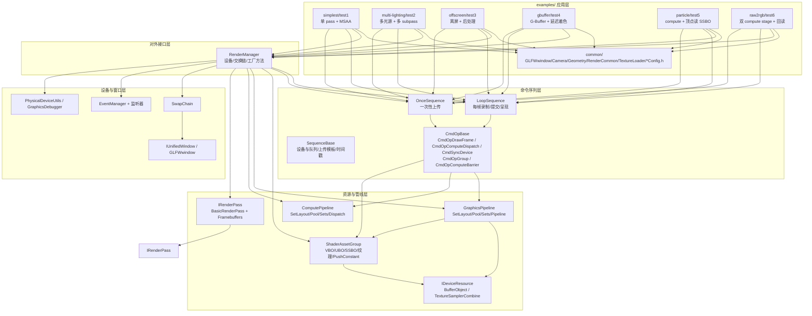
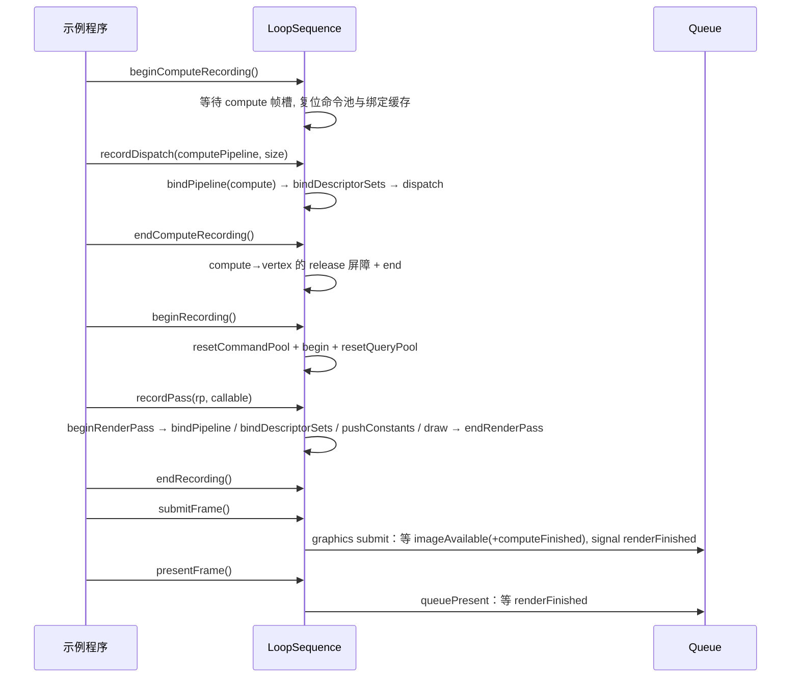
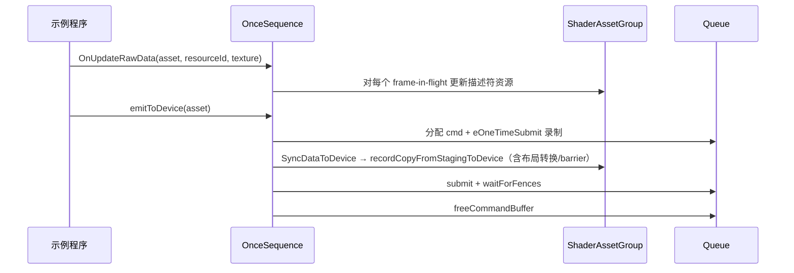
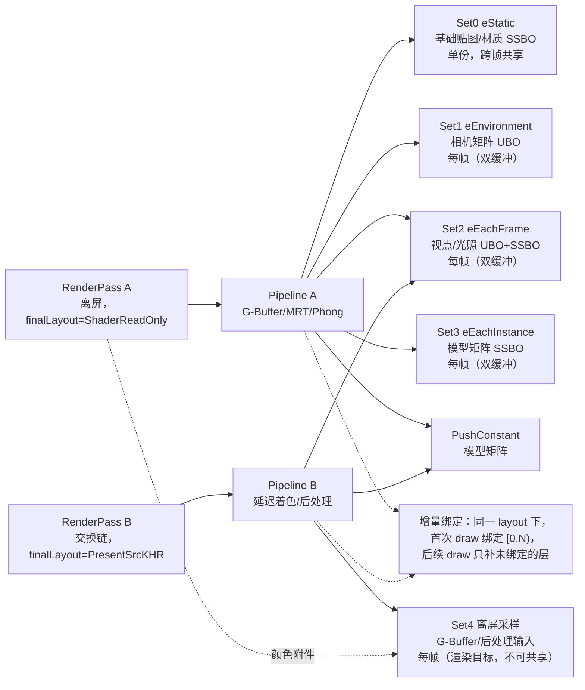
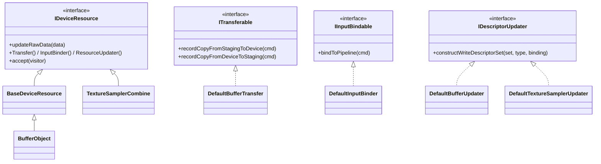
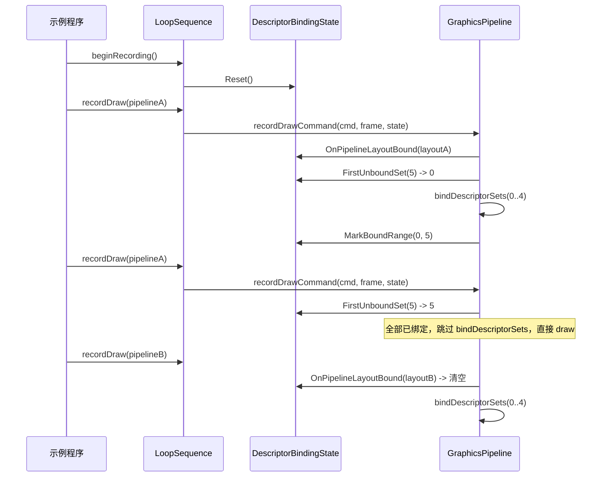
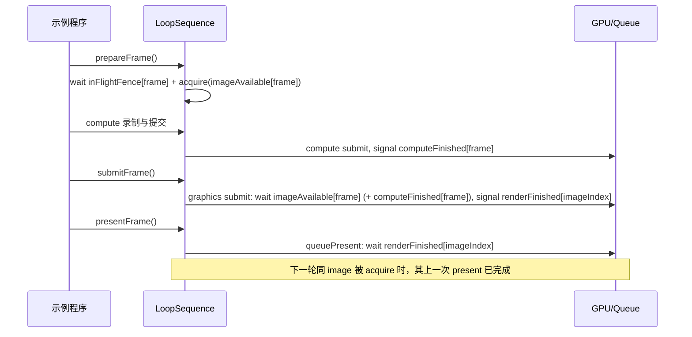

# render_demo 设计书

> 一个基于 **Vulkan 1.3 + C++20** 的最小渲染框架与示例集合。
>
> 框架目标：把「设备/交换链管理」「命令序列录制」「描述符与资源更新」「渲染通道组织」拆成互不耦合的几层，让新增一个示例只需要描述「用哪些资源、画多少个实例」，而不必重复写 Vulkan 样板代码。

---

## 1. 概览

| 项 | 内容 |
| --- | --- |
| 语言标准 | C++20（`concepts`、`requires`、`std::span` 风格接口、聚合初始化） |
| 图形 API | Vulkan 1.3，使用 `vulkan.hpp`；创建/查询接口统一显式检查 `vk::Result` |
| 窗口 / 输入 | GLFW（`IUnifiedWindow` 抽象，示例使用 `GLFWwindow`） |
| 数学库 | GLM |
| 资源加载 | `stb_image` 解码；`tinygltf`（glTF/GLB）、`tiny_obj_loader`（OBJ/MTL）、KTX 1.0 解析器、assimp（`.dae/.fbx` 等，运行期动态绑定，可选，见 19.2）、手写 MMD（PMX/PMD/VMD）与 DirectX X 文本解析器（见 29） |
| 构建 | CMake ≥ 3.22，需 `glslangValidator` 编译着色器并转成 `*.hpp` 字节码头 |
| 目标产物 | `myEngine` 静态库 + `frameworkExtensions`（框架拓展层，见 30/31）+ `example_common` + **48 个**可执行示例（simplest / multi-lighting / offscreen / gbuffer / particle / raw2rgb，迁移示例 test7..test48，见 14–31） |

依赖约定：`globalConfig` 接口目标统一提供 `src/`、`examples/common/`、`external/`、`external/glm/include`、`external/glfw/include`、`build_vs/generated`；`frameworkExtensions` 再以 PUBLIC 方式追加 `extensions/model`、`extensions/texture`、`extensions/debug`、`extensions/raytracing` 四个头文件根，因此 48 个示例沿用无前缀的短 include 名（见 30/31）。`external/` 下三方依赖全部入库，fresh clone 无需外部 SDK 即可构建。

---

## 2. 目录结构

```text
render_demo/
├── CMakeLists.txt                  # 顶层：globalConfig / myEngine / frameworkExtensions / example_common 四层依赖 + 子目录
├── README.md
├── DESIGN.md                       # 本文档
├── cmake/
│   ├── vulkan_shader_compiler.cmake    # glslangValidator -> .spv -> .hpp
│   ├── bin_file_to_header.cmake
│   ├── check_vulkan_version.cmake
│   ├── set_package_info.cmake
│   └── ...
├── configuration/root_directory.h.in   # 生成 PROJECT_ROOT_PATH 宏
├── assets/                         # ===== 示例运行期资源（单一根，见 32）=====
│   ├── models/                     # 迁移示例的模型：glTF（suzanne / deer / sphere / armor / plane / cube / teapot / torusknot / samplebuilding + glass / deferred_floor）、backpack/{obj,mtl,diffuse.jpg,normal.png,specular.jpg}（见 19 / 32.7）、planet/（见 22）、vampire/{dancing_vampire.dae,textures/}（见 21）、formats/{sample.pmx,pmd,x,vmd}（见 29）
│   ├── textures/                   # awesomeface / container2（+specular）；KTX（metalplate01 / yokohama cubemap / texturearray / rocks 颜色+法线高度 / colored_glass，见 15）；breakout/ 12 张精灵与粒子贴图（见 27.3）
│   ├── fonts/                      # Antonio-Bold.ttf + SIL OFL 许可（文字渲染的字形来源，见 26.2）
│   ├── heightmaps/                 # iceland_heightmap.png（见 22）
│   ├── levels/{one,two,three,four}.lvl  # Breakout 的四张关卡（见 27.7）
│   ├── images/                     # raw2rgb 的输出目录（运行期由示例创建，内容全部被忽略，见 32.6）
│   └── ltc/{ltc1.f32,ltc2.f32}     # LTC 1/2 查找表（64×64 RGBA32F 小端，各 64 KB，见 25.4）
├── doc/                            # 设计讨论存档（当前为空）
├── external/                       # 全部入库（见 30.3）：glm（含 share/）/ glfw（含 lib/glfw3.lib）/ stb_image.h / tiny_obj_loader.h / tinygltf（json.hpp + tiny_gltf.h）/ assimp 头文件（仅头，见 19.2）/ freetype 头文件（仅头，见 26.6）；仅 *.bak 备份被忽略
├── extensions/                     # ===== 框架拓展能力（静态库 frameworkExtensions，与 src 平级，见 30）=====
│   ├── CMakeLists.txt              # 拓展库定义 + 三方依赖策略 + assimp 运行期 DLL 探测
│   ├── model/                      # 模型加载：加载器中立数据层 / 注册表 / 插件 / 后处理流水线 / 7 种格式加载器 / 骨骼动画
│   ├── texture/                    # 纹理加载：stb_image 通用解码 + KTX 1.0 解析
│   ├── debug/                      # PPM dump：基于核心 ImageReadback 的离线调试存盘
│   └── raytracing/                 # 硬件光追：能力探测 / 动态入口 / AS 构建 / SBT 布局 / RT 管线（见 31）
├── src/                            # ===== 引擎核心（静态库 myEngine）=====
│   ├── RenderManager.h/.cpp        # 对外唯一入口：设备、交换链、工厂方法
│   ├── SequenceBase.h/.cpp         # 序列公共基类：设备/队列/limits/上传模板/时间戳
│   ├── LoopSequence.h/.cpp         # 每帧命令序列（录制/提交/呈现）
│   ├── OnceSequence.h/.cpp         # 一次性上传命令序列
│   ├── CmdOpBase.h                 # 命令操作抽象
│   ├── CmdOpDrawFrame.h            # 绘制操作（可挂动态 stencil 状态，见 17.3）
│   ├── CmdOpStencilState.h         # 录制 setStencilReference / CompareMask / WriteMask（见 17.3）
│   ├── CmdOpClearStencil.h         # render pass 内 vkCmdClearAttachments 清 S8 平面（见 17.3）
│   ├── CmdSyncDevice.h             # staging -> device 同步操作
│   ├── CmdOpComputeDispatch.h      # compute 命令操作
│   ├── CmdOpGroup.h                # 把多个 CmdOp 合成一次提交（多 stage 计算链）
│   ├── CmdOpComputeBarrier.h       # compute -> 下一阶段的显式内存依赖
│   ├── SecondaryCommandBuffer.h    # secondary command buffer 录制器（多线程示例）
│   ├── ShaderAssetGroup.h/.cpp     # VBO/UBO/SSBO/纹理/PushConstant 的聚合与更新
│   ├── GraphicsPipeline.h/.cpp     # 图形管线（多 stage / topology / tessellation / spec 常量）
│   ├── ComputePipeline.h/.cpp      # 计算管线（spec 常量 / 间接派发 / 限额校验 / 增量绑定）
│   ├── DescriptorBindingState.h    # 增量绑定缓存（Bind Once）
│   ├── VulkanHandle.h              # Vulkan 句柄 RAII 包装
│   ├── IRenderPass.h               # 渲染通道抽象
│   ├── BasicRenderPass.h/.cpp      # 唯一的 RenderPass 实现（framebuffer/clear/viewport）
│   ├── IAttachmentDetail.h         # 附件/子通道/依赖的模板化描述
│   ├── IDescriptorSetDetail.h      # DescriptorSetDetailTemplate + IDescriptorSetLayoutGroup
│   ├── IVertexInputStateGroup.h    # 顶点输入状态抽象
│   ├── DeviceResource.h/.cpp       # IDeviceResource 基类 + 资源表
│   ├── DeviceMemoryAllocator.h/.cpp# 设备内存 sub-allocation（block + free list）
│   ├── BufferObject.h/.cpp         # VBO/IBO/UBO/SSBO 实现
│   ├── TextureImage.h/.cpp         # 纹理资源（2D/array/cube/3D，含 mip）
│   ├── TextureSamplerCombine.h/.cpp# combined image sampler
│   ├── InputAttachmentView.h/.cpp  # subpass 输入附件描述符（不拥有图像，见 16.2）
│   ├── ImageAttachment.h/.cpp      # 深度 / MSAA 附件
│   ├── ImageReadback.h/.cpp        # GPU -> 主机一次性回读（调试用；可按单 aspect 拷 S8，见 17.4）
│   ├── DeviceResourceUtils.h/.cpp  # createImage / createImageView 等
│   ├── SwapChain.h/.cpp            # swapchain + image views + acquire/present
│   ├── Event.h                     # EventManager / WindowEvent / SwapChainEvent
│   ├── IUnifiedWindow.h            # 窗口与 surface 抽象（唯一实现在 examples/common/GLFWwindow）
│   ├── PhysicalDeviceUtils.h/.cpp  # 物理设备选择、swapchain support、格式查询
│   ├── GraphicsDebugger.h/.cpp     # 校验层与 debug messenger
│   └── typedefs.h                  # ResourceId/ResourceKey/各类 Spec/枚举/资源表模板
├── examples/
│   ├── CMakeLists.txt              # add_render_example() 统一示例配置
│   ├── common/                     # 仅示例侧胶水；模型/纹理/dump 已上移到 extensions/（见 30）
│   │   ├── GLFWwindow.h/.cpp       # 窗口/输入/surface（示例侧实现）
│   │   ├── Camera.h / Frustum.h / Geometry.h / RenderCommon.h
│   │   ├── FontAtlas.h/.cpp        # FreeType 字形图集：唯一链接期强三方依赖，由 RENDER_DEMO_HAS_FREETYPE 条件隔离（见 26.6 / 30.2）
│   │   ├── DescriptorLayoutConfig.h    # set0~set4 组件枚举与配置表 + subpass 输入附件表 + OIT 组件（见 16.4 / 20）
│   │   ├── ComputeLayoutConfig.h       # compute set0 组件表 + 单层 layout 模板
│   │   ├── AttachmentDetailConfig.h    # Simple/GBuffer/SubpassDeferred/Oit 附件配置 + DependencyPreset + StencilAttachmentSpec（见 16/17/20）
│   │   ├── DebugViewMode.h             # 调试视图枚举 + push constant + 按键状态（见 13.2）
│   │   └── VertexInputStateConfig.h    # Vertex / VertexInputAtlas
│   ├── simplest/{test1.cpp,shader/}
│   ├── multi-lighting/{test2.cpp,shader/}
│   ├── offscreen/{test3.cpp,shader/}
│   ├── gbuffer/{test4.cpp,shader/}
│   ├── particle/{test5.cpp,shader/}    # 计算管线 + 粒子渲染
│   ├── raw2rgb/{test6.cpp,Raw2RgbLayoutConfig.h,shader/{rawunpack.comp,raw2rgb_v2.comp}}
│   ├── geometryshader / tessellation / deferred / terraintessellation /
│   │   gltfloading / gltfscenerendering / multithreading  # 迁移示例（test7..test13，见 14）
│   ├── texture / texturecubemap / texturearray / parallaxmapping / texture3d
│   │                                                       # 纹理家族迁移（test14..test18，见 15）
│   ├── subpasses/{test19.cpp,shader/}                       # 三 subpass 延迟+透明（见 16）
│   ├── stencil/{test20.cpp,shader/}                         # stencil 描边（见 17）
│   ├── model_loading/{test21.cpp,shader/}                   # 模型加载 + 自动取景（见 19）
│   ├── oit/{test22.cpp,shader/}                             # 加权混合顺序无关透明（见 20）
│   ├── skeletal_animation/{test23.cpp,shader/}               # 骨骼动画 + 蒙皮（见 21）
│   ├── scene_graph/{test24.cpp,shader/}                     # 场景图 + 视锥剔除（见 22）
│   ├── heightmap_terrain/{test25.cpp,shader/}               # 高度图地形 CPU/GPU 双位移路（见 22）
│   ├── csm/{test26.cpp,shader/}                             # 5 级联阴影 + 分层深度数组（见 23）
│   ├── hdr/{test27.cpp,shader/}                             # RGBA16F + 曝光色调映射（见 24）
│   ├── bloom/{test28.cpp,shader/}                           # MRT 阈值 + 10-pass 高斯模糊 + 合成（见 24）
│   ├── gamma/{test29.cpp,shader/}                           # sRGB 纹理 + gamma 编码对拍（见 24）
│   ├── shadow_mapping/{test30.cpp,shader/}                  # 单张 2D 深度图 + bias/PCF + depth quad（见 24）
│   ├── point_shadow/{test31.cpp,shader/}                    # 点光源阴影：6 层深度数组 + 径向距离 + 软阴影（见 24）
│   ├── ssao/{test32.cpp,shader/}                            # G-Buffer + 64-sample kernel + 模糊 + 环境光合成（见 24）
│   ├── compute_shader/{test33.cpp,shader/}                  # compute 写存储图像 + 全屏采样（见 25.2）
│   ├── physically_based_bloom/{test34.cpp,shader/}           # 13-tap 降采样 / tent 升采样 mip 链 vs 旧 10-pass（见 25.3）
│   ├── area_lights/{test35.cpp,shader/}                      # LTC 面光源：64² LTC1/LTC2 查表 + 最多 32 盏灯的 SSBO（见 25.4）
│   ├── text_rendering/{test36.cpp,shader/}                  # FreeType 字形图集 + 单次实例化绘制（见 26）
│   ├── breakout/{test37.cpp,shader/}                        # 2D 打砖块：离屏 MSAA + 实例化精灵 + 后处理（见 27）
│   ├── occlusion_query/{test38.cpp,shader/}                # 遮挡查询：深度剔除后统计通过样本数（见 28.2）
│   ├── pipeline_statistics/{test39.cpp,shader/}            # 管线统计查询：6 个计数器与 CPU 绘制表对拍（见 28.2）
│   ├── instancing/{test40.cpp,shader/}                     # 双 vertex binding：binding 1 逐实例属性（见 28.3）
│   ├── model_formats/{test41.cpp,shader/}                  # PMX/PMD/XFile/VMD 加载框架与验证（见 29）
│   ├── raytracing_basic/{test42.cpp,shader/}               # RT 管线最小闭环：BLAS/TLAS + SBT + traceRays（见 31.3）
│   ├── raytracing_shadows/{test43.cpp,shader/}             # 二级阴影射线 + 多 miss/hit group（见 31.3）
│   ├── raytracing_callable/{test44.cpp,shader/}            # executeCallableEXT 按实例分派材质（见 31.3）
│   ├── raytracing_sbtdata/{test45.cpp,shader/}             # shaderRecordEXT：材质写在 SBT 记录里（见 31.3）
│   ├── raytracing_reflections/{test46.cpp,shader/}         # 递归反射：payload 结构 + spec 常量控制弹射数（见 31.3）
│   ├── ray_query/{test47.cpp,shader/}                      # rayQueryEXT：无需 RT 管线的查询式追踪（见 31.3）
│   └── compute_raytracing/{test48.cpp,shader/}             # SDF raymarching：不依赖任何 RT 扩展的降级路径（见 31.3）
├── tools/gltf2obj.py               # glTF -> OBJ 导出，用于生成往返验证资源（见 18.5）
├── tools/gen_model_formats.py      # 生成 29 的四个合成模型（可复现、无版权、见 29.5）
└── build_vs/                       # Visual Studio 构建目录（含各示例可执行程序）
```

> **说明**：顶层 `CMakeLists.txt` 通过 `file(GLOB ... CONFIGURE_DEPENDS "src/*.cpp")` 收集 `src/` 顶层源码，`examples/common/*.cpp` 同理；`extensions/CMakeLists.txt` 以 `GLOB_RECURSE` 分别收集 `model/*.cpp` / `texture/*.cpp` / `debug/*.cpp`——`CONFIGURE_DEPENDS` 会在构建时重新匹配，新增源文件无需手动 re-configure。历史 pass 实现（原 `src/legacy/`，37 个文件）、engine 侧未使用的 GLFW 桥接（`GLFWwindow.cpp` / `GLFWwindowUtils.h`，`window_utils` 命名空间函数从未被调用）以及根目录旧 shader 副本均已在代码卫生清理中删除，可从 git 历史（`Initial commit`）追溯。示例侧配置头（`*Config.h`）与窗口实现留在 `examples/common/`，模型/纹理/调试能力上移到与 `src/` 平级的 `extensions/`（四层依赖见 30.1）。调试存盘目录 `dump/`（见 13.4）由程序运行时创建，已在 `.gitignore` 中忽略。

---

## 3. 代码框图

### 3.1 分层架构



### 3.2 核心类关系


### 3.3 每帧时序（LoopSequence）



一次性上传（OnceSequence）的时序：



### 3.4 描述符分层与多 Pass 组合



> 层的排列顺序 = 更新频率由低到高。`DescriptorBindingState` 记录「当前 layout 下已绑定的层」，同一个 layout 连续绘制时只补绑缺失的层；切换布局才整体失效。

---

## 4. 核心设计框架分析

### 4.1 RenderManager —— 唯一对外入口

**职责**

1. 实例 / 调试层：`createInstance()` + `GraphicsDebugger`（Debug 构建启用校验层，当前只启用 synchronization validation，见 4.14）。
2. 物理设备与逻辑设备：`PhysicalDeviceUtils::select()` 选择图形 / 呈现 / 计算队列族，`createDevice()` 创建逻辑设备与队列。
3. 交换链与窗口生命周期：通过 `EventManager` 订阅 `WindowEvent::eCreate/eResize` 重建 `SwapChain`，订阅 `SwapChainEvent::eReCreate` 重建各 `IRenderPass` 的 framebuffer。
4. 工厂方法：`CreateShaderAssetGroup` / `CreateRenderPass` / `CreatePipeline` / `CreateComputePipeline` / `UploadSequence` / `DrawFrameSequence`。

**两阶段构造**：构造函数只挂事件监听，Vulkan 初始化放在 `RenderManager::Create()` 里。`getInstance()/getLogicalDevice()` 通过 `shared_from_this()` 返回句柄的 aliasing `shared_ptr`，而构造期间控制块还不存在，直接在构造函数里调用会抛 `std::bad_weak_ptr`；示例统一改用 `RenderManager::Create(window, framesInFlight)` 创建。

**避免自引用环**：`m_surface`（删除器捕获 instance）、`m_swapChain`（持有 device）、`m_debugger` 里的 debug messenger（删除器捕获 instance）都是 manager 自己的成员，若用 aliasing `shared_ptr` 就会形成「成员 → 句柄 → manager」的环，manager 永远不析构；这三处改用 `instanceView()/deviceView()` 提供的非拥有视图。对外（sequence、pipeline、render pass）仍用 aliasing 版本，由它们负责延长 manager 的生命周期。非拥有视图安全的前提是成员声明顺序：`m_surface`/`m_debugger` 在 `m_instance` 之后声明、`m_swapChain` 在 `m_device` 之后声明，析构时它们先被销毁，句柄仍然有效（详见 4.12）。

### 4.2 SequenceBase / LoopSequence / OnceSequence —— 命令序列层

**SequenceBase** 抽象两类序列的公共部分，消除重复：

| 能力 | 说明 |
| --- | --- |
| 设备与队列 | 构造时从 `RenderManager` 取 `vk::Device`、graphics/present queue、queueFamilyIndex |
| `OnUpdateRawData` 模板 | 用 `requires { data.data(); data.size(); }` 自动区分容器与普通结构体；派生出纯虚的 `(const void*, size_t)` 重载 |
| 时间戳 QueryPool | `CreateTimestampQueryPool()` 在设备不支持时间戳时返回 `nullptr`（不再抛异常），调用方直接判空 |
| `recordDraw(pipeline)` / `record(op)` | 通过 `CmdOpBase` 解耦「记录什么」与「谁记录」 |
| `recordPass(rp, callable)` | **作用域化**的 Begin/End，避免异常或提前 return 导致 render pass 未闭合 |
| `submitFrame()` | `queueSubmit`，等待 imageAvailable、signal renderFinished、关联 in-flight fence |
| `presentFrame()` | `queuePresent`；`OutOfDate/Suboptimal/窗口 resize` 统一走重建路径 |

资源布局：每个 frame-in-flight 各自持有 `CommandPool → CommandBuffer → QueryPool` + `imageAvailable/renderFinished Semaphore` + `Fence`。

**OnceSequence**

- 单命令池 + 单 fence，上传即同步（`waitForFences`），命令缓冲使用 `eOneTimeSubmit` 并在提交后释放。
- 描述符资源更新会遍历所有 frame-in-flight（静态资源被所有帧共享）。

**重构点**

- 命令缓冲由 `unordered_map<uint32_t, vector<shared_ptr<vk::CommandBuffer>>>` 简化为 `vector<shared_ptr<vk::CommandBuffer>>`（每帧一个 primary buffer），消除 `[i][0]` 这类间接访问。
- 删除未使用的 `vk::Result result` 变量、`steady_clock` 计时片段与注释掉的调试输出。
- 修正 `endRecording()`/`submitFrame()` 中复制自其他项目的错误异常文案。
- `m_operations` 在 `beginRecording()` 清空（原实现只增不减，长期运行会持续增长）。
- `prepareFrame/presentFrame` 标注 `[[nodiscard]]`，避免忽略「需要跳帧」的返回值。

### 4.3 ShaderAssetGroup —— 资源聚合与更新

**职责**：把「一个 draw 所需的全部资源」聚合为一个对象，屏蔽 `ResourceTypes/ResourceId` 的差异。

**重构点**

- `UpdateConstantsResource` 增加类型、帧索引、目标容量校验（原实现直接 `memcpy`，`size` 超过 `maxPushConstantsSize` 时会踩内存）。
- `SyncDataToDevice` 抽成单个 lambda，消除 VBO 与描述符两份重复循环。
- `SyncDataToDevice` 现在按**脏标记**跳过未变化的资源（`IDeviceResource::NeedsUpload/OnUploaded`），避免重复 `emitToDevice` 时把整份纹理/SSBO 再拷一次。
- `DescriptorResource(key)` 与 `UpdateDescriptorResourceData()` 对 frame1..N 找不到资源时回退到 frame0，以支持「静态层单份资源」。
- 构造期打印移除，避免每个资源组都刷屏。
- 新增 `AliasDescriptorResource(alias, target)`，让两个 `ResourceKey` 指向同一个 `IDeviceResource`（同一 `VkBuffer`），用于 compute 输出与顶点输入的 ping-pong 复用。

### 4.4 GraphicsPipeline —— 描述符集合与管线

**职责**

1. 依据 `IDescriptorSetLayoutGroup` 创建 `DescriptorSetLayout[]`、`DescriptorPool`、按帧分配 `DescriptorSet[][]`。配置通过 `SharedClone()` 由管线自己持有，调用方的 layout 对象可以先于管线销毁。
2. 通过 `ShaderAssetGroup::DescriptorResource(key)` + `IDescriptorUpdater::constructWriteDescriptorSet()` 完成 `updateDescriptorSets`（首次绑定即完成写入）；**共享层只写 frame0 的 set**。
3. 创建 `PipelineLayout`（含 push constant range）与 `GraphicsPipeline`，句柄统一由 `VulkanHandle` 管理。
4. `recordDrawCommand(cmd, frame, bindingState)`：`bindPipeline` → `pushConstants` → **增量** `bindDescriptorSets` → `bindVertex/IndexBuffer` → `draw/drawIndexed`（实例数来自 `drawInstanceCount()`）。

- `bindingState.OnPipelineLayoutBound(layout)`：布局变化则整体失效；
- `firstSet = FirstUnboundSet(setCount)`，只绑定 `[firstSet, setCount)`；
- `descriptorSetFor(frame, setId)`：共享层固定返回 frame0 的 set。

**约定**

- 空顶点输入时顶点数取 `VertexInputAtlas` 的 `drawVertexCount`：为 0 时画 3 个顶点（全屏三角形，shader 用 `gl_VertexIndex` 生成），大于 0 时按该数量绘制（SSBO 驱动的粒子，见 6.6）；实例数取 `drawInstanceCount()`，默认 1。
- 混合状态按 `renderPass->colorAttachmentCount()` 生成，天然支持 MRT。
- `multisampling.rasterizationSamples` 取自 `renderPass->sampleCount()`。

**重构点**

- ShaderModule 用局部 RAII guard 管理，`createGraphicsPipelines` 抛异常时不再泄漏。
- 校验 `vert`/`frag` 是否存在，缺失时给出明确错误而不是空指针解引用。
- 保存 `m_colorFormat/m_depthFormat/m_msaaSamples/m_colorAttachmentCount`、`m_hasDepthAttachment/m_depthAttachmentIndex/m_attachmentCount` 等派生信息。

### 4.5 BasicRenderPass —— 渲染通道与 framebuffer

`BasicRenderPass` 是 `IRenderPass` 的唯一实现，依据 `IAttachmentDetail` 产出的 `RenderPassBlueprint` 构建 `vk::RenderPass` 与 framebuffer。

- `createFramebuffers` 负责创建深度附件、MSAA 颜色附件，并按「交换链图像数量（或 frame-in-flight 数量）」创建 framebuffer。
- **framebuffer 索引规则（重要）**：`begin(cmd, frameIndex, ...)` 的 `frameIndex` 由调用方决定。对 swapchain-sized pass，framebuffer 数量等于交换链图像数，必须用 `acquireNextImage` 返回的 `imageIndex` 选择；对离屏 pass，framebuffer 按 frame-in-flight 数量创建，用帧号选择。`LoopSequence::recordPass()` 已按 `renderPass->isSwapChainSized()` 区分处理（见 4.14）。
- **附件暴露**：除采样用的 `offscreenViews()` 外，`IRenderPass` 还提供 `offscreenImages()` 与 `offscreenColorFormat(colorSlot)`（与视图同索引的 `vk::Image`、按 slot 重复的格式），供调试回读使用（见 13.3）。单采样颜色附件创建时统一带 `eTransferSrc`，因此可以被 copy 到 staging；MSAA transient 附件会去掉该用途（它只用于 resolve，不参与回读）。
- **层数组**：`RenderPassBlueprint::layers` 声明 framebuffer 层数，`OffscreenTargetSpec::layers` 声明附件数组层数，创建期校验二者相等；`framebufferInfo.layers` 取前者，`gl_Layer` 才合法。深度附件另由 `depthStencilView()/depthStencilLayers()` 暴露**覆盖所有层**的单一数组视图，既作为 framebuffer 附件也作为 `sampler2DArray` 的描述符源（见 23.2）。

**重构点**

- `clearValueCount` 由固定 `colorCount+1` 改为 `m_attachmentCount`，深度清屏值写到真实索引。原实现在 G-Buffer（3 color + depth）等场景下会触发校验层报错。
- 重建 framebuffer 前显式 `clear()`，避免重建期新旧句柄并存。
- 移除 framebuffer 删除器里多余的 `targetContext` 捕获。
- 修复 `ImageAttachment::multiSampleCreateInfo` 中 `extent.height` 误用宽度的赋值错误。
- blend attachment 数跟随当前 subpass 的颜色附件数（深度-only subpass 为 0），不再是"至少 1 个"（见 23.2）。

### 4.6 资源层（IDeviceResource 体系）



- 「能力接口」拆分让同一资源可以同时具备传输、绑定、描述符写入三种能力，而调用方各取所需。
- `ResourceObjectRepository<Key,T>` 用 `std::any` 包装 `shared_ptr<T>` 实现异构资源表，同时保留强类型 `findValue()`。
- `DeviceResourceVisitor` 用于从资源表中「反向取信息」，例如 `ImageViewCollector` 收集离屏附件的 image view。
- **队列族共享**：`BufferObject` 接受 `sharedQueueFamilies`，`RenderManager::sharedQueueFamilies()` 返回去重后的 `{graphics, compute}`。两个 family 不同时，primary buffer 用 `VK_SHARING_MODE_CONCURRENT` 创建，compute 队列写完、graphics 队列直接读无需 ownership transfer；只有 1 个 family 时退回 `eExclusive`。staging buffer 只被传输（graphics）队列访问，始终保持 exclusive。纹理/图像目前仍为 `eExclusive`——现有示例的纹理只在 graphics 侧使用；若将来 compute 要写图像，需要按同样方式把 `createImage` 的 sharingMode 改成 concurrent。

### 4.7 配置描述层（模板 + 常量表）

三个接口把「示例侧配置」与「引擎侧实现」解耦：

| 接口 | 实现 | 配置载体 |
| --- | --- | --- |
| `IVertexInputStateGroup` | `VertexInputAtlas` | `VertexComponent` 列表 + 属性表（format/offset/stride） |
| `IAttachmentDetail` | `SimpleAttachmentDetail` / `GBufferAttachmentDetail` | 组件枚举 + 附件规格表 |
| `IDescriptorSetLayoutGroup` | `DescriptorLayoutAtlas` | `SetDetailConfig{global, onDemand, perFrame, perObject, inputAttachment, pushconstant}` |

设计收益：

- 组件到「binding/location/role」的映射由 `constexpr std::tuple` 表在编译期决定，示例只写枚举。
- 描述符池大小由各配置表累加得出，新增组件不会漏配。注意 Vulkan-Hpp 中 `eUniformBuffer=6`、`eStorageBuffer=7`，池大小统计必须按实际 `vk::DescriptorType` 值建索引，不能用固定长度的小数组（曾因数组越界漏配 UBO/SSBO，见 4.14）。
- `DescriptorSetDetailTemplate<ComponentEnum, SetID, Table>` 固定 set 编号，天然对应「分层设计」。

### 4.8 Event / SwapChain / Window

- `IUnifiedWindow` 抽象窗口、surface、resize 标记；`GLFWwindow` 负责输入（WASD + 鼠标 + 滚轮）。
- `EventManager` 以类型名字符串索引监听器列表，`notify` 时拷贝列表再回调（避免回调中增删监听器导致迭代失效）。
- `SwapChain` 只做「选格式/模式/范围 → 创建 → 取图像 → 建 image view → acquire/present」。

### 4.9 生命周期与调用约定（重要）

1. `GraphicsPipeline` 以 `shared_ptr<const IVertexInputStateGroup>` / `shared_ptr<const IDescriptorSetLayoutGroup>` 持有配置（见 4.7 的 `SharedClone()`），示例侧配置对象不再需要与管线同生命周期。
2. `reCreateSwapChain()` 遍历 `RenderManager` 登记的**全部** render pass，仅对 `isSwapChainSized()==true` 的（`SimpleAttachmentDetail::eDirect/eMSAA` 生成）重建 framebuffer；离屏（offscreen / G-Buffer）pass 尺寸固定，跳过重建。

### 4.10 描述符分层的落地实现对照

对照 `doc/Descriptor set分层设计.txt` 的设计要求，逐条落到代码：

| 设计文档要求 | 实现位置 | 说明 |
| --- | --- | --- |
| 按更新频率划分 Set | `DescriptorLayoutAtlas::frequencyOfSet()` | set0 `eStatic`、set1 `eEnvironment`、set2 `eEachFrame`、set3 `eEachInstance`、set4 离屏输入 |
| 低频层只绑一次（Bind Once） | `DescriptorBindingState` + `LoopSequence::m_bindingState` | 每帧 `Reset()`；同一 layout 下只补绑未绑定的层 |
| 每层双缓冲 | `RenderManager::DescriptorResources(layout, maxFrameInFlight)` | 资源 key 为 `ResourceKey{ResourceId, frame}`，set 为 `m_descriptorSets[frame][setId]` |
| eStatic 层单份 | `DescriptorLayoutAtlas::makeSet(..., shared=true)` → `SetLayoutDetail::shared` / `isSetShared()` | 只创建 frame0 的资源与 set，所有帧绑定同一份 |
| 只更新变化的数据（MarkDirty/IsDirty） | `IDeviceResource::NeedsUpload()/OnUploaded()` | `SyncDataToDevice` 跳过未变化资源；首次上传行为保持不变 |
| 材质不单独占一个 Set | set0 内 `eMaterialProperty` SSBO + 贴图绑定 | 材质作为数据索引，避免按材质切 Set |
| 多实例用 Dynamic Offset | 未实现 | 当前用「一个实例 SSBO + `gl_InstanceIndex`」，同样避免 N 个 Set |
| Bindless 贴图数组 | 未实现 | 需要 `descriptorIndexing` 特性与 shader 改造，见第 8 章 |

增量绑定的执行过程：



约束与注意：

- 描述符绑定是 **command buffer 状态**，跨 `BeginRenderPass/EndRenderPass`、跨 `nextSubpass` 均有效，因此缓存可以在整帧内复用。
- 只有**切换 PipelineLayout** 才会使绑定失效（`OnPipelineLayoutBound` 用句柄比较实现）。
- 若自定义 `CmdOpBase` 直接调用了 `bindPipeline`/`bindDescriptorSets`，必须在之后调用 `LoopSequence::InvalidateDescriptorBindings()`，否则后续 `recordDraw` 可能跳过必要的绑定。

### 4.11 ComputePipeline 与多 compute stage

| 项 | GraphicsPipeline | ComputePipeline |
| --- | --- | --- |
| SPIR-V 入口 | `"vert"` / `"frag"` | `"comp"`（或 `CreateComputePipeline` 传入的 entry 名） |
| 录制 | `recordDrawCommand` | `recordDispatchCommand(cmd, frame, DispatchSize)` |

**提交链**（`LoopSequence`）：

```text
prepareFrame()                 // 等待 graphics 帧槽 + 获取交换链图像
beginComputeRecording()        // 等待 compute 帧槽，复位命令池与绑定缓存
recordDispatch(computePipeline, size)
endComputeRecording()          // release 屏障，结束录制
beginRecording() / recordPass(...)   // 图形录制
submitFrame()                  // 等待 imageAvailable(+computeFinished), signal renderFinished
presentFrame()                 // queuePresent
```

compute 优先选 **compute-only** 族以支持异步计算，找不到则回退 graphics 族；`createDevice` 为三者各申请 1 个队列（`std::set` 去重），`getComputeQueueFamilyIndex()` 与 compute 命令池、compute 提交使用同一个族（见 4.13）。

**跨管线共享缓冲**：`ShaderAssetGroup::AliasDescriptorResource(alias, target)` 让两个 `ResourceKey` 指向同一个 `IDeviceResource`（同一个 `VkBuffer`）。粒子示例用它表达 ping-pong：`input[frame] -> output[(frame+N-1)%N]`，这样 compute 读上一帧写的缓冲，而图形管线读 `output[frame]`，两条管线共用一份 `ShaderAssetGroup`（因此也是同一批 buffer），无需额外的拷贝。

**无顶点输入的绘制**：当 `IVertexInputStateGroup` 为空输入时，`GraphicsPipeline` 使用顶点数决定绘制量：为 0 时按全屏三角形画 3 个顶点；大于 0 时按该数量绘制，顶点数据由 shader 从 SSBO（`gl_VertexIndex` 索引）读取——计算输出直接作为顶点流使用。

**多 compute stage 共享一个 ShaderAssetGroup**：`CreateComputePipeline(descLayout, asset, spirvEntry)` 用 entry 名选择模块，因此一个 asset 可以同时存放 `"rawunpack"` 与 `"raw2rgb"` 两段 SPIR-V：两个管线共用同一套描述符布局、同一批 SSBO，多 pass 之间不需要拷贝或资源别名。描述符层用 `ComputeLayoutAtlasTemplate` 的 `sharedAcrossFrames` 选项可以关闭双缓冲（一次性图像处理不需要每帧一份）。

**GPU → CPU 回读**：`IDeviceResource::MappedData()/MappedByteSize()` 映射 device-local 资源；`DefaultBufferTransfer::recordCopyFromDeviceToStaging` 落地（含 `shaderWrite→transferRead`、`transferWrite→hostRead` 屏障）；`OnceSequence::ReadBack()` 完成提交 + fence 等待 + 拷贝。`OnceSequence::OnUpdateRawData` 也补齐了 push constant 分支（对所有 frame 槽位写入），这样一次性任务可以在上传阶段把 `width/height` 之类的参数写好。

**管线能力**（`ComputePipeline.h`）

| 能力 | 接口 | 说明 |
| --- | --- | --- |
| SPIR-V 入口选择 | 构造参数 `spirvEntry` | 一个 asset 可放多段 compute，按入口名各建一条管线 |
| 特化常量 | `ComputePipelineOptions::specializationConstants` / `addSpecializationConstant()` / `makeSpecializationConstant<T>(id, value)` | 值以 4/8 字节原始数据传入（GLSL 侧 `layout(constant_id = N) const ...`），未覆盖的常量用 shader 里的默认值；粒子示例用它把工作组宽度做成运行时可调 |
| 间接派发 | `recordDispatchCommand(cmd, frame, IndirectDispatch{buffer, offset}, state)` | 三个组数从 `VkDispatchIndirectCommand`（3×uint32）读取，用于「工作量由 GPU 决定」的场景 |
| 组数校验 | 构造时传入 `vk::PhysicalDeviceLimits`（`RenderManager` 自动传 `m_physicalDeviceProperties.limits`） | 超过 `maxComputeWorkGroupCount` 时抛异常并打印三轴上限；任一轴为 0 则跳过录制（空工作量是合法 no-op，不必占一条命令） |
| PSO 缓存 | `RenderManager::pipelineCache()` | 进程内共享，`CreateComputePipeline` 默认注入；仅内存复用，未做落盘序列化 |
| 幂等构建 | `builtUp()` / `built()` | 允许「先设置特化常量再构建」，重复调用是 no-op |
| 创建结果校验 | 内部 | `vkCreateComputePipelines` 返回逐管线结果时会检查该结果与句柄非空，报错信息带入口名 |

**描述符集索引必须用 setIndex**：`m_descriptorSets` 按 `[frameSlot][setIndex]` 布局（见 `allocateAndWriteSets`），而 `SetLayoutDetail::setId` 是逻辑编号。两者在单集合时同为 0，一旦集合重排或编号不连续就会取错集合，所以 `descriptorSetFor(frame, setIndex)` 一律用**下标**索引，并用 `details[setIndex].shared` 决定是否落到 frame 0。某个集合为空时按单个集合逐个绑定，避免把空句柄塞进连续绑定范围。

**多 stage 链式提交**（`CmdOpGroup` / `CmdOpComputeBarrier`）

```cpp
auto chain = std::make_shared<CmdOpGroup>();
chain->add(std::make_shared<CmdOpComputeDispatch>(unpackPipeline, sizeA));
chain->add(std::make_shared<CmdOpComputeBarrier>());          // compute -> compute
chain->add(std::make_shared<CmdOpComputeDispatch>(rgbPipeline, sizeB));
once->submit(chain, asset);                                   // 一次提交、一个 fence
```

提交顺序只保证**执行**顺序，不保证**内存可见性**：上一 stage 写入的 SSBO/纹理必须经过 `CmdOpComputeBarrier`（`eShaderWrite → eShaderRead|eShaderWrite`）才对下一 stage 可见。`LoopSequence::recordComputeBarrier()` 是帧内版本的同一件事。

### 4.12 句柄暴露与生命周期约定

`RenderManager` 用 `VulkanHandle` 拥有 `vk::Instance`/`vk::Device`，对外提供两组访问器：

| 访问器 | 实现 | 所有权 | 生命周期保证 | 可见性 |
| --- | --- | --- | --- | --- |
| `getInstance()` / `getLogicalDevice()` | `shared_ptr<T>(shared_from_this(), &handle)`（aliasing） | 与 `RenderManager` 共享控制块，强引用 +1 | 只要指针活着 manager 一定活着 → 句柄永远有效 | public |
| `instanceView()` / `deviceView()` | `shared_ptr<T>(&handle, [](T*){})`（空删除器） | 独立控制块，**不**持有 manager | 不保证，manager 先析构即悬空 | private |

判定规则：**接收方会不会被 manager 自己拥有？**

| 接收方 | 传什么 | 例子 |
| --- | --- | --- |
| 会被 manager 的成员保存（删除器捕获 / 成员字段） | view | `m_surface`（`createSurface` 的删除器）、`m_swapChain`（`SwapChain` 保存 device）、`m_debugger` 的 debug messenger |

成员声明顺序保证 `m_surface`/`m_debugger` 在 `m_instance` 之后、`m_swapChain` 在 `m_device` 之后声明，因此析构时 surface/messenger/swapchain 先被销毁，删除器拿到的句柄仍然有效（同时满足 Vulkan「debug messenger 必须先于 instance 销毁」的要求）。

**两阶段构造**：`getInstance()/getLogicalDevice()` 依赖 `shared_from_this()`，而构造期间控制块还不存在，在构造函数里调用会抛 `std::bad_weak_ptr`。因此构造函数只挂事件监听，Vulkan 初始化放在工厂里：

```cpp
auto manager = std::shared_ptr<RenderManager>(new RenderManager(window, framesInFlight)); // 控制块建立
manager->initVulkan();                                                                     // 之后才能 shared_from_this()
```

构造函数已私有，示例统一使用 `RenderManager::Create(window, framesInFlight)`。

**易踩的坑**

- 不要把 view 存进成员 / 静态变量 / 返回给外部 API；
- `view.use_count()==1`，`get().use_count()` 等于 manager 的强引用数，可用于排查生命周期；
- 销毁 view 不会销毁句柄；销毁最后一个 aliasing 指针才会真正销毁 manager 与句柄；
- 队列（`getGraphicsQueue()/getComputeQueue()/getPresentQueue()`）是 `make_shared<vk::Queue>(handle)` 的独立拷贝，与 manager 生命周期无关。

**关机顺序（shutdown）**

| 顺序 | 责任方 | 说明 |
| --- | --- | --- |
| 1 | 调用方栈变量 | 示例里 `mgr` 最先创建、最后销毁；pipeline/asset/render pass 先于 `mgr` 析构 |
| 2 | `~LoopSequence()` | 先 `device.waitIdle()`，再释放 fence/semaphore/command pool（否则 validation 报 "fence is in use"、"semaphore...in use"、"pCommandBuffers is in use"） |
| 3 | `~RenderManager()` | body 里 `waitIdle()` → 成员逆序销毁：swapchain → device → surface → instance |
| 4 | `~GLFWwindow()` | 最后 `glfwDestroyWindow()` + `glfwTerminate()`，此时 surface/instance 已释放 |

配套约定：

- **surface 由 `RenderManager` 独占**：`GLFWwindow::createSurface()` 只返回 `shared_ptr` 并保存 `weak_ptr`，因此 `vkDestroySurfaceKHR` 一定早于 `vkDestroyInstance` 与 `glfwTerminate()`（旧实现里 window 也持有强引用，surface 拖到 instance 之后才销毁，触发 VUID-vkDestroyInstance-instance-00629）；
- **时间戳按 `e64 | eWithAvailability` 读取**：每 query 占 16 字节，结果缓冲区需 `4 × uint64_t`、stride = 16；上一帧的时间戳可能还没写完，未就绪时直接跳过采样，避免 `vkGetQueryPoolResults` 返回 `VK_NOT_READY`（见 4.14）；
- 序列（fence/semaphore/command buffer 的所有者）必须在析构前等待设备空闲——`~OnceSequence` 早已如此，`~LoopSequence` 也补齐了这一步。

### 4.13 队列族选择与跨族资源共享

**选择策略（`PhysicalDeviceUtils::findQueueFamilies`）**

| 用途 | 规则 |
| --- | --- |
| graphics | 优先「graphics 且能 present」的族（present 尽量不跨族），否则第一个 graphics 族 |
| present | 能复用 graphics 族就复用，否则第一个可呈现族 |
| compute | 优先 **compute-only** 族（`eCompute && !eGraphics`，支持异步计算），找不到回退 graphics 族 |

实现上先缓存每个族的 surface 支持再决策，**不做 early break**——compute-only 族经常排在 graphics/present 之后，提前退出会导致永远选不到（旧实现的缺陷）。

**设备与队列（`RenderManager::createDevice`）**

```cpp
const uint32_t graphicsFamily = indices.graphicsFamily.value(); // isComplete() 保证
const uint32_t presentFamily  = indices.presentFamily.value();
const uint32_t computeFamily  = indices.computeFamily.value_or(graphicsFamily); // 不再 value()
std::set<uint32_t> uniqueQueueFamilies = {graphicsFamily, presentFamily, computeFamily}; // 去重
```

graphics==compute 时只创建一个队列，`getQueue` 拿到同一个 `VkQueue`；`getComputeQueueFamilyIndex()` 与 compute 命令池、compute 提交使用同一个族。

**跨族资源：buffer 用 `eConcurrent`**

`BufferObject` 接受 `sharedQueueFamilies` 参数，`RenderManager::sharedQueueFamilies()` 返回去重后的 `{graphics, compute}`：

| family 情况 | 共享模式 |
| --- | --- |
| 只有 1 个（集成显卡 / 无专用 compute 族） | `eExclusive`（与改造前一致，零额外开销） |
| 2 个（存在专用 compute 族） | `eConcurrent` + `setQueueFamilyIndices`，compute 写完 graphics 直接读，无需 ownership transfer |

staging buffer 只被传输（graphics）队列访问，始终保持 `eExclusive`。

**仍然 exclusive 的资源**

- 纹理 / 图像（`TextureImage`、`ImageAttachment`）：现有示例只在 graphics 侧使用；若将来 compute 要写图像，需要把 `imageInfo.sharingMode` 同样改成 concurrent；
- swapchain 图像：`SwapChain::createSwapChain` 在 graphics != present 时已使用 `eConcurrent`。

**异步 compute 的收益前提**：即使队列独立，粒子示例里 compute 每帧写、顶点着色器同帧读**同一块** SSBO，中间有信号量与屏障依赖，实际仍是串行；要获得并行收益需要双缓冲资源（compute 写 A、图形读 B）或拆分互不相关的资源集。

### 4.14 Validation 正确性与收尾修复（本轮）

在完成从单 exe demo 到分层框架的重构后，用 synchronization validation 跑通六个示例，定位并修复了以下问题。**硬性 VUID 与全部 `WRITE_AFTER_WRITE` / `READ_AFTER_WRITE` hazard 均已清零**（最终六个示例 VUID=0、hazard=0）。

| 编号 | 问题 | 根因 | 修复 |
| --- | --- | --- | --- |
| VUID-00869 | `dstAccessMask` 含 `SHADER_READ` 但 `dstStage=eBottomOfPipe` | eOffscreen 第二 dependency 的 stage 不支持 shader read | 目标阶段改为 `eFragmentShader \| eComputeShader` |
| VUID-06700 | 含 stencil 的 depth 附件 `initialLayout=UNDEFINED` 且 `stencilLoadOp=eLoad` | Vulkan-Hpp 默认 `stencilLoadOp=eLoad`，配置未显式设置 | 两处 depth 配置显式设 `stencilLoadOp/StoreOp=eDontCare` |
| VUID-01430（真 bug） | present 的图像仍是 `UNDEFINED`，画面未渲染 | swapchain-sized framebuffer 按 `imageIndex` 建，但 `recordPass` 传的是 in-flight 帧号，渲染写错图 | `recordPass()` 按 `isSwapChainSized()` 选 `imageIndex`/`frameIndex`，见 4.5 |
| VUID-00067 | 复用的 `renderFinished` 信号量仍被 present 占用 | 信号量按帧索引复用，present 持有时间可能跨帧 | 按 swapchain image 数分配，用 `m_renderFinished[m_imageIndex]` |
| 队列 stage 不兼容 | compute-only 队列用 `dstStage=eVertexInput` 的屏障 | `eVertexInput` 不是 compute 队列支持的 stage | release 屏障目标阶段改为 `eBottomOfPipe` |
| 信号量已 signaled | `vkAcquireNextImageKHR` 报 semaphore 处于 signaled | compute 链激活时只等 `computeFinished`，从不消费 `imageAvailable` | 始终等待 `imageAvailable`，compute 时**额外**等待 `computeFinished`（两个 wait） |
| VUID 内存对齐 | 图像内存 offset 非 1024 对齐 | 子分配对齐 256 不足 | `kSubAllocationAlignment` 提升到 1024 |
| transient usage | `eTransientAttachment` 与 `eTransferSrc` 同时设置非法 | 多采样附件 usage 组合不当 | transient 附件去掉 `eTransferSrc`/`eSampled` |
| 描述符池漏配 | `vkAllocateDescriptorSets` 报 pool 未含 UBO/SSBO | 池大小用长度 5 的数组按 enum 索引，而 UBO/SSBO 枚举值 > 4 | 改用 `std::map<uint32_t,uint32_t>` 按实际 `vk::DescriptorType` 统计 |
| Query 结果 stride | `dataSize 16 < 24`、`stride 8 < 16` | `eWithAvailability` 时每 query 占 16 字节 | 结果缓冲 4×uint64_t、stride 16，availability 在 [1]/[3] |
| device lost / 极慢 | GPU-assisted validation 触发异常性能与设备丢失 | 同时启用 GPU-AV + best-practices + synchronization | 只保留 synchronization validation |
| 输出路径错误 | raw2rgb 输出到 `./${CMAKE_SOURCE_DIR}/...` | `root_directory.h.in` 被写成字面量路径 | 模板恢复为 `#define PROJECT_ROOT_PATH "@PROJECT_ROOT_PATH@"` |
| shader 编译错误 | 全屏三角形缺 location；uniform block 误用 std430 | GLSL 语法问题 | 输出加 `layout(location=0)`；uniform block 去掉 `std430` |
| 编译警告 | `[[nodiscard]]` 返回值被忽略 | raw2rgb 中 `presentFrame()` 未接收 | 显式 `(void)sequence->presentFrame()` |
| WRITE_AFTER_WRITE（hazard） | `beginRenderPass` 的 layout transition 与前帧 `endRenderPass` 的 depth 写入冲突 | `eSwapChain` 的 `0→external` dependency 只 release 了 color，漏掉 depth（`eLateFragmentTests` / `eDepthStencilAttachmentWrite`）；**所有带 depth 的 pass 都受影响，不止 offscreen** | src 加入 `eLateFragmentTests` + `eDepthStencilAttachmentWrite`，dst 加入 `eColorAttachmentOutput`/`eEarlyFragmentTests` 及对应 access，见 4.14 后记 |
| 跨帧采样竞争（结构） | offscreen/GBuffer 的多个 in-flight frame 共享同一组附件图像 | `framebufferCount=2` 但 `createAttachments()` 只建一组 image；两个 framebuffer 引用同一 color/depth view | `m_attachmentSets[set][attachment]` 按帧分配独立附件组；`offscreenViews()` 改为 frame-major 排列并新增 `offscreenColorCountPerSet()`；offscreen/gbuffer 示例同步改用 `[set*colorCount+slot]` 索引 |

**4.14 后记：WRITE_AFTER_WRITE hazard 的真正根因**

对照实验：仅含单个 swapchain pass 的 `simplest`/`multi-lighting` 也报同样的 `DEPTH_STENCIL_ATTACHMENT_WRITE @ LATE_FRAGMENT_TESTS` 冲突，证明它并非 offscreen 独有，而是**所有带 depth 的 render pass 共有的 dependency 缺陷**。原 `eSwapChain` 的结束依赖只 release color 写入：

```cpp
// 修复前：srcStage=eColorAttachmentOutput，srcAccess=ColorRead|ColorWrite
0 → VK_SUBPASS_EXTERNAL
```

depth 写入发生在 `eLateFragmentTests`、access 为 `eDepthStencilAttachmentWrite`，不在 release 集合内，因此下一帧 `beginRenderPass` 的 layout transition 无法与之同步。修复后同时 release color + depth，并在 dst 侧补齐 consumer stage/access：

```cpp
srcStage = eColorAttachmentOutput | eLateFragmentTests
srcAccess = ColorRead | ColorWrite | DepthStencilAttachmentWrite
dstStage = eBottomOfPipe | eColorAttachmentOutput | eEarlyFragmentTests
dstAccess = MemoryRead | ColorRead | ColorWrite | DepthStencilAttachmentWrite
```

配合 offscreen/GBuffer 的每帧独立附件组，六个示例的 `WRITE_AFTER_WRITE` / `READ_AFTER_WRITE` 全部归零。

**最终验证结果**

- 干净构建：0 error / 0 warning。
- 六个示例冒烟：全部 VUID=0、hazard=0、fatal=0，GPU timestamp 正常出帧；五个窗口示例 `exit=124` 为 `timeout` 主动终止（表示程序持续渲染），`raw2rgb` `exit=0` 并产出正确文件（`P6 / 64 64 / 255` + 8192 B raw）。
- 详见第 7、11 章。

**4.15 设计文档对照审计（后续轮次）**

按本文档逐条核对实现，又定位并修复了以下缺陷：

| # | 问题 | 根因 | 修复 |
|---|---|---|---|
| 1 | `vkBindBufferMemory2`/`vkBindImageMemory2` offset 可能不满足资源 alignment（VUID-02857/02858） | `DeviceMemoryAllocator::allocate()` 丢弃 `memRequirements.alignment`，硬编码 1024；只在驱动恰好要求 ≤1024 时不报错 | `allocate()` 增加 alignment 参数，`createBuffer`/`createImage` 传入 `memRequirements.alignment`，内部按 `max(1024, alignment)` 对齐 offset/size，`DeviceMemorySlice` 记录实际 alignment 供 `free()` 精确归还 |
| 2 | gbuffer（及所有窗口示例）在窗口最小化/失焦时**间歇性挂起**（只出 0~8 帧后卡死） | `reCreateSwapChain()` 里 `while(width==0||height==0){ getFramebufferSize(); waitEvents(); }`：`waitEvents()` 阻塞直到有事件，而能修正尺寸的事件在线程被占住时不会到来 | 移除死等循环；`chooseSwapExtent()` 本就把 0 尺寸 clamp 到 `minImageExtent`，仅对 ≤0 兜底为 1，后续真实 resize 事件会重建为正确尺寸。修复后 gbuffer 连续 5 次稳定出 275~465 帧 |
| 3 | offscreen/GBuffer 的每帧附件组数量与 in-flight 帧数脱钩 | 示例配置硬编码 `framebufferCount=2`；若 `Create(window, N≠2)` 会取模复用别帧附件、重新引入跨帧竞争 | `RenderManager::CreateRenderPass()` 对非 swapchain pass 用 `m_maxFramesInFlight` 覆盖该值，示例里的 2 仅为占位 |
| 4 | `recordPass()` 异常时 render pass 未闭合 | catch 分支只 `reset()` 活动 pass 就 rethrow，漏了 `end()` | catch 内先 `end(cmd)` 再 rethrow，兑现 4.2 的作用域保证 |
| 5 | `CubeIndices()` 与 `CubeVertices()` 不匹配 | 前者是 24 顶点立方体索引表，后者是 36 顶点展开表；按文档使用会画出错面 | `CubeIndices()` 改为 0..35 恒等索引（当前示例走非索引绘制，属潜伏缺陷） |
| 6 | 粒子首帧分布与 shader 重生分布不一致 | 种子 y∈[0.2,1.2]、vy 用独立随机数；shader 重生 y∈[1.0,1.25]、vy 与 ry 相关 | `test5.cpp::makeParticles()` 用同一 `rx/ry/rz` 派生 position 与 velocity，首帧即喷泉形状 |
| 7 | 源文件名大小写错误，Linux/CI 下会找不到实现文件 | 实现文件名为 `DeviceResourceUtIls.cpp`（大写 I），头文件与文档均为 `DeviceResourceUtils`；Windows 大小写不敏感故本机未暴露 | 重命名为 `src/DeviceResourceUtils.cpp`，与头文件、目录树声明一致 |

同时修正了本文档中多处与实现不符的描述：目录树删除已不存在的 `render_demo设计书.txt` 与根目录 `shader/`，external 依赖校正为 `glfw/glm/stb_image/tiny_obj_loader`；6.1 删除虚构的 `SwapChainFramebuffers`/`MakeSwapChainAttachmentDetail` 并把 `sharedSets` 统一为真实的 `makeSet(..., shared=...)`；4.4 空输入绘制改为按 `drawVertexCount`/`drawInstanceCount()`；6.7 raw2rgb 同步流程改为两次 `OnceSequence::submit()`；11 章 graphics fence 复位时机改为 `submitFrame()`。

---

## 5. 重构改动点汇总

| 类别 | 位置 | 变更 |
| --- | --- | --- |
| 结构 | `src/SequenceBase.h/.cpp` | 新增公共基类，收敛设备/队列/limits/上传模板/时间戳 |
| 结构 | `src/LoopSequence.*` | 命令缓冲容器简化、`recordPass()` 作用域接口、死代码清理、`[[nodiscard]]`、按 imageIndex 选 framebuffer、compute 链双信号量等待 |
| 结构 | `src/OnceSequence.*` | 复用基类、`eOneTimeSubmit`、单 fence 同步流程整理 |
| 结构 | `src/ShaderAssetGroup.cpp` | 资源同步去重、push constant 边界校验、脏标记、`AliasDescriptorResource` |
| 结构 | `src/GraphicsPipeline.cpp` | RAII ShaderModule、必需 shader 校验、去除调试输出、增量绑定 |
| 结构 | `src/RenderManager.cpp` | 构造路径合并、采样数查询循环化、析构保护、两阶段构造、句柄视图拆分 |
| 结构 | `src/BasicRenderPass.*` | 附件索引/清屏值修正、重建前释放 framebuffer、transient usage 修正；附件改为按帧分组（`m_attachmentSets[set][attachment]`），offscreenViews 改 frame-major 排列并新增 `offscreenColorCountPerSet()` |
| 缺陷 | `src/ImageAttachment.cpp` | MSAA 附件高度误用宽度 |
| 缺陷 | `src/BasicRenderPass.cpp` | `clearValueCount` 超过附件数量 |
| 缺陷 | `src/ShaderAssetGroup.cpp` | push constant `memcpy` 越界 |
| 缺陷 | `src/IAttachmentDetail.h` | eOffscreen 依赖的 dstStage/dstAccess 不匹配（见 4.14） |
| 缺陷 | `src/DeviceMemoryAllocator.cpp` | 子分配对齐 256 → 1024 |
| 示例 | `examples/common/Geometry.h` | 立方体几何统一（原 4 份重复） |
| 示例 | `examples/common/TextureLoader.*` | 纹理加载统一（stb 实现只编译一次） |
| 示例 | `examples/common/RenderCommon.h` | 相机矩阵/旋转模型/视点/附件配置/ImageView 收集统一 |
| 示例 | `examples/common/AttachmentDetailConfig.h` | 引入 `DependencyPreset`，depth 显式设 stencil ops |
| 示例 | `examples/common/DescriptorLayoutConfig.h` | 描述符池大小按实际 `vk::DescriptorType` 统计 |
| 示例 | `test1..test4` | 统一录制风格（`recordPass`）、去除无效宏分支与重复数据 |
| 扩展 | `src/GraphicsPipeline.*` | `GraphicsPipelineConfig`：任意 stage（geom/tesc/tese）、topology/patch、polygonMode/cullMode、depth/blend 开关、按 stage 的 specialization constant |
| 扩展 | `src/typedefs.h` + `PhysicalDeviceUtils.cpp` + `RenderManager::createDevice` | `DeviceRequirement` 增加 geometryShader / tessellationShader / fillModeNonSolid / samplerAnisotropy，按需请求与筛选 |
| 扩展 | `src/SecondaryCommandBuffer.h` | `SecondaryRecorder`：per-thread command pool + secondary buffer + 独立绑定缓存 + viewport/scissor 设置 |
| 扩展 | `src/IRenderPass.h` + `BasicRenderPass` + `LoopSequence::recordPass` | 可选 `vk::SubpassContents`（默认 eInline），支持 secondary buffer 执行 |
| 缺陷 | `src/RenderManager::CreatePipeline` | index buffer 的 `elementType` 由 `eCustom` 改为 `vertexInput->indexType()`，修复索引绘制抛异常 |
| 示例 | `examples/common/GltfModelLoader.*` | tinygltf 之上的纯 CPU glTF 解析（顶点/索引/节点矩阵/材质/纹理）；加载器抽象与 OBJ 通路见 18 |
| 示例 | `test7..test13` | 迁移 7 个示例：geometryshader / tessellation / deferred / terraintessellation / gltfloading / gltfscenerendering / multithreading（见 14） |
| 扩展 | `src/typedefs.h` | `TextureImageSpec` 增加 `depth/layers/faces/format/mipsInData/addressMode`，视图类型由维度推导（见 15.2） |
| 结构 | `src/TextureImage.h/.cpp`（原 `TextureImage2D`） | 泛化为 2D / 2D array / cube / cube array / 3D；上传分「GPU 生成 mip」与「按子资源拷贝预烘焙 mip」两条路径 |
| 结构 | `src/DeviceResourceUtils.*` | `createImageView` 支持 `baseArrayLayer/layerCount`；新增 `copyBufferToImageRegion` 按子资源拷贝 |
| 示例 | `examples/common/KtxLoader.*` | KTX 1.0 解析：未压缩 RGBA8 / R16，cube / array / 3D，预烘焙 mip 链 |
| 缺陷 | `examples/common/VertexInputStateConfig.h` | `eTangent` 属性声明 16 字节但字段只有 12 字节，最后一个顶点越界读 4 字节 |
| 缺陷 | `examples/common/Geometry.h` | `CubeVertices()` 的 -Z / +X / +Y 三面绕序与法线相反，开启背面剔除会丢三个面 |
| 缺陷 | `cmake/vulkan_shader_compiler.cmake` | 自定义目标名改为按输出完整路径唯一化，修复全新 configure 的 CMP0002 |
| 示例 | `test14..test18` | 纹理家族 5 个示例：texture / texturecubemap / texturearray / parallaxmapping / texture3d（见 15） |
| 资源 | `data/textures/` | 5 个 KTX 入库（21 MB），`data/models/` 追加 5 个轻量模型 |
| 扩展 | `src/IRenderPass.h` + `BasicRenderPass.*` + `GraphicsPipeline.cpp` | `colorAttachmentCount(subpass)`：混合状态按管线所属 subpass 取颜色附件数（修 VUID-06055，见 16.2） |
| 结构 | `src/IRenderPass.h` + `BasicRenderPass.*` + `GraphicsPipeline.*` | `attachmentGeneration()` + `RefreshDescriptors()`：framebuffer 附件重建（resize）后重写指向它们的描述符（见 16.2） |
| 结构 | `src/InputAttachmentView.h/.cpp`（新增） | subpass 输入附件描述符资源：`eInputAttachment` + `SHADER_READ_ONLY`，不拥有视图（见 16.2） |
| 扩展 | `src/IAttachmentDetail.h` | `OffscreenTargetSpec::extraUsage` 改为 `vk::ImageUsageFlags`，可叠加 `eInputAttachment` |
| 扩展 | `src/SwapChain.*` + `src/LoopSequence.h` | 交换链图像加 `eTransferSrc`，新增 `getImages()` / `getImageIndex()`，使合成后的帧可被 `--dump` 捕获 |
| 示例 | `test19` + `examples/common/{AttachmentDetailConfig,DescriptorLayoutConfig}.h` | 三 subpass 延迟渲染：`SubpassDeferredAttachmentDetail` + 三套 subpass 描述符表（见 16） |
| 示例 | 示例 CMake | `example_common` 静态库 + `add_render_example()`，shader 头显式依赖 |
| 缺陷 | test1/test2/test3 | 1x 采样设备下不再配置非法的 resolve 附件 |
| 结构 | `src/RenderManager.*` + `IRenderPass.h` + `BasicRenderPass.*` | **P0-#1 多 pass resize**：`reCreateSwapChain()` 去掉 `renderPass` 参数；`RenderManager` 在 `CreateRenderPass` 登记全部 render pass，`reCreateSwapChain` 遍历并仅对尺寸来自交换链的 pass 重建 framebuffer，离屏/G-Buffer 固定尺寸 pass 跳过 |
| 结构 | `src/GraphicsPipeline.*` + `IVertexInputStateGroup.h` + `IDescriptorSetDetail.h` + `examples/common/*Config.h` | **P0-#2 管线配置所有权**：`GraphicsPipeline` 以 `shared_ptr<const ...>` 持有配置；`CreatePipeline` 经 `SharedClone()` 取得独立副本，示例侧配置对象可先于管线销毁 |
| 结构 | `src/VulkanHandle.h` | **P0-#3 句柄工具**：新增 `VulkanHandle<Handle,Deleter>` 拥有式 RAII 包装（移动语义/`operator Handle()`/`explicit operator bool()`），统一替代散落的 `shared_ptr<vk::X>` + 自定义删除器模式 |
| 结构 | `src/RenderManager.*` + `ShaderAssetGroup.*` + `GraphicsPipeline.cpp` | **静态层单份**：共享层只创建 frame0 的资源与 descriptor set；查找/更新对 frame1..N 回退到 frame0；只写/绑 frame0 的 set |
| 结构 | `src/DeviceResource.*` + `TextureSamplerCombine.*` + `ShaderAssetGroup.cpp` | **脏标记上传**：`IDeviceResource` 新增 `NeedsUpload()/OnUploaded()`；`SyncDataToDevice` 跳过未变化资源 |
| 修复 | `examples/common/AttachmentDetailConfig.h` | `SimpleAttachmentDetail::build()` 设 `swapChainSized=true`，否则窗口 resize 时交换链 framebuffer 不会重建 |
| 修复 | `src/VulkanHandle.h` + `BasicRenderPass.cpp` | 补齐默认构造与 `getPtr()` const 重载；修正 `RenderPass()` 改返回值后的误用 |
| 构建 | 顶层 `CMakeLists.txt` | 历史 pass 实现先迁移到 `src/legacy/` 排除构建，最终在代码卫生清理中彻底删除，避免与 `BasicRenderPass+IAttachmentDetail` 双份维护 |
| 结构 | `src/ComputePipeline.h/.cpp` + `CmdOpComputeDispatch.h` | **计算管线**：复用 `IDescriptorSetLayoutGroup`/`ShaderAssetGroup`/`DescriptorBindingState`，提供 `BuiltUp()` 与 `recordDispatchCommand()`；`DispatchSize::FromInvocationCount()` 由元素数与局部尺寸换算工作组数 |
| 结构 | `src/DeviceResource.*` + `BufferObject.*` + `ShaderAssetGroup.*` + `OnceSequence.*` | **GPU→CPU 回读**：`MappedData()/MappedByteSize()`、`recordCopyFromDeviceToStaging`（含屏障）、`RecordDescriptorResourceReadback/ReadStagedDescriptorResource`、`ReadBack()` |
| 结构 | `examples/common/ComputeLayoutConfig.h` | 抽出 `ComputeLayoutAtlasTemplate<ComponentEnum,ComputeSetConfig...>`，供不同 compute 示例复用 |
| 示例 | `examples/particle/test5.cpp` + shader | 由 Sascha Willems 粒子样例重构：compute 更新粒子 SSBO，图形 pass 用 `gl_VertexIndex` 展开四边形绘制 |
| 结构 | `src/ComputePipeline.*` + `RenderManager.*` | **多 compute stage**：`spirvEntry` 参数允许一个 asset 存放多段 compute SPIR-V 并被多个管线共享 |
| 结构 | `src/LoopSequence.*` | **compute 内部屏障**：`recordComputeBarrier()`（compute→compute 的 shader write→read） |
| 结构 | `src/DeviceMemoryAllocator.*`（新增）+ `DeviceResourceUtils.*` + `BufferObject.*` + `RenderManager.*` | **设备内存 sub-allocation**：≤4MB 从 16MB block 切分（free list + 合并），>4MB 专用分配；`DeviceMemorySlice{memory,offset,size}` 统一绑定/映射/释放 |
| 结构 | `src/DeviceResource.*` + `ShaderAssetGroup.*` + `OnceSequence.*` + `BufferObject.*` | **staging 生命周期**：上传 fence 后释放 staging，回读前按需重建 |
| 修复 | `src/BufferObject.cpp` | 补齐 primary 的 `eTransferSrc` 与 staging 的 `eTransferDst` usage，修复 `ReadBack` 的 `vkCmdCopyBuffer` 违规 |
| 修复 | `examples/common/GLFWwindow.cpp` + `src/LoopSequence.cpp` | surface 创建自包含（解决 GLFW C struct 与示例类同名冲突导致的 LNK2019）；关机顺序与时间戳读取修正 |
| 修复 | `examples/common/RenderCommon.h` | `MakeSpinningModel()` 旋转轴 Z→Y 并叠加 -20° X 倾斜：绕 Z 旋转只是屏幕内翻滚，侧面投影面积恒为 0 |
| 修复 | `examples/offscreen/test3.cpp` + `shader/phong.*` | 相机 aspect 用显示尺寸；phong 顶点着色器改用世界空间法线与正确向量，frag 对插值法线重新归一化 |
| 构建 | `configuration/root_directory.h.in` | 恢复 `@PROJECT_ROOT_PATH@` 占位符，修复 raw2rgb 输出路径 |
| 结构 | `src/GraphicsDebugger.cpp` | 只启用 synchronization validation，关闭 GPU-assisted / best-practices |
| 扩展 | `src/IAttachmentDetail.h` | `StencilAttachmentSpec` + `RenderPassBlueprint::stencil` + `hasStencilAspect()`；`makeDependencies(preset, withStencil)` 精确补 `DEPTH_STENCIL_ATTACHMENT_READ`（见 17.2） |
| 扩展 | `src/BasicRenderPass.*` + `IRenderPass.h` | `hasStencil()` / `depthStencilImage(set)` / `depthStencilFormat()`；构造前校验附件格式带 S8，并把 stencil load/store、清值、依赖掩码一次性落进 blueprint（见 17.2） |
| 扩展 | `src/PhysicalDeviceUtils.*` + `RenderManager.*` | `findDepthStencilFormat()` + `DepthStencilFormat()`：默认 `findDepthFormat()` 首选 D32Sfloat（**无 stencil**），必须单独挑带 S8 的格式 |
| 结构 | `examples/common/AttachmentDetailConfig.h` | `SimpleAttachmentDetail` 新增可选 `StencilAttachmentSpec` 构造参数，旧调用零改动（见 17.2） |
| 扩展 | `src/GraphicsPipeline.h/.cpp` | `GraphicsPipelineConfig` 增加 stencilTestEnable / front / back + 三个 dynamic stencil 开关；`stencilTestEnable` 但通道无 S8 时在**建管线期**抛错（见 17.3） |
| 结构 | `src/CmdOpStencilState.h`（新增） + `CmdOpClearStencil.h`（新增） + `CmdOpDrawFrame.h` + `GraphicsPipeline::AfterBindHook` | 运行期 stencil 状态：三个 setStencil* 命令 + pass 内清 S8；状态挂在 draw 上，保证录在 `vkCmdBindPipeline` 之后（见 17.3） |
| 缺陷 | `src/ImageReadback.cpp` | 回读组合深度模板图像时 barrier 的 `aspectMask` 必须含 DEPTH\|STENCIL（VUID 03320），而 copy region 只能含一个 aspect（VUID 00188）；两者拆成独立参数 |
| 扩展 | `examples/common/ImageDump.h/.cpp` | `DumpResult::rgb8` 暴露写进 PPM 的字节，示例可直接做像素级断言 |
| 示例 | `test20` + `examples/stencil/shader/` | stencil 描边：两条管线共享一个 asset（四组 stage key），`--dump` 同时抓交换链帧与 S8 平面（见 17） |
| 重构 | `examples/common/ModelAsset.h/.cpp`（新增） | 原 `GlTFVertex/GlTFMaterial/GlTFModel` 等改为加载器中立的 `MeshVertex/Material/Primitive/Mesh/ModelNode/Model`；`Primitive::attributes` 如实声明文件里到底有哪些属性（见 18.1） |
| 重构 | `examples/common/ModelLoader.h/.cpp`（新增） | `IModelLoader` + `ModelLoaderRegistry` + 统一后处理链（去重/法线/切线/V 翻转/变换），格式数 N 与修复项 M 从 N×M 降为 N+M（见 18.2） |
| 重构 | `examples/common/GltfModelLoader.h/.cpp`（原 `GlTFLoader.*`） | 改成 `IModelLoader` 实现；顺带修掉贴图相对路径按**工作目录**解析的旧缺陷，改为按模型目录解析 |
| 新增 | `examples/common/ObjModelLoader.h/.cpp` | OBJ/MTL 加载器，直接复用 `external/tiny_obj_loader.h`；证明新增格式只需一个类 + 一次注册（见 18.4） |
| 工具 | `tools/gltf2obj.py` | glTF → OBJ 导出（烘焙节点变换、翻转 V、保留 float 精度），用于生成往返验证资源（见 18.5） |
| 结构 | `examples/common/ModelAsset.*` + `test19` + `test20` | `forEachMeshInstance()` 取代两处手写的节点递归，示例只描述"一个 (节点, primitive) 怎么处理" |
| 扩展 | `src/GraphicsPipeline.h/.cpp` + `src/CmdOpDrawFrame.h` | **多区间索引绘制**：`DrawRange{firstIndex,indexCount,baseVertex,firstInstance}` + `recordDrawCommand(..., vector<DrawRange>)`，绑定抽成 `bindForDraw()` 与单区间共用；`indexCount==0` 表示到缓冲末尾（见 19.3） |
| 新增 | `examples/common/AssimpModelLoader.h/.cpp` | assimp 加载器：运行期 `LoadLibraryW` + `GetProcAddress` 绑定，只请求 `Triangulate\|SortByPType`，其余交给共享后处理链（见 19.2） |
| 结构 | `examples/common/ModelLoader.h/.cpp` | `ModelLoadOptions` 新增 `preferredLoader`（强制指定，用于 A/B）与 `flattenScene`；`defaultPlan(path)` 按路径区分 V 轴约定；新增 `ModelLoaderRegistry::findByName`；新增 `model_post::flattenScene`——把节点世界矩阵烘进顶点，修复「归一化作用在裸顶点空间」的框架缺陷（见 19.4） |
| 结构 | `examples/common/ModelAsset.h` | `Material` 新增 `specularTexture`（MTL/assimp 的 Phong 高光槽；glTF 无对应） |
| 新增 | `examples/model_loading/`（test21）+ `shader/model.{vert,frag}` | LearnOpenGL `3.model_loading` 的 Vulkan 迁移：按包围盒自动取景、一条 VBO/IBO 按材质分桶、`--model/--loader/--yaw/--dump/--dump-after/--resize-after`（见 19.1） |
| 资源 | `data/models/backpack/` | 背包资源入库（obj + mtl + diffuse.jpg），`source_attribution.txt` 记录来源 |
| 构建 | 顶层 `CMakeLists.txt` + `examples/model_loading/CMakeLists.txt` | `RENDER_DEMO_ASSIMP_DIR` cache 变量（回退 `ASSIMP_DIR` 环境变量与自动探测），`external/assimp/include` 进 include，DLL 路径以 `RENDER_DEMO_ASSIMP_DLL_HINT` 编译期注入，POST_BUILD 拷 DLL 到 exe 目录；找不到时只提示不报错（见 19.2） |
| 修复 | `examples/model_loading/test21.cpp` | 参考实现硬编码的 `scale(0.25)` 与相机 `(0,3,5)` 都会让模型落在视锥外或比例错误；改为 `normalizeSize` + `frameModel()`，并把取景距离加上 `0.5*size.z` 保证最近面不裁切（见 19.1） |
| 扩展 | `src/GraphicsPipeline.h/.cpp` | **逐颜色附件混合**：`ColorBlendAttachment` + `GraphicsPipelineConfig::blendAttachments`（含 `alphaBlend/additive/revealage` 三个预设），列表短于附件数时重复末项；空列表保持老的 `blendEnable` 路径不变（见 20.2） |
| 扩展 | `src/typedefs.h` + `PhysicalDeviceUtils.cpp` + `RenderManager.cpp` | `DeviceRequirement::independentBlend`（默认 **true**）：逐附件不同的 blend factor 必须先启用该特性，否则建管线报 VUID-00605（见 20.2） |
| 结构 | `src/TextureSamplerCombine.h` | 新增 `setImageView()`：附件重建后重定向视图并配合 `RefreshDescriptors()` 重写描述符（与 `InputAttachmentView` 一致，见 20.6） |
| 示例 | `examples/common/AttachmentDetailConfig.h` | 新增 `OitAttachmentDetail`：opaque RGBA16F + depth + accum RGBA16F + reveal R8 四附件、两 subpass 共用 depth、颜色附件集不相交且双向 `preserveAttachments`（见 20.4） |
| 示例 | `examples/common/DescriptorLayoutConfig.h` | 新增 `OitObject`/`OitObjects` 顶点阶段 SSBO 与 `OitCompositeComponent` 三张采样纹理表（见 20.1） |
| 示例 | `examples/oit/`（test22）+ 5 个 shader | 加权混合 OIT：solid/transparent 两 subpass + screen pass 一步合成，`--dump/--no-depth-test/--reversed/--resize-after` 用于验证顺序无关性（见 20.5） |
| 扩展 | `examples/common/ModelAsset.h/.cpp` | **蒙皮与动画进数据层**：`Joint/Skin/AnimationChannel/AnimationClip` + `Model::skins/clips/boneIndices/boneWeights` + `isSkinned()`；新增 `computeNodeWorldMatrices(model, locals)`（动画用外部局部矩阵重建世界矩阵）与 `computeWorldBounds()`（按节点世界矩阵求渲染空间包围盒）（见 21.2） |
| 扩展 | `examples/common/AssimpModelLoader.cpp` | 读 `aiMesh::mBones` 生成 `Skin`（joint→nodeIndex 在树建完后按名字解析），逐顶点写 `uvec4` 索引/`vec4` 权重并按截断后权重**重新归一化**；读 `scene->mAnimations` 生成 `AnimationClip`（通道按 nodeIndex 索引关键帧，tick 率 0 时取 25）（见 21.2） |
| 修复 | `examples/common/ModelLoader.cpp` | `deduplicateVertices` 与 `flattenScene` 对蒙皮模型直接返回：前者会把绑在不同骨骼上的同位置顶点合并、且不会同步置换骨骼数组，后者会摧毁关节层级；`flattenScene` 被要求用在蒙皮模型上时打印原因（见 21.7） |
| 新增 | `examples/common/SkeletonAnimator.h/.cpp` | 动画采样器：TRS 分轨插值（位置/缩放线性、旋转 slerp 走短弧）、未驱动节点保留静态变换、`finalJoint = world(jointNode) * inverseBind`、`computeSkinnedBounds()`（CPU 蒙皮包围盒，见 21.3） |
| 示例 | `examples/skeletal_animation/`（test23）+ 2 个 shader | 骨骼动画：局部 `SkinnedVertex` + 顶点输入组（位置/UV/骨骼索引/权重）、set1 UBO 含 64 个关节矩阵、按动画包络逐轴取景、`--time/--static/--bind-mesh/--clip/--dump/--resize-after`（见 21.1 / 21.5） |
| 资源 | `data/models/vampire/` | `dancing_vampire.dae` + 4 张贴图入库（42 MB），`source_attribution.txt` 记录来源与体积原因 |
| 诊断 | `examples/common/AssimpModelLoader.cpp` | 四影响截断的告警补上"最坏顶点保留了多少权重"：只报个数读不出截断是否无害（见 21.4 / 21.6） |
| 扩展 | `src/typedefs.h` + `src/TextureImage.*` + `src/DeviceResourceUtils.cpp` | **存储图像**：`TextureImageSpec::storageImage`（`eStorage` 用法、`eGeneral` 布局、描述符不带采样器）；顺带补上 `bytesPerTexel()` 缺的全浮点格式（RGBA32F 只分到 1/4 staging，导致 `copyBufferToImage` 越界崩溃）；`transitionImageLayout` 补两条到 `eGeneral` 的路径（见 25.1） |
| 示例 | `examples/compute_shader/`（test33）+ `examples/physically_based_bloom/`（test34）+ `examples/area_lights/`（test35）+ `assets/ltc/` | guest 2022 三个示例：compute 写存储图像、13-tap/tent mip 链 bloom（含示例侧 `SizedOffscreenAttachmentDetail`）、LTC 面光源（见 25.2–25.4） |
| 新增 | `examples/common/FontAtlas.h/.cpp` + `external/freetype/include` + `data/fonts/` | **字形图集**：FreeType 逐字光栅化到单张 R8 图集（shelf 装箱、逐行按 `bitmap.pitch` 拷贝、空格只走 advance），度量按像素给出以复刻参考的 `RenderText()`；头文件入库、静态库按 `RENDER_DEMO_FREETYPE_DIR` 探测（见 26.2 / 26.6） |
| 示例 | `examples/text_rendering/`（test36） | 文字渲染：实例 SSBO + `gl_VertexIndex` 展开的一次 draw、正交投影、`--verify` 回读实例缓冲、`--dump` 自动比对布局包围盒（见 26.3 / 26.4） |
| 扩展 | `src/ImageReadback.cpp` + `examples/common/ImageDump.*` | `R8Unorm` 进格式表（`texelSize`/`layoutOf`/`readTexel` 单通道复制成灰度），新增 `DumpEncoding::eCoverage`（见 26.5） |
| 示例 | `examples/breakout/`（test37）+ `data/levels/` + `data/textures/breakout/` | 2D 打砖块：游戏状态机原样移植（不含 Vulkan）、示例侧 `SceneAttachmentDetail` 给**非交换链**颜色目标加 MSAA + resolve、11 条按纹理分组的实例化精灵管线 + 加法混合粒子、全屏三角形后处理器（shake/confuse/chaos/边缘检测）、+y 向下的 HUD 文字、`std::mt19937` 固定种子（见 27.1–27.6） |
| 示例侧扩展 | `examples/breakout/test37.cpp` 的 `SceneAttachmentDetail` | 本轮**没有改动框架层**：`IAttachmentDetail` 已经支持 `samples`/`resolveAttachments`/多份 `OffscreenTargetSpec`。关键是 resolve 附件必须单独再给一份 `OffscreenTargetSpec`（其默认 `extraUsage = eSampled`），否则它只有 `COLOR_ATTACHMENT|TRANSFER_SRC`，能 dump 但被 shader 采样时是全黑（见 27.2） |
| 扩展 | `src/QueryPool.h/.cpp` + `src/CmdOpQuery.h` + `src/typedefs.h` + `src/RenderManager.cpp` + `src/PhysicalDeviceUtils.cpp` | **通用查询池**：occlusion / pipeline-statistics 两类的创建、非阻塞（WITH_AVAILABILITY）与阻塞（WAIT）结果回读；`CmdOpQuery` 把 reset/begin/end 拆成三个 `CmdOpBase`，让 reset 落在 render pass 外、begin/end 包住 draws；`DeviceRequirement::pipelineStatisticsQuery` 打通「选设备时校验 → 建设备时启用」（见 28.2） |
| 扩展 | `src/typedefs.h` + `src/BufferObject.cpp` + `src/IVertexInputStateGroup.h` + `examples/common/VertexInputStateConfig.h` + `src/RenderManager.cpp` | **多 vertex binding**：新增 `ResourceTypes::eInstanceVertex`（binding 1、`eInstance` 输入率），`VertexInputAtlas` 可声明逐实例属性并与逐顶点 location 连续编号；`CreatePipeline` 自动多建一份设备缓冲。全部默认关闭，旧示例零改动（见 28.3） |
| 扩展 | `src/ShaderAssetGroup.h/.cpp` + `src/OnceSequence.h/.cpp` | **输入资源回读**：此前只有 descriptor 资源能 `ReadBack`；补齐 `InputResource` / `RecordInputResourceReadback` / `ReadStagedInputResource` 与 `OnceSequence::ReadBack(asset, ResourceTypes, ...)`，逐实例 VBO 才能与 CPU 数组逐字节对拍（见 28.3） |
| 示例 | `examples/occlusion_query/`（test38）+ `examples/pipeline_statistics/`（test39）+ `examples/instancing/`（test40） | Vulkan-Samples 查询与实例化三例：`--verify` 分别校验遮挡计数关系、统计计数器与 CPU 绘制表、逐实例 VBO 内容；`--dump`/`--stats`/固定种子可复现（见 28.2 / 28.3） |
| 重构 | `examples/common/ModelLoader.*` + `ModelLoaderPlugin.h` + `ModelPostProcess.*` + `BuiltinModelLoaders.cpp` | **模型加载框架三处解耦**：① 插件式工厂——注册表只认 `ModelLoaderDescriptor`，`ModelLoader.cpp` 不再 include 任何具体 loader，新增格式只改内置工厂表一行；② 责任链内容嗅探——`IModelLoader::probe(header)` 让 magic 头优先于扩展名，错扩展名/无扩展名也能分派；③ 后处理流水线——8 个硬编码 `if` 变成可查询、可插拔的 `PostProcessPipeline`，末尾接 `IModelLoader::postProcess()` 模板方法钩子。全部通过「新增带默认实现的虚函数」保持 14 个既有 `loadModel()` 调用点零改动（见 29.2） |
| 扩展 | `ModelBuilder.h` + `ModelBinaryReader.h` + `ModelFormatsCommon.h` + `ModelAsset.h` | **四种新格式共用基础设施**：Builder 统一保证 primitive 索引窗口自包含与 skin 并行数组对齐；小端安全读取器统一边界检查/1·2·4 字节变长索引/UTF-16LE/Shift-JIS；Phong 材质语义与名字寻址动画绑定；`Material::shininess`、`AnimationChannel::nodeName` 两个向后兼容字段（见 29.3） |
| 示例 | `examples/model_formats/`（test41）+ `data/models/formats/` + `tools/gen_model_formats.py` | Saba `Model/` 迁移：PMX 2.0/2.1（BDEF1/2/4/SDEF/QDEF 权重→`skins`）、PMD、DirectX X 文本（Frame→`nodes`）、VMD（→`AnimationClip`）；`--list`/`--probe`/`--self-test 65 项`/`--verify`/`--stats`/`--dump` 全链路验证（见 29.4 / 29.6） |

---

## 6. 例子程序分析

### 6.1 公共层

| 文件 | 作用 |
| --- | --- |
| `GLFWwindow` | 窗口/输入/surface；ESC 退出，WASD 移动，鼠标转向，滚轮缩放 |
| `Camera` | 位置 / Front / Right / Up + `GetViewMatrix() const` |
| `Geometry` | `CubeVertices(color)`（36 顶点，按面复制法线/UV）、`CubeIndices()`（与 36 顶点匹配的恒等索引；各示例当前走非索引绘制，索引表仅备用） |
| `RenderCommon` | `MakeCameraMatrix`（含 Vulkan Y 翻转；有 `float` 与 `vk::Extent2D` 两个重载，后者按当前交换链尺寸算 aspect）、`MakeSpinningModel`（绕自身 Y 自转 + 固定 -20° X 倾斜，保证任意时刻能看到 3 个面）、`MakeEyePoint`、`SwapChainImageViews`。交换链 framebuffer 与附件配置已下沉到引擎（`BasicRenderPass` + `SimpleAttachmentDetail`），旧的 `SwapChainFramebuffers` / `MakeSwapChainAttachmentDetail` 已不存在 |
| `TextureLoader` | 以 `STBI_rgb_alpha` 解码，返回 `{pixels, width, height, channels=4, mipLevels}`；先试相对路径，失败回退 `PROJECT_ROOT_PATH` |
| `DescriptorLayoutConfig.h` | set0~set4 的组件枚举、静态配置表、`DescriptorLayoutAtlas`（含 `frequencyOfSet()` 与 `makeSet(..., bool shared)` 单份层声明）；`PushConstantDetail` 定义在引擎侧 `src/IDescriptorSetDetail.h` |
| `AttachmentDetailConfig.h` | `SimpleAttachmentDetail`（3 种依赖预设）与 `GBufferAttachmentDetail` |
| `DebugViewMode.h` | 调试视图枚举 / 32 B push constant / 数字键边沿触发状态；header-only 且不依赖 GLFW（按键查询以回调注入），详见 13.2 |
| `ImageDump.h/.cpp` | 中间结果 → PPM 的编码与存盘、`DumpResult` 统计量、`--capture` / `--view` 命令行解析，详见 13.4 |
| `ModelAsset.h/.cpp` | 加载器中立的模型数据层（顶点/索引/材质/节点/纹理 + 实例遍历），详见 18.1 |
| `ModelLoader.h/.cpp` | `IModelLoader` / 注册表 / 共享后处理链，详见 18.2 |
| `GltfModelLoader.h/.cpp` | glTF/GLB 加载器：顶点/索引/节点世界矩阵/材质/纹理，详见 14.2 |
| `ObjModelLoader.h/.cpp` | OBJ/MTL 加载器，详见 18.4 |
| `VertexInputStateConfig.h` | `Vertex` 结构、`VertexComponent` 与属性表、`VertexInputAtlas` |

**纹理坐标约定（Vulkan）**：Vulkan 图像与 stb_image 都把第 0 行存在顶部，采样时 UV `(0,0)` 对应左上角 texel。因此 `loadTexture()` 不做垂直翻转，shader 里也不对 V 取反；`CubeVertices` 的 36 个顶点统一按「从面外看 `(0,0)` 在左上角」排布（±Z/±Y 面 V 向下增大，±X 面 U 沿 Z、V 沿 Y，−Y 面 +Z 为上）。若误用 OpenGL 风格 UV（V=0 在几何底部），贴图会上下颠倒；±X 面还会因 U/V 互换而旋转 90°。offscreen 的全屏三角形同样依赖这个约定：NDC `(−1,−1)`（屏幕左上）对应 `uv=(0,0)`，直接采样 offscreen attachment 的左上 texel，无需翻转。

**采样器设置（`TextureImage::createSampler()`）**：`magFilter/minFilter = eLinear`、`mipmapMode = eLinear`、各向异性 16、`maxLod = LOD_CLAMP_NONE`（配合 `TextureLoader` 生成的完整 mip 链），**地址模式是 `eClampToEdge` 而不是 `eRepeat`**。本项目所有网格每个面的 UV 都正好铺满 `[0,1]`，线性过滤下 `u=0`/`u=1` 落在 texel 边界上，`eRepeat` 会把对边的 texel 混进面的边缘，每个立方体棱上都会出现一条一 texel 宽的接缝（mip 级别越高越明显）；正交/透视放大时也会看到 `(0,0)` 处重复的图案。改成 clamp 后边缘取的是本面最外侧 texel，接缝消失。

**相机 aspect（所有交互示例）**：投影必须每帧按**当前**交换链尺寸重建——`const vk::Extent2D extent = *mgr->getSwapChain()->getExtent2D();` 后调用 `MakeCameraMatrix(*camera, extent)`。把启动时的尺寸存进局部变量只算一次，窗口 resize（交换链重建）后宽高比会停留在旧值，画面被横向/纵向拉伸。`MakeCameraMatrix` 对 `height == 0`（窗口最小化）做了保护，避免除零得到 NaN 投影。

### 6.2 simplest（test1）

- **Pass**：1 个，`color(MSAA) + depth + resolve → PresentSrcKHR`。
- **描述符**：set0 = baseColor 贴图；set1 = `CameraMatrix` UBO；push constant = 模型矩阵。
- **着色器**：`depth_buffer.vert/frag`。
- **数据**：立方体顶点 + `awesomeface.png`（set0 以 `makeSet(0, ..., shared=true)` 声明为单份层，贴图只保留一份）。
- **看点**：最小闭环——一个 pipeline、一次 draw，展示 MSAA、深度、UBO 与 push constant 的组合。

### 6.3 multi-lighting（test2）

- **Pass**：1 个 render pass、**2 个 subpass**，`color(MSAA) + depth + resolve`。
- **Pipeline A（subpass 0）**：`lighting.vert/frag`
  - set0：baseColor / specular 贴图 + 材质表 SSBO
  - set1：相机 UBO
  - set2：视点 UBO + 方向光 UBO + 点光源 SSBO + 聚光 UBO + 光照参数 UBO（binding 5：Phong/Blinn 开关与两种指数，见 24.8）
  - set3：实例矩阵 SSBO（10 个立方体，`gl_InstanceIndex` 索引）
- **Pipeline B（subpass 1）**：`light_cube.vert/frag`，set1 + set3（4 个光源立方体）。
- **上传**：顶点、两张贴图、材质表、4 个点光源（静态 SSBO）、两套实例矩阵。
- **每帧更新**：相机矩阵、视点、方向光、跟随相机的聚光灯。
- **共享层**：`sceneSets` 用 `makeSet(0, ..., shared=true)` 声明 set0 单份，两张贴图与材质表只上传一次，两个 frame-in-flight 绑定同一份 set。
- **看点**：多 subpass 与「同一渲染通道内两套管线/描述符布局」的配合；切换 subpass 后布局变化，绑定缓存会整体失效并重新绑定第二套 layout。
- **模型矩阵**：10 个立方体是**静态**实例（`translate(1.4*列-2.8, 1.4*行-0.7, 0) + rotate(20°*i,(1,0.3,0.5))`），3/4 视角靠旋转角度而非动画获得；每帧上传的 push constant `model` 两段 shader 都没有使用（历史遗留，可清理）。
- **取景**：相机 `(0, 1.2, 8.5)`、yaw −90°、pitch −8°（视线正好落在原点），5×2 棋盘与 4 个光源立方体都在 45° 视锥内：z=0 处可见半宽 `8.6·tan22.5°·4/3 ≈ 4.75`，大于 `2.8 + 0.87`（旋转后立方体包围半径）。早期用 3.0 距离 + 1.6 间距，两列立方体被窗口边缘切掉、光源立方体完全在视野外。

### 6.4 offscreen（test3）

- **Pass A（离屏 512×512）**：`color(R8G8B8A8Unorm) + depth → ShaderReadOnly`，`DependencyPreset::eOffscreen`。
- **Pass B（交换链）**：`color + depth → PresentSrcKHR`。
- **Pipeline A**：`phong.vert/frag`，set0 baseColor 贴图、set1 相机、set2 视点/光源、push constant 模型矩阵。
- **Pipeline B**：`quad.vert/frag`，空顶点输入（全屏三角形），set0 采样 Pass A 的颜色目标。
- **关键点**：离屏 pass 的 framebuffer 用 frame-in-flight 索引；`finalLayout=ShaderReadOnlyOptimal` 触发按帧取 framebuffer。后处理 pass 的 set0 是离屏颜色目标，属于按帧创建的可写图像，**不能**声明为单份层（`makeSet(..., shared=false)`），否则两个 in-flight 帧会写同一张图。
- **相机 aspect**：离屏图像最终被全屏铺到窗口，所以投影必须用**显示**尺寸（每帧读取的交换链 extent）；若用 512×512 的 1:1 aspect，合成时会被横向拉伸 4:3。反过来，pass A 里被 4:3 投影横向压扁的画面，正好被 pass B 把正方形目标铺满窗口时的横向拉伸抵消，任何窗口尺寸下立方体都不会变形。
- **世界空间向量**：`phong.vert` 输出世界空间法线（`transpose(inverse(model))`）、`fragPos`、`fragTexCoord`、`fragAlbedo`；`phong.frag` 里 `Eye=normalize(-(fragPos-eye))` 并对插值后的法线重新归一化。
- **贴图**：pass A 采样 `awesomeface.png`（set0，单份层语义与 simplest 相同），albedo = `texture(baseColorSampler, uv).rgb * fragAlbedo`，因此离屏目标里就是带贴图的结果，pass B 原样显示——这也是「渲染到纹理」这个例子的目的。早期 set0 是空布局、frag 只用光照颜色，立方体呈现为纯灰色。
- **模型**：立方体用 `MakeSpinningModel()`（绕 Y 自转 + -20° X 倾斜）。
- **调试**：`quad.frag` 用 32 B push constant 切出 `eUv`（采样方向 / V 轴）、`eLuminance`（曝光）、`eNativeScale`（1:1 像素）三个视图，按键 `0..3`；`P` 把 512×512 的离屏颜色目标回读成 `dump/NNNN_offscreen-color.ppm`——这是 pass B 采样到的原图，方向/比例问题在这里看得最清楚，详见 13.3。

### 6.5 gbuffer（test4）

- **Pass A（G-Buffer 2048×2048）**：`position(R32G32B32A32Sfloat) + normal(R32G32B32A32Sfloat) + albedo(R8G8B8A8Unorm) + depth`，全部 `ShaderReadOnly`，`DependencyPreset::eOffscreen`。
- **Pass B（交换链）**：延迟着色 + 全屏合成。
- **Pipeline A**：`mrt.vert/frag`，MRT 写 3 张 G-Buffer 目标。
- **Pipeline B**：`deferred.vert/frag`，采样 G-Buffer 做光照。
- **相机 aspect**：仍用显示尺寸（每帧读取的交换链 extent）；中间目标的宽高比只影响采样密度，不影响最终画面比例（与 6.4 相同的抵消关系）。
- **模型**：3 个立方体是静态实例，间距 1.4、相机在 z = 4.5，`mrt.vert` 从实例 SSBO 读取模型矩阵；每帧 push constant 上传未被使用（历史遗留）。早期间距 1.8 + 相机 z = 3.0 时，z=0 处可见半宽只有 `3·tan22.5°·4/3 ≈ 1.66`，左右两个立方体被窗口边缘裁掉。
- **albedo**：`mrt.vert` 直接把顶点色写入 G-Buffer albedo（`fragAlbedo = inColor`）；早期的 `mix(inColor, 橙色, step(...)*step(...))` 里两个 `step()` 之积恒为 0，是永远取不到分支的死代码。
- **光照**：`mrt.vert` 用 `transpose(inverse(mat3(model)))` 把法线转到世界空间，`deferred.frag` 用世界空间位置/法线与世界空间光源计算，二者一致。
- **调试**：`deferred.frag` 在光照之前按 push constant 切出 albedo / normal / position / linear-depth / lighting-only 五个通道视图（按键 `0..5`，回车即生效，不需要重建管线）；`P` 一次回读三张 G-Buffer 目标，产出 4 张 2048×2048 PPM（第 4 张是由 position 反推的线性深度），日志同时打印覆盖率、通道均值与法线平均长度。逐通道的期望值与异常表征见 13.5 的校验清单。

### 6.6 particle（test5）

由 Sascha Willems 的粒子样例重构而来（原始样例文件已移除）。

- **管线**：`ComputePipeline`（`particle.comp`）+ `GraphicsPipeline`（`particle.vert/frag`），两者共用同一个 `ShaderAssetGroup` 与同一套描述符布局。
- **描述符（set0）**：`binding0` 参数 UBO（`{float deltaTime; uint particleCount; uint pad0; uint pad1;}`，16 B）、`binding1` 粒子 SSBO（输入）、`binding2` 粒子 SSBO（输出，额外声明 vertex stage 供顶点着色器读取）。
- **数据**：8192 个粒子（位置/速度/颜色）。工作组宽度由 `--local-size`（默认 256）经**特化常量 0** 传入，派发组数由 `DispatchSize::FromInvocationCount(8192, localSize)` 算出（256 → 32 组、96 → 86 组、1024 → 8 组）。
- **越界保护**：`particle.comp` 先判 `gl_GlobalInvocationID.x >= params.particleCount` 直接 return，因此任何工作组宽度（包括不能整除 8192 的 96）都不会读写越界——这是本地工作组宽度可特化的前提。
- **ping-pong**：`AliasDescriptorResource` 把 `input[frame]` 指向 `output[(frame+N-1)%N]`。
- **图形绘制**：空顶点输入 + `PARTICLE_COUNT*6` 个顶点，顶点着色器按 `gl_VertexIndex` 取出粒子并展开成四边形。
- **push constant（128 B）**：`{ mat4 view; mat4 proj; }`。billboard 需要相机基向量，单传 `view*proj` 无法还原；`particle.vert` 用视图矩阵的第 0/1 行（glm 列主序下写作 `view[0][0],view[1][0],view[2][0]`）作为世界空间 right/up，把 quad 角点摆到 `pos + (right*cx + up*cy)*size`。早期用 `vec3(corner*0.02, 0)` 只在世界 XY 平面展开，相机一转就变成纸片。128 B 正好是规范保证的 `maxPushConstantsSize` 下限。
- **模拟**：`particle.comp` 用真实帧间隔（clamp 到 0.1 s）积分，重力 −1.8；落到 y < −1.2 时用整数哈希就地重生到顶部，形成持续喷泉。重生点是一根**窄柱**（x∈±0.25、z∈±0.4、y∈[1.0,1.25]，初始向上速度 0.6~1.2），水平速度与重生横向偏移成正比（`vx = rx*0.5`），于是粒子一边下落一边向外扩散成锥形，`test5.cpp` 的 `makeParticles()` 用同一分布播种，启动第一帧就是喷泉形状。早期是「弹跳 + 速度衰减 0.6」，所有粒子几秒内收敛成一条细带并掉到画面外，最终几乎没有可见粒子；重生范围若是整个视锥（x∈±1.1），画面会被均匀铺满成「彩色墙纸」，没有任何形状。
- **粒子尺寸**：`particle.vert` 的 `PARTICLE_HALF_SIZE = 0.015`（世界单位半边长）。z≈0 处可见半高约 `3·tan22.5° ≈ 1.24`，600 px 高的窗口下 1 世界单位 ≈ 242 px，所以一个粒子直径约 7 px；半边长 0.025 时是 12 px，8192 个叠在一起会糊成一片。
- **参数 UBO**：按 16 B 结构体一次上传（`float deltaTime` + `uint particleCount` + 2 个 pad），padding 不会是未初始化内存。
- **交互与脚本化**：`Space` 暂停（`deltaTime = 0`，仍照常派发以保持 ping-pong 一致）；`--frames <n>` 跑完 n 帧退出；`--verify` 在最后一帧后回读 binding2 的 SSBO，统计「从未被写过」的粒子数（与播种数据逐字节比较）、y 的取值范围与均值。工作组宽度若被驱动忽略，尾部粒子会停在播种位置，`untouched` 立刻非 0——这是特化常量真正生效的直接证据（实测 256/96/1024 三种宽度均为 `untouched 0 / 8192`）。
- **同步**：`computeFinished` 信号量 + `submitFrame()` 中的 `VertexInput` 等待阶段；compute 命令缓冲末尾追加 shader write → vertex input read 的 release 屏障（目标阶段 `eBottomOfPipe`，见 4.14）。**同时始终等待 `imageAvailable`**，否则 acquire 信号量一直处于 signaled 状态。
- **与原始样例的差异**：① compute 走独立的 compute 队列；② 不做 SSBO→顶点缓冲的绑定，改为顶点着色器直接读 SSBO；③ 补齐 compute 与后续提交之间的屏障与双信号量同步；④ 用 billboard 四边形代替 `gl_PointSize` 点精灵（点大小是驱动相关量，且 `gl_PointCoord` 在部分实现上对 MSAA/裁剪行为不一致），并把工作组宽度做成特化常量。

### 6.7 raw2rgb（test6）

离线图像处理：RAW12 原始数据经 `rawunpack` 解包、再经 `raw2rgb_v2` 去马赛克，结果回读到主机、与 CPU 参考实现逐值比对后存盘。

- **输入**：默认程序生成的 64×64 合成 RGGB 图案（`makeSyntheticRaw12()`，6144 B 紧凑 RAW12）；`--input <file>` 可指定真实 RAW12 转储，`--width/--height` 可按需放大（两者必须为偶数且 ≥ 4）。
- **输出**：`<out>/output_unpack_raw16_<W>x<H>.raw` 与 `<out>/output_rgb_<W>x<H>.ppm`（P6，头部 `#` 注释记录来源、布局、最大误差）；合成输入还会另存 `input_raw12_<W>x<H>.raw`，可再用 `--input` 灌回验证往返一致。
- **同步**：两段 compute 用 `CmdOpGroup` 合成**一次提交**，中间夹 `CmdOpComputeBarrier`。之前的实现是两次 `OnceSequence::submit()` + 两次 fence 等待：既多一次往返，又只靠提交顺序提供执行顺序，SSBO 的内存可见性其实没有保证。一次提交 + 显式屏障两者都解决。
- **回读与存盘**：unpack 输出为 raw16（两个 16-bit 样本打包在一个 uint32，左对齐）；RGB 输出为 3 个 float/像素。PPM 走 `WritePpmRgb8()`（与第 13 章调试存盘同一个写入器），所以头部注释格式一致。
- **自校验**：`unpackReference()` 与 `demosaicReference()` 逐运算复刻两个 shader（同样的 4-tap 绿通道估计、同样的 RGGB 相位、同样的 `word` 拆包），比较后打印
  `unpack: N / M words differ`、`demosaic: max |gpu-cpu| = ..., rms = ...`。实测 unpack 逐字相同、去马赛克最大误差 ≈ 6e-8（float 舍入）。unpack 有任何不一致、或去马赛克误差 > 1e-3 时程序以非零码退出，CI 里不必看图就能判定。
- **缓冲大小约束**：RGB 输出采用 3 个 float/像素（64×64 约 49 KB）而不是 RGBA，因为 `maxStorageBufferRange` 最低保证 128 MB；原始 3648×2736 版本需 119 MB（RGB）而非 152 MB（RGBA）。
- **窗口**：`RenderManager` 需要一个窗口/交换链，因此仍创建窗口并录制一个空 render pass（只清屏）用于 present。

---

## 7. 构建与运行

```bash
# 需要：CMake >= 3.22、Vulkan SDK、glslangValidator、GLFW/GLM（已内置 external）
cmake -S . -B build -DCMAKE_BUILD_TYPE=Debug
cmake --build build -j

./build/examples/simplest/simplest
./build/examples/multi-lighting/multi-lighting
./build/examples/offscreen/offscreen
./build/examples/gbuffer/gbuffer
./build/examples/particle/particle
./build/examples/raw2rgb/raw2rgb

# 迁移示例（见 14）
./build/examples/geometryshader/geometryshader        # G 键切换法线可视化
./build/examples/tessellation/tessellation            # PN-triangles 细分
./build/examples/deferred/deferred                    # MRT + 延迟光照
./build/examples/terraintessellation/terraintessellation --wireframe
./build/examples/gltfloading/gltfloading              # --model <path> 换模型
./build/examples/gltfscenerendering/gltfscenerendering
./build/examples/multithreading/multithreading        # 线程数取 hardware_concurrency()（钳在 2..8），无命令行开关

# 纹理家族（见 15）：KTX 资源在 assets/textures/，采样器与视图类型由 TextureImageSpec 决定
./build/examples/texture/texture                      # 512² × 10 mip，+/- 调 LOD 偏差
./build/examples/texturecubemap/texturecubemap        # cube map 天空盒 + 反射，+/- 调 LOD
./build/examples/texturearray/texturearray            # sampler2DArray，7 层一次 instanced draw
./build/examples/parallaxmapping/parallaxmapping      # 1/2/3/4 切换四种映射模式，+/- 调高度
./build/examples/texture3d/texture3d                  # 64³ 体积光线步进，+/- 调密度增益

# 多 subpass（见 16）：一条通道里 G-Buffer -> 延迟合成 -> 前向透明
./build/examples/subpasses/subpasses                  # R 键重新随机 64 盏灯
./build/examples/subpasses/subpasses --dump           # 抓 G-Buffer 三通道 + 合成后的交换链帧
./build/examples/subpasses/subpasses --resize-after 30  # 第 30 帧改窗口尺寸，验证附件重建 + 描述符刷新

# stencil 描边（见 17）：--dump 同时输出 0000_stencil-frame.ppm 与 0001_stencil-mask.ppm
./build/examples/stencil/stencil                        # F/C/R/+/- 键切换动态 stencil 状态与轮廓宽度
./build/examples/stencil/stencil --dump                # 打印 marked texels / outline pixels 并退出
./build/examples/stencil/stencil --dump --no-fill      # 运行期把 fill 的 writeMask 设 0，轮廓变成整个放大壳
./build/examples/stencil/stencil --dump --clear-mid    # 两次 draw 之间清 S8，效果同 --no-fill
./build/examples/stencil/stencil --dump --ref 2        # 改 dynamic reference，NOT_EQUAL 全部通过
./build/examples/stencil/stencil --dump --resize-after 20 --dump-after 45  # resize 后再抓，验证附件重建

# 模型加载（见 18）：同一个 loadModel()，扩展名决定走哪个加载器
./build/examples/gltfloading/gltfloading --model assets/models/plane.gltf
./build/examples/gltfloading/gltfloading --model assets/models/plane.obj   # OBJ 通路
./build/examples/stencil/stencil --dump --model assets/models/plane.obj    # 两个格式的 dump 应逐字节一致
python tools/gltf2obj.py assets/models/deer.gltf /tmp/deer.obj             # 用官方脚本导出新 OBJ

# 模型加载 + 自动取景（见 19）：按包围盒取景，不依赖某个特定资源的比例
./build/examples/model_loading/model_loading                            # 默认 assets/models/backpack/backpack.obj
./build/examples/model_loading/model_loading --model assets/models/vampire/dancing_vampire.dae   # assimp 接管 .dae
./build/examples/model_loading/model_loading --loader assimp            # 强制 assimp 走 .obj，与 tinyobj A/B
./build/examples/model_loading/model_loading --yaw 40 --dump            # 绕 Y 轴旋转后抓帧
./build/examples/model_loading/model_loading --yaw 40 --resize-after 3 --dump-after 6 --dump
                                                                        # resize 后投影重算 + 取景校验
# assimp 的 DLL 位置：默认找 exe 目录 / PATH，也可显式指定
#   cmake -S . -B build_vs -DRENDER_DEMO_ASSIMP_DIR=D:/LearnOpenGL
#   set RENDER_DEMO_ASSIMP_DLL=D:/somewhere/assimp-vc140-mt.dll

# 顺序无关透明（见 20）：加权混合 OIT，两个 subpass + 一步合成
./build/examples/oit/oit                                # 默认：红被蓝覆盖，绿被深度测试拒绝
./build/examples/oit/oit --dump                         # 打印 red/purple/green 计数与帧 hash
./build/examples/oit/oit --dump --no-depth-test         # 三层同时参与，能看到加权平均的结果
./build/examples/oit/oit --dump --no-depth-test --reversed
                                                        # 交换绘制顺序，hash 必须与上一条完全相同
./build/examples/oit/oit --dump --no-depth-test --resize-after 3 --dump-after 8
                                                        # 附件重建 + 描述符刷新后再验一次顺序无关性

# 骨骼动画（见 21）：默认 assets/models/vampire/dancing_vampire.dae
./build/examples/skeletal_animation/skeletal_animation                # 实时播放剪辑（时长 3.43 s，循环）
./build/examples/skeletal_animation/skeletal_animation --time 1.14 --dump
                                                        # 冻结在 1.14 s 抓帧，可复现（打印 jointFingerprint）
./build/examples/skeletal_animation/skeletal_animation --static --dump
                                                        # 不套剪辑，只用文件自带的节点姿态
./build/examples/skeletal_animation/skeletal_animation --bind-mesh --dump
                                                        # 测试钩子：关节矩阵=网格节点世界矩阵，
                                                        # 结果应与 model_loading 的 dump 仅差浮点末位
./build/examples/skeletal_animation/skeletal_animation --time 2 --resize-after 3 --dump-after 8 --dump

# guest/2021（见 22/23）：场景图 / 高度图地形 / 级联阴影
./build/examples/scene_graph/scene_graph --mode grid --cull --dump
./build/examples/scene_graph/scene_graph --mode chain --time 9 --cull --dump
./build/examples/heightmap_terrain/heightmap_terrain --mode gpu --dump
./build/examples/heightmap_terrain/heightmap_terrain --mode cpu --step 2 --dump
./build/examples/csm/csm --dump                         # 5 层深度 PPM + 主帧，逐层打印覆盖率和平均深度
./build/examples/csm/csm --no-shadow --dump             # 关阴影对照，主帧 hash 必须不同
./build/examples/csm/csm --debug-cascade --dump         # 按级联染色
./build/examples/csm/csm --debug-shadow --dump          # 只看 shadow 项
./build/examples/csm/csm --debug-map --dump             # 阴影图深度（--no-shadow 下也有效）
./build/examples/csm/csm --debug-diff --dump            # R=片元深度、G=图中深度，0.5 灰=相等
./build/examples/csm/csm --far 500 --shadow-res 512 --dump  # 换 split 定律的基准与分辨率

# 5.advanced_lighting（见 24）：HDR / Bloom / Gamma / 阴影 / SSAO
./build/examples/hdr/hdr --dump                         # RGBA16F -> 曝光 1.0 -> 1/2.2
./build/examples/hdr/hdr --exposure 2 --dump            # 曝光对照，主帧 hash 必须不同
./build/examples/hdr/hdr --no-hdr --dump                # 参考的 "HDR off" 分支
./build/examples/hdr/hdr --debug-raw --dump             # Reinhard 诊断视图
./build/examples/bloom/bloom --dump                     # 亮部阈值 + 10-pass 模糊 + 加法合成
./build/examples/bloom/bloom --no-bloom --dump          # 关 bloom，只做色调映射
./build/examples/bloom/bloom --debug-bloom --dump       # 只看模糊后的亮部
./build/examples/gamma/gamma --dump                     # sRGB 纹理 + 1/d² + 1/2.2
./build/examples/gamma/gamma --no-gamma --dump          # 线性纹理 + 1/d，无编码

# 第二批：Blinn 开关与单张 2D 阴影图（见 24.8 / 24.9）
./build/examples/multi-lighting/multi-lighting --dump                          # Phong（默认 32 次幂）
./build/examples/multi-lighting/multi-lighting --blinn --dump                  # Blinn（默认 64 次幂）
./build/examples/multi-lighting/multi-lighting --blinn --phong-exp 8 --blinn-exp 32 --dump
                                                                                # 按参考 1 的 8 ↔ 32 对拍
./build/examples/shadow_mapping/shadow_mapping --dump                         # 3.1.3：bias + 9-tap PCF
./build/examples/shadow_mapping/shadow_mapping --no-bias --no-pcf --dump      # 3.1.2：硬阴影 + acne
./build/examples/shadow_mapping/shadow_mapping --debug-quad --dump            # 3.1.1：全屏深度 quad
./build/examples/shadow_mapping/shadow_mapping --debug-diff --dump            # R=片元深度，G=图中深度
./build/examples/shadow_mapping/shadow_mapping --no-shadow --debug-map --dump # 关阴影但深度视图仍有效
./build/examples/shadow_mapping/shadow_mapping --shadow-res 512 --dump        # 分辨率/PCF 纹素步长联动

# 第三批：点光源阴影与 SSAO（见 24.10 / 24.11）
./build/examples/point_shadow/point_shadow --dump                        # 3.2.1：硬阴影 + 6 层深度图逐层存盘
./build/examples/point_shadow/point_shadow --soft --dump                 # 3.2.2：20 抽头圆盘 PCF
./build/examples/point_shadow/point_shadow --no-shadow --dump            # 只留光照，用于算差值
./build/examples/point_shadow/point_shadow --debug-map --dump            # 看某一层的径向深度
./build/examples/point_shadow/point_shadow --debug-diff --dump           # R=片元距离，G=图中距离
./build/examples/point_shadow/point_shadow --shadow-res 512 --soft --dump
./build/examples/point_shadow/point_shadow --light 3 5 -2 --dump         # 换光位，六个面的覆盖率会变
./build/examples/ssao/ssao --dump                                        # 四段式：G-Buffer -> AO -> 模糊 -> 合成
./build/examples/ssao/ssao --no-ssao --dump                              # 关遮蔽，只差环境项
./build/examples/ssao/ssao --debug-ao --dump                             # 把 AO 图直接贴到屏幕
                                                                         # dump 同时给出 ssao-raw / ssao-blur / position / normal

# guest/2022（见 25）：compute 存储图像 / mip 链 bloom / LTC 面光源
./build/examples/compute_shader/compute_shader --size 60 --time 1.5 --dump
                                                        # 60×60 存储图像 + 全屏采样，附 CPU 参考校验
./build/examples/compute_shader/compute_shader --animate --speed 40
                                                        # 每帧推进 t，红色扫描线随时间横移
./build/examples/physically_based_bloom/physically_based_bloom --dump        # 默认 mode 2：mip 链
./build/examples/physically_based_bloom/physically_based_bloom --mode 0 --dump   # 关 bloom（对照基准）
./build/examples/physically_based_bloom/physically_based_bloom --mode 1 --dump   # 2017 参考：10 遍 9-tap 高斯
./build/examples/physically_based_bloom/physically_based_bloom --strength 0 --dump
                                                        # mode 2 退化为纯场景，与 mode 0 逐字节相同
./build/examples/physically_based_bloom/physically_based_bloom --threshold-input --dump
                                                        # 按参考的接线把阈值化缓冲喂给 mip 链
./build/examples/physically_based_bloom/physically_based_bloom --debug-bloom --dump  # 只看 bloom 缓冲
./build/examples/physically_based_bloom/physically_based_bloom --mips 4 --dump       # 只建 4 级 mip
./build/examples/area_lights/area_lights --dump                # 16 盏面光源，LTC 镜面 + LTC 漫反射
./build/examples/area_lights/area_lights --diffuse-only --dump # 关镜面，只留 M = I 的余弦项
./build/examples/area_lights/area_lights --one-sided --dump    # 只照正面，背面灯不贡献
./build/examples/area_lights/area_lights --lights 4 --dump     # 4 盏灯：光斑间距变大
./build/examples/area_lights/area_lights --lights 32 --dump    # 上限 32 盏（kMaxLights）
./build/examples/area_lights/area_lights --roughness 1 --dump  # 全粗糙：镜面项几乎消失
./build/examples/area_lights/area_lights --no-quads --dump     # 不画发光片，只看地板

# 7.in_practice/2.text_rendering（见 26）：FreeType 图集 + 一次实例化绘制
./build/examples/text_rendering/text_rendering --stats --dump          # 参考的两行文字 + 字形度量
./build/examples/text_rendering/text_rendering --verify --dump         # 回读实例缓冲并比对 CPU 布局
./build/examples/text_rendering/text_rendering --size 96 --dump        # 换字号：图集重建为 576x553
./build/examples/text_rendering/text_rendering --size 24 --dump        # 换字号：图集 160x149
./build/examples/text_rendering/text_rendering --no-blend --dump       # 关 alpha 混合：每个字形变成一个色块
./build/examples/text_rendering/text_rendering --text "Hello" --scale 2 --x 60 --y 300 --dump
./build/examples/text_rendering/text_rendering --color 1 0 0 --no-copyright --dump
./build/examples/text_rendering/text_rendering --atlas-width 512 --dump
                                                        # dump 同时给出 0001_font-atlas.ppm（R8 覆盖率）

# 7.in_practice/3.2d_game（见 27）：Breakout，离屏 MSAA + 后处理
./build/examples/breakout/breakout --demo --dump          # 自动演示：挡板跟球、自动发球、通关后自动进下一关
./build/examples/breakout/breakout --demo --frames 120 --stats --dump
                                                        # 定点跑 120 帧并打印砖块/道具/粒子计数
./build/examples/breakout/breakout --demo --verify --dump # 回读 block 实例 SSBO 与 CPU 数组逐字节比对
./build/examples/breakout/breakout --self-test            # 20 项纯 CPU 自检（碰撞几何 + 关卡 + 状态机），不建 Vulkan
./build/examples/breakout/breakout --demo --effect chaos --dump
                                                        # 强制后处理：none|shake|confuse|chaos
./build/examples/breakout/breakout --demo --level 3 --seed 7 --dump
./build/examples/breakout/breakout --demo --msaa 1 --dump # 关 MSAA 对照
./build/examples/breakout/breakout --demo --no-blend --dump
./build/examples/breakout/breakout --frames 20           # 交互模式也能用 --frames 限定帧数（0 = 直到关窗）

# Vulkan-Samples 查询与实例化（见 28）：三个示例共用 --frames/--dump/--dump-after/--stats/--verify
./build/examples/occlusion_query/occlusion_query --verify --stats --dump
                                                        # 遮挡板挡住一个物体：hidden=0 / visible>0
./build/examples/occlusion_query/occlusion_query --no-occluder --verify --dump
                                                        # 移走遮挡板：两个查询都非零
./build/examples/pipeline_statistics/pipeline_statistics --objects 3 --verify --stats --dump
                                                        # 6 个计数器，IA/VS 计数与 3 个立方体精确对拍
./build/examples/instancing/instancing --instances 512 --verify --stats --dump
                                                        # 双 vertex binding，回读逐实例 VBO
./build/examples/instancing/instancing --instances 4096 --seed 7 --dump
                                                        # 容量上限 4096，固定种子布局可复现

# 多格式模型加载（见 29）：CPU 自检 / 注册表 / 嗅探都不创建 Vulkan 设备
./build/examples/model_formats/model_formats --list     # 七个插件、扩展名、十步后处理链
./build/examples/model_formats/model_formats --probe assets/models/formats/sample.pmx
                                                        # 打印每个 loader 的 probe 投票与胜出原因
./build/examples/model_formats/model_formats --self-test
                                                        # 65 项纯 CPU 检查（解析 / 嗅探 / 流水线 / 插件）
./build/examples/model_formats/model_formats --format pmd --verify --stats --dump
                                                        # VBO/IBO 逐字节回读 + 渲染出图
./build/examples/model_formats/model_formats --format x --model assets/models/formats/sample.x --stats
./build/examples/model_formats/model_formats --format vmd --stats
                                                        # 动画格式只出 AnimationClip，不渲染

> `csm` 通过 `DeviceRequirement::geometryShader = true` 请求设备能力；不支持几何着色器的设备会在 `RenderManager::Create()` 阶段明确报错，而不是在管线创建时给出一个难懂的 VUID。

# 调试：数字键切换通道视图，P 存盘；也可脚本化（见 13.6）
./build/examples/gbuffer/gbuffer --view 2            # 直接进 normal 视图
./build/examples/gbuffer/gbuffer --capture 30        # 跑 30 帧后存盘并退出

# compute 示例的开关
./build/examples/particle/particle --frames 30 --verify          # 30 帧后回读并检查覆盖
./build/examples/particle/particle --local-size 128              # 特化工作组宽度
./build/examples/raw2rgb/raw2rgb --width 128 --height 96         # 换尺寸并自校验
./build/examples/raw2rgb/raw2rgb --input assets/images/input_raw12_64x64.raw  # 该输入由上一次合成模式写出（见 32.6）
```

调试产物默认写到**当前工作目录**下的 `dump/`（已加入 `.gitignore`），文件名形如
`0000_gbuffer-albedo.ppm`、`0001_gbuffer-normal.ppm`；PPM 为二进制 P6，可用任何看图工具
或 `ffmpeg` / `ImageMagick` 转换。`--dump` 也能抓交换链图像本身（如
`0003_subpasses-frame.ppm`），前提是该图像的 usage 含 `eTransferSrc`（引擎已为交换链打开）。
stencil 示例还会单独抓一张 `0001_stencil-mask.ppm`：它是 depth-stencil 附件的 S8 平面，
按单 aspect 回读（barrier 用 DEPTH\|STENCIL、copy region 只用 STENCIL，见 17.4）。

构建结构：

- `globalConfig`：唯一提供 include 目录与 glfw/Vulkan 链接的接口目标。
- `myEngine`：`src/*.cpp`（GLOB）静态库，历史实现已从构建中排除。
- `example_common`：`GLFWwindow.cpp`、`TextureLoader.cpp`、`GltfModelLoader.cpp`（唯一编译 stb/tinygltf 实现的 TU）、`ObjModelLoader.cpp`（唯一编译 tiny_obj_loader 的 TU）、`AssimpModelLoader.cpp`（assimp 走运行期绑定，不产生链接期依赖，见 19.2）、`ModelAsset.cpp`、`ModelLoader.cpp`、`KtxLoader.cpp`（KTX 解析，见 15.2）、`ImageDump.cpp`、`glm.cpp`（只编译一次）。
- `add_render_example(target source shader_target [generated headers...])`：统一示例可执行配置，生成的 shader 头显式列为依赖，保证干净构建目录也能触起着色器编译。
- `cmake/vulkan_shader_compiler.cmake`：自定义目标名按输出 `.spv` 的完整路径唯一化（曾因两个示例都编译 `shader/mesh.vert` 而让全新 configure 失败，见 15.5）；`glslangValidator` 编译 `.vert/.frag/.comp/.geom/.tesc/.tese` → `.spv`，再由 `bin_file_to_header.cmake` 转成 `.hpp`。这两步写在**同一条** `add_custom_command` 里（`.spv` 与 `.hpp` 同时是 OUTPUT），因为 CMake 生成器（MSBuild）在同一轮构建里先判定 `CustomBuild` 批次的输出是否最新：拆成两条链式命令时，头文件的新旧判定发生在 `.spv` 被重写之前，于是改完 shader 需要**构建两次**头文件才会更新——第一次只重编 `.spv`，可执行文件里仍是旧 SPIR-V，表现为「改了 shader 但画面完全没变」（本轮排查 offscreen 的灰色立方体、particle 的空画面就是这个坑）。

> **构建配置**：默认配置在顶层 `CMakeLists.txt` 里确定——**仅在用户未指定时**设为 `Debug`；`examples/CMakeLists.txt` 不再强制 `CMAKE_BUILD_TYPE` 或 `-g -O0`。因此 `cmake -S . -B build -DCMAKE_BUILD_TYPE=Release` 会得到真正的 `-O3 -DNDEBUG` 构建：性能对比用 Release，调试断点用 Debug。

> **Windows / MSBuild 注意**：若环境变量中同时存在 `HTTPS_PROXY` 与 `https_proxy`（大小写不同），MSBuild 调用 `CL.exe` 会因字典键重复报 `MSB6001: 已添加项`。构建前需清除：
> ```powershell
> Remove-Item Env:\https_proxy, Env:\http_proxy, Env:\HTTPS_PROXY, Env:\HTTP_PROXY -ErrorAction SilentlyContinue
> cmake --build build_vs --config Debug --parallel 4
> ```

---

## 8. 已知限制与后续演进

| 项 | 说明 / 建议 |
| --- | --- |
| 队列 | graphics 与 present 属于不同队列族时，swapchain 采用 `Concurrent` 共享模式，未做显式 queue ownership transfer |
| 每帧命令缓冲 | 每帧 1 个 primary buffer；多线程录制时由 `SecondaryRecorder` 提供 per-thread secondary buffer，primary 通过 `LoopSequence::executeSecondaries()` 聚合执行（见 14.2） |
| 绑定缓存 | 缓存以「command buffer + pipeline layout」为粒度；自定义 `CmdOpBase` 若直接绑定 layout，需调用 `LoopSequence::InvalidateDescriptorBindings()` |
| 多线程录制 | ✅ 已实现：`SecondaryRecorder` 为每个线程建独立 command pool 与 `DescriptorBindingState`，secondary 带 render-pass 继承信息；见 14.2 / 14.5 的线程安全约定 |
| 引用生命周期 | ✅ 已解决（P0-#2）：`GraphicsPipeline` 改为 `shared_ptr<const...>` 持有配置并 `SharedClone()` |
| 采样法线 | G-Buffer 的 normal 直接写顶点法线，`mrt.frag` 中 TBN 计算未启用 |
| 历史实现 | `MyRenderPass`/`GBufferRenderPass`/`OffscreenRenderPass`/`PostProcessRenderPass` 已由 `BasicRenderPass + IAttachmentDetail` 取代，旧源码已删除（可从 git `Initial commit` 追溯） |
| 时间戳 | 仅统计「一帧总耗时」；`e64 \| eWithAvailability`、stride 16，未就绪时跳过。分 pass 统计需扩展 QueryPool |
| compute 队列 | 优先 compute-only 族，无专用族时回退 graphics；跨族 buffer 用 `eConcurrent`，不需要 ownership transfer。异步 compute 与 graphics 争抢同一 buffer 时仍靠信号量/屏障保证顺序，真正并行收益取决于负载划分 |
| compute 工作组 | 工作组宽度已可特化（`layout(local_size_x_id = 0)` + `ComputePipelineOptions`），默认仍为 256；示例用 `--local-size` 选择，shader 内的 `particleCount` 越界保护是任意宽度可用的前提 |
| compute 描述符 | compute 的 UBO/SSBO 仍按「建管线时写一次」；若需要每帧替换缓冲对象，需重新 `updateDescriptorSets` 或使用 dynamic offset |
| 间接 dispatch | ✅ 已实现（`IndirectDispatch{buffer, offset}` → `vkCmdDispatchIndirect`）；尚无示例使用，GPU 决定工作量的场景需自行保证 `VkDispatchIndirectCommand` 的可见性（写它的 pass 之后要有屏障） |
| PSO 缓存 | 进程内共享（`RenderManager::pipelineCache()`），未落盘；跨进程复用需读取 `vkGetPipelineCacheData` 并在下次启动时传给 `vkCreatePipelineCache` |
| 组数超限 | 仅在 host 知道组数时报错（`maxComputeWorkGroupCount` 校验）；间接派发的组数由 GPU 决定，host 侧无法预检，越界仍是未定义行为 |
| 大缓冲 | 单个 SSBO 不得超过 `maxStorageBufferRange`（最低保证 128 MB）；更大图像需要分块处理 |
| 回读开销 | `OnceSequence::ReadBack` 是同步阻塞的（提交 + 等 fence + 全量拷贝），只适合离线/测试；实时回读应改为环形 staging + 多帧延迟读取 |
| 图像跨族 | 纹理/图像仍为 `eExclusive`，仅 graphics 使用；compute 若需写图像，要按 buffer 方式给 `createImage` 加 concurrent 共享 |
| 异步 compute 收益 | 队列已独立，但示例 compute 与图形共用同一块 SSBO 且存在信号量依赖，实际并行度有限；需要双缓冲资源才能体现收益（见 4.13） |
| 构造入口 | `RenderManager` 构造函数已私有，新增示例/工具必须使用 `RenderManager::Create(window, framesInFlight)` |
| 代码卫生清理 | 已删除 `src/legacy/`（37 个历史文件）、engine 侧 `GLFWwindow.cpp`/`GLFWwindowUtils.h`（`window_utils` 从未被调用）、根目录旧 shader 副本（`shader/{lighting,mrt,deferred}.*`）；示例遗留的 `triangle`/`texture_triangle`/`mirror` shader 本就不存在。全部可从 git `Initial commit` 追溯 |
| 存储图像 | `TextureImageSpec::storageImage = true` 会加 `eStorage` 用法、把图像固定在 `eGeneral` 布局、并让描述符省略采样器（`image2D` 只能这样绑）；当前只支持单 mip、固定 formats 表内的全浮点格式，采样器式的 `imageLoad`（bindless / 无格式）未实现（见 25.1） |
| 非交换链尺寸附件 | `IAttachmentDetail` 的尺寸仍由交换链推导；bloom 的各级 mip 用示例侧的 `SizedOffscreenAttachmentDetail` 显式给尺寸，还没有升进 `examples/common`（见 25.3） |
| mip 链 bloom | `physically_based_bloom` 的降/升采样各是一遍独立 pass，输出各自成像、靠 `base + tent(coarse)` 相加而不是混合到同一张图；真正的「一图多级 + blend」需要 attachment 视图级 mip 目标（见 25.3） |
| 面光源 | LTC 表以 128 KB 二进制随仓库分发（`assets/ltc`），不依赖参考实现的 `ltc_matrix.hpp`；单灯固定 4 顶点的矩形，不支持任意多边形/贴图发光体（见 25.4） |
| 文字字形来源 | FreeType 是**链接期**依赖：头文件已 vendor 到 `external/freetype`，`lib/freetype.lib` 仍需 `RENDER_DEMO_FREETYPE_DIR`（默认探测 `D:/LearnOpenGL`）；找不到时 `examples/text_rendering` 整个跳过，其余示例不受影响（见 26.6） |
| 文字字符集 | 图集默认只烘焙 ASCII 32..126（95 个字形），其它码点计入 `missingGlyphs` 后被跳过；要中文/emoji 得把码点范围、shelf 装箱与图集尺寸一起放大（见 26.2） |
| 文字布局 | 单行推进（无换行、无 kerning、无 bidi）：逐字取 `advance` 累加，与参考一致；多行需要自己按 `lineHeight` 分行 |
| 单通道 dump | `R8Unorm` 已进 `ImageReadback`/`ImageDump` 格式表，`eCoverage` 把单通道复制成灰度；但 PPM 仍按"alpha<0.5 写黑"处理，所以关掉混合时字形框内的透明部分在文件里是黑的（屏幕上不是，见 26.5） |
| Breakout 音频 | 参考的 irrKlang 音效（`breakout.mp3`、`bleep`、`solid`、`powerup`）整段不移植：与渲染无关，且会引入第二个链接期第三方依赖（见 27.7） |
| Breakout 关卡文件 | 关卡必须存在且非空，缺文件直接抛异常（参考静默得到空关卡并「秒通关」）；`resetLevel()` 用 `Level::sourcePath` 重新加载，因此该路径必须是 `assetPath()` 给出的绝对路径（见 27.7） |
| 2D 采样器 | 精灵/粒子共用 `eRepeat` 采样器（复刻参考 `GL_REPEAT`，后处理 3×3 卷积的越界 tap 会绕回），字体图集仍用 `eClampToEdge`；两者 wrap 语义不同，不能共用一个 sampler（见 27.4 / 27.6） |
| 后处理效果时长 | `shake/confuse/chaos` 由拾取道具触发，参考用 `glfwGetTime()` 计时；本例改用固定步长 `simTime`（按帧累加 `dt`）以便确定性复现，因此效果的实际时长与帧率无关、只与帧数有关（见 27.6） |
| 查询池 | 新增 `QueryPool` 只覆盖 occlusion 与 pipeline-statistics（timestamp 仍走 `SequenceBase` 的旧池）；示例每帧用 `VK_QUERY_RESULT_WAIT_BIT` 阻塞读取，与参考一致，未做「下一帧再取」的延迟回读（见 28.2） |
| 多 vertex binding | 只支持 binding 0（逐顶点）+ binding 1（逐实例）两槽，逐实例 stride 固定为 `InstanceData` 的 48 B；更多槽位/自定义 stride 要继续扩展 `VertexInputAtlas`（见 28.3） |
| MMD / X 格式子集 | PMX/PMD 只解析到骨骼段（几何/材质/骨骼），morph、IK 链、显示帧、刚体/关节与 VPD 姿势未读取；VMD 只读骨骼关键帧，morph/相机/灯光/阴影/IK 段按 count=0 跳过；DirectX X 只支持文本 flavour，`xof 0302bin` 明确报错（见 29.7） |
| MMD 字符串 | PMD/VMD 的 Shift-JIS 名字只做 ASCII 直通 + 半角片假名精确映射，其余多字节字符降级为 U+FFFD；名字只用于材质/骨骼标签与日志，不影响几何或绘制（见 29.3） |
| 模型贴图 | side-car 贴图按模型文件所在目录解析并容错加载（`stb_image`）；缺失或不可解码不致命。真实 MMD 常引用未随模型附带的 toon/sphere 文件，因此 `images` 可能为空（见 29.3） |
| Vulkan-Samples 覆盖 | `D:/Vulkan-samples/examples` 共 82 个示例，本仓库直接迁移 16 个、间接覆盖 28 个、本轮新增 3 个，仍有 35 个未迁移（多为 ray tracing / 设备扩展 / headless），逐项原因见 28.1 |
| Validation 状态 | VUID 与 `WRITE_AFTER_WRITE`/`READ_AFTER_WRITE` hazard 全部为 0；offscreen/GBuffer 每帧独立附件组，`eSwapChain` 依赖已覆盖 depth 写入，见 4.14；48 个示例的回归扫描见 25.6 / 26.7 / 27.8 / 28.5 / 29.6 / 31.8 |
| 调试视图覆盖 | 仅 gbuffer / offscreen 接入 `DebugViewState`；其余示例可在各自 fragment shader 里按 13.2 的约定加分支 |
| 交换链图像回读 | ✅ 已实现（见 16.2 / 17）：swapchain 申请了 `eTransferSrc`，`LoopSequence::getImageIndex()` 定位当前帧，`--dump` 可抓合成后的交换链帧；S8 平面回读见 17.4 |
| 深度通道导出 | G-Buffer 与 offscreen 的深度 `storeOp = DontCare`，内容不留存，因此没有深度 PPM；深度用 position 通道反推（`eLinearDepth`） |
| 单张阴影图范围 | `shadow_mapping` 用固定正交光盒 `[-10,10]` / `near=1` / `far=7.5`（与参考 3.1.x 一致）；物体移出光盒即失去阴影 | 大场景改用 `csm` 的视锥拟合光空间；不要把该示例当通用阴影方案 |
| 回读阻塞 | `ImageReadback::capture()` 提交后同步等 fence，一次 capture 会停顿一个 copy 的时长（2048² RGBA32F 约 64 MB），仅适合手动/脚本触发的调试 |
| 模型格式 | 已支持 glTF/GLB 与 OBJ/MTL，新格式只需一个 `IModelLoader` 实现 + 一次注册（见 18）；`.dae/.fbx/.3ds` 等经 assimp 覆盖（见 19）；蒙皮与动画片段已在数据层（见 21），**形变目标/形变动画（morph）仍无字段**，assimp 的 `mNumMeshChannels` 目前被忽略 |
| assimp 依赖 | 运行期动态绑定 `assimp-vc140-mt.dll`，缺失时只有 assimp 格式不可用（异常里报出查找过的路径），其余示例不受影响；**不随仓库分发** DLL（14 MB），需自备并放到 exe 目录或设 `RENDER_DEMO_ASSIMP_DLL`（见 19.2） |
| 模型示例着色 | `model_loading` 只做贴图着色，法线/高光贴图虽已解析进 `Material` 但未采样（见 19.6） |
| 场景图烘焙 | `flattenScene` 一旦开启，节点变换被烘进顶点、层级被塌缩为 identity 根节点；需要逐节点绘制或做节点级动画时必须关掉它（见 19.4） |
| 混合状态 | 逐附件混合需要 `independentBlend`（已默认请求）；MSAA 与逐附件混合的组合未验证，OIT 示例固定 1x（见 20.7） |
| OIT 精度 | reveal 为 R8Unorm、accum 为 RGBA16F；超过约 256 层时 reveal 乘积量化到 0，上千层时 accum 可能溢出（已按参考实现做 `isinf` 兜底） |
| 描述符时序 | 资源必须在 `CreatePipeline` **之前**加入 asset：描述符集在建管线时一次性写入，之后新增的资源不会进 `vkUpdateDescriptorSets`（见 20.6） |
| 骨骼数量 | 关节矩阵放 set1 的 UBO（`kMaxJoints = 64`，67 个 mat4 = 4288 B）；超过 64 根骨骼的模型需要换 SSBO，示例会直接报错而不是截断（见 21.7） |
| 每顶点影响数 | 固定 4 个（`kMaxJointInfluences`）；第 5 个及以后的影响被丢弃并按剩余权重重新归一化（vampire 有 6 个这样的影响），与支持 8 权重的工具会有微小姿态差异（见 21.4） |
| 蒙皮与后处理 | 蒙皮模型跳过顶点去重（合并会混淆骨骼绑定）与 `flattenScene`（会摧毁关节层级）；`normalizeSize` 也不适用，归一化必须走 `model` 矩阵（见 21.3 / 21.7） |
| 动画播放 | `SkeletonAnimator` 是单剪辑、线性时间轴：无混合树、无事件、无根运动重定向；`--time` 冻结姿态用于可复现 dump（见 21.7） |
| 级联数量 | `csm` 固定 5 层，同时写死在 `kMaxCascades`、三个 shader 的 `lightSpaceMatrices[5]` 与 `depth.geom` 的 `invocations = 5`；SPIR-V 执行模式无法在运行期查询，改层数要改三处（见 23.2 / 23.7） |
| 阴影 dump 格式 | `csm --dump` 要求 `D32Sfloat`；其它深度格式可正常渲染，但回读路径按 32-bit float 解码，程序会直接报错而不是输出错误图像（见 23.4） |
| 阴影稳定性 | 光空间 AABB 未做 texel snapping，相机连续移动时级联边界会轻微游走；当前示例以固定机位的可复现 dump 为目标（见 23.7） |
| 阴影滤波 | 3×3 手写 PCF + 白色 clamp-to-border，未用 `sampler2DArrayShadow` 硬件比较或更大半径；bias 按参考实现的世界尺度公式，未做 normal-offset / receiver-plane bias（见 23.3） |

---

## 9. 代码现状、优化与扩展指引

### 9.1 规模与职责

| 层 | 文件 | 主要职责 | 关键文件 |
| --- | --- | --- | --- |
| 设备与窗口 | 6 组 | 实例/设备/队列/swapchain/事件/调试 | `RenderManager`、`SwapChain`、`PhysicalDeviceUtils`、`Event.h`、`IUnifiedWindow`、`GraphicsDebugger` |
| 命令序列 | 11 组 | 基类/循环/一次性/绘制/上传/组合/屏障/动态 stencil/绑定缓存/secondary 录制 | `SequenceBase`、`LoopSequence`、`OnceSequence`、`CmdOpBase`、`CmdOpDrawFrame`、`CmdOpGroup`、`CmdOpComputeBarrier`、`CmdOpStencilState`、`CmdOpClearStencil`、`DescriptorBindingState`、`SecondaryCommandBuffer` |
| 资源与管线 | 9 组 | 资源聚合/两种管线/渲染通道/句柄 | `ShaderAssetGroup`、`GraphicsPipeline`、`ComputePipeline`、`BasicRenderPass`、`VulkanHandle` |
| 设备资源 | 9 组 | 分配器/缓冲/纹理/输入附件/附件/工具 | `DeviceMemoryAllocator`、`BufferObject`、`TextureImage`、`TextureSamplerCombine`、`InputAttachmentView`、`ImageAttachment` |
| 配置接口 | 4 个 | 顶点/附件/描述符/compute 配置抽象 | `IVertexInputStateGroup`、`IAttachmentDetail`、`IDescriptorSetDetail`、`ComputeLayoutConfig.h` |
| 示例公共 | 28 个 | 窗口/相机/几何/纹理/KTX/配置表/模型数据层与加载器/动画采样 | `examples/common/*`（含 `ModelAsset`、`ModelLoader`、`GltfModelLoader`、`ObjModelLoader`、`AssimpModelLoader`、`SkeletonAnimator`、`KtxLoader`） |

### 9.2 已实施的优化

| 类别 | 内容 | 位置 |
| --- | --- | --- |
| 提交/同步 | 2 帧 in-flight + fence 限流；compute→graphics 用信号量串联（imageAvailable 必等、computeFinished 附加）；compute 命令缓冲内部屏障 | `LoopSequence` |
| 描述符 | 频率分层（static/environment/per-frame/per-instance）+ 共享层单份；增量绑定（Bind Once）只发未绑定的尾部 set | `DescriptorLayoutConfig`、`DescriptorBindingState` |
| 资源 | 脏标记上传（`NeedsUpload()` 跳过未变化资源）；纹理 mipmap 生成；UBO 走 host-visible 映射；16MB sub-allocation | `DeviceResource`、`ShaderAssetGroup`、`TextureImage`、`DeviceMemoryAllocator` |
| 命令 | 命令池复用（`resetCommandPool` 而非重建）；`recordPass` 作用域化避免未闭合 | `LoopSequence` |
| 计算 | 图形/计算共用 `ShaderAssetGroup` 与描述符层；一个 asset 多段 SPIR-V（`spirvEntry`）；跨队列族 buffer 用 `eConcurrent`；专用 compute 队列（缺失回退 graphics）；特化常量、间接派发、组数上限校验、进程内 PSO 缓存；多 stage 链用 `CmdOpGroup` + `CmdOpComputeBarrier` 合成一次提交 | `ComputePipeline`、`CmdOpGroup`、`CmdOpComputeBarrier`、`BufferObject`、`PhysicalDeviceUtils` |
| 生命周期 | 两阶段构造（`RenderManager::Create`）避免 `bad_weak_ptr`；非拥有视图消除自引用环；关机前 `waitIdle`；surface 由 manager 独占 | `RenderManager`、`LoopSequence`、`GLFWwindow` |
| 构建期 | 着色器编译期转 `*.hpp`；配置对象 `SharedClone()` 解耦生命周期；`VulkanHandle` RAII 统一句柄管理 | `cmake/`、`GraphicsPipeline`、`VulkanHandle` |

### 9.3 优先级扩展表

| 优先级 | 项 | 当前状态 | 建议 |
| --- | --- | --- | --- |
| P2 | 图像内存 | 纹理/附件仍是专用分配（`createImage` 未接入池） | 把 `createImage` 也接到 `DeviceMemoryAllocator`（同一套 Slice 接口） |
| P2 | 描述符池 | 每个 pipeline 一个 `vk::DescriptorPool` | 合并为全局/每帧一个池 |
| P2 | PipelineCache | 未使用 `vk::PipelineCache` | 传入缓存，降低启动与重建时的编译开销 |
| P2 | 上传批处理 | 每次上传新建 staging buffer，逐 mip 插 barrier | 复用 staging ring + 批量 copy |
| P3 | Bindless | 材质切换仍靠换 set | `descriptorIndexing` + 贴图数组 |
| P3 | 多线程录制 | 单份绑定缓存 | per-thread secondary command buffer + 聚合 |
| P3 | 间接绘制/dispatch | 未实现 | `vkCmdDrawIndirect` / `vkCmdDispatchIndirect` |
| P3 | async compute 收益 | 队列已独立，但示例 compute 与图形共用同一 SSBO | 双缓冲资源 + 拆分互不相关的负载 |
| P2 | CSM 层数配置 | `kMaxCascades`、三个 shader 的数组长度、`depth.geom` 的 `invocations = 5` 三处手工同步 | 由同一份常量生成 shader 宏，或在启动时从 SPIR-V 读出 Invocations 与 `depthStencilLayers()` 比对 |
| P2 | CSM 稳定级联 | 光空间 AABB 未吸附到 texel 网格，移动相机会抖 | 按 cascade 的 world-per-texel 取整光空间平移 |
| P3 | 阴影滤波 | 固定 3×3 手写 PCF | 换 `sampler2DArrayShadow` 硬件比较，开放半径 / PCSS |
| P1 | 点光源阴影 | ✅ `examples/point_shadow` 已覆盖 3.2.1 / 3.2.2（见 24.10） | 6 层 2D 深度数组 + 手算面 UV；若要真 `samplerCubeShadow`，需给 `ImageAttachment` 加 viewType、给 `TextureImageSpec` 加 compareEnable |
| P1 | SSAO | ✅ `examples/ssao` 已覆盖 9.ssao（见 24.11） | 复用 MRT + SSBO kernel + 4×4 noise；种子已固定，dump 可复现 |
| P2 | Blinn 开关 | ✅ `multi-lighting --blinn` 已支持运行期切换与 A/B dump（见 24.8） | 若要逐像素复现参考 1，再补一块地板 + 单点光的专用场景 |
| P2 | 单张阴影图 | ✅ `examples/shadow_mapping` 已覆盖 3.1.1–3.1.3（见 24.9） | 固定光盒不随视锥拟合；大场景继续用 CSM |
| P3 | 延迟光照体 | `subpasses` 已有全屏合成，无球体 volume 几何 | 参考 8.2 实际只是半径剔除；若要真 volume 需 stencil/背面深度剔除 |

### 9.4 代码卫生

**已清理**（本轮完成，旧文件可从 git `Initial commit` 追溯）：

| 已删除 | 原因 |
| --- | --- |
| `src/legacy/`（37 个文件） | 历史 pass 实现，已被 `BasicRenderPass + IAttachmentDetail` 取代且排除构建 |
| `src/GLFWwindow.cpp` + `src/GLFWwindowUtils.h` | engine 侧 GLFW 桥接，`render_demo::window_utils` 命名空间函数从未被调用；唯一窗口实现在 `examples/common/GLFWwindow` |
| 根目录 `shader/{lighting,mrt,deferred}.*` | 旧 shader 副本，各示例均有独立 `shader/` 目录，根目录副本不参与编译。删除后同步移除了 `examples/common/GLFWwindow.cpp` 中对应的 `#include "GLFWwindowUtils.h"` |
| 构建残留 `build/`（5.5G）、`build2/`、`build_vs17/` | 历史配置（含失败的 Ninja/VS17 尝试），均被 `.gitignore` 忽略；保留当前使用的 `build_vs/` |

**仍待优化**（非死代码，属改进项）：

| 位置 | 内容 |
| --- | --- |
| `examples/multi-lighting/test2.cpp`、`examples/gbuffer/test4.cpp` | 每帧上传的 push constant `model` 两段 shader 都不读（死代码）；gbuffer 的 deferred 布局另有一个 32 B 的调试用 push constant 范围，二者属于不同 asset，`ePushConst` 只会写进对应 asset 的存储 |

### 9.5 新增一个示例的步骤

1. 新建 `examples/<name>/`，放 `testN.cpp` 与 `shader/`；
2. `CMakeLists.txt` 里对每个着色器调用 `vulkan_compile_shader(INFILE ... OUTFILE ... NAMESPACE "shader")`，再 `add_render_example(<target> testN.cpp shader_<target> <生成的.hpp...>)`；
3. 在 `examples/CMakeLists.txt` 追加 `add_subdirectory(<name>)`；
4. 代码骨架：`GLFWwindow` → 描述符配置（`DescriptorLayoutAtlas` / `ComputeLayoutAtlas`）→ `RenderManager::Create()` → `CreateRenderPass` / `CreatePipeline` → `UploadSequence` 上传静态数据 → `DrawFrameSequence` 逐帧录制；
5. 若 pass 的输出需要被其它 pass 采样，用 `TextureSamplerCombine` 包装 `offscreenViews()`，且该层必须 `makeSet(..., shared=false)`（按帧双缓冲）。视图按 frame-major 排列，索引为 `frame * offscreenColorCountPerSet() + colorSlot`（MRT 时 `colorSlot` 为 0..N-1，单附件为 0）；这样每个 in-flight frame 采样自己渲染的附件组，见 4.14。

### 9.6 设备内存 sub-allocation 与 staging 生命周期

**分配器策略（`DeviceMemoryAllocator`）**

| 项 | 内容 |
| --- | --- |
| 小块 | ≤4MB 从 16MB block 切分（free list + 相邻合并），子分配对齐 1024 |
| 大块 | `size > 4MB` 专用 `vkAllocateMemory`（raw2rgb 的大缓冲走这条，避免池被单用户占满） |
| 分配句柄 | `DeviceMemorySlice{memory, offset, size}`，`shared_ptr` 持有，析构自动 free |
| 绑定/映射 | `bindBufferMemory(buffer, slice.memory, slice.offset)`、`mapMemory(slice.memory, slice.offset, size)`——**不能再假设 offset == 0** |
| 线程安全 | 内部 `std::mutex`（当前单线程录制，为将来预留） |

接入点：`DeviceMemoryProperty` 增加 `std::shared_ptr<DeviceMemoryAllocator> allocator`，`BufferObject` 的 primary buffer 使用它；staging buffer 与图像仍走旧的专用分配路径。分配器由 `RenderManager` 持有（`getMemoryAllocator()`），创建时传入 `deviceView()`，因此不会形成自引用环。

**staging 生命周期**

```text
updateRawData() → EnsureStaging()：按需创建/映射 staging，写入 CPU 数据
SyncDataToDevice() → 录制 staging → primary 拷贝（仅脏资源）
OnceSequence::submit() → 提交 + 等 fence
emitToDevice() → ShaderAssetGroup::OnUploadCompleted()
  → 每个资源 OnUploadCompleted() → BufferObject 释放 staging（unmap + free buffer/memory）
ReadBack() → PrepareReadback(key) → OnReadbackRequested() → 重建 staging 并映射
  → 录制 primary → staging 拷贝、等 fence、读 map 内存 → OnUploadCompleted() 再次释放
```

效果：raw2rgb 三个大缓冲上传后立即释放 host 侧副本，回读时只按需重建当前那一个资源。顺带修掉两处 usage 标志错误：primary buffer 缺少 `eTransferSrc`、staging buffer 缺少 `eTransferDst`，都会让 `vkCmdCopyBuffer` 违反 buffer usage 校验。

---

## 10. 配置组件全表

所有配置都在 `examples/common/*Config.h`（raw2rgb 额外有 `examples/raw2rgb/Raw2RgbLayoutConfig.h`），示例只写枚举，binding/location/role 由 `constexpr` 表在编译期决定。

### 10.1 顶点输入（`VertexInputStateConfig.h`）

`VertexInputAtlas(binding, {components...})`：**location 按列出顺序从 0 递增**，binding 固定、stride = `sizeof(Vertex)`、`inputRate=eVertex`。只列出用到的属性，未列出的不影响。

| 组件 | Vulkan 格式 | `Vertex` 字段 |
| --- | --- | --- |
| `ePosition` | `R32G32B32_SFLOAT` | `position`（vec3） |
| `eColor` | `R32G32B32_SFLOAT` | `color`（vec3） |
| `eUV` | `R32G32_SFLOAT` | `texCoord`（vec2） |
| `eNormal` | `R32G32B32_SFLOAT` | `normal`（vec3） |
| `eTangent` | `R32G32B32A32_SFLOAT` | `tangent`（vec4） |

### 10.2 描述符分层（`DescriptorLayoutConfig.h`）

| Set | 更新频率 | 组件配置 | 绑定内容 |
| --- | --- | --- | --- |
| 0 | `eStatic` | `GlobalComponentTable` | 基础贴图 / 材质 SSBO（单份，跨帧共享） |
| 1 | `eEnvironment` | `EnvironmentComponentTable` | `eCameraMatrix` → UniformBuffer / vertex |
| 2 | `eEachFrame` | `FrameComponentTable` | 视点 UBO / 光源 UBO+SSBO / 方向光 / 点光源 SSBO / 聚光 UBO |
| 3 | `eEachInstance` | `ObjectComponentTable` | `eModelMatrix` → StorageBuffer / vertex |
| 4 | 按帧（离屏采样） | `InputAttachmentComponentTable` | `ebaseColor`/`ePosition`/`eNormalMap`/`eAlbedo` → CombinedImageSampler / fragment |
| — | push constant | `PushConstantComponent` | `eModelMatrix` → vertex 阶段，size 由组件 spec 决定 |

- binding = 组件在构造函数列表中出现的顺序（0,1,2…），必须与 shader 的 `layout(set,binding)` 一致；
- `DescriptorLayoutAtlas::makeSet(set, ..., shared=true)` 声明单份层（通常只有 set0）；渲染目标层必须 `shared=false`，绝不能共享。

### 10.3 附件（`AttachmentDetailConfig.h`）

| 枚举 | 成员 | 角色 |
| --- | --- | --- |
| `SimpleComponent` | `eColor`/`eDepth`/`eResolve` | Color / DepthStencil / Resolve |
| `GBufferComponent` | `ePosition`/`eNormal`/`eAlbedo`/`eDepth` | 3× Color + DepthStencil |
| `DependencyPreset` | `eSwapChain`/`eMultiSubpass`/`eOffscreen` | 单 pass / 0→1 / 0→external 的 subpass 依赖 |
| `SubpassDeferredAttachmentDetail` | 5 附件 / 3 subpass / 4 条自写依赖 | 输入附件版延迟渲染（见 16.3） |
| `StencilAttachmentSpec` | `attachmentIndex`/`loadOp`/`storeOp`/`clearValue`/`finalLayout`/`hostReadable` | 声明式 stencil 附件（见 17.2），挂在 `RenderPassBlueprint::stencil` 上 |
| `OffscreenTargetSpec::layers` | 默认 1；>1 时 `ImageAttachment` 分配 2D 数组并创建一个覆盖全部层的数组视图 | 分层阴影图（见 23.2） |
| `RenderPassBlueprint::layers` | 默认 1；写入 `framebufferInfo.layers`，与附件数组层数必须一致 | 分层渲染时 `gl_Layer` 合法的前提（见 23.2） |

> 预设只是常用组合；`makeDependencies(preset, withStencil=true)` 只给**含 early/late fragment tests 阶段**的依赖补 `DEPTH_STENCIL_ATTACHMENT_READ`（stencil test 发生在这两个阶段）。给 `BOTTOM_OF_PIPE` / `FRAGMENT_SHADER` 的作用域补这个 access 会触发 VUID-VkSubpassDependency-dstAccessMask-00869。`RenderPassBlueprint::dependencies` 是公开字段，需要精确控制时（例如 subpass 间输入附件读取、layout 转换的写语义）直接填自己的依赖数组，`SubpassDeferredAttachmentDetail` 就是这么做的。

`SimpleAttachmentDetail` 的三种模式：

| 模式 | 颜色附件 | 深度 | 交换链尺寸 | 用途 |
| --- | --- | --- | --- | --- |
| `eDirect` | 单颜色 → PresentSrc | 可选 | 是 | simplest 之外的普通 pass |
| `eMSAA` | MSAA 颜色 + resolve | MSAA 深度 | 是 | simplest / multi-lighting |
| `eOffscreen` | 单颜色 → ShaderReadOnly | 深度 | 否 | offscreen 的 Pass A |

`SimpleAttachmentDetail` 的构造函数末尾还有一个可选参数
`std::optional<StencilAttachmentSpec> stencil`。传入后：第 1 号附件（depth）被声明为
带 S8 的 depth-stencil 附件，依赖掩码补 stencil READ，`BasicRenderPass` 在建 render pass
之前校验格式、写入 `stencilLoadOp`/`stencilStoreOp` 与清值。调用方必须传
`RenderManager::DepthStencilFormat()`（`D24UnormS8Uint` / `D32SfloatS8Uint`），
传默认 `DefaultDepthFormat()`（`D32Sfloat`）会被拒绝（见 17.2）。

### 10.4 compute 描述符层

| 头文件 | 枚举 | 组件 → 类型/stage |
| --- | --- | --- |
| `ComputeLayoutConfig.h` | `ComputeComponent` | `eParameter` UBO/compute、`eParticleInput` SSBO/compute、`eParticleOutput` SSBO/compute+vertex |
| `Raw2RgbLayoutConfig.h` | `Raw2RgbComponent` | `eRawImage`、`eUnpackedImage`、`eRgbImage` → 全部 SSBO/compute（set0） |

`ComputeLayoutAtlasTemplate<ComponentEnum, ComputeSetConfig<SetID,Table>...>`：每个 `ComputeSetConfig` 描述一层，组件顺序即 binding；可选 push constant（一个从 offset 0 开始的 range）与 `sharedAcrossFrames`。

---

## 11. 同步模型总览

每个 frame slot（`MAX_FRAMES_IN_FLIGHT=2`）各持有一套 frame 级同步对象；**present 信号量按 swapchain image 索引另为一组**：

| 对象 | 数量 | signal 方 | wait 方 / 时机 |
| --- | --- | --- | --- |
| `inFlightFences[i]` | N（帧） | graphics submit | `prepareFrame()`：仅等待；复位在 `submitFrame()` 中紧邻提交前进行（跳帧时 fence 保持 signaled，避免下轮死锁） |
| `computeInFlightFences[i]` | N（帧） | compute submit | `beginComputeRecording()`：等待 + 复位 |
| `imageAvailableSemaphores[i]` | N（帧） | `acquireNextImage` | graphics submit，`eColorAttachmentOutput` |
| `computeFinishedSemaphores[i]` | N（帧） | compute submit | graphics submit，`eVertexInput`（compute 激活时附加） |
| `renderFinishedSemaphores[image]` | 交换链图像数 | graphics submit | `presentFrame()` |

> `renderFinished` 必须按 image 索引：它参与 `queuePresent`，present 持有它的时间可能超过 graphics fence 的信号时刻；按帧复用会在图像尚未重新 acquire 时被再次 signal（VUID-00067，见 4.14）。



**屏障与布局转换**

| 位置 | 内容 |
| --- | --- |
| `recordComputeBarrier()` | compute→compute（同一命令缓冲内两段有依赖的 dispatch） |
| `endComputeRecording(chainToGraphics)` | shader write →（release，目标 `eBottomOfPipe`）；graphics 侧经信号量的 wait stage 获取可见性 |
| `DefaultBufferTransfer` | staging/device 拷贝前后的 `transferWrite`/`transferRead` 屏障 |
| render pass | 图像布局转换由 `IAttachmentDetail` 的 subpass dependency（`DependencyPreset`）描述 |
| 资源上传 | `SyncDataToDevice` 由 `OnceSequence` 提交并等待 fence，属于主机侧同步 |

**跨队列族**：compute 与 graphics 属于不同 family 时，共享 buffer 用 `eConcurrent`（见 4.13），所以这里只需要信号量，不需要 queue ownership transfer；swapchain 图像在 graphics ≠ present 时同样用 `eConcurrent`。

---

## 12. 错误处理与失败策略

| 场景 | 当前行为 | 约定 |
| --- | --- | --- |
| 实例/设备/交换链/管线创建失败 | `throw std::runtime_error` | 视为不可恢复，向上传播 |
| `acquireNextImage` 返回 `eErrorOutOfDateKHR` | `reCreateSwapChain()` 并 `return false`，示例 `continue` 跳帧 | 可恢复 |
| `eSuboptimalKHR` / 窗口 resize | 正常渲染，`presentFrame()` 内重建 | 可恢复 |
| 时间戳查询未就绪 | 跳过本次采样（`eWithAvailability`） | 不视为错误 |
| 资源缺失（`DescriptorResource()` 返回空） | 更新/绑定阶段跳过 | 调用方需自行判空 |
| 缺少 `vert`/`frag` SPIR-V | `GraphicsPipeline::BuiltUp()` 抛异常 | 配置错误 |
| 校验层 | Debug（未定义 `NDEBUG`）开启 synchronization validation，Release 关闭 | 见 `RenderManager.cpp` 的 `enableValidationLayers` |

**建议（尚未实施）**

1. 示例 `main()` 用 `try/catch` 包住 `test()`（当前六个示例已采用该写法），打印 `what()` 并返回非 0，避免直接 `std::terminate`；
2. 引擎层对每个 `vk::Result` 显式分支，不要一律用 `!= eSuccess` 抛异常（区分可恢复/不可恢复）；
3. 设备筛选阶段（`PhysicalDeviceUtils::select`）直接跳过不满足 `samplerAnisotropy`/`shaderClipDistance` 的设备，而不是等到创建逻辑设备时才失败；
4. 回读类接口（`ReadBack`）在资源不存在时返回空 vector，由调用方判断，避免异常穿透到示例。


---

## 13. 渲染调试方案（Debug View 与图像回读）

渲染 bug 的定位成本主要花在「猜哪个环节错了」上：光照不对是法线写反了、位置重建错了，还是
albedo 采样错了？中间结果（G-Buffer 各通道、离屏颜色、深度）本身看得到，问题就变成判断题。
本节描述框架提供的两条互补通道，二者共用同一套**通道语义与色彩映射**，所以屏幕上的样子和
存盘文件里的样子一定一致。

| 通道 | 组件 | 回答的问题 | 开销 |
| --- | --- | --- | --- |
| 屏幕可视化 | `examples/common/DebugViewMode.h` + 各示例的 fragment shader | 「它**看起来**对不对？」——逐帧热切换，肉眼比对 | 0 额外 pass / 0 额外 pipeline / 0 额外描述符，只有 32 B push constant |
| 主机回读 | `src/ImageReadback.h` + `examples/common/ImageDump.h` | 「它**到底是什么值**？」——保留原始 texel，可拾色、量范围、逐字节 diff | 一次阻塞式 copy（手动触发，不进帧循环） |

**为什么不做「再画一遍到屏幕」**：延迟 / 离线示例本来就有全屏 pass 在采样这些中间结果
（`deferred.frag` 采样 G-Buffer，`quad.frag` 采样离屏颜色），把输出换成中间值只是改一个分支，
而新建「调试专用 pass + pipeline + 描述符集」不仅要多写一套样板，还要额外处理 pass 之间的
依赖关系——调试工具本身引入新的同步 bug 是最坏的情况。

**为什么不把图像回读录进帧命令缓冲**：录进帧里需要给 `LoopSequence` 增加「在 present 之前
插入 copy」的钩子，并处理 copy 与 present 的布局时序；而调试回读是**手动、低频**操作，
`ImageReadback` 在帧提交之后单独提交一次 copy 命令并等 fence，既不侵入引擎，也不会在正常
帧里留下任何分支。代价是调用瞬间阻塞（见 13.7）。

### 13.1 组件与数据流

```text
[attachment image]                          [host]
 ShaderReadOnlyOptimal
      │ ① barrier: AllCommands/Write -> Transfer/Read
      ▼
 TransferSrcOptimal
      │ ② vkCmdCopyImageToBuffer（紧凑行距）
      ▼
 [host-visible staging buffer] ──③ map+memcpy──▶ Capture{extent, format, pixels}
      │ ④ barrier: Transfer/Read -> 原 layout               │
      ▼                                                      ▼
 恢复原 layout（下一帧照常使用）                    ⑤ 按 encoding 编码 → P6 PPM
```

对应实现：

| 步骤 | 位置 | 说明 |
| --- | --- | --- |
| ①④ barrier | `ImageReadback::capture()` | 保守屏障：源 `eAllCommands`/`eMemoryWrite`，目标 `eTransfer`/`eTransferRead`；恢复时反向。源 layout 为 `eUndefined` 时 `srcAccessMask` 必须为 0（`VUID-vkImageMemoryBarrier-oldLayout`），且不再恢复 |
| ② copy | 同上 | `bufferRowLength = 0`（紧凑行距），`imageExtent = {w, h, 1}`，仅 mip0 / layer0 |
| ③ mapping | 同上 | 用 `slice.offset` 映射（sub-allocation 下 offset 可能非 0，见 9.6） |
| ⑤ 编码 | `ImageDump.cpp` | 见 13.4 |

### 13.2 `DebugViewMode`：屏幕上的通道确认

枚举是**跨示例的统一语义**，同时也是 push constant 里 `mode` 的取值；每个示例只声明自己
支持的**子集**，数字键 `0..N-1` 选的是子集里的第 i 项（而不是枚举值本身），因此不同示例的
按键布局都是「从 0 开始、连续」，互不干扰。

| 枚举 | 值 | 语义 | 路径 |
| --- | --- | --- | --- |
| `eFinal` | 0 | 正常着色结果（默认） | 全部 |
| `eAlbedo` | 1 | G-Buffer albedo 原样输出 | deferred |
| `eNormal` | 2 | 世界空间法线 `n*0.5+0.5` | deferred |
| `ePosition` | 3 | 世界空间位置 `p/ref*0.5+0.5` | deferred |
| `eLinearDepth` | 4 | 到眼睛的距离，近亮远暗 | deferred |
| `eLightingOnly` | 5 | 去掉 albedo 的纯光照贡献 | deferred |
| `eUv` | 6 | 屏幕 `(u,v)` 梯度 | forward / offscreen |
| `eLuminance` | 7 | 亮度灰度 | forward / offscreen |
| `eNativeScale` | 8 | 中间结果按 1:1 像素居中显示 | offscreen |

| 示例 | 按键 | 支持模式 |
| --- | --- | --- |
| gbuffer (test4) | `0..5` | final / albedo / normal / position / linear-depth / lighting-only |
| offscreen (test3) | `0..3` | final / uv / luminance / native-1:1 |
| 其他示例 | 无 | 未接入（可在对应 fragment shader 里按同一约定加分支） |

**push constant 布局**（`DebugViewPushConstant`，32 B，`static_assert` 守护）：

| 偏移 | 类型 | 字段 | 用途 |
| --- | --- | --- | --- |
| 0 | `uint32_t` | `mode` | 调试模式（枚举值） |
| 4 | `float` | `nearPlane` | 线性深度映射下限（0.1，与 `MakeCameraMatrix` 一致） |
| 8 | `float` | `farPlane` | 线性深度映射上限（100） |
| 12 | `float` | `referenceScale` | position 色彩编码的世界尺度（5.0） |
| 16/20 | `float` | `viewportWidth` / `viewportHeight` | 交换链像素尺寸（`eNativeScale` 用） |
| 24/28 | `float` | `contentWidth` / `contentHeight` | 中间结果像素尺寸（`eNativeScale` 用） |

字段刻意全部用 4 B 标量而不用 `vec2`，这样 C++ 与 GLSL 之间不存在任何对齐/填充假设。
push constant 的存储按 frame-in-flight 索引，所以模式切换必须**每帧**重新上传。

**色彩映射规范**（shader 与 CPU 端 `DumpEncoding` 逐字对应，改一处必须同步另一处）：

| 模式 | 映射 | 备注 |
| --- | --- | --- |
| albedo | 原样 | G-Buffer 是 UNORM / SFLOAT，未做色调映射 |
| normal | `n*0.5+0.5` | +X→红、+Y→绿、+Z→蓝；看到「青绿顶面 + 珊瑚侧面 + 蓝紫正面」说明法线朝外 |
| position | `clamp(p/ref*0.5+0.5, 0, 1)` | 参考尺度 5.0 使 ±2.5 单位内的场景不饱和 |
| linear-depth | `1 - clamp((d-near)/(far-near), 0, 1)` | 场景很小时（d≈4.5、far=100）整片接近白，属预期，量具体数值请看 position 通道或 dump 文件 |
| lighting-only | `ambient + diffuse*NdotL + specular` | albedo 置白，用于区分「光照错」与「albedo 错」 |
| uv | `vec4(u, v, 0, 1)` | 一眼看出采样方向 / V 轴是否翻转 |
| luminance | `dot(rgb, vec3(0.2126, 0.7152, 0.0722))` | 曝光 / 对比度检查 |

**背景识别**：G-Buffer 的清屏色 alpha 为 0，`mrt.frag` 对所有覆盖像素写 alpha 1，于是 alpha
就是覆盖率掩码。`deferred.frag` 先判 `normalSample.a < 0.5` 直接输出背景色，避免对清屏
texel 执行 `normalize(vec3(0))`（结果是 NaN，会污染整片背景）。屏幕与 PPM 都用这个掩码。

### 13.3 `ImageReadback`：从 GPU 取回一块图像

```cpp
ImageReadback readback(mgr->getLogicalDevice(), mgr->memoryProperties(),
                       mgr->getMemoryAllocator(), mgr->getGraphicsQueue(),
                       *mgr->getQueueFamilyIndices().graphicsFamily);

ImageReadback::Capture capture =
    readback.capture(image, format, extent, vk::ImageLayout::eShaderReadOnlyOptimal);
// capture.pixels: 紧凑排列，行序与图像一致（第 0 行是图像顶部）
```

| 项 | 约定 |
| --- | --- |
| 粒度 | 一次 capture 只取 1 个 mip、1 个 layer（调试够用；mip 链/立方体贴图需扩展 `imageSubresource`） |
| 同步 | 内部 `resetCommandPool` → 录制 → `submit` → `waitForFences(UINT64_MAX)`，返回即数据可用 |
| 与帧的关系 | 必须在 `submitFrame()` 之后调用。copy 的源阶段是 `eAllCommands`，同队列的屏障足以排在本帧之后，无需 `queueWaitIdle()` |
| 图像状态 | 返回前恢复原 layout；源 layout 为 `eUndefined` 时不恢复（内容本就无定义，下一个 pass 也会丢弃） |
| staging | 可增长复用（`m_stagingSize` 只增不减），一次 capture 一次 map/copy/unmap |
| 支持格式 | `R8G8B8A8_UNORM/SRGB`、`B8G8R8A8_UNORM/SRGB`、`R32G32B32A32_SFLOAT`、`R32_SFLOAT`、`D32_SFLOAT`；其他格式抛异常（`texelSize()` 是格式支持与否的唯一判据） |
| 访问器 | 附件图像通过 `IRenderPass::offscreenImages()` 暴露，与 `offscreenViews()` **逐索引对应**（frame-major），格式由 `offscreenColorFormat(colorSlot)` 给出；附件创建时已带 `eTransferSrc` 用途（`BasicRenderPass::createAttachments`） |

### 13.4 PPM 存盘：`ImageDump`

`DumpImages(readback, requests, directory, firstIndex)` 对每个 `DumpRequest` 依次
capture → 编码 → 写 `dump/<NNNN>_<label>.ppm`，返回路径与统计量。

**文件格式**：二进制 P6（`P6` + 可选 `#` 注释行 + `W H` + `255` + RGB 数据）。
PPM 头部允许注释，所以文件能自描述——这是必要的，因为裸 PPM 没有元数据槽位：

```text
P6
# render_demo debug capture
# channel: gbuffer-normal
# encoding: normal (n*0.5+0.5)
# source: R32G32B32A32Sfloat
# background: alpha < 0.5 written as black
# row order: image row 0 first (no vertical flip)
2048 2048
255
```

写入器 `WritePpmRgb8(path, w, h, rgb8, comments)` 是公开的：调试存盘与 raw2rgb 共用它，
所以两处的头部格式、行序约定一致（`# source:` 里是 `vk::to_string` 的格式名，不带
`VK_FORMAT_` 前缀）。

**数组附件**：`DumpRequest::layer` 默认 0；非 0 时 `ImageReadback` 只对目标层做
layout 转换与 `vkCmdCopyImageToBuffer`，其它层保持原布局。一个 PPM 只能装一张 2D 图，
所以深度数组要逐层抓多张文件——`csm --dump` 就是这么把五层级联分别存盘的（见 23.2 / 23.4）。

**三个容易踩的点**：

1. **不做垂直翻转**。Vulkan 图像、`stb_image` 与 PPM 的行序都是「第 0 行在顶部」，三方一致；
   如果在这里翻转，文件就会上下颠倒，进而让人误判是渲染或 UV 错了。
2. **背景写黑**。position / depth 通道里清屏 texel 会编码成中灰，看起来像几何体；用 alpha
   掩码把它们写成黑色，几何轮廓才清楚（这也是屏幕视图的做法）。
3. **8 位直写不做 sRGB 变换**。G-Buffer albedo 是线性 UNORM 值，屏幕上显示时已经过交换链的
   sRGB 编码；PPM 里保留线性值反而更利于比对数值。若需要「看起来与屏幕一致」，在
   `ImageDump.cpp` 的 `toByte()` 之前加一次 sRGB 编码即可（注意这会让文件不再是原始值）。

**编码与统计**：

| `DumpEncoding` | 映射 | 典型用途 |
| --- | --- | --- |
| `eColor` | 原样，clamp 到 `[0,1]` | albedo、离屏颜色 |
| `eNormal` | `n*0.5+0.5` | 法线朝向 / 是否归一 |
| `ePosition` | `p/ref*0.5+0.5` | 位置重建是否正确 |
| `eLinearDepth` | `1 - (‖p-eye‖-near)/(far-near)` | 深度范围（G-Buffer 不存深度，用 position 反推） |

`DumpResult` 同时给出三个不用打开图片就能判断的指标：

| 字段 | 含义 | 怎么用 |
| --- | --- | --- |
| `alphaCoverage` | alpha ≥ 0.5 的 texel 占比 | 0 表示「什么都没画」；与画面占比明显不符说明几何/矩阵有问题 |
| `meanColor` | 写出的 RGB 均值（背景计黑） | 全黑或全白意味着通道饱和 / 未写入 |
| `meanNormalLength` | 覆盖像素的法线平均长度（仅 `eNormal`） | 应约为 1.000；偏离说明法线未归一（插值后未 `normalize`、或矩阵错） |

### 13.5 G-Buffer 逐通道校验清单

以 gbuffer 示例（3 个旋转立方体、相机 z=4.5）为基准，按一次 `P`（4 张 2048×2048 PPM）
即可逐项确认：

| 文件 | 期望 | 异常表征 | 常见成因 |
| --- | --- | --- | --- |
| `0000_gbuffer-albedo.ppm` | 立方体为顶点色，背景纯黑；`meanColor` ≈ 覆盖率 × 面色 | 全黑 | MRT 第 3 个 attachment 没写 / `outAlbedo` location 错位 |
| `0001_gbuffer-normal.ppm` | 顶面青绿、侧面珊瑚、正面蓝紫；日志里的法线平均长度 ≈ 1.000 | 颜色随视角闪烁、法线平均长度 ≠ 1 | 法线未转世界空间（用了模型空间）、插值后未归一、`transpose(inverse())` 写成 `inverse()` |
| `0002_gbuffer-position.ppm` | 三个方块内平滑渐变，方块之间（z 不同）颜色不同 | 整片同色 / 全是中灰 | 位置通道写成 view 空间或屏幕空间；清屏 alpha 不是 0 时背景会变成中灰 |
| `0003_gbuffer-linear-depth.ppm` | 轮廓内接近白（d≈4.5 相对 far=100），背景黑 | 深度越大反而越亮 | `1-t` 写反；near/far 与投影矩阵不一致 |

> 想量「具体数值」而不是「看颜色」，用 `ePosition` 文件的像素值反解：
> `p = (rgb/255*2-1)*referenceScale`。

### 13.6 交互与脚本化

| 方式 | 用法 | 说明 |
| --- | --- | --- |
| 交互 | 数字键 `0..N-1` 切换视图；`P` 存盘一次 | 边看边切；`P` 在帧提交后捕捉**当前这一帧**的中间结果 |
| 脚本 | `gbuffer --view 2 --capture 30` | 跑 30 帧、在第 30 帧自动存盘后退出；`--view` 等价于按对应数字键。用于冒烟测试与回归 dump |

`--capture` 走同一条 `DumpImages` 路径，因此 CI 里可以只检查「进程退出码 + 产出文件 +
日志里的 `|n|`/coverage」，不必人工看图。

> 编号每次运行都从 0 开始，所以同一目录重复运行会覆盖上一轮的同名文件——这是有意的：
> `0001_gbuffer-normal.ppm` 永远是法线通道，方便跨运行比对（需要留档时把 `dump/` 换个名字即可）。

### 13.7 扩展点与限制

| 项 | 现状 | 扩展方式 |
| --- | --- | --- |
| 交换链图像回读 | 未实现（swapchain 未申请 `eTransferSrc`，且 copy 必须在 present 之前录进帧命令缓冲） | 给 `SwapChain` 加 `eTransferSrc`，在 `recordPass` 之后、`submitFrame` 之前插入一个 `CmdOpBase` 做 layout 往返 + copy；或改成「渲染到离屏 + blit 到交换链」的架构 |
| 深度通道 | 未导出（G-Buffer / offscreen 的深度 `storeOp = DontCare`，内容不留存） | 把深度 `storeOp` 改为 `eStore`、`finalLayout` 改 `eDepthStencilReadOnlyOptimal`，并把 `eDepth` 编码加进 `DumpEncoding` |
| 每次 capture 阻塞 | `waitForFences` 同步等待 | 改成「提交后不等待，下一帧再读」的延迟回读；调试场景没必要 |
| 格式覆盖 | 5 类格式 | `ImageReadback::texelSize()` + `ImageDump::layoutOf()` 两处同时扩展 |
| 编码覆盖 | 4 种 | 在 `DumpEncoding` + `encodeColor()` + 对应 shader 分支三处同步 |
| 多示例复用 | 仅 gbuffer / offscreen 接入 | 其余示例按 13.2 的「子集 + 数字键」约定接 `DebugViewState`，并按 13.3 暴露附件图像 |

---

## 14. 扩展示例迁移（Vulkan Examples → render_demo 范式）

本章记录从 Sascha Willems 的 Vulkan Examples（`D:/Vulkan-samples`）迁移 7 个示例到本框架的过程与设计决策。

### 14.1 为什么是"重写"而非"搬运"

参考示例基于 `VulkanExampleBase`（命令式：直接持有 `VkDevice`/`VkQueue`/`VkCommandBuffer`，手工 `vkCreate*` + `vks::initializers::*`），本框架则是声明式：示例只描述**资源规格 + 场景图 + 命令操作**，`RenderManager`/`LoopSequence` 负责设备、交换链、同步与录制。因此迁移时：

| 参考侧 | render_demo 侧 |
| --- | --- |
| `VulkanExampleBase` 基类 + `VULKAN_EXAMPLE_MAIN()` | `test()` + `main()` try/catch，窗口与 `RenderManager::Create` 组合 |
| `vks::initializers::*`（约 30 个 create-info 助手） | `DescriptorLayoutAtlas::makeSet` / `SimpleAttachmentDetail` / `GraphicsPipelineConfig` |
| `vkglTF::Model::loadFromFile()`（68 KB 加载器） | `loadModel()` + `IModelLoader` 注册表（纯 CPU 解析，输出 POD；上传仍走 `ShaderAssetGroup`，见 18） |
| `drawCmdBuffers[]` + `submitInfo` + 信号量数组 | `LoopSequence::recordPass()` / `submitFrame()` / `presentFrame()` |
| `loadShader(getShadersPath()+...)` | `vulkan_compile_shader()` 在构建期把 GLSL 编成 `shader/xxx_yyy.hpp` 中的 SPIR-V 数组 |

迁移顺序按"先验证能力、后叠加复杂度"：geometryshader（几何 stage）→ tessellation（细分 stage）→ deferred（MRT 多 pass）→ terraintessellation（动态地形）→ gltfloading / gltfscenerendering（场景图）→ multithreading（secondary command buffer）。

### 14.2 引擎能力扩展

为支持这些示例，引擎做了三处**向后兼容**的扩展——默认参数与旧行为完全一致，原有 6 个示例无需改动。

**① 图形管线多 stage 与可配置状态（`GraphicsPipelineConfig`）**

`CreatePipeline(..., config = {})` 新增可选配置，空配置等价于旧的 `{vert, frag}` + triangle-list + fill + depth-less：

| 字段 | 用途 | 对应示例 |
| --- | --- | --- |
| `stages`（`addStage(key, stage)`） | 任意 stage 组合：`vert` / `geom` / `tesc` / `tese` / `frag`，key 是 `ShaderAssetGroup` 里的 SPIR-V 注册名 | geometryshader、tessellation、terraintessellation |
| `topology` / `patchControlPoints` | `ePatchList` + 控制点数触发 `VkPipelineTessellationStateCreateInfo` | tessellation（3）、terraintessellation（4） |
| `polygonMode` / `cullMode` / `lineWidth` | 线框、单/双面 | terraintessellation（wireframe） |
| `depthTest/Write/CompareOp`、`blendEnable` | 深度与混合开关 | 通用 |
| `specializations`（`addSpecialization(stageKey, constants)`） | 按 stage 挂载 `VkSpecializationInfo`（复用 compute 侧的 `SpecializationConstant`） | 细分级别等构建期常量 |

实现要点：shader module 与 specialization 的存储都放在 `createPipeline()` 的栈上并保持到 `createGraphicsPipelines()` 返回之后才释放，避免悬垂指针；`pTessellationState` 仅在 `patchControlPoints > 0` 时非空。

**② 设备特性按需请求**

`DeviceRequirement` 增加 `geometryShader` / `tessellationShader` / `fillModeNonSolid` / `samplerAnisotropy`（默认只开各向异性）。`RenderManager::Create(window, frames, requirement)` 把请求透传到设备筛选与 `vkCreateDevice`。`PhysicalDeviceUtils::checkDeviceSuitable` 只检查**被请求**的特性，所以旧示例的设备选择结果不变。请求未被满足时在构造期抛错，而不是留下一个运行时 validation error。

**③ 模型加载器（`examples/common/{ModelLoader,GltfModelLoader,ObjModelLoader}.*`，见 18）**

`tinygltf/json.hpp` 与 `tiny_gltf.h` 作为 header-only vendored 到 `external/tinygltf/`（MIT），OBJ 走 `external/tiny_obj_loader.h`。加载器刻意停在**纯 CPU 数据层**：

```cpp
Model m = loadModel(PROJECT_ROOT_PATH "/assets/models/deer.gltf"); // 扩展名决定用哪个加载器
// m.vertices / m.indices / m.meshes[].primitives / m.materials / m.images
// computeNodeWorldMatrices(m) -> 每个节点的世界矩阵
// forEachMeshInstance(m, fn)  -> 按场景顺序遍历 (节点, mesh, primitive)
```

- 所有 primitive 展开进**单一**顶点/索引缓冲，draw 简化为 `(firstIndex, indexCount)`；引擎完全不知道文件格式的存在。
- 属性补齐（去重 / 法线 / 切线 / V 翻转 / 变换）**不在加载器里**，由注册表统一执行一次，见 18.2。
- 正确处理 `byteStride`（交错属性）、`uint8/16/32` 索引、TRS 与显式 `matrix` 节点、归一化整数属性。
- 纹理通过 stb_image 解码为 RGBA8，相对路径按**模型所在目录**解析；stb 实现集中在 `GltfModelLoader.cpp` 一个 TU（`TextureLoader.cpp` 只 include 声明），避免重复符号。

**一个 stb 陷阱**：v2.21 的实现部分位于 include guard **之外**，同一 TU 内 include 两次会重复定义全部符号。`tiny_gltf.h` 内部会 `#include "stb_image.h"`，因此 `GltfModelLoader.cpp` 不再自己 include 它——只靠 tinygltf 的那一次 include 同时提供声明与唯一实现。`ObjModelLoader.cpp` 只 include 声明（`STB_IMAGE_IMPLEMENTATION` 不定义），因此仍只有一份实现。

**④ Secondary command buffer（`src/SecondaryCommandBuffer.h`）**

`SecondaryRecorder` 为每个工作线程建一个带 `eResetCommandBuffer` 的 command pool，每帧每线程一个 secondary buffer，并各自持有 `DescriptorBindingState`（主线程的绑定缓存对 secondary 无效）。`LoopSequence::executeSecondaries()` 在 `recordPass()` 的 body 内由 primary 执行它们。secondary 带 `eRenderPassContinue` 继承信息（renderPass / subpass / framebuffer）。

### 14.3 资源策略

大资源不入库：参考的 Sponza（268 MB + KTX）与 FlightHelmet（53 MB + 外置 PNG）被**轻量内嵌模型替代**——`assets/models/` 只放数据内嵌在 `.gltf` 里的 suzanne（376 KB）、deer（1.4 MB）、sphere（140 KB）、armor（1.2 MB）与 deferred_floor（4 KB）。因此：

- 加载器不需要 KTX 解码器；纹理数组（`VK_IMAGE_VIEW_TYPE_2D_ARRAY`）未实现也不构成阻塞。
- KTX 依赖的 terraintessellation 改用**程序化高度场**（CPU 生成 sin/cos 叠加地形），既保留"高度驱动动态细分"的技术核心，又让工程自包含、可离线构建与冒烟测试。

### 14.4 迁移示例一览

| 示例 | 主程序 | 核心技术与交互 | 数据规模 |
| --- | --- | --- | --- |
| geometryshader | test7.cpp | 实体 Phong + `G` 键切换「几何着色器法线可视化」；geom stage 从三角形生成 6 条线段（每顶点 1 条，起红止蓝），`normaldebug.geom` 用 `line_strip` 输出 | suzanne 7958 顶点（非索引） |
| tessellation | test8.cpp | 左右分屏：左 pass-through 细分、右 PN-triangles（10 控制点 B 样条）；用 specialization constant 把 clip.x 压到半屏并设 tessLevel=6 | deer 展开为 3588 个 patch |
| deferred | test9.cpp | MRT G-Buffer（position/normal/albedo 三附件）+ 全屏三角形合成 6 个点光源 Blinn-Phong；`--dump` 用 ImageReadback 导出各通道 | armor 15843 源顶点 → 57651 展开 |
| terraintessellation | test11.cpp | 程序化高度场 32×32=1024 个四边形 patch（4 控制点/patch）；TCS 按 patch 到相机距离动态设 tess level（1..8，近细远粗）；`W` 键切换 `eFill`/`eLine` | 4096 控制点，128×128 世界单位 |
| gltfloading | test10.cpp | 节点树世界矩阵写入 set3 SSBO，单次 instanced draw 用 `gl_InstanceIndex` 取矩阵；`--model` 换模型 | deer 2440 源顶点 / 10764 索引 |
| gltfscenerendering | test13.cpp | 递归场景图（SceneRoot→BranchLeft/Right→4 叶）；每节点一个 SSBO 矩阵；`--toggle-node N` / `V` 键切换节点可见性（把矩阵置零推出裁剪空间） | deer 7 节点演示树 |
| multithreading | test12.cpp | worker 线程并行做视锥剔除 + 录制 secondary（`SecondaryRecorder`），primary `executeSecondaries` 聚合；每线程独立 pipeline/SSBO/push constant 上色（线程数 = `hardware_concurrency()` 钳在 2..8） | 1000 个立方体，约 788 个存活 |

**共同的实现约定**：

- 相机矩阵统一走 `MakeCameraMatrix()`（含 Vulkan Y 翻转），每帧按当前 swapchain extent 重算。
- glTF 顶点经 `toEngineVertices()` 转成框架 `Vertex` 并居中和归一化，避免模型尺度/位置差异导致相机参数各不相同。
- **索引缓冲**：上述 glTF/细分示例当前把索引**展开为非索引顶点流**。原因是迁移期间发现的引擎缺陷——`RenderManager::CreatePipeline` 曾把 index buffer spec 的 `elementType` 硬编码为 `eCustom`，而 `BufferObject::bindToPipeline` 需要具体类型推导 `vk::IndexType`，索引绘制会抛 `cannot infer index type from buffer spec`。该缺陷已在本轮修复（把 `vertexInput->indexType()` 写进 spec），后续示例可直接用真正的索引缓冲；已迁移的示例保留展开路径，几何等价。

### 14.4.1 修复的两个引擎缺陷（迁移连带发现）

| 缺陷 | 现象 | 修复 |
| --- | --- | --- |
| index buffer element type 为 `eCustom` | 任何 `drawIndexed` 在 `bindIndexBuffer` 前抛 `cannot infer index type from buffer spec`；此前 6 个示例都用非索引绘制，故未暴露 | `RenderManager::CreatePipeline` 把 `indexSpec.elementType` 设为 `vertexInput->indexType()` |
| render pass 固定 `eInline` | secondary buffer 里 `vkCmdExecuteCommands` 触发 VUID-09680（contents 必须是 `SECONDARY_COMMAND_BUFFERS`） | `IRenderPass`/`BasicRenderPass`/`LoopSequence::recordPass` 增加可选的 `vk::SubpassContents`；默认仍是 `eInline` |

此外 `SecondaryRecorder` 在 secondary 内**显式**设置 viewport/scissor：dynamic state 不会从 primary 继承，否则每帧 44 条 VUID-07831/07832。

### 14.5 与参考原版的差异与已知限制

| 项 | 参考示例 | 本项目 | 原因 |
| --- | --- | --- | --- |
| 资源 | Sponza 268 MB / FlightHelmet 53 MB + KTX | 内嵌数据的轻量 glTF（suzanne/deer/armor）+ 程序化高度场 | 保持仓库自包含、离线可构建；避免引入 KTX 解码器与 2D 纹理数组 |
| UI | ImGui overlay（滑块/下拉框/复选框） | 命令行参数 + 键盘快捷键 | 框架未集成 ImGui；调试交互用最小的按键状态机 |
| glTF 材质 | 完整 PBR + 法线贴图 + alphaMask 特化 | 简化的法线/顶点色光照 | 无纹理数组与 bindless；聚焦于渲染技术（细分/几何/MRT/场景图）本身 |
| 视锥剔除 | `vks::Frustum` 逐物体 | 简化的 clip-space 判定或按组剔除 | 避免引入独立 frustum 模块 |
| 命令行 | `VulkanExampleBase` 统一解析 | 各示例自行解析 `--model` / `--wireframe` / `--toggle-node` 等（`multithreading` 的线程数取 `hardware_concurrency()`，不开放 CLI） | 框架没有全局 CLI 层 |

**线程安全约定**：`VkCommandPool` 不是线程安全的，`SecondaryRecorder` 为每个线程建独立 pool；`DescriptorBindingState` 也不能跨命令缓冲共享，每个 secondary 持有自己的一份。帧同步仍由 `LoopSequence` 的 fence/semaphore 负责，工作线程只录制、不提交。

**间接派发的限制**（沿用 §8）：组数由 GPU 决定时 host 无法预检 `maxComputeWorkGroupCount`；本批示例未使用间接派发。

### 14.6 构建与验证状态

迁移完成后对**全部 13 个示例**做了一次全量构建 + 逐个冒烟运行（含 validation layer）：

| 项 | 结果 |
| --- | --- |
| 配置 | Visual Studio 18 2026 / x64，`cmake --build build_vs --config Release` |
| 编译 | **0 error / 0 warning**（`myEngine` + `example_common` + 13 个目标） |
| 产物 | `build_vs/examples/<name>/Release/<name>.exe` × 13 |
| 运行期校验 | 13 个示例全部 **VUID 计数 = 0**：simplest / multi-lighting / offscreen / gbuffer / particle / raw2rgb / geometryshader / tessellation / deferred / terraintessellation / gltfloading / gltfscenerendering / multithreading |
| 数据通路 | deferred `armor: expanded to 57651 vertices`；geometryshader `loaded 7958 vertices from suzanne.gltf`；tessellation `2440 vertices / 10764 indices (3588 patches)`；terraintessellation `1024 quad patches, 4096 control points`；gltfloading `2440 source vertices, 10764 indices -> 10764 draw vertices, 5 nodes, 4 mesh instances`；gltfscenerendering 7 节点树 / `4 mesh nodes -> 4 instances in one draw`；multithreading `8 worker threads, 1000 objects, 125 matrix slots per thread` + `788/1000 objects survived frustum culling`；raw2rgb `demosaic: max |gpu-cpu| = 5.96e-08` |

> 迁移当时这批验证跑的是 `Debug`，下表已按**当前可复现**的口径改为 `Release`：`build_vs/examples/*/Debug/*.exe` 是 `11-26` 的产物（25 个），内部仍指向已合并掉的 `data/`，属过期产物，不再作为复现依据；13 个 `Release` 产物均为 `11-28` 构建。`build_vs/` 不入库，删掉重配即可，`Release` 全量重建的结论见 32.4。

冒烟验证的两个注意点（供复现）：

- 构建前需清掉 shell 里的代理变量（`unset https_proxy http_proxy HTTPS_PROXY HTTP_PROXY ALL_PROXY all_proxy`），否则 MSBuild 的自定义 build 步骤会以 MSB6001 失败。
- 这些示例是交互式窗口，冒烟测试的做法是启动后运行若干秒再终止，从 stdout 里 grep `VUID` 与前述统计行；`particle` 额外支持 `--frames N` 自退出。

**交互入口一览**（无 ImGui，全部是键盘 + CLI，且每个示例只暴露必要的几个）：

| 示例 | 键盘 | 命令行 |
| --- | --- | --- |
| geometryshader | `G` 切换实体 / 法线可视化 | — |
| tessellation | — | — |
| deferred | — | `--dump`：首帧把 G-Buffer 各通道写成 `dump/*.ppm` |
| terraintessellation | `W` 切换线框（也可 `--wireframe` 指定初始状态） | `--wireframe` |
| gltfloading | — | `--model <path>`（默认 `assets/models/deer.gltf`） |
| gltfscenerendering | `V` 循环隐藏下一个节点 | `--toggle-node N` |
| multithreading | — | —（线程数 `std::thread::hardware_concurrency()`，钳在 2..8） |

---

## 15. 纹理家族迁移（KTX 资源通路）

第 14 章迁完了「几何/管线」类示例，但它们都刻意绕开了外置纹理：`data/` 里真正的资源是 351 MB 的 **KTX** 与 681 MB 的 glTF 模型，而框架当时只有「单层 2D + 运行期生成 mip」这一条纹理通路。这一章补的是资源侧能力，然后在其上迁移纯纹理类示例。

### 15.1 资源现状：全是 KTX 1.0，未压缩

先解析全部 KTX 头部，确认只有一个格式族：

| glInternalFormat | 含义 | 数量 | 备注 |
| --- | --- | --- | --- |
| `0x8058` | `GL_RGBA8`（`GL_UNSIGNED_BYTE` / `GL_RGBA`） | 37 | 颜色/法线/高度/字体，含 cube、2D array、cube array、完整 mip 链 |
| `0x8234` | `GL_R16`（`GL_UNSIGNED_SHORT` / `GL_RED`） | 1 | `terrain_heightmap_r16.ktx` |

没有任何 BCn/DXT 压缩块，也没有 KTX2。这条结论直接决定了实现路线：**不需要引入 libktx 或 KTX-Software**，一个 200 行的解析器就够，反而比加第三方依赖更可控。HDR 立方体贴图（`textures/hdr/*.ktx`，各 64 MB）未纳入本批。

KTX 1.0 的层级布局有一个必须踩准的坑：`imageSize` 的语义随 `numberOfFaces` / `numberOfArrayElements` 变化。

| 情形 | `imageSize` 覆盖范围 | 实测例证 |
| --- | --- | --- |
| `faces=1, arrayElements=0` | 整个 mip 层 | `metalplate01` 512²×4 = 1048576 |
| `faces=1, arrayElements=7` | **全部**数组元素 | `texturearray_rgba` = 7×262144 = 1835008 |
| `faces=6, arrayElements=0` | **单个面**（面后有 4 字节对齐填充） | `cubemap_space` = 512²×4 = 1048576 |
| `faces=6, arrayElements=3` | **全部**元素 × 面 | `cubemap_array` = 18×262144 = 4718592 |

按这条规则遍历，41 个文件里的 40 个能被精确消费到文件末尾（剩下一个是 cube-array 分支，按第四行规则同样对齐）。加载器按此实现，容忍文件尾多余字节，截断则报错。

### 15.2 引擎扩展：一条纹理通路覆盖所有视图类型

**① `TextureImageSpec` 从「2D 尺寸」升级为「图像描述」**

```cpp
struct TextureImageSpec {
    uint32_t width = 1, height = 1, channels = 4, miplevels = 1;
    uint32_t depth = 1, layers = 1, faces = 1;   // 新增
    vk::Format format = vk::Format::eR8G8B8A8Srgb;
    bool mipsInData = false;                     // 新增：上传块已含完整 mip 链
    vk::SamplerAddressMode addressMode = vk::SamplerAddressMode::eClampToEdge;
    bool anisotropy = true;
    bool storageImage = false;                   // 25.1 新增：可写图像（eStorage + eGeneral，描述符不带采样器）
};
```

视图类型由维度推导，不需要额外参数：

| 条件 | `vk::ImageViewType` | 使用示例 |
| --- | --- | --- |
| `faces == 6 && layers > 1` | `eCubeArray` | 本批未使用 |
| `faces == 6` | `eCube` | texturecubemap |
| `depth > 1` | `e3D` | texture3d |
| `layers > 1` | `e2DArray` | texturearray |
| 其他 | `e2D` | 原有全部示例 |

这些字段都有默认值，所以旧的示例调用点不需要改一行。

**② `TextureImage2D` 改名并泛化为 `TextureImage`**

类名原本就名不副实了，直接改名（`git mv` 两个文件，4 处引用同步），并让上传路径分两种：

- `mipsInData == false`（原有行为）：只上传 base level，随后 `generateMipmaps()` 用 blit 逐级生成。
- `mipsInData == true`（KTX 路径）：按 `(mip → layer → face)` 顺序对每个子资源发一条 `copyBufferToImage`，**不**生成 mip。

cube 的 6 个面就是同一张 image 的 6 个 array layer，因此创建 image 时 `arrayLayers = layers * faces` 并带 `eCubeCompatible`。staging 大小由 `TextureImageSpec::uploadByteSize()` 算出（`mipsInData` 时是所有 mip 之和），不再用 `width*height*channels` 这个只对 RGBA8 单层成立的近似。

**③ `DeviceResourceUtils` 两个补充**

- `createImageView(..., viewType, baseArrayLayer, layerCount)`：原来 `layerCount` 写死 1，cube/array 的视图创建不出来。
- 新增 `copyBufferToImageRegion(cmd, buffer, image, bufferOffset, mip, baseArrayLayer, layerCount, w, h, d)`：按子资源拷贝，替代只能拷 base level 的旧函数。

**④ `KtxLoader`（`examples/common/KtxLoader.h/.cpp`）**

只做解析，不碰 Vulkan 对象：

```cpp
KtxTexture ktx = loadKtx(PROJECT_ROOT_PATH "/assets/textures/rocks_color_rgba.ktx", /*preferSrgb=*/true);
TextureImageSpec spec = ktx.imageSpec();   // 维度/层数/面数/mip/格式/mipsInData 全部就绪
syncOp->OnUpdateRawData(ResourceId(0, 0), 0u, ktx.data);
```

`ktx.data` 的排布刻意与 `TextureImageSpec::mipsInData` 约定一致，调用方不需要再做任何重排。`preferSrgb` 只影响 RGBA8 → `eR8G8B8A8Srgb` 的映射：颜色贴图开，法线/高度贴图关。

加载器是**严格**的：压缩格式、大端文件、或行需要补齐（16-bit 且奇数宽度）都会抛出可读异常，而不是产出花屏。五类视图（2D / 2D array / cube / cube array / 3D）都在 `imageSpec()` 里正确推导。

**⑤ 顺带修掉一个顶点属性越界**

`VertexComponentTable` 里 `eTangent` 声明为 `eR32G32B32A32Sfloat`（16 字节），但 `Vertex::tangent` 是 `glm::vec3`（12 字节），偏移 44、stride 56，于是**最后一个顶点会读越界 4 字节**。此前没有示例使用切线，缺陷一直潜伏；视差映射需要切线，因此把该属性改成 `eR32G32B32Sfloat`，并同步着色器里的 `vec3 inTangent`。

**⑥ `GlobalComponent::eNormalHeightMap`**

视差映射需要「颜色图 + 法线/高度图」两张静态贴图。原有的 `eSpecularMap` 语义不符，于是新增一个分量到 `GlobalComponentTable`（顺序追加，不影响既有集合的 binding 编号）。

### 15.3 资源入库策略

`data/textures/` 只放本批示例真正引用的 5 个 KTX（约 21 MB），`data/models/` 追加 5 个轻量模型（约 0.4 MB）：

| 文件 | 体积 | 规格 | 用于 |
| --- | --- | --- | --- |
| `metalplate01_rgba.ktx` | 1.4 MB | 512² RGBA8，10 mip | texture |
| `cubemap_yokohama_rgba.ktx` | 8.1 MB | 512² × 6 面，完整 mip | texturecubemap |
| `texturearray_rgba.ktx` | 1.8 MB | 256² × 7 层，1 mip | texturearray |
| `rocks_color_rgba.ktx` | 5.4 MB | 1024² RGBA8，10 mip | parallaxmapping |
| `rocks_normal_height_rgba.ktx` | 4.1 MB | 1024² RGBA8（RGB = 法线，A = 高度） | parallaxmapping |

仍不引入 Sponza（681 MB）与 HDR cubemap（3 × 64 MB）；`texture3d` 用程序化生成的体积噪声，本来就没有外置资源。

### 15.4 迁移示例一览

| 示例 | 主程序 | 核心技术 | 资源 / 规模 |
| --- | --- | --- | --- |
| texture | test14.cpp | KTX 完整 mip 链 + `texture(..., lodBias)` 手动选级；`+/-` 调 LOD 偏差，直接观察 10 级 mip；采样器 `eRepeat` 平铺 | metalplate01 512² × 10 mip（1398100 B） |
| texturecubemap | test15.cpp | cube map 天空盒 + 反射：天空盒 `eFront` 剔除、深度不写、`eLessOrEqual`；反射直接在世界空间构造 | yokohama 512² × 6 面 / 10 mip（8388600 B）；天空盒 36 顶点，sphere 13536 + teapot 27384 |
| texturearray | test16.cpp | `sampler2DArray` + 一次 instanced draw 画 7 个球，`gl_InstanceIndex` 同时索引矩阵表与数组层 | texturearray 256² × 7 层（1835008 B）；sphere 13536 顶点 / 7 实例 |
| parallaxmapping | test17.cpp | 切线空间 TBN + 四种模式（纯色 / 视差 / 陡峭视差 / 视差遮挡，默认 4），`1/2/3/4` 切换、`+/-` 调高度 | rocks 颜色 1024² / 11 mip（sRGB + repeat）+ 法线高度 1024² / 1 mip（linear + repeat）；plane 4 顶点 → 6 绘制顶点 |
| texture3d | test18.cpp | CPU 生成 fBm 体积，`sampler3D` + 片元内光线步进前向合成，单次 draw | 程序化 64³ RGBA8，4 个八度，116430/262144 体素非空，112 步上限 |

**共同约定**（沿用第 14 章）：顶点展开为非索引流；相机矩阵统一 `MakeCameraMatrix()`；每帧按当前 extent 重算；push constant 只放真正逐 object 变化的数据。

### 15.5 迁移连带修复的三处缺陷

这一批在跑真实资源时暴露了三个与纹理无关、但会实际伤人的问题。

| 缺陷 | 现象 | 修复 |
| --- | --- | --- |
| `vulkan_compile_shader` 的自定义目标名冲突 | `add_custom_target(build-time-make-directory-${文件名})` 用的是**文件名**，而 CMake 目标名在全局命名空间唯一。`gltfloading` 与 `geometryshader` 都编译 `shader/mesh.vert`，于是**全新 configure 直接失败**（CMP0002）。`build_vs` 之所以能工作，只是因为它是在第二批示例加入之前增量配置的 | 目标名改用 `string(MAKE_C_IDENTIFIER "<输出 .spv 绝对路径>")`，与目录绑定后天然唯一。已用全新目录验证 configure 通过 |
| `CubeVertices()` 三个面绕序反了 | `-Z` / `+X` / `+Y` 三面按 `cross(B-A, C-A)` 算出的法线与存储法线相反。所有旧示例 `cullMode = eNone`，所以从未暴露；`texturecubemap` 的天空盒 `eFront`、物体 `eBack` 一开剔除，立刻少三个面 | 交换这三面两个三角形的第 2/3 个顶点（位置、UV、法线不变，只改绕序），使六面统一为「从外部看逆时针」 |
| 推常量超过 128 字节下限 | 迁移出的示例把 `mat4 model + mat4 inverseModel + 若干标量` 塞进 push constant，共 144 字节。NVIDIA 给 256 所以本机无异常，但 **AMD / Intel 只保证 128**，管线创建会直接抛错 | 两处都降到下限以内：`texturecubemap` 把反射放到世界空间（不再需要 `inverseModel`，68 字节）；`texture3d` 在片元里 `inverse(push.model)`（80 字节）。`GraphicsPipeline` 的设备上限校验本来就会拦，但应该让它永远撞不上 |

顺带记录一条**不是缺陷但会误导排查**的事实：`std::cout` 走管道时是全缓冲，冒烟测试 `terminate()` 掉进程会丢掉未刷新的日志，看起来像「示例没打印任何东西」。新示例在启动横幅后显式 `flush`，`std::endl` 用于运行期按键日志。

### 15.6 与参考原版的差异

| 项 | 参考示例 | 本项目 | 原因 |
| --- | --- | --- | --- |
| KTX 解码 | libktx（KTX-Software） | 自写解析器，只支持未压缩 RGBA8 / R16 | 资源全集只有这两族；避免为 header-only 依赖引入一个 C 库 |
| texturecubemap 物体 | sphere / teapot / torusknot / venus 四个 | 减为 sphere + teapot 两个（不放 venus 1.4 MB） | 控制入库体积，技术点不变 |
| 立方体反射空间 | 顶点预变换到世界空间，再用 `inverseModel` 把反射向量转回物体空间 | 顶点留在物体空间，反射直接在世界空间构造，省掉 `inverseModel` | 本框架不对顶点做预变换；同时把推常量压到 128 字节下限以内 |
| texture3d | 逐切片堆叠绘制 + 混合 | 单次 draw 内的光线步进 | 框架是「一个 op 一次 draw」，切片数需要 N 个 op；光线步进数学等价且只需一次绘制 |
| texture 采样器 | 示例自行决定 | `TextureImageSpec::addressMode` 显式指定 | 框架默认 clamp（逐面 UV 需要），平铺贴图按需覆盖 |

### 15.7 仍未覆盖的能力（历史清单，最新状态见 28.1）

按实现成本从低到高，这些曾是后续示例的硬前置。第 28 章补上了其中两项，其余仍按原计划保留：

| 缺失能力 | 阻塞的示例 | 本轮后的状态 |
| --- | --- | --- |
| 独立 `eSampler` 描述符（`SAMPLED_IMAGE` + `SAMPLER` 分离） | texturemipmapgen | 待补（还需运行时 mip 生成） |
| 深度/模板状态的 stencil 字段 | stencilbuffer | ✅ 已完成（见 17） |
| 查询池（occlusion / pipeline-statistics） | occlusionquery、pipelinestatistics | ✅ 已完成（见 28.2 / test38、test39）；timestamp 一直是 `SequenceBase` 的内建能力 |
| 多 vertex binding（逐实例属性） | instancing、vertexattributes | ✅ 已完成（见 28.3 / test40） |
| 管线多视口 | specializationconstants 的三分屏、viewportarray | 待补 |
| input attachment 与 subpass 依赖 | subpasses / inputattachments / deferredmultisampling | 部分完成：`subpasses` 已迁（见 16）、`InputAttachmentView` 已就绪，后两者待做 |

### 15.8 构建与验证状态

| 项 | 结果 |
| --- | --- |
| 全新 configure | `cmake -S . -B build_check` 通过（修复 15.5 的目标名冲突后，不再需要预建目录） |
| 编译 | 18 个示例 + `myEngine` + `example_common`：**0 error / 0 warning** |
| 运行期校验 | 18 个示例逐个冒烟运行，**VUID = 0 / Validation Error = 0**（原有 13 个无回归） |
| KTX 数据通路 | texture `512x512, 10 mips, 1398100 bytes`；texturecubemap `512x512, 6 faces, 10 mips, 8388600 bytes`；texturearray `256x256, 7 layers, 1 mip, 1835008 bytes`；parallaxmapping 颜色 `1024x1024, 11 mips` + 法线高度 `1024x1024, 1 mip`；texture3d `64x64x64 rgba8`，116430/262144 体素非空 |

> **构建顺序注意**：`example_common` 是静态库且被所有示例链接，MSBuild 在同一个解决方案里同时重建它与多个可执行文件时会并行读取尚未写完的 `.lib`，报 `LNK1235: 损坏或无效的 COFF 符号表`。先 `--target example_common` 再整体构建即可，或直接串行构建。

---

## 16. 多 subpass 迁移（subpasses）

参考实现 `examples/subpasses` 是这批示例里唯一一个**把 G-Buffer 留在渲染通道内部**的例子：3 个 subpass 依次完成 G-Buffer 填充、延迟合成与前向透明，中间产物以 input attachment 的形式被 `subpassLoad()` 读取，从不落地成可采样纹理。对 tile-based GPU 这是省带宽的关键路径，对本框架则是一次真正的结构补齐——此前 `BasicRenderPass` 已经能描述多个 subpass，却没有任何示例能把它跑起来，因为缺少「逐 subpass 的管线属性」和「input attachment 描述符」这两块。

### 16.1 参考实现里真正值得复用的三点

| 参考实现的做法 | 为什么必须照做 |
| --- | --- |
| subpass 0 把 4 个颜色附件（交换链 + position + normal + albedo）全部写一遍 | 一个 subpass 声明的每个颜色附件都必须被写；只写一部分在 tile-based 硬件上读到的是未定义值 |
| subpass 1/2 用 `pInputAttachments` 引用 1..3，layout 用 `SHADER_READ_ONLY_OPTIMAL` | 描述符的 `imageLayout` 必须与该 subpass 声明的输入附件 layout 一致，否则是 VUID-00344 |
| 4 条 `VkSubpassDependency`：`EXTERNAL→0`、`0→1`、`1→2`、`2→EXTERNAL` | subpass 之间**没有任何隐式依赖**（只有 `EXTERNAL` 边界有隐式依赖）。另外：附件在 subpass 边界上的 layout 转换发生在依赖的 dst 域，它本身是一次**写**，所以 dstAccess 里必须出现 `COLOR_ATTACHMENT_WRITE`，否则同步校验直接报 WRITE_AFTER_WRITE |
| 每个 subpass 一套独立的 pipeline layout | 三者的描述符集合完全不同：顶点 UBO / 三个输入附件 + 光源 UBO / UBO + 输入附件 + 采样器 |
| `VkGraphicsPipelineCreateInfo::subpass` 指定管线所属 subpass | 管线必须与所在 subpass 兼容，且混合状态的附件数必须等于**该 subpass**的颜色附件数 |

### 16.2 引擎扩展

| 扩展 | 位置 | 作用 |
| --- | --- | --- |
| `colorAttachmentCount(subpass)` | `IRenderPass` / `BasicRenderPass` / `GraphicsPipeline` | 原来管线创建时统一取 subpass 0 的附件数。subpass 0 写 4 个、subpass 1/2 只写 1 个，混合状态必须按 subpass 取，否则 VUID-06055。零参版本保留，单 subpass 通道不受影响 |
| `attachmentGeneration()` + `GraphicsPipeline::RefreshDescriptors()` | `IRenderPass` / `BasicRenderPass` / `GraphicsPipeline` | G-Buffer 是**交换链尺寸**通道的附件，窗口 resize 时 `createFramebuffers()` 会销毁并重建这些图像，指向它们的描述符立刻失效。通道在每次重建附件时自增代数，示例检测到变化后重建 `InputAttachmentView` 并重写描述符（前 `waitIdle`，因为正在使用的描述符不能更新） |
| `InputAttachmentView` | 新增 `src/InputAttachmentView.h/.cpp` | 只持有 `imageView` + `imageLayout`，写出 `eInputAttachment` 描述符（无 sampler）。它不是 `TextureSamplerCombine`：后者写的是 combined image sampler，类型与校验规则都不同。`DeviceResourceVisitor` 增加同名重载 |
| `OffscreenTargetSpec::extraUsage` 由 `ImageUsageFlagBits` 改为 `vk::ImageUsageFlags` | `IAttachmentDetail.h` | 输入附件需要 `eInputAttachment`，同时保留 `eSampled` 供调试存盘，标志位必须能叠加 |
| `SwapChain::getImages()`、`LoopSequence::getImageIndex()`、交换链图像增加 `eTransferSrc` | `SwapChain` / `LoopSequence` | 让「合成后的那一帧」可以被 `--dump` 抓到。只抓 G-Buffer 无法验证 subpass 1/2 的实际输出；交换链图像原本只声明了 `eColorAttachment`，任何拷贝都是非法的 |

> 说明：`GBufferSpec` 走到 `eInputAttachment` 绑定上时，引擎的资源工厂会返回空指针（它只物化 UBO/SSBO/纹理），输入附件因此必须由示例显式注入——这正好符合「附件归渲染通道所有」的所有权关系。

### 16.3 附件、subpass 与依赖

| 附件 | 格式 | load / store | finalLayout |
| --- | --- | --- | --- |
| 0 交换链颜色 | 交换链格式 | clear / store | `PRESENT_SRC_KHR` |
| 1 position | `R32G32B32A32_SFLOAT`（a = 线性深度） | clear / store | `SHADER_READ_ONLY_OPTIMAL` |
| 2 normal | `R16G16B16A16_SFLOAT` | clear / store | `SHADER_READ_ONLY_OPTIMAL` |
| 3 albedo | `R8G8B8A8_UNORM` | clear / store | `SHADER_READ_ONLY_OPTIMAL` |
| 4 depth | 引擎默认深度格式 | clear / don't care | `DEPTH_STENCIL_ATTACHMENT_OPTIMAL` |

| subpass | 颜色附件 | 输入附件 | 深度 | 管线 |
| --- | --- | --- | --- | --- |
| 0 | 0,1,2,3 | — | 4（测试 + 写） | `gbuffer.vert/frag` |
| 1 | 0 | 1,2,3 | 4（测试，不写） | `composition.vert/frag`（全屏三角形，64 光源） |
| 2 | 0 | 1 | 4（测试，不写） | `transparent.vert/frag`（混合） |

参考实现里 G-Buffer 的 store 是 `DONT_CARE`（它假设 tile 内存会保住数据），这在本框架里改成 `STORE`：桌面驱动行为一致，但 DONT_CARE + 后续 subpass 读取在规范上是未定义值。深度用 `DONT_CARE` 是安全的——它只在本次通道内被读。

依赖的四个作用域（`eByRegion`）：

1. `EXTERNAL → 0`：上一帧对 G-Buffer/深度的写（这些图像被所有 framebuffer 共享）必须先于本帧的清屏与写入。
2. `0 → 1`、`1 → 2`：颜色/深度写 + 到 `SHADER_READ_ONLY` 的 layout 转换先于下一 subpass 的 `subpassLoad`。
3. `2 → EXTERNAL`：末 subpass 的写与结尾 layout 转换释放给呈现与下一帧。

### 16.4 描述符布局与 stage 规则

三套集合互不复用，各自对应一个 subpass：

| 集合 | 绑定 | 类型 | stage |
| --- | --- | --- | --- |
| gbuffer set0 | 0 camera | `eUniformBuffer`（`CameraMatrix`） | vertex |
| composition set0 | 0/1/2 position/normal/albedo | `eInputAttachment` | fragment |
| | 3 lights | `eUniformBuffer`（`SubpassLights`，2064 B） | fragment |
| transparent set0 | 0 camera | `eUniformBuffer` | vertex |
| | 1 position(depth) | `eInputAttachment` | fragment |
| | 2 glass | `eCombinedImageSampler` | fragment |

`examples/common/DescriptorLayoutConfig.h` 新增三张表（`SubpassInputComponentTable`、`SubpassCompositionComponentTable`、`SubpassTransparentComponentTable`）与 `SubpassLight`/`SubpassLights`（std140：每盏 32 B，共 64 盏，`static_assert` 固定尺寸）。光源数量通过特化常量传给片元着色器，因此改灯数不需要重编 SPIR-V。

stage 规则照旧：GLSL 里变量只能声明在布局表声明的 stage（相机 UBO 只在 vertex，输入附件与光源 UBO 只在 fragment），否则触发 VUID-07988。

### 16.5 规模、dump 与验证

| 项 | 数据 |
| --- | --- |
| 场景 | `samplebuilding.gltf` 12 mesh / 72 node → 展开为 **70164 顶点**；`samplebuilding_glass.gltf` 12 个 node → **624 顶点** |
| 玻璃贴图 | `colored_glass_rgba.ktx` 512² × 10 mip |
| 光源 | 64 盏，环形分布在建筑周围（半径 1.8–3.2，高 0.25–2.45） |
| 子通道 | 3 个，1 条渲染通道，4 条依赖 |

`--dump` 抓四张图，分别验证不同层：

| 文件 | 内容 | 结果 |
| --- | --- | --- |
| `0000_subpasses-albedo.ppm` | subpass 0 的 albedo | coverage 0.089，白色墙面 + 金色穹顶 + 灰色地面 |
| `0001_subpasses-position.ppm` | 世界坐标编码 | coverage 与 albedo 一致，说明 position/normal/albedo 三个目标逐像素对齐 |
| `0002_subpasses-depth.ppm` | 线性深度编码 | 亮度随距离单调递减，近端面可见（背面剔除方向正确） |
| `0003_subpasses-frame.ppm` | **交换链图像**（subpass 2 的结果） | 合成后的建筑 + 底部玻璃带，证明 subpass 1 的 `subpassLoad` 与 subpass 2 的混合都生效 |

PPM 直接看比较费劲，仓库里没有图像库依赖，验证时用一段 20 行的 Python（`zlib` 手写 PNG chunk）转成 PNG 目视确认，不引入任何构建依赖。

构建与运行：19 个示例（原 18 + subpasses）全量重编 **0 error / 0 warning**；逐个冒烟运行 **VUID = 0 / Validation Error = 0**。交换链 usage 的改动影响全部示例，因此这一轮是把所有旧示例一起重跑确认无回归后才提交的。

resize 路径单独验证过：`--resize-after 30` 在第 30 帧把窗口改成 1024×600（`GLFWwindow::resize()` 触发 GLFW 的 framebuffer 回调，走的就是用户拖窗口那条重建链），日志出现 `attachments rebuilt, input descriptors refreshed`，此后仍保持 VUID = 0——说明"附件换代 → 重建 `InputAttachmentView` → `RefreshDescriptors()`"这条链路是通的，而不是只在纸面上成立。

### 16.6 差异与限制

| 项 | 参考原版 | 本实现 | 原因 |
| --- | --- | --- | --- |
| 几何准备 | `PreTransformVertices` 在加载阶段把顶点烘焙到世界空间 | 示例侧 `mergeModel()` 展开索引 + 应用节点世界矩阵 + 乘材质基色 | 框架不做顶点预变换；材质基色进顶点色替代 `PreMultiplyVertexColors` |
| 相机 | GL 约定，着色器里 `y = -y` 两次翻转 | 世界空间保持 Y-up，不做翻转 | `MakeCameraMatrix` 已经在投影里翻转 Y |
| 布光 | UI 按钮随机，半径 1–2 | `R` 键随机，半径 0.3–0.6，环形分布，合成末尾 Reinhard 色调映射 | 64 盏光叠加在小体积里必然过曝；不调的话整个立面被压成纯白，看不出着色 |
| G-Buffer 归属 | 每个 framebuffer 一套附件 | 所有 framebuffer 共享一套（`swapChainSized` 通道沿用引擎既有策略） | 由 `EXTERNAL→0` 依赖兜住跨帧写-写，代价是两帧不能并行写 G-Buffer；换来 resize 只需刷新描述符，不必重建整套附件绑定 |
| resize | 重建附件 + framebuffer + 描述符（参考实现把它写在 `prepare()` 里） | `attachmentGeneration()` 变化时重写描述符 | 框架的 resize 走 `SwapChainEvent` 批量重建，示例只需要响应代数 |
| 顶点绕序 | `VK_CULL_MODE_BACK` + CCW | 同样是 back + CCW | 投影矩阵翻 Y 与 NDC 的 Y 向下互相抵消，glTF 的 CCW 仍然是正面；这条用深度 dump 实测确认，不是照抄 |
| 未覆盖 | MSAA、subpass 输入的多重采样解析 | 未做 | 与本示例技术点无关，留给 multisampling 系示例 |

附带记录一条**框架级**的知识：`ImageDump` 的 `eLinearDepth` 编码在 far=100 时会把整栋建筑压在亮度 0.93–0.97 之间，几乎无法用于判断"看到的是近面还是远面"；dump 请求可以单独指定 `farPlane`，验证时应改成一个贴近场景的区间。

---

## 17. stencil 描边（两层联动：声明期 + 录制期）

参考 `D:/Vulkan-samples/examples/stencilbuffer/stencilbuffer.cpp`（274 行）。它在一个 render pass 里画两遍同一个模型：

1. **toon pass** 画物体本体，同时用 `compareOp = ALWAYS / passOp = REPLACE / reference = 1` 把覆盖到的 texel 的 stencil 写成 1；
2. **outline pass** 把同一网格沿法线挤出 `outlineWidth`，关掉深度测试，用 `compareOp = NOT_EQUAL` 拒绝掉 stencil 已标记的 texel —— 只剩物体外圈那道壳，就是描边。

这一轮用户明确要求「`IAttachmentDetail` 和 `CmdOp` 一起改」，正好对应这项技术在框架里的天然分界：**「有没有 S8 附件、怎么清、怎么留」是声明**，「reference / compareMask / writeMask 是多少、要不要中途清」是**录制**。参考实现把 reference 写死在 `VkPipelineDepthStencilStateCreateInfo` 里，本实现则把它做成动态状态，于是同一条管线不需要重建就能切换描边行为。

### 17.1 迁移前缺的三块

| 缺口 | 为什么致命 |
| --- | --- |
| `findDepthFormat()` 的候选表以 `eD32Sfloat` 打头 | 几乎所有设备都支持它，于是 `DefaultDepthFormat()` 返回**不含 stencil** 的格式。拿它建 stencil 管线，stencil 写是未定义/无效的，而且校验层可能到运行期才报 |
| `GraphicsPipelineConfig` 完全没有 stencil 字段 | `createPipeline()` 里 `stencilTestEnable` 硬编码 `VK_FALSE`，front/back 全默认，无法表达 `NOT_EQUAL` / `REPLACE` |
| 附件描述里 `stencilLoadOp = eDontCare` | 所有既有 config 都这么写（对纯深度附件是对的）。stencil 内容若从 UNDEFINED 起步，后续 `NOT_EQUAL` 的比较基准就是垃圾值 |

另有一处隐性缺陷：`eSwapChain` 依赖的 dst/src access 只有 `DEPTH_STENCIL_ATTACHMENT_WRITE`，没有 READ —— stencil test 会读 S8 平面。

### 17.2 声明层：`IAttachmentDetail` → `BasicRenderPass`

```cpp
// IAttachmentDetail.h
struct StencilAttachmentSpec {
    uint32_t attachmentIndex = 1;
    vk::AttachmentLoadOp loadOp = vk::AttachmentLoadOp::eClear;
    vk::AttachmentStoreOp storeOp = vk::AttachmentStoreOp::eStore;
    uint32_t clearValue = 0;
    vk::ImageLayout finalLayout = vk::ImageLayout::eDepthStencilAttachmentOptimal;
    bool hostReadable = false;
};
// RenderPassBlueprint 增加：std::optional<StencilAttachmentSpec> stencil;
```

| 位置 | 改动 |
| --- | --- |
| `IAttachmentDetail.h` | `StencilAttachmentSpec`、`hasStencilAspect(format)`；`makeDependencies(preset, withStencil=false)` |
| `IRenderPass.h` | `hasStencil()` / `depthStencilImage(set)` / `depthStencilFormat()`，全部带默认实现，旧代码零改动 |
| `BasicRenderPass.cpp::applyStencilSpec()` | 在 `createRenderPass()` **之前**校验附件格式确实带 S8（否则抛异常）、写 `stencilLoadOp`/`stencilStoreOp`/`finalLayout`、把 `clearValues[index]` 换成 `ClearDepthStencilValue(1.0, clearValue)`；`hostReadable` 强制 `eStore` |
| `BasicRenderPass::createAttachments()` | 记录每套附件的 depth-stencil image（resize 后自动指向新 image）；`aspectOf()` 对 S8 格式自动返回 `DEPTH\|STENCIL` |
| `PhysicalDeviceUtils` / `RenderManager` | 新增 `findDepthStencilFormat()`（候选 `D24UnormS8Uint` / `D32SfloatS8Uint` / `D16UnormS8Uint`）与 `DepthStencilFormat()` |
| `examples/common/AttachmentDetailConfig.h` | `SimpleAttachmentDetail` 构造函数末尾加可选 `std::optional<StencilAttachmentSpec>`；把 spec 的 `attachmentIndex` 归一为 1（该 config 的 depth 附件下标） |

依赖掩码的处理有个容易踩的坑：**不能无脑给每条依赖都补 `DEPTH_STENCIL_ATTACHMENT_READ`**。
`makeDependencies` 只把 READ 加进「stage 里含 `EARLY_FRAGMENT_TESTS` 或 `LATE_FRAGMENT_TESTS`」的作用域；给 `BOTTOM_OF_PIPE` / `FRAGMENT_SHADER` 作用域补这个 access 会触发
`VUID-VkSubpassDependency-dstAccessMask-00869`。默认参数 `false` 保证 19 个旧示例的位模式逐位不变。

声明层与管线层的交叉校验放在 `GraphicsPipeline::createPipeline()` 开头：
`stencilTestEnable == true` 但 `renderPass->hasStencil() == false` 时直接抛异常。把「格式写错」从一条运行期 validation error（甚至静默失败）提前成**建管线期**的可读错误。

### 17.3 录制层：`CmdOp` → `GraphicsPipeline`

| 位置 | 改动 |
| --- | --- |
| `GraphicsPipelineConfig` | `stencilTestEnable` / `stencilFront` / `stencilBack` / `dynamicStencilReference` / `dynamicStencilCompareMask` / `dynamicStencilWriteMask`；`setStencil()` + `setDynamicStencil()` 链式 setter。默认全关，旧管线状态不变 |
| `GraphicsPipeline::createPipeline()` | dynamic states 从 `std::array<...,2>` 改为 `std::vector`，按开关追加 `eStencilReference`（1.0）/ `eStencilCompareMask`、`eStencilWriteMask`（1.3） |
| `CmdOpStencilState.h`（新） | 录制 `setStencilReference` / `setStencilCompareMask` / `setStencilWriteMask`，三个值各自可选、互不覆盖；`apply(cmd)` 可直接调用 |
| `CmdOpClearStencil.h`（新） | `vkCmdClearAttachments` 只清 `eStencil` aspect，`setExtent()` 每帧跟随交换链尺寸 |
| `GraphicsPipeline::AfterBindHook` | `bindPipeline()` 之后、`draw()` 之前的钩子 |
| `CmdOpDrawFrame::setStencilState()` | 把动态 stencil 状态挂到 draw 上，走 after-bind hook |

**为什么要有 after-bind hook**：动态状态在 `vkCmdBindPipeline` 之后才保证对该次 draw 生效。若把 `CmdOpStencilState` 当成一个独立 op 放进 `CmdOpGroup`，一旦有人在它和 draw 之间插了另一个 `record()`（或后续维护时调整顺序），状态就落到了错误的 pipeline 上。挂在 draw 上则顺序由 `recordDrawCommand()` 内部保证，无法被重排。

两个 pass 的静态 stencil 配置（动态值由 CmdOp 覆盖）：

| | compareOp | failOp | passOp | depthFailOp | depthTest | writeMask（动态） |
| --- | --- | --- | --- | --- | --- | --- |
| toon | `eAlways` | `eKeep` | `eReplace` | `eKeep` | on / `eLessOrEqual` | `0xff`（`--no-fill` 时 0） |
| outline | `eNotEqual` | `eKeep` | `eKeep` | `eKeep` | **off** | `0`（始终） |

`depthFailOp = eKeep`（而非参考实现的 `eReplace`）让只有真正通过深度测试的前表面标记 stencil；outline 的 `writeMask = 0` 保证 S8 平面在 dump 时**只反映 toon pass 写了什么**，这正是验证能成立的前提。

### 17.4 三个真实踩过的坑

1. **VUID-VkImageMemoryBarrier-image-03320**：回读 S8 时，barrier 的 `subresourceRange.aspectMask` 只填了 `STENCIL`，但对 `D24UnormS8Uint` 这类同时含 depth+stencil 的图像，在未启用 `separateDepthStencilLayouts` 时必须同时含 `DEPTH|STENCIL`。
2. **VUID 00188**：`vkCmdCopyImageToBuffer` 的 `imageSubresource.aspectMask` 反过来**只能有一个** aspect。原有 `ImageReadback` 用 `aspectOf(format)` 同时填两处，对带 stencil 的格式必然违规（此前没有示例回读过这种附件，缺陷一直没暴露）。修复：`capture()` 增加 `aspect`（copy 用）与 `barrierAspect`（transition 用）两个独立参数，并拒绝同时含 depth+stencil 的 copy aspect。`texelSize(eS8Uint) = 1`。
3. **sRGB 交换链改写颜色**：`outline.frag` 输出线性品红 `(1.0, 0.12, 0.72)`，sRGB swapchain 把它编码成约 `(255, 97, 222)`。最初用 `g < 90` 统计描边像素，结果恒为 0 —— 不是没画出来，是阈值写死在 UNORM 假设上。改成「红、蓝都比绿高 60 以上且红 > 150」，在 sRGB 与 UNORM 下都成立，且能排除 toon 蓝（绿占优）与深色背景。

顺带：`DumpResult::rgb8` 暴露写进 PPM 的原始 RGB 字节，示例不必把自己刚写的文件再解析一遍。

### 17.5 示例与验证

`examples/stencil/test20.cpp`：模型用已入库的 `suzanne.gltf`（47232 个展开顶点），归一化到高 2.0。
**两条管线共享同一个 `ShaderAssetGroup`**，asset 里注册 4 组 SPIR-V（`toon_vert/frag`、`outline_vert/frag`），各用 `GraphicsPipelineConfig::addStage()` 取自己的 key —— 顶点缓冲因此只上传一次，UBO 也只更新一次。UBO 是 224 B 的 std140 块（3×mat4 + 2×vec4），两个 vert shader 都完整声明整块（只有 `params.x` 被 outline 用到），否则布局会错位。

`--dump` 一次抓两张：`0000_stencil-frame.ppm`（交换链帧）与 `0001_stencil-mask.ppm`（S8 平面，白 = 非 0），并打印两个统计量。五组对照全部由**运行期 CmdOp** 改变，管线未重建：

| 运行 | stencil marked | outline pixels | 说明 |
| --- | --- | --- | --- |
| 默认 | 77038 / 921600（8.36%） | 11273（1.22%） | 只有轮廓环 |
| `--no-fill` | 0 | 88311（9.58%） | fill 的 writeMask 设 0，`NOT_EQUAL(1,0)` 全通过 → 整个放大壳 |
| `--clear-mid` | 0 | 88311 | 两次 draw 之间 `vkCmdClearAttachments` 清 S8 |
| `--ref 2` | 77038 | 88311 | 改 outline 的 dynamic reference，`NOT_EQUAL(2,·)` 全通过 |
| `--fill-ref 2` | 77038 | 88311 | 改 fill 的 dynamic reference，写 2 后 `NOT_EQUAL(1,2)` 全通过 |

`--ref 2` 那一行 marked 仍是 77038，正好反证 outline 的 `writeMask = 0` 生效、没有污染 S8 平面。
`--dump --resize-after 20 --dump-after 45` 在窗口改成 1024×600 之后再抓：日志出现
`attachments rebuilt; depth-stencil extent 1024x600`，marked 53501 / 614400（8.71%）、
outline 7838（1.28%），VUID 仍为 0 —— 声明层的附件重建链是通的。

| 项 | 结果 |
| --- | --- |
| 全新改动后 configure + 全量构建 | 20 个示例 + `myEngine` + `example_common`：**0 error / 0 warning** |
| 运行期校验 | 20 个示例逐个冒烟：**VUID = 0 / Validation Error = 0**（原 19 个无回归） |
| 格式 | 本机 `D24UnormS8Uint`；`DefaultDepthFormat()` 仍是 `D32Sfloat`（无 S8） |
| 目视 | 青蓝 toon 猴头 + 亮品红外轮廓，S8 平面为实心剪影（无轮廓） |

### 17.6 差异与限制

| 项 | 参考原版 | 本实现 | 原因 |
| --- | --- | --- | --- |
| stencil reference | 编译进 pipeline 的 `back.reference = 1` | `eStencilReference` 动态状态，由 `CmdOpStencilState` 每次 draw 前设置 | 一次建管线即可做 `--no-fill` / `--ref` / `--clear-mid` 三组对照 |
| 模型 | `venus.gltf`（681 MB 资产包内） | `suzanne.gltf`（375 KB，已入库） | 沿用「不引入大资产」策略；猴头轮廓更利于验证 |
| 描边宽度 | UI 的 `inputFloat` 直接改 UBO | `+`/`-` 键与 `--width` 改同一个 UBO 字段 | 等价 |
| 着色 | 独立 `toon.vert/frag` + `outline.vert/frag` | 同 | 但两个 pipeline 共享一个 asset，避免重复上传顶点 |
| MSAA stencil | 未涉及 | 未做 | 多采样附件的 `eTransferSrc` 会被 `createAttachments()` 移除，S8 回读只支持单采样 |
| `separateDepthStencilLayouts` | 未启用 | 未启用 | 因此 barrier 必须同时含 DEPTH\|STENCIL；若将来启用该特性，17.4 的两条约束可以合并 |

仍待覆盖的能力见 15.7：独立 sampler、查询池、多视口、多 vertex binding。

---

## 18. 模型加载重构（加载器中立 + 可插拔格式）

### 18.1 为什么必须先改数据层

重构前的加载器只有一个，但它的**类型名就是格式名**：`GlTFModel`、`GlTFVertex`、`GlTFMaterial`、`GlTFPrimitive`、`GlTFNode`、`GlTFMesh`、`GlTFImage`，散在 11 个示例的 50 多处引用里。想接入第二种格式，只有两条路：

| 方案 | 后果 |
| --- | --- |
| 复制一份 `ObjModel`/`ObjVertex` | 示例无法共用渲染代码，每个新格式都要再抄一遍顶点上传 |
| 让 OBJ 加载器返回 `GlTFModel` | 类型名撒谎，读代码的人会去翻 glTF 规范找一个 OBJ 根本没有的字段 |

两条都会随时间腐化，所以先把**数据层**中立化，再谈加载器抽象。新名字与旧名字一一对应（`test19`/`test20` 的 `SceneMesh`/`EngineModel` 等示例私有类型不受影响）：

| 旧 | 新 | 说明 |
| --- | --- | --- |
| `GlTFVertex` | `MeshVertex` | 全字段浮点布局，含 position/normal/texCoord/tangent/color |
| `GlTFMaterial` | `Material` | `alphaMode` 从 `int` 改成 `AlphaMode` 枚举 |
| `GlTFPrimitive` | `Primitive` | 新增 `attributes` 位掩码（见下） |
| `GlTFMesh` | `Mesh` | |
| `GlTFNode` | `ModelNode` | 不叫 `SceneNode`：`test13` 已有一个同名的示例私有节点类型 |
| `GlTFImage` | `TextureImage` | 新增 `name`，便于日志定位 |
| `GlTFModel` | `Model` | 新增 `triangleCount()` / `instanceCount()` / `recomputeBounds()` |

**`Primitive::attributes` 是这次重构里唯一"新增语义"的字段**，也是后面所有自动修复的前提。统一成一种顶点格式后，"文件里没有法线"和"文件里的法线恰好是默认值"在数据上无法区分：`MeshVertex::normal` 默认 `(0,0,0)`，可 `tangent` 的默认值 `(1,0,0)` 完全可能是真的。没有这个位掩码，后处理只有两个选择——全部重算（丢掉文件里的硬边法线）或全部不重算（OBJ 缺法线的模型渲染成一团黑）。

```cpp
namespace VertexAttribute {
inline constexpr uint32_t ePosition = 1u << 0;
inline constexpr uint32_t eNormal   = 1u << 1;
inline constexpr uint32_t eTangent  = 1u << 2;
inline constexpr uint32_t eTexCoord = 1u << 3;
inline constexpr uint32_t eColor    = 1u << 4;
}
```

顺带把两处手写的节点递归（`test19::mergeModel`、`test20::loadMesh`）换成 `forEachMeshInstance(model, fn)`：回调收到 `(worldMatrix, nodeIndex, mesh, primitive)`，示例只写"一个 (节点, primitive) 该怎么处理"，不再重复实现 DFS 与环检测。`computeNodeWorldMatrices()` 也改成显式栈，避免深层嵌套的畸形文件打爆默认 1 MB 栈。

### 18.2 三层分工：loader / 后处理 / 注册表

```
IModelLoader          一个格式一个类，只做「字节 -> Model」，不做任何修复
      ↓
post-process chain    去重 / 生成法线 / 生成切线 / V 翻转 / 缩放居中，全局共享一份
      ↓
ModelLoaderRegistry   按扩展名选 loader，调用 load()，再跑后处理链
```

把后处理放在**注册表外层**而不是各 loader 内部，是本轮唯一真正重要的架构决定。理由是可数的：格式数 N、修复项 M，写在 loader 里就是 N×M 份组合，外加 M 个 bug 要修 N 次；写在外层是 N+M，而且新格式**零成本**继承整条链——`ObjModelLoader` 全文没有一行去重或法线生成的代码，却拿到了全部能力。

`ModelLoadOptions` 用三态 `Toggle{eAuto,eOn,eOff}` 而不是 `bool`，因为"该不该去重"是**格式相关**的：glTF 的 primitive 本来就索引化，OBJ 的面流是完全炸开的。`eAuto` 让 loader 通过 `defaultPlan()` 推荐，调用方可以强行覆盖：

| 选项 | 默认 | glTF 推荐 | OBJ 推荐 |
| --- | --- | --- | --- |
| `deduplicate` | `eAuto` | on | on |
| `flipTexCoordV` | `eAuto` | off（glTF 原点在左上，与 Vulkan 一致） | **on**（OBJ/MTL 原点在左下） |
| `generateNormals` | `eAuto` | on（属性缺失时才算） | on |
| `generateTangents` | `eAuto` | on | on |

执行顺序有硬性依赖，写死在 `ModelLoaderRegistry::load()` 里并加注释：

1. **去重**——必须在属性生成之前，否则新生成的属性会让文件里本应合并的顶点变得不同
2. **V 翻转**——必须在切线生成之前，切线由 UV 导数求得
3. **法线**——必须在切线之前，切线要对法线做 Gram-Schmidt 正交化
4. **变换**（缩放/居中/归一化）——最后，只动位置不动拓扑

### 18.3 去重的三个约束（比参考实现多出来的复杂度）

参考实现 `28_model_loading.cpp` 的做法是 `std::unordered_map<Vertex, uint32_t>` 全局去重 + 浮点位模式 hash，在"单个 shape、单材质、无节点变换"的场景里足够。放到本框架的多格式、多 primitive、带场景图的语境里会踩三处：

| 约束 | 违反的后果 | 本实现 |
| --- | --- | --- |
| **必须在属性生成之前** | 先补法线再去重，两个原本相同的顶点会因为各自累加的面法线不同而无法合并，去重退化成空操作 | 顺序写死（见 18.2） |
| **必须逐 primitive 独立** | 跨 primitive 共享顶点时，A 的"生成法线"会写进同时被 B 引用、且 B 自带法线的顶点，硬边被抹平 | 每个 primitive 一个私有窗口，`firstIndex/indexCount` 语义完全不变 |
| **必须比较量化值而非位模式** | `-0.0f` 与 `+0.0f` 位不同但相等；经过一次矩阵往返后末位比特会抖，本该合并的顶点漏合 | 14 个分量各自 `llround(v * 1e6)` 后比较 |

代价是每个 primitive 会复制少量边界顶点。这是刻意的取舍：primitive 私有窗口让"属性生成"可以放心地按 primitive 批量写，不必担心污染邻接数据，而这个性质比省下的几十个字节值钱得多。

### 18.4 OBJ 加载器：扩展性的一次实证

`ObjModelLoader` 全文约 250 行，除了解析本身，没有一行涉及去重、法线、切线、变换——全部由共享链提供。注册只需要在注册表构造函数里加一句。

解析上有四处与参考实现不同，都是"框架比单文件示例要求更多"所致：

| 点 | 参考 `28_model_loading.cpp` | 本实现 | 原因 |
| --- | --- | --- | --- |
| 顶点去重键 | 浮点位模式 hash | `(vertex_index, texcoord_index, normal_index)` 三元组 | OBJ 本来就是三路索引，用索引组合是**精确**的，也更快；浮点 hash 在坐标恰好相同时才等价 |
| 材质分段 | 不处理（单材质） | 按 `material_ids` 的**连续相同段**切 primitive | 一个 `Primitive` 只能有一个材质；按连续段而非 map 分组，输出顺序与文件一致 |
| V 轴 | 解析时直接 `1.0f - v` 硬写 | 交给 `defaultPlan().flipTexCoordV` | 翻转是**采样约定**问题，不是解析问题；调用方可能用别的纹理系统 |
| 纹理路径 | 无 | `baseDirectory` 解析 mtl 与贴图 | mtl 里的贴图名是相对路径，参考实现依赖工作目录 |

MTL → `Material` 的映射（MLT 是 Phong 模型，与 PBR 字段没有一一对应）：

| MTL | Material | 说明 |
| --- | --- | --- |
| `Kd` | `baseColorFactor.rgb` | |
| `d`（dissolve） | `baseColorFactor.a` + `alphaMode` | `< 0.999` 视为 `eBlend` |
| `Ke` | `emissiveFactor` | |
| `Ns`（shininess） | `roughnessFactor = clamp(1 - Ns/1000, 0.08, 1)` | 没有更好的信息源；MTL 的 PBR 扩展写了 `Pr` 时优先用它 |
| `Pm`（metallic） | `metallicFactor`，缺省 **0** | 核心 MTL 没有金属度，默认非金属比默认全金属安全 |
| `map_Kd` / `norm`+`bump` / `map_Ka` / `map_Ke` | baseColor / normal / occlusion / emissive | 贴图解码走 stb，同一路径只解一次 |
| —— | `doubleSided = true` | OBJ 不记录绕序保证，导出器各行其是；双面比"整片消失"好 |

三角化由 `LoadObj(..., triangulate=true)` 完成，多边形按扇形拆分，绕序不变。

### 18.5 往返验证：同一个几何，两条通路

只测"OBJ 能加载"没有意义，要测"两条通路产出**同一个东西**"。为此写了 `tools/gltf2obj.py`：读 glTF、烘焙节点世界变换、把 UV 写成 `1 - v`（OBJ 约定）、用 `%.9g` 保证 float 精确往返，输出 OBJ + MTL。

| 验证 | 方法 | 结果 |
| --- | --- | --- |
| 顶点/索引数 | `[model]` 日志对比 | `suzanne`：glTF **7958 / 47232**，OBJ **7958 / 47232**，完全一致 |
| 几何数值 | Python 复算烘焙后的前 3 个顶点与 bounds | 7 位小数一致，span 完全相同 |
| 渲染结果 | `stencil --dump` 分别跑两个格式，比较 PPM 字节 | **S8 平面逐字节一致**；最终帧 921600 像素中**仅 1 个**边缘像素不同（光栅化边界抖动的浮点序） |
| 材质通路 | `plane.obj` + `plane.mtl`（`Kd 1 1 1` / `d 1`） | 解析出 1 个材质，`tint` 与 glTF 默认值相同 |
| 属性生成 | 日志里的 `N normal set(s) / M tangent set(s) generated` | `plane.gltf` 自带 TANGENT → 0 组生成；`plane.obj` 无切线概念 → 1 组生成 |

`plane.obj` / `plane.mtl`（合计 303 B）入库作为最小回归资源；`suzanne.obj`（1.2 MB）不入库，需要时用脚本现生成。

### 18.6 差异与限制

| 项 | 现状 | 原因/后续 |
| --- | --- | --- |
| 场景图 | OBJ 每个 mesh 生成一个根节点（单位变换） | OBJ 没有层级概念；`forEachMeshInstance` 因此对两种格式行为一致 |
| 顶点色 | OBJ 无此概念，保持白色默认，不设 `eColor` | |
| 切线 | OBJ 无此概念，由后处理从 UV 生成 | 无 UV 的 OBJ（如 `suzanne`）不会生成，`attributes` 如实标记 |
| 蒙皮/形变 | `Model` 里没有 joint / weight / morph target 字段 | 本框架没有骨骼动画通路；接入时按同样方式扩展 `MeshVertex` 与 `Primitive` 即可 |
| 材质模型 | MTL 走 Phong → PBR 的经验映射 | 只能近似；真正的 OBJ PBR 扩展（`Pr`/`Pm`）已优先采用 |
| 后处理粒度 | 属性"整 primitive 全有或全无" | 同一 primitive 里混着"有法线"和"没法线"的顶点时，选择整体重算，避免接缝 |
| 跨 primitive 去重 | 不做 | 刻意（见 18.3）；若将来确需合并，应改为"重排索引 + 允许 primitive 共享窗口" |
| 注册表 | 进程级单例，按扩展名线性查找 | 格式数量是 O(10) 量级，线性足够；同名扩展后注册者胜出，便于测试覆盖内置格式 |

### 18.7 构建与验证状态

| 项 | 结果 |
| --- | --- |
| 全量构建 | 20 个示例 + `myEngine` + `example_common`：**0 error / 0 warning** |
| 运行期校验 | 20 个示例逐个冒烟：**VUID = 0 / Validation Error = 0** |
| 回归 | 原 19 个示例的渲染输出与重构前一致（改名未触碰渲染路径；`test19`/`test20` 换了遍历写法，dump 结果不变） |

> 本轮之后新增了 `model_loading`（19 章）与 `oit`（20 章），示例总数为 **22**，最新一次的构建与冒烟结果见 20.8。

---

## 19. 模型加载示例迁移（LearnOpenGL model_loading + assimp 方法吸收）

### 19.1 参考实现里真正需要改的三处

`LearnOpenGL/src/3.model_loading/1.model_loading` 的渲染部分只有十几行，但它的 `model.h` 里写死了三个只在"它自带的那一个背包"上成立的前提：

| 参考实现 | 问题 | 本示例 |
| --- | --- | --- |
| `glm::scale(model, vec3(0.25f))` | 背包约 4 单位高，`0.25` 是试出来的；换成 210 单位高的 `.dae`（节点自带 0.01 缩放）或 0.02 单位的模型就全错 | 缩放由加载器 `normalizeSize` 负责：居中 + 最长轴统一到 2 单位 |
| 相机 `(0, 3, 5)` 平视 -Z | 背包中心在该视轴下方 2.86 单位、距离 5.2，NDC y ≈ **-1.33**，整个模型在视锥外——照抄必然得到纯背景 | `frameModel()` 按包围盒求解：眼位在模型竖直轴上偏移半径的固定比例，距离取"包围球刚好填满竖直 FOV"处，再叠加 `0.5 * size.z` 保证**最近面**也不裁切 |
| `aiProcess_GenSmoothNormals \| FlipUVs \| CalcTangentSpace` | 与 18.2 的共享后处理链**功能重复**，两边都做会算两遍，而且结果不同（assimp 平滑法线是角度加权，链里是面积加权） | assimp 只请求 `aiProcess_Triangulate \| aiProcess_SortByPType`，属性生成全部交给共享链 |

取景这一步是本轮唯一踩了两次的坑，记下来免得重犯：

* 初版用三维对角线 `0.5 * length(high - low)` 当包围球半径，最多是单边的 `sqrt(3)` 倍，于是物体只占画面 9.8%。
* 改成 `0.5 * max(size.x, size.y, size.z)` 后覆盖率正常，但深度大的模型仍会上下出框——球拟合只保证**中心**在视锥内。距离上加 `0.5 * size.z` 后才同时保证最近面在框内。

### 19.2 assimp 的接入方式：运行期动态绑定

assimp 的预编译产物是 vc140 的 `assimp.lib` + `assimp-vc140-mt.dll`，当前工具链是 Visual Studio 18 2026。**能不能链**与**该不该链**是两个问题，先在工作区建独立探针工程用 `D:/LearnOpenGL/includes` + `lib/assimp.lib` 编译并跑通 `aiImportFile`（backpack 解析出 79 mesh / 2 material），确认可行之后，第二个问题才是决定项：

`example_common` 会把注册表链进**全部 21 个示例**。若链接期导入，DLL 缺失时受影响的是 21 个 exe 的**启动**——一个可选格式的能力缺失，炸掉了整个仓库的可运行性。改成 `LoadLibraryW` + `GetProcAddress` 后，爆炸半径收敛为"`.dae/.fbx` 打不开，并在异常里说清原因"。

代价是真实的：C++ 侧的 `aiMaterial`/`aiScene` 访问器（`material.inl` 里的 `GetTextureCount` 等）本质是导出 C 函数的 **inline 包装**，没有可解析的符号。所以 `AssimpModelLoader.cpp` 只走 C API（`aiGetMaterialTextureCount` / `aiGetMaterialTexture` / `aiGetMaterialColor` / `aiGetMaterialString` / `aiGetMaterialFloatArray`），并直接读 `aiScene` / `aiMesh` 的公开结构体字段——后者是纯数据，不涉及函数符号。

DLL 的候选顺序（`AssimpModelLoader::runtime()` 只尝试一次，结果与失败原因缓存）：

1. 环境变量 `RENDER_DEMO_ASSIMP_DLL`（绝对路径，便于临时换版本）
2. 裸名 `"assimp-vc140-mt.dll"`（走 exe 目录 / PATH，**CMake 的 POST_BUILD 拷贝让这一条通常命中**）
3. `RENDER_DEMO_ASSIMP_DLL_HINT`——CMake 探测到的绝对路径，编译期定义注入

路径必须显式转宽字符再 `LoadLibraryW`：`std::getenv` 给的是 ANSI 串，含中文的模型路径会在这里静默失败。`RENDER_DEMO_ASSIMP_DIR` 是 cache 变量，回退 `ASSIMP_DIR` 环境变量，最后自动探测 `D:/LearnOpenGL` 等常见位置；**找不到只打印提示，不报错**——没有 assimp 的环境仍然要能构建出另外 20 个示例。

头文件 vendored 在 `external/assimp/include`（45 个文件 / 633 KB），只取 `aiScene`/`aiMesh`/`aiMaterial`/`aiTexture` 与 C API 声明，锁定 API 版本，避免依赖开发机上的 assimp 安装。它和 `external/tinygltf` 一样是 `.gitignore` 里 `/external/*` 的**显式例外**——`AssimpModelLoader.cpp` 由 GLOB 无条件编译，头文件不入库的话新克隆会直接构建失败；之所以必须锁定版本，是因为 `aiScene` 这些结构体本身就是 ABI，对着机器上任意一版 assimp 头文件编译，就是"本地能跑、换台机器读到垃圾"的典型来源。

### 19.3 一个模型一条索引缓冲，N 个材质窗口

参考实现每个 mesh 一个 `Draw`（`vao/vbo/ebo` 各一份）。本示例走的是"整模型一条 VBO + 一条 IBO，按材质分桶记录索引窗口"，因为：

* 顶点格式已经统一成 `MeshVertex`（18.1），79 个子 mesh 拆成 79 条缓冲只是把同一种上传重复 79 次；
* 一次 `vkCmdBindVertexBuffers` / `vkCmdBindIndexBuffer` 之后连续 `vkCmdDrawIndexed` 更接近真实引擎的做法；
* 材质是唯一需要切管线的东西，天然是分桶键。

为此给 `GraphicsPipeline` 加了 `DrawRange`：

```cpp
struct DrawRange {
    uint32_t firstIndex = 0;
    uint32_t indexCount = 0;   // 0 = runs to the end of the bound index buffer
    uint32_t baseVertex = 0;
    uint32_t firstInstance = 0;
};
```

`recordDrawCommand(cmd, frame, bindingState, const std::vector<DrawRange> &)` 把原来的"绑定 + 一次 draw"拆成 `bindForDraw()` + N 次 `vkCmdDrawIndexed`，单区间重载复用同一段绑定逻辑，行为不变。`indexCount == 0` 表示"到缓冲末尾"，省掉"总数减起点"这类易错的算术。

`CmdOpDrawFrame` 相应新增 `setDrawRanges()` / `drawRanges()`，`Record()` 按 `m_ranges` 是否为空分派——空则走原来的单区间路径，21 个既有示例零改动。

### 19.4 `flattenScene`：一个必须修在框架层的缺陷

`dancing_vampire.dae` 渲染空白（`coverage = 5.4e-06`）。日志显示 `normalizeSize` 之后 bounds 是规规矩矩的 `-1..1`，但把 `MakeCameraMatrix` 与首顶点相乘得到 `clip w = 3.35`、`z = 3.16`——**几何实际只有 0.02 单位大**。

根因不在示例：`Model::recomputeBounds()` 只看未实例化的顶点缓冲，**忽略节点变换**。`.dae` 的节点带 0.01 缩放，于是"归一化"作用在了错误的坐标空间——按裸顶点算出 210 单位，缩到 2 单位后，再乘上节点矩阵的 0.01，只剩 0.02。

修法是把烘焙提前，而不是给示例加特判。新增 `ModelLoadOptions::flattenScene` 与 `model_post::flattenScene`：按 `forEachMeshInstance` 逐 (节点, primitive) 把世界矩阵烘进顶点，输出"每个 mesh 实例一个 identity 根节点"，保留 `Primitive` 的索引窗口与材质划分，并兜底未被任何节点引用的孤立网格。

后处理顺序因此变成 **flatten → dedup → flipV → normals → tangents → transform**。flatten 必须在最前：一旦去重或属性生成先跑，烘焙矩阵会把这些工作全部作废。归一化（最后一步）此时作用在真正的世界空间上，对 `.obj`（节点本来就是 identity）与 `.dae` 都成立——这也解释了为什么 backpack 的行为没有任何变化。

### 19.5 双通路过招：assimp 与 tinyobj 加载同一个文件

只验证"assimp 能加载"没有意义，要验证两条通路产出同一个东西。`--loader assimp` 可强制对同一个 `.obj` 走 assimp：

| 指标 | tinyobj（默认） | `--loader assimp` | 结论 |
| --- | --- | --- | --- |
| 顶点 / 索引 / 三角形 | 49060 / 203721 / 67907 | **49060 / 203721 / 67907** | 完全一致 |
| 去重前顶点数 | 203721 | 203721 | 两条都是展开流 |
| 材质数 | 1 | 2（多一个 `DefaultMaterial`） | assimp 为无材质的 mesh 补默认材质 |
| 节点数 | 79（每 mesh 一个根） | 80 | assimp 保留文件里的真实场景图 |
| dump 像素对比（1280×720 = 921600 px） | — | **仅 24 个像素差 1/255** | 两套浮点去重的末位差异 |

注册顺序是 `AssimpModelLoader → GltfModelLoader → ObjModelLoader`，而查找是**反向**遍历：后注册者胜出，所以手写的 glTF/OBJ 加载器对各自扩展名仍然权威，assimp 只接管 `.dae/.fbx/.3ds` 等其余格式；`--loader assimp` 则绕过分派，用于这种 A/B。

实测数据：

| 模型 | 加载器 | 规模 | 归一化后 bounds | dump 覆盖率 / 不同色数 |
| --- | --- | --- | --- | --- |
| `backpack.obj` | obj（tinyobj） | 49060 v / 203721 i / 79 mesh / 1 mat / 1 tex(4096², 13 mip) | `-0.807,-1,-0.750 .. 0.807,1,0.750` | 0.1194 / 996 |
| `backpack.obj` | assimp | 同上（拓扑一致） | 同上 | 同上（24 px 差 1/255） |
| `dancing_vampire.dae` | assimp | 8792 v / 45066 i / 15022 tri / 1 mesh / 67 node / 3 tex | `-1,-0.782,-0.251 .. 1,0.782,0.251` | 0.0547 / 404 |

覆盖率用"背景众数"法而非固定阈值推算：取画面里出现最多的 8-bit 颜色当背景，其余算前景。sRGB 交换链下清屏色 `0.05` 存成 63 而不是 13，写死阈值的做法在这里会直接失效。`uniqueColors` 只统计出现 ≥16 texel 的颜色，用来确认"纹理真的被采样了"——纯色填充的 `uniqueColors` 恒为 1。

### 19.6 差异与限制

| 项 | 现状 | 原因/后续 |
| --- | --- | --- |
| 光照 | fragment shader 只有 `texture(diffuseMap, uv)` | 参考实现也是纯贴图着色；接入光照需要材质里已有 PBR 字段（已有）与多张贴图槽的描述符布局 |
| 高光贴图 | `Material::specularTexture` 已从 MTL/assimp 的 Phong 槽填入，但**示例未消费** | 数据层先如实保留，避免像参考实现那样在解析阶段就丢掉信息 |
| 法线贴图 | 加载器已按 `NORMALS` → 回退 `HEIGHT` 解析，示例未采样 | 同上；烘焙切线已由共享链生成，通路是现成的 |
| 材质模型 | `Ns/1000` → roughness 的经验映射，`Pm` 缺省 0 | 同 18.6 |
| 蒙皮/动画 | `dancing_vampire.dae` 只能渲染 bind pose | `Model` 没有 joint/weight 字段（见 18.6） |
| 场景图 | 示例固定 `flattenScene = true` | 单物体演示不需要层级；需要逐节点绘制时应关掉它并保留 `ModelNode::transform` |
| assimp 版本 | 绑定 vc140 的 5.x 产物的 C API，头文件来自 LearnOpenGL 的 vendored 副本 | 更高版本若改了 `aiScene` 布局需要重新对齐头文件 |
| 资源 | `assets/models/backpack/` 入库 `obj` + `mtl` + `diffuse.jpg` + `normal.png` + `specular.jpg`（约 33 MB，见 32.7） | 目录里的 `roughness.jpg` / `ao.jpg` 仍未复制——`backpack.mtl` 没有引用它们（`map_Kd` / `map_Bump` / `map_Ks` 三个槽位已齐全） |

### 19.7 构建与验证状态

| 项 | 结果 |
| --- | --- |
| 全量构建 | **21 个示例** + `myEngine` + `example_common`：**0 error / 0 warning** |
| 运行期校验 | 21 个示例逐个冒烟：**VUID = 0 / Validation Error = 0**，原 20 个无回归 |
| 组合路径 | `--yaw 40 --resize-after 3 --dump-after 6`：resize 到 1024×600 后投影按新 aspect 重算，旋转与取景均正确，模型无拉伸、无裁切 |
| 双通路一致性 | 见 19.5：拓扑完全一致，921600 像素中 24 个差 1/255 |
| 跨格式 | `.obj`（tinyobj / assimp）与 `.dae`（assimp）三个用例均目视确认纹理与几何正确 |

---

## 20. 顺序无关透明（LearnOpenGL guest 2020/oit，加权混合 OIT）

### 20.1 参考实现在做什么

`8.guest/2020/oit/weighted_blended.cpp` 是 McGuire & Bavoil 的 weighted-blended OIT 最小复现：三个 quad（红不透明、绿/蓝 50% 透明）分四步画完。

| 步骤 | 参考实现 | 目标 |
| --- | --- | --- |
| opaque | FBO-A = RGBA16F color + depth texture | 红 quad，写深度 |
| transparent | FBO-B = accum RGBA16F + reveal R8，**复用 FBO-A 的 depth** | 绿/蓝 quad，不写深度 |
| composite | 绑 FBO-A，采样 accum/reveal，`SRC_ALPHA` 混合 | 把透明层叠到不透明层上 |
| final | 绑 backbuffer，采样 FBO-A | 显示 |

两个关键点决定了它在 Vulkan 里的形状：

* **两个颜色附件要不同的 blend factor**：accum 是加法（`ONE/ONE`），reveal 是乘法（`ZERO/ONE_MINUS_SRC_COLOR`）。这需要 `independentBlend` 设备和逐附件混合状态。
* **FBO-B 复用 FBO-A 的 depth**：Vulkan 里没有"跨 framebuffer 共享附件"这种表达，等价写法是**一个 render pass 的两个 subpass**，subpass 0 用附件 {0}，subpass 1 用 {2,3}，两者都指向附件 1（depth）。

于是本示例的 pass 是：4 个附件、2 个 subpass、颜色附件集**不相交**（disjoint）。

### 20.2 引擎扩展：逐颜色附件混合

原来 `GraphicsPipelineConfig` 只有 `bool blendEnable`，factor 写死 `SRC_ALPHA / ONE_MINUS_SRC_ALPHA`。加一个列表，保持老路径逐字节不变：

```cpp
struct ColorBlendAttachment {
    bool enable = true;
    vk::BlendFactor srcColor, dstColor; vk::BlendOp colorOp;
    vk::BlendFactor srcAlpha, dstAlpha; vk::BlendOp alphaOp;
    vk::ColorComponentFlags writeMask;
    static ColorBlendAttachment alphaBlend(); // 老默认值
    static ColorBlendAttachment additive();   // dst = src + dst
    static ColorBlendAttachment revealage();  // dst = dst * (1 - src)
};
// config:
std::vector<ColorBlendAttachment> blendAttachments; // 空 = 用 blendEnable
```

列表短于附件数时**重复最后一项**——调用方只关心第一个 target 时不必把其余的抄一遍。

**`independentBlend` 必须显式启用**。它是 `VkPhysicalDeviceFeatures` 成员而不是 1.1+ 的提升特性，不请求就用逐附件不同的状态会直接踩：

```
VUID-VkPipelineColorBlendStateCreateStateInfo-pAttachments-00605:
If the independentBlend feature is not enabled, all elements of pAttachments must be identical
```

`DeviceRequirement::independentBlend` 默认 **true**：桌面 GPU 几乎全部支持，把它做成 per-example 开关只会制造"本地能跑、换机器管线创建失败"的静默陷阱。代价是设备筛选多一个条件，而这个条件的通过率高到可以忽略。

### 20.3 composite 的等价变换

参考实现的 composite 与 final 是两步：先以 `SRC_ALPHA/ONE_MINUS_SRC_ALPHA` 把透明层混进 FBO-A，再把 FBO-A blit 到 backbuffer。本示例合成了一步——screen pass 采样三张 offscreen 纹理，在 fragment 里算完直接写交换链。

原因是硬性的：composite 需要把 opaque 当 color attachment **写**、同时读 accum/reveal，而这三张都是上一个 pass 的附件。要在一个 pass 内做到，opaque 必须走 input attachment，accum/reveal 也得是同一 pass 的附件——那就得把 composite 做成第三个 subpass，且 opaque 作为 color + input 同时存在。能写，但复杂度和收益不成比例。

两步合成一步是**严格等价**的，可以推：

```
reveal = Π(1 - aᵢ)                   每层 alpha 的"未被遮挡率"之积
avg    = Σ(wᵢ·cᵢ·aᵢ) / Σ(wᵢ·aᵢ)     按权重与 alpha 加权的平均色

参考：dst = avg·(1 - reveal) + opaque·reveal     （SRC_ALPHA 混合，src.a = 1-reveal）
本实现：mix(opaque, avg, 1 - reveal) = opaque·reveal + avg·(1 - reveal)
```

两式恒等。因此 screen pass 不需要开混合，`blendEnable = false`。

顺带一个性质：`reveal == 1` 表示该像素从未被任何透明片元覆盖，此时直接输出 opaque 并跳过除法（参考实现里是 `discard`）。这里不能 discard——screen pass 的 clear 色会露出来——所以改成提前 `return`。

### 20.4 不相交附件集为什么必须 preserve

这是本示例唯一"看起来能跑但规范上是错的"的地方。两个 subpass 用的颜色附件完全不相交，于是：

* 附件 0（opaque）由 subpass 0 写，subpass 1 不用它
* 附件 2/3（accum/reveal）由 subpass 1 写，subpass 0 不用它们

Vulkan 的规则是：**一个 subpass 不使用的附件，其内容在该 subpass 执行后未定义**，除非列入 `preserveAttachments`。同时 `loadOp/storeOp` 是**整个 pass 级**的，只在 pass 开始/结束各生效一次，不是每 subpass。

于是两处 preserve 缺一不可：

```cpp
solid.preserveAttachments       = {2, 3}; // 否则 pass 开始时的 clear 被 subpass 0 抹掉
transparent.preserveAttachments = {0};    // 否则 subpass 0 写的 opaque 被 subpass 1 抹掉
```

漏掉的后果不是崩溃，而是**画面随机正确或全黑**——取决于驱动是否恰好把内容留在原处。桌面驱动通常"看起来没问题"，这正是这类 bug 最难查的原因。

### 20.5 顺序无关性：从断言到逐字节证明

OIT 的卖点是"不用排序"，但只写一句"两个 blend 操作可交换"是断言，不是验证。为此加了 `--reversed`：交换两个透明 quad 的 SSBO 顺序（等价于交换绘制顺序）。

`--no-depth-test` 同样是必需的：按参考实现的坐标，绿 quad（z=0，距离 5）在红 quad（z=1，距离 4）**后面**，会被深度测试整片拒绝。也就是说默认状态下只有一个透明层参与，无从验证"多层累积"。关掉深度测试后三层才同时可见。

| 场景 | 参数 | 结果 |
| --- | --- | --- |
| 默认（深度测试开） | `--dump` | 红被蓝全覆盖 → 品红；蓝超出红的边 → 蓝；绿被拒 → 不可见。`purple=188356`，均值 `(0.150, 0, 0.268)` |
| 关深度测试 | `--dump --no-depth-test` | 三层：蓝框 → 品红环 → 三层混合的灰绿区。`purple=67252 green=121104`，hash `0x756bb90821cd8703` |
| 关深度测试 + 反序 | `--dump --no-depth-test --reversed` | **hash 完全相同**，`cmp` 逐字节一致 |
| resize 后反序 | 再加 `--resize-after 3 --dump-after 8` | 614400 texels，两序 hash 仍相同（`0xe671d967d6d804df`） |

均值可以手算校验：品红区 188356 px、纯蓝区 148000 px，合计 336356 px 占 921600 的 36.5%；sRGB 下 linear 0.5 → 0.735，`0.735 × 0.365 ≈ 0.268`，正是测到的 B 均值；R 只在品红区出现，`0.735 × 0.204 ≈ 0.150`。数字对得上说明混合与 gamma 通路都没有暗中的偏差。

### 20.6 三个真实踩过的坑

| 症状 | 根因 | 修法 |
| --- | --- | --- |
| 管线创建报 VUID-00605 | `independentBlend` 未启用，逐附件混合被判定为非法 | `DeviceRequirement` 请求该特性（20.2） |
| 画面全黑 + `vkCmdDraw` 报 "descriptor never been updated" | 描述符集在 `CreatePipeline` 时**一次性写入**；三张纹理是在建管线**之后**才 `addDescriptorResource` 的，`vkUpdateDescriptorSets` 从未看到它们 | 把资源绑定挪到建管线之前（20.3 的前置条件） |
| resize 后同样的 descriptor 报错 | 附件重建换了 image view，`TextureSamplerCombine` 仍指向已销毁的旧 view | 给 `TextureSamplerCombine` 补 `setImageView()`（与 `InputAttachmentView` 一致），靠 `attachmentGeneration()` 触发重定向 + `RefreshDescriptors()` |

第二个坑值得单拎出来：`SyncDataToDevice()` 只做 staging→device 的**数据**拷贝，它不碰描述符。描述符的生命周期完全由 `CreatePipeline` / `RefreshDescriptors` 决定，所以"先加资源、再建管线"是这个框架里一条硬约束。

另外 `dumpPending` 的初值必须是 `false`，让 `--dump-after` 的判断来决定何时抓帧；写成 `= options.dump` 会让第一帧就 dump 并退出，`--resize-after` 永远轮不到执行（本次实际踩到）。

### 20.7 差异与限制

| 项 | 现状 | 原因/后续 |
| --- | --- | --- |
| 几何 | 三个 quad，位置/颜色照抄参考实现 | 目的是验证混合而非场景复杂度 |
| 绿 quad 默认不可见 | 深度测试按规范拒绝了它 | 参考实现同样如此；`--no-depth-test` 才能看到三层 |
| accum 溢出 | 检测 `isinf` 后退化为 `vec3(accum.a)` | 与参考一致；16F 在几千层叠加后会溢出 |
| 近平面衰减 | weight 用 `1 - gl_FragCoord.z*0.9`（参考的常数） | 与参考一致；物理上更合理的是 `1/depth` |
| 单层精度 | reveal 是 R8Unorm（8 位） | 参考用 `GL_R8`；超过约 256 层时乘积会量化到 0 |
| 采样器 | 线性过滤 + ClampToEdge | 全屏 quad 是 1:1 采样，过滤模式实际不起作用 |
| MSAA | 不支持 | `independentBlend` 与 MSAA resolve 组合需要额外验证，暂不引入 |
| 描述符共享 | OIT pass 的附件跨 in-flight frame 共用一套 | 与 subpasses 一致；同队列串行执行 + 每帧 clear 保证安全（见 16.2） |

### 20.8 构建与验证状态

| 项 | 结果 |
| --- | --- |
| 全量构建 | **22 个示例** + `myEngine` + `example_common`：**0 error / 0 warning** |
| 运行期校验 | 22 个示例逐个冒烟：**VUID = 0 / Validation Error = 0**，原 21 个无回归 |
| 顺序无关性 | 交换绘制顺序后 dump **逐字节一致**（1280×720 与 1024×600 两种分辨率各验一次） |
| 像素级校验 | 混合区域面积与 sRGB 均值可手算复现（见 20.5） |
| resize | 附件重建后描述符刷新，投影按新 aspect 重算，0 校验错误 |

---

## 21. 骨骼动画（LearnOpenGL guest 2020/skeletal_animation）

对应 `D:\LearnOpenGL\src\8.guest\2020\skeletal_animation`：`skeletal_animation.cpp`（203 行）+ `anim_model.vs/fs`（41 + 11 行）只是外壳，真正的系统在 `includes/learnopengl/` 的五个头文件里——`model_animation.h`（282 行）、`bone.h`（188）、`animation.h`（111）、`animator.h`（80）、`animdata.h`（14）。

### 21.1 参考实现：同一份文件被导入两次

它把一件事拆成了两条互不知情的导入路径：

```cpp
Model ourModel(path);                       // Assimp::Importer #1：几何 + 骨骼权重
Animation danceAnimation(path, &ourModel);  // Assimp::Importer #2：节点树 + 关键帧
Animator animator(&danceAnimation);
```

* 第一次导入（`Model::loadModel`）请求 `Triangulate | GenSmoothNormals | CalcTangentSpace`，然后**丢弃每个 `aiNode::mTransformation`**：`processNode` 只读 `node->mMeshes`，从不把节点矩阵作用到顶点。骨骼信息落进 `m_BoneInfoMap{name → {id, offsetMatrix}}` 和每顶点 4 个 `m_BoneIDs/m_Weights` 槽。
* 第二次导入（`Animation` 构造函数）重新 `aiImportFile`，用 `ReadHeirarchyData` 递归复制一棵 `AssimpNodeData` 树——这次**保留**了 `mTransformation`——再用 `ReadMissingBones` 给每个 `aiNodeAnim` 造一个 `Bone`。

代价是三份数据（几何、节点树、骨骼表）各自维护、只能靠**节点名字**对齐；那句

```cpp
aiMatrix4x4 globalTransformation = scene->mRootNode->mTransformation;
globalTransformation = globalTransformation.Inverse();
```

算完再没被用过，是"节点矩阵被丢弃"那个缺陷留下的补丁残骸。此外 `Bone::GetPositionIndex` 系列在 `animationTime` 超过末帧时 `assert(0)` 后**没有 return**（release 下即未定义行为），只能靠 `Animator` 的 `fmod` 保证时间不越界。

移植后的形态：一次导入同时产出几何、骨骼、剪辑，三者在同一个 `Model` 里用**索引**而不是名字互指。

### 21.2 数据层：`Skin` 与 `AnimationClip` 落在 ModelAsset

| 项 | 参考实现 | 本移植 |
| --- | --- | --- |
| 关节表 | `std::map<string, BoneInfo{id, offset}>` + `Bone` 数组 | `Skin{joints}`，`Joint{name, nodeIndex, inverseBindMatrix}`；顶点里存的是 `joints` 的下标 |
| 顶点属性 | `ivec4 m_BoneIDs`（`-1` 表示空槽）+ `vec4 m_Weights` | `uvec4 boneIndices` + `vec4 boneWeights`，空槽为 `(0, 0)`——权重 0 对结果无贡献，着色器不必判哨兵 |
| 关键帧 | `Bone{KeyPosition/KeyRotation/KeyScale}` 三个 vector | `AnimationChannel{nodeIndex, positions, rotations, scales}`，缺哪条轨道就沿用绑定值 |
| 时间 | `mTicksPerSecond` 逐帧乘加后 `fmod` | 同（`AnimationClip::durationSeconds()` 提供秒） |
| 关节矩阵 | `Animator::CalculateBoneTransform` 递归 | `finalJoint[j] = world(joint.nodeIndex) * inverseBind[j]`，直接复用 `computeNodeWorldMatrices(model, locals)` |

加载器侧（`AssimpModelLoader`）新增两段读取：

* **骨骼**：遍历 `aiMesh::mBones`，首个遇见的骨骼名分配 joint id（跨 mesh 共享，一个骨架可以被拆进多个 `aiMesh`），`mOffsetMatrix` 转成 `inverseBindMatrix`。`nodeIndex` 在**节点树建完之后**才按名字解析——DFS 建树时尚未访问到的子树里的关节名这时还查不到，所以不能边建边查。逐顶点写入时用每 mesh 的局部计数器找空槽。
* **剪辑**：`scene->mAnimations` 逐个转成 `AnimationClip`，通道按 `nodeIndex` 索引；`mTicksPerSecond == 0` 表示文件没写，按 25 处理（否则播放时会除零）。`mNumMeshChannels`（morph 目标权重）**不读**：`MeshVertex` 没有形变字段，读了也没有去处。

采样器 `examples/common/SkeletonAnimator` 做四件事：把秒换成 tick、分轨插值（位置/缩放线性，旋转 `slerp` 走短弧）、用插值结果重建局部矩阵、再走一遍世界矩阵与关节矩阵。它有一条容易写错的前提：

```cpp
// 先铺底，再让剪辑覆盖它驱动的节点
for (size_t i = 0; i < m_locals.size(); ++i) m_locals[i] = m_model->nodes[i].transform;
```

漏掉这一句，**所有没被剪辑驱动的节点**都会变成单位阵——包括骨架根节点，而这份 `.dae` 的根节点带着 `0.01` 缩放。第一次跑出来的姿态比正常大 100 倍、横向偏出画面 200 个单位，原因就在这里。

### 21.3 归一化：只能走 `model` 矩阵，不能烘进顶点

蒙皮顶点位置是

```
p' = Σ_i w_i · (world(joint_i.node) · inverseBind_i) · p
```

`world(joint.node)` 已经包含文件自己的层级缩放（这份 `.dae` 把 `0.01` 放在 `RootNode` 上），所以 **`p'` 已经是渲染空间坐标**，而 `Model::vertices` 里是网格空间坐标。两者差 100 倍：

| 坐标空间 | 数值 | 谁在用 |
| --- | --- | --- |
| 网格空间 | `-135.19,-1.61,-31.26 .. 135.19,209.77,36.55`（270 × 211 × 68） | `Model::minBounds`，对蒙皮模型无意义 |
| 世界空间 | `-1.352,-0.016,-0.313 .. 1.352,2.098,0.366` | `computeWorldBounds()`（节点矩阵作用后） |
| 当前姿态 | `-1.968,-0.012,-0.795 .. -0.198,1.688,0.984` | `SkeletonAnimator::computeSkinnedBounds()`（**实际画出来的**） |
| 整段剪辑包络 | `-1.984,-0.028,-1.164 .. 1.691,1.767,1.244` | 取景与归一化的依据 |

注意第三行：这份文件的**场景姿态和绑定姿态不是一回事**（52 根骨骼里 `world·inverseBind` 等于网格节点世界矩阵的有 **0** 根），角色被摆在网格左侧整整一个单位。所以拿 `Model::minBounds` 取景会偏、拿 `computeWorldBounds` 取景会偏得更少但依然偏——只有 CPU 蒙皮算出来的包围盒是像素真正落下的位置。

归一化本身必须写成矩阵：

```cpp
modelMatrix = scale(2 / longest) * translate(-center);   // 传给 shader 的 u.model
```

把它烘进顶点是错的，理由分两层：

* **平移**烘进去一定错。`Σ w M_j (v − c) = Σ w M_j v − Σ w M_j c`，只要各关节的 `M_j` 不同（动画播放时必然不同），第二项就不是一个统一的平移，形体会被剪切。
* **缩放**烘进去恰好等价（`Σ w M_j (s·v) = s · Σ w M_j v`），但这是巧合而非性质——它依赖于 `inverseBind` 与顶点空间解耦。既然平移必须走矩阵，缩放也一并走矩阵，不留两种规则。

`longest`/`center` 取自**剪辑包络**（在剪辑上采 24 个时间点，把 `computeSkinnedBounds` 取并集），这样播放时相机不必移动、也不会裁切；`--bind-mesh` 例外，见 21.5。

### 21.4 四个影响之外：截断与重新归一化

参考实现的 `MAX_BONE_INFLUENCE` 是 4，本移植同样是 4（`kMaxJointInfluences`）。这份 vampire 实测单顶点最多 **5** 个影响，`aiBone` 顺序下共有 **6 个（顶点, 影响）对** 溢出：

```
[model] assimp: dropped 6 influence(s) beyond 4 per vertex in mesh 'VampireMesh',
                worst vertex kept only 94.5294% of its weight
```

末尾那个比例是 21.6 之后加的：只报个数读不出"截断是否无害"，同一个 6 对溢出可能只丢 5%，也可能丢一半。

差别在于截断之后做什么。参考实现直接丢掉第 5 个权重，那些顶点的权重和小于 1，蒙皮结果会朝关节原点收缩；本移植按剩余权重重新归一化，于是**绑定姿态下蒙皮结果与未蒙皮几何严格相等**——这正是 21.5 那个逐像素对照能成立的前提。

### 21.5 验证：绑定态逐像素对照 + 逐时间点姿态

**像素级对照。** `--bind-mesh` 把每个关节矩阵强行设成网格节点的世界矩阵。此时

```
Σ w_i · W_mesh · v = W_mesh · v · Σ w_i = W_mesh · v
```

即蒙皮退化成"按节点变换"，而这正是 `model_loading` 对同一文件画出来的几何（它把节点矩阵烘进顶点）。两边用同一套归一化算术与同一个球拟合相机，dump 应当一致：

| 指标 | 帧缓冲像素 |
| --- | --- |
| 分辨率 | 1280 × 720（921600 像素） |
| `skeletal_animation --bind-mesh --dump` vs `model_loading --model assets/models/vampire/dancing_vampire.dae --dump` | **12 个像素差 1/255** |
| 相机与统计 | 完全一致（eye `(0,0.45,3.32508)`、pitch `-7.7073°`、coverage `0.0547038`、uniqueColors `404`、mean `(0.250283,0.267325,0.327648)`） |

那 12 个像素是两条归一化路径的浮点末位（`S·(0.01v − 0.01c)` 对 `S'·(v − c)`）。这一条同时证明了顶点布局、属性 location、`uvec4/vec4` 权重、std140 UBO 布局与矩阵乘序全部正确——任何一处转置或偏移都会让整张图崩掉，而不只是 12 个像素。

**逐时间点。** 打印所有关节矩阵元素之和作为姿态指纹，`--time` 固定后两次运行必须完全相同：

| `--time` | jointFingerprint | 像素质心 x（1280 宽） |
| --- | --- | --- |
| 0（= 3.43，一个循环回到起点） | 38.7349 / 38.2062 | 542 |
| 0.57 | 52.2684 | 563 |
| 1.14 | 57.9867 | 655 |
| 1.72 | 42.6672 | 756 |
| 2.29 | 45.8336 | 756 |
| 2.86 | 17.3904 | 665 |

指纹各异 → 剪辑确实在采样；质心 542 → 756 → 542 → 说明这段舞蹈有约一个身宽的横向位移，也解释了为什么取景要用整段包络（球拟合会浪费画面，因此改用逐轴包围盒拟合：距离从 3.73 降到 2.25，coverage 0.019 → 0.068）。同一 `--time 1.14` 连跑两次指纹都是 `57.9867`。

**resize。** `--time 2 --resize-after 3 --dump-after 8 --dump` → dump 为 1024 × 600，0 校验错误，角色完整在框内。

### 21.6 第二段动画：换格式、换 tick 率、换骨骼数再验一遍

vampire 一个样本会把若干条路径掩盖成"恰好成立"，因为它同时满足几个特殊条件：Collada、tick 率 1.0（秒与 tick 恰好 1:1）、每通道关键帧齐全、每顶点最多 5 个影响。为此又跑了一个结构上尽量不同的样本——assimp 官方测试集里的 `test/models/FBX/animation_with_skeleton.fbx`（195 KB，外部资源，不入库）：

```
./build/examples/skeletal_animation/skeletal_animation \
    --model D:/assimp/test/models/FBX/animation_with_skeleton.fbx --time 0.28 --dump
```

| 维度 | `dancing_vampire.dae` | `animation_with_skeleton.fbx` |
| --- | --- | --- |
| 容器 | Collada（XML） | FBX（二进制） |
| tick 率 | 1.0 | **24** |
| 骨骼 / 关节 | 52 | 14 |
| 单顶点最多影响 | 5 | **6** |
| 通道数 / 命中骨骼 | 52 / 52 | 15 / **14**（1 条驱动非骨骼节点 `Armature`） |
| 贴图 | 3 | 0（走 1×1 白回退） |
| 剪辑 | 3.4333 s，每通道 104 帧 | 0.8333 s，仅 `Bone.005` 有 14 帧 |

这个样本把四条原本空转的路径真正跑起来了：

1. **秒 ↔ tick 换算。** vampire 的 `ticksPerSecond` 是 1.0，`m_timeSeconds * ticksPerSecond` 是恒等变换，漏乘也看不出来。这个文件是 24，漏乘会让整段动画快 24 倍、每个时间的姿态全错。实测 `--time 0.28` → tick 6.72 落在 `Bone.005` 的 key 6 与 7 之间，弯曲幅度与预期一致。
2. **四影响截断。** 单顶点 6 个影响，共 **3783 个（顶点, 影响）对**溢出，最坏顶点截断后只剩 **76.99%** 的权重——重新归一化在这里是必需的，否则那批顶点会明显朝关节收缩。vampire 只有 6 对、最坏 94.53%，差别几乎不可见，这一条在它身上验不出来。
3. **通道关键帧密度不均。** 14 个通道只有首尾两帧（tick 0 与 20），只有 `Bone.005` 是 tick 0,1,…,12,20。形变在 tick 12 = **0.5 s** 就走完了，之后一路保持到 tick 20。于是 `--time 0.56 / 0.70 / 0.83` 的 dump **逐字节相同**（`cmp` 通过），而 0.56 与 0.28 不同——这正是"钳到末帧"该有的行为，不是采样器停在半路。
4. **无贴图材质。** 0 张贴图，走 `(none)` 的 1×1 白回退，输出是剪影而非着色画面，便于纯几何核对。

逐时间点数据（`jointFingerprint` 是全部关节矩阵元素之和）：

| `--time` | jointFingerprint | coverage |
| --- | --- | --- |
| 0 | 572.963 | 0.0319965 |
| 0.14 | 861.769 | 0.0317914 |
| 0.28 | 1295.1 | 0.0316601 |
| 0.42 | 1469.5 | 0.0314703 |
| 0.56 | 1481.54 | 0.0314149 |
| 0.70 | 1481.55 | 0.0314149 |
| 0.83 | 1481.54 | 0.0314149 |

**几何自洽性。** 逐时刻统计剪影包围框，两端 x 恒为 104 与 1175 不动（只有链中段的 `Bone.005` 在转，两端骨骼的关键帧首尾相同），弯曲幅度从 27 px 单调增到 93 px 后停在 0.5 s；9 个时刻全部在框内，最小边距 **104 px**，说明按整段包络取景没有切掉任何姿态。

**其余检查。** 同一 `--time 0.42` 连跑两次指纹都是 `1469.5`；`--resize-after 3 --dump-after 8` → 1024 × 600、0 校验错误；`--static` 的指纹是 `1481.54`，与末帧相同，说明这个文件的节点默认变换本身就停在末帧姿态上（不是"绑定态等于首帧"的巧合）。错误路径也干净：`spider.fbx`（19 个网格、无骨骼）与 `duck.dae` 都报 `is not a skinned model`，`--clip 2` 报 `has 1 clip(s)`。

这一轮还顺手把截断告警改成可判读的——原来只报个数，读不出"丢弃是否无害"：

```
[model] assimp: dropped 3783 influence(s) beyond 4 per vertex in mesh 'Cube.001',
                worst vertex kept only 76.9853% of its weight
```

### 21.7 差异与限制

| 项 | 现状 | 原因/后续 |
| --- | --- | --- |
| 顶点属性 | 只上传位置/UV/骨骼索引/权重，法线不传 | 参考实现的 fragment 只 `texture(texture_diffuse1, ...)`；它虽然算了 `localNormal` 却从未使用，是死代码。贴图光照类示例需要法线时再加两个 location |
| 关节矩阵 | set1 UBO，`kMaxJoints = 64`（4288 B） | 超过 64 根骨骼直接报错而非截断；更多骨骼应换 SSBO |
| 播放能力 | 单剪辑、单时间轴，`setTime/update/playing` | 无混合树、无动画事件、无根运动重定向 |
| 蒙皮与去重 | 蒙皮模型跳过 `deduplicateVertices` | 顶点键不含骨骼数据，合并会让顶点继承先遇到的骨骼绑定；且骨骼数组不会被同步置换（见 18.2） |
| 蒙皮与扁平化 | 蒙皮模型跳过 `flattenScene` | 烘进顶点会把关节层级塌缩成 identity，动画器无树可走。静态浏览蒙皮模型要么先丢蒙皮，要么自己按 `forEachMeshInstance` 变换 |
| 归一化 | 不走 `normalizeSize`，改传 `model` 矩阵（21.3） | 平移烘进顶点对多关节形变是错的 |
| 取景 | 按整段剪辑包络逐轴拟合（`frameBox`） | 相机不随姿态移动；代价是横向位移大的剪辑会让角色在单帧里显得偏小 |
| 姿态对照 | `--bind-mesh` 用 `frameSphere`（与 model_loading 同式） | 只为让两条路径的 dump 可逐像素比对；正常路径用 `frameBox` |
| 大资源 | `data/models/vampire/` 42 MB（dae 32 MB + 4 张贴图 11 MB） | Collada 是逐行 XML、每个关键帧都用十进制展开；换成 glTF 会小一个量级，但那样就不再是"迁移同一个资源文件"了 |
| morph | `mNumMeshChannels` 未读 | `MeshVertex` 无形变字段 |

### 21.8 构建与验证状态

| 项 | 结果 |
| --- | --- |
| 全量构建 | **23 个示例** + `myEngine` + `example_common`：**0 error / 0 warning** |
| 运行期校验 | 23 个示例逐个冒烟：**VUID = 0 / Validation Error = 0**，原 22 个无回归 |
| 加载结果 | 45066 顶点 / 45066 索引 / 15022 三角形 / 1 mesh / 1 material / 3 image / 67 节点 / 52 关节 / 1 剪辑（3.4333 s @ 1 tick/s，52 通道 × 104 关键帧） |
| 蒙皮等价性 | `--bind-mesh` 与 `model_loading` 的 921600 像素仅 12 个差 1/255（21.5） |
| 姿态可复现 | 同一 `--time` 两次运行 `jointFingerprint` 完全一致；6 个时间点各不相同（21.5） |
| 第二样本 | `FBX/animation_with_skeleton.fbx`（24 tick/s、14 骨骼、单顶点 6 影响、通道密度不均）：0 VUID / 0 ERR，9 个时刻全部在框内，最小边距 104 px；保持段 dump 逐字节相同（21.6） |
| 截断诊断 | 告警附带最坏顶点的保留权重比：vampire 94.53%（6 对）、FBX 76.99%（3783 对）（21.4 / 21.6） |
| resize | 1024 × 600 下角色完整、0 校验错误（两个样本都验过） |

## 22. LearnOpenGL guest 2021 之一（场景图 + 视锥剔除、高度图地形）

`D:/LearnOpenGL/src/8.guest/2021` 下四个目录、六个可执行。逐个读过之后的结论：

| 参考目录 | 内容 | 处置 |
| --- | --- | --- |
| `1.scene/1.scene_graph` | 11 级嵌套行星，逐帧合成父子矩阵 | 并入 `examples/scene_graph`（`--mode chain`） |
| `1.scene/2.frustum_culling` | 400 个实体 + AABB 视锥剔除 | 并入 `examples/scene_graph`（`--mode grid`） |
| `2.csm` | 5 级联阴影 | 并入 `examples/csm`（见 23；补齐数组深度附件 / 可采样深度视图 / GS 分层） |
| `3.tessellation/terrain_cpu_src` | 高度图在 CPU 端位移 | 并入 `examples/heightmap_terrain`（`--mode cpu`） |
| `3.tessellation/terrain_gpu_dist` | 高度图在 TES 里位移 + 距离自适应细分 | 并入 `examples/heightmap_terrain`（`--mode gpu`） |
| `4.dsa` | OpenGL 4.5 Direct State Access | **不迁移**，理由见 22.7 |

两个场景图程序合成一个示例，两个地形程序合成一个示例，因为它们各自只差**一个变量**——合并之后那个变量变成命令行开关，可以直接对拍。这是本批迁移唯一有意义的组织方式：分成四个独立示例就只能靠眼睛比。

### 22.1 场景图：层次是索引，实例化是压紧

参考实现把整棵树的每个结点都做成一个独立的 `Entity`：

```cpp
struct Entity { std::list<std::unique_ptr<Entity>> children; Model ourModel; Transform transform; };
```

`Model` 是**顶点、索引、纹理**的全套拷贝，所以每个结点一次 `glDrawElements`，400 个实体的场景就是 400 份 VBO 和 400 次绑定。这份火星模型 1 mesh / 3.5 万三角形，400 份拷贝是 1.1 GB 显存——它能跑起来只是因为示例里 400 个实体共用同一个 `Model` 的副本被驱动去重了（几何内容相同），换成每个实体几何不同就会立刻炸。

本移植把层次和绘制彻底分开：

```cpp
struct SceneNode { int parent; glm::vec3 localPosition; float localScale; bool hasMesh; };
```

* 层次是**扁平数组 + 父索引**，且装载期强制"父索引 < 子索引"，所以世界矩阵是一次前向遍历，无递归、无分配：
  ```cpp
  for (size_t i = 0; i < nodes.size(); ++i) world[i] = world[parent(i)] * locals[i];
  ```
  这条不变量用异常兜住（`node N precedes its parent`），未来改场景时不会静默错。
* 绘制是**一次实例化 draw**：每个可见结点的世界矩阵写进 set3 的实例表，`gl_InstanceIndex` 选一行。400 个实体 = 1 次绑定 + 1 次 `vkCmdDrawIndexed`。

### 22.2 视锥平面从 viewProj 提取，而不是从相机基向量

参考实现在 `includes/learnopengl/entity.h` 里有 `createFrustumFromCamera(const Camera&, ...)`，用相机的 `Front/Right/Up`、`aspect`、`fovY`、`near/far` 手搓六个平面。

它隐含三个前提：投影对称、无 roll、`fovY` 与真正的投影矩阵一致。第一条在本移植里就不成立——`MakeCameraMatrix` 把 `proj[1][1]` 取了负（Vulkan 的 Y 向下 NDC），第二条一旦有人给相机加 roll 就崩。

所以走矩阵：`examples/common/Frustum.h` 只从 `viewProj` 拿平面。

```cpp
// 行向量记号下，裁剪空间不等式 -w <= x <= w 展开成六个平面
plane[0] = row3 + row0;   // left
plane[1] = row3 - row0;   // right
plane[2] = row3 + row1;   // bottom
plane[3] = row3 - row1;   // top
plane[4] = row3 + row2;   // near
plane[5] = row3 - row2;   // far
```

这样 CPU 端的剔除测试与 GPU 端的裁剪**用的是同一套数学**：只要测试说"在视锥外"，硬件就一定也认为在视锥外。

有一个细节必须写清楚：`glm::perspective` 给的是 OpenGL 的 `[-1, 1]` 深度，而 Vulkan 只裁 `[0, 1]`。近平面取 `row3 + row2`（对应 z = -w）比 Vulkan 实际保留的范围**更宽松**，所以是保守剔除——多画不会错，这是可以接受的方向。反过来取 `[0,1]` 的平面才是危险的。

包围盒变换用 `|M| · extent`：

```cpp
const glm::mat3 absolute(glm::abs(linear[0]), glm::abs(linear[1]), glm::abs(linear[2]));
WorldBox box{ mat * vec4(localCenter, 1), absolute * localExtent };
```

逐分量取绝对值再乘，得到的正是世界空间 AABB 的半长——缩放、旋转、非均匀缩放一起覆盖，不需要单独判断。

### 22.3 剔除的判据：逐字节相同

"看起来对"不足以证明剔除正确。平面提取错一个符号、包围盒少算一次缩放、`instanceCount` 传错，画面都可能只是"少了一点点"。

所以这个示例的验收标准是：**`--cull` 与 `--no-cull` 的 dump 必须逐字节相同**。剔除只允许改变"画几个"，不允许改变"画成什么样"。剔除的实现方式正好让这一点可证——存活实体被压紧到实例表头部，draw 的实例数设成存活数：

```cpp
pipeline->setInstanceCount(static_cast<uint32_t>(visibleMatrices.size()));
```

一个 draw 参数、一张表，没有第二条代码路径可以出错。

实测（1280 × 720，`cmp` 判定）：

| 场景 | 剔除 | 存活 | coverage | uniqueColors | 与 no-cull 对比 |
| --- | --- | --- | --- | --- | --- |
| grid（20 × 20 = 400） | on | **93 / 400** | 0.452869 | 3180 | **逐字节相同** |
| chain（11 级）t = 0 | on | **11 / 11** | 0.0494314 | 871 | **逐字节相同** |
| chain t = 9（根已转 180°） | on | **2 / 11** | 0.0232064 | 284 | **逐字节相同** |

三行合起来说明三件不同的事：grid 证明"剔掉了 77% 而画面不变"；chain t=0 证明"没有该剔的剔错"（全部存活）；chain t=9 证明"根旋转 180° 后确实只剩两个在框内，而画面依然不变"——如果平面提反了，t = 9 会剔掉本该留下的。

`--time` 冻结动画，两次运行 dump 完全一致（0.0366048 / 533 色），所以上面这些数字是可复现的。

### 22.4 高度图地形：两条位移路的共同基准

参考实现的两个地形程序差的**不止**"谁来位移"：

| 维度 | `terrain_cpu_src` | `terrain_gpu_dist` |
| --- | --- | --- |
| 位移位置 | CPU，逐 texel 建顶点 | TES，逐细分顶点采样高度图 |
| 网格 | 2624 × 1756 顶点全分辨率 | 20 × 20 个四边形面片（80 个控制点/行） |
| 索引 | 1755 条 triangle strip | 无 |
| 自适应细分 | 无 | TCS 按边到相机距离，4 .. 64 级 |
| 着色 | 灰度 `(h+16)/32`，无法线 | 灰度 `(h+16)/64`，无法线 |

这两个程序的教学价值就在这张表的对比上，所以 `heightmap_terrain` 把两者**各自保真**地合并，`--mode` 选路，`--step` 控制 CPU 路抽稀，`--patches` 控制 GPU 路面片数。

让对拍成立的关键决定：**两条路输出完全相同的三个 varying**，跑同一个 fragment shader。

```glsl
// terrain_cpu.vert 与 terrain_gpu.tese 都写这三个
layout (location = 0) out vec3 outNormal;
layout (location = 1) out vec3 outWorldPos;
layout (location = 2) out float outHeight;
```

于是 dump 之间的差异只可能是几何差异，不可能来自着色。实测（1280 × 720，同机位、同参数）：

| 对比 | meanAbsDiff | max | RGB 完全相同的 texel |
| --- | --- | --- | --- |
| gpu vs cpu（`--step 1`，460 万顶点） | **1.54 / 255** | 146 | 25.1% |
| gpu vs cpu（`--step 2`，115 万顶点） | **1.99 / 255** | 141 | 20.2% |

两条完全独立的位移路径（一条在主机上算，一条在硬件细分器里算）平均差 0.5%～0.7%，差异集中在山脊的亚像素轮廓上。这个量级同时证明了两件事：高度图采样一致、法线重建一致。

几何规模的对比是另一个结论：

| | 控制点/顶点 | 上传量 | 三角形 |
| --- | --- | --- | --- |
| cpu `--step 2` | 1 151 936 顶点 | 61.5 MB 顶点 + 8.8 MB 索引 | 2 299 494 |
| cpu `--step 1` | 4 607 744 顶点 | 246.1 MB 顶点 + 35.1 MB 索引 | 9 206 730 |
| gpu `--patches 32` | **4 096 控制点** | **224 KB** | 由细分级别决定（上限 838 万） |

### 22.5 主机侧采样必须复刻采样器行为

CPU 路要在主机上算高度和法线，就必须和 GPU 路的 `textureLod(heightMap, uv, 0.0)` 给出同一个数，否则两条路永远对不上。`HeightField::sample()` 是照 `CLAMP_TO_EDGE` + linear + LOD 0 的语义手写的：

```cpp
const float fx = u * width - 0.5f;      // u = 0.5/w 正好落在第一个 texel 中心
const int x0 = static_cast<int>(std::floor(fx));
const float tx = fx - x0;
// 四个 texel 双线性，索引 clamp 到 [0, w-1]
```

三处细节：

* **-0.5 偏移**。归一化坐标 `u = 0` 是第一个 texel 的**左边缘**，而双线性插值的锚点是 texel 中心，所以必须先减 0.5 再取整。少了这一句，整张高度图会偏移半个 texel，同时山脊的法线出现一格宽的错位。
* **只有一级 mip**。高度图是数据不是照片：盒式滤波生成的 mip 是"更平滑的高度"而不是"更低分辨率的高度"，远处地形会随着 mip 选择悄悄变形。同理在 TES 里必须用 `textureLod(..., 0.0)`——TES 里的隐式 LOD 由**细分域**的导数决定，会随细分级别变化，几何量会跟着 LOD 跳。
* **UNORM，不是 sRGB**。`TextureImageSpec::format` 若给 `eR8G8B8A8Srgb`，字节会被解一次 ~2.2 的 gamma，同一张图在同一个坐标上给出不同的高度。这一条写进了 `data/heightmaps/source_attribution.txt`。

### 22.6 参考实现里修掉的两处

**高度归一化不一致。** CPU 路 `(Height+16)/32`、GPU 路 `(Height+16)/64`，而两条路的世界高度其实都是 `byte/255·64 - 16`（CPU 的 `64/256` 与 GPU 的 `64.0` 是同一个比例）。所以 CPU 路的灰度峰值到 2.0，整片高地被截白；GPU 路的灰度只到 1.0。这里两条路统一成 `span = 64, shift = 16`，fragment 除以 span，`--grayscale` 的取值因此严格落在 `[0, 1]`——实测 GPU 路 256 个灰阶、均值 0.528，没有任何截白区域。

**面片角点顺序。** 参考实现按 `(i,j) (i+1,j) (i,j+1) (i+1,j+1)` 发四个控制点，而四边形细分器规定 0、1、2、3 沿**周长**排列，且 `gl_TessCoord = (u,v)` 里 u 沿 0→1、v 沿 0→3。于是控制点 2 被当成 `(u=1,v=1)`、控制点 3 被当成 `(u=0,v=1)`，而参考实现自己又按 `p00=c0, p01=c1, p10=c2, p11=c3` 做双线性——两套约定不一致，结果是一个在 u 方向**镜像**的面片。它之所以看起来还行，是因为高度图 UV 也被同一个镜像关系插值了，几何和纹理一起镜像。本移植按周长顺序发点，u 沿 +x、v 沿 +z，TCS 的外边级别也就落在了正确的边上（外边 i 连接控制点 i 与 i+1）。

用 `--patches 4 --wireframe` 把这 16 个面片放大到整屏，可以直接看到细分网格跨面片边界连续、无 T 形裂缝：

```
[heightmap_terrain] mode gpu: 4 x 4 = 16 patches, 64 control points (3.5 KB), ...
```

顺带修掉的一处旧缺陷：`examples/terraintessellation`（第 14 章的 test11）从来没有把 `CmdSyncDevice` 录进帧循环，`updateRawData` 只是把数据写进 staging 并置脏，真正的 staging → device 拷贝只在一次性的 `UploadSequence` 里发生过。相机不动时看不出问题，一动就会发现 `viewProj` 永远停在首帧的值。本批把它补进了 `sequence->record(syncOp)`（并顺手改成只写当前 frame 的 UBO）。

### 22.7 `4.dsa` 为什么没有 Vulkan 对应

`hello_triangle_dsa.cpp`（147 行）讲的是 OpenGL 4.5 的 Direct State Access：

```cpp
glCreateBuffers(1, &vbo);
glNamedBufferStorage(vbo, sizeof(vertices), vertices, 0);
glVertexArrayAttribFormat(vao, 0, 3, GL_FLOAT, GL_FALSE, 0);
glTextureStorage2D(tex, 1, GL_RGB8, 1, 1);
```

它解决的问题是**状态机**：GL 的对象默认"先绑定、再操作"，DSA 让每个函数带上对象名，省掉绑定。这是一个纯 API 风格的收益，没有渲染技术。

Vulkan 里不存在这个问题的前提——**没有任何隐式绑定状态**。每个 `vkCmd*` 都显式带 `vkCommandBuffer`，每次拷贝都带源和目标，创建 `VkImage` 时格式/尺寸/usage 一次性写进 create-info 且之后不可变。GL 的"绑定"在 Vulkan 里对应的是一次描述符集写入 + 一次 `vkCmdBindDescriptorSets`，而那是**显式的**、由引擎的 `DescriptorLayoutAtlas` 统一生成的。

也就是说：`4.dsa` 想教的东西，Vulkan 在设计上就已经是了。硬要迁移只能写出一个"Vulkan 里做同一个三角形"的示例，那和 `examples/simplest` 重复，且会误导读者以为 DSA 是一个可以"移植"的技术。所以不迁移，只在此记录理由。

### 22.8 差异与限制

| 项 | 现状 | 原因/后续 |
| --- | --- | --- |
| 场景图取景 | grid `eye(0,14,90)` pitch −8°、chain `eye(27,7,28)` pitch −13°，都落在 `MakeCameraMatrix` 的 0.1..100 远平面内 | 有意不改远平面：这样"剔除是否出错"不会和"远平面是否截断"混在一起 |
| chain 可见度 | t=0 时 11/11 全在框内，coverage 仅 0.049 | 链条本身细长（37 单位宽），相机拉远才能装下，所以它只适合证明"没多剔"，不适合证明"少画" |
| 实例表容量 | set3 `GBufferSpec{meshNodeCount, sizeof(mat4)}` | 400 个实体 = 6.4 KB；上万实体应换 SSBO |
| 地形取景 | `eye(0,627.5,800)`、yaw −90°、pitch −45° | 高度图是有限平板：从任何同时看得见长轴的机位出发，远角只有约 1800 单位，一定在框内。沿 1755 单位短轴看、相机离远边界 800 单位时，画面顶端到 1515 单位、边界在 1677，整帧才落在图内（coverage 0.99） |
| 地形远平面 | 自建投影 `near 1 / far 20000`，不用 `MakeCameraMatrix`（far = 100） | 地图 2623 单位跨距，far = 100 会把整片地形裁掉 |
| CPU 路内存 | `--step 1` 需 246 MB 顶点 + 35 MB 索引（+ 同尺寸 staging） | 这是"CPU 位移的代价"，故意保留；要省就 `--step 2`（61 MB）或走 GPU 路（224 KB） |
| CPU 路网格格式 | `sizeof(Vertex)` = 56 B，其中 color/tangent 未使用 | 引擎的 `VertexInputAtlas` 把 stride 固定成 `sizeof(Vertex)`；要按属性压紧需要自定义 `IVertexInputStateGroup` |
| CPU 路 draw 数 | 875 … 1755 次 `vkCmdDrawIndexed`（每条 strip 一次） | 相邻行不能拼成一条 strip（会把行间顶点连起来），要压成一次 draw 只能改成 triangle list，索引量翻三倍 |
| 高度图资源 | 2624 × 1756 RGBA8，1.5 MB，只读 R 通道 | 保持与参考实现同一个文件；换成单通道 R8 可省 3/4，但那样就不是"迁移同一份资源"了 |
| 首帧确定性 | `--dump-after` 默认 2 | 冷启动首帧偶发沿用了旧的 swapchain extent（投影差一点）；两个稳定帧之后 dump 才可复现 |
| 阴影 | 有，5 级 CSM（见 23） | 参考的 `2.csm` 已并入 `examples/csm` |

### 22.9 构建与验证状态

| 项 | 结果 |
| --- | --- |
| 全量构建 | **25 个示例**（本批结束时）+ `myEngine` + `example_common`：**0 error / 0 warning** |
| 场景图剔除等价 | grid / chain t=0 / chain t=9 三组 `--cull` 与 `--no-cull` 的 dump **逐字节相同**（`cmp`） |
| 场景图剔除数 | grid 93/400 存活；chain t=0 11/11；chain t=9 **2/11** |
| 场景图可复现 | 同 `--time` 两次运行 coverage / uniqueColors / mean 完全一致 |
| 地形双路等价 | gpu vs cpu(step1) meanAbsDiff **1.54/255**；gpu vs cpu(step2) **1.99/255** |
| 地形灰度 | GPU 路 257 个灰阶、均值 0.5279、无截白；CPU 路 256 / 0.5281 |
| 地形面片连续性 | `--patches 4 --wireframe` 下 16 个面片跨边界连续，无裂缝 |
| 地形规模 | cpu step2：1 151 936 顶点 / 2 299 494 三角形；cpu step1：4 607 744 / 9 206 730；gpu：4096 控制点 |
| 运行期校验 | `heightmap_terrain` 两种模式、`terraintessellation`（改动后）冒烟：**VUID = 0 / Validation Error = 0** |
| 回归 | `terraintessellation` 补上逐帧 `CmdSyncDevice` 后仍 0 校验错误，画面与改动前一致 |

## 23. LearnOpenGL guest 2021 之二（级联阴影，2.csm）

参考 `2.csm` 用 5 级级联把 `near=0.1 / far=500` 的视锥切成 10 / 20 / 50 / 250 / 500 五段，每段在光空间拟合一张 4096² 深度图，片元按视空间深度选层，再做 3×3 PCF。它的核心不是"多画几遍"，而是**把一个三角形同时写进五张图**：

```cpp
layout(triangles, invocations = 5) in;
gl_Position = lightSpaceMatrices[gl_InvocationID] * gl_in[i].gl_Position;
gl_Layer = gl_InvocationID;
```

本移植把它落进 `examples/csm`（test26）。引擎为此补的正是上一章末尾留下的三个缺口：数组深度附件、可被采样的深度视图、几何阶段分层渲染。

### 23.1 一次 draw 写五层：从 GL 状态机到 layered framebuffer

GL 侧是一个只挂深度附件的 FBO + 一张 `GL_TEXTURE_2D_ARRAY`（4096²×5），五层由 `gl_Layer` 分发；Vulkan 侧对应的是**五层的 `VkImage` + 覆盖所有层的 2D 数组视图 + 声明 `framebuffer.layers = 5` 的 framebuffer**。三者少一个都会静默出错：视图只覆盖第 0 层时 `gl_Layer` 写入是未定义行为，framebuffer 只声明 1 层时分层渲染非法，两者都不一定报 validation error。

示例的三个描述符层：

| set | 内容 | 频率 | 消费阶段 |
| --- | --- | --- | --- |
| 0 | `CsmUBO`：5 个光空间矩阵 + view/viewProj + split / lightDir / eye / flags，512 B | 每帧 | VS / GS / FS |
| 1 | `Instance[]`：model + material，一次 instanced draw | 每实例 | VS |
| 2 | `sampler2DArray`：阴影 pass 的深度数组 | 每帧 | FS |

阴影 pass 自己只要 set0 / set1，所以它的 atlas 只声明两层——若照搬主 pass 的三层布局，引擎会为没人用的 set2 分配一张占位纹理。深度数组在 `CreatePipeline` **之前**由 `addDescriptorResource(ResourceId(2,0), frame, combine)` 手动塞进 asset：描述符集是建管线时一次性写入的（见 20.6），每个 in-flight frame 采样自己那一组阴影图。

### 23.2 框架层：把"层"变成附件的一等属性

本批落在 `src/` 的改动，全部由 csm 一个示例消费：

* `OffscreenTargetSpec::layers` / `RenderPassBlueprint::layers`：一个说图像有几层，一个说 framebuffer 有几层。`BasicRenderPass::createAttachments()` 现在会校验两者相等，不一致直接抛异常——否则一个 `layers=5` 的 blueprint 配上 1 层纹理，轻则 validation error，重则只写第 0 层。
* `ImageAttachment`：`arrayLayers = layers`，并在 `layers > 1` 时创建 `e2DArray` 视图、`layerCount = layers`。**一个视图同时给 framebuffer 和 sampler 用**；再建一个同图像的新视图会得到新的 subresource range，而 render pass 的布局转换只覆盖前者。
* `IRenderPass::depthStencilView()` / `depthStencilLayers()`：深度附件不再只有裸 `VkImage`。stencil 回读只需要 image，采样深度数组必须拿到 view。
* `GraphicsPipeline::createPipeline()`：color attachment 为 0 时不再硬塞一个 blend state。深度-only subpass 若声明 1 个 blend attachment，会触发 `VUID-VkGraphicsPipelineCreateInfo-renderPass-06055`。
* `GraphicsPipelineConfig::addGeometryStage(key)`：几何阶段只是一笔 stage 注册。`invocations = 5` 是 SPIR-V 的 `OpExecutionMode`，由 glslang 从 shader 字面量生成，不是 `VkGraphicsPipelineCreateInfo` 的字段；示例额外断言 `depthStencilLayers() == kMaxCascades`，但 SPIR-V 里的 5 无法在运行期查询，改层数仍需同步三处。
* `ImageReadback::capture(..., layer)` 与 `DumpRequest::layer`：两条 barrier 和 `VkBufferImageCopy::baseArrayLayer` 都带上层号。只切换目标层的布局，抓第 3 层不会把另外四层从 `eDepthStencilReadOnlyOptimal` 拽走；PPM 只存一张 2D 图，所以逐层抓六张。

### 23.3 光空间矩阵：Vulkan 深度范围是主要差异

split 定律照抄参考：`far/{50,25,10,2}`，片元按 `abs((view * worldPos).z)` 选层，不用到相机的距离。每层用 `inverse(projection * view)` 反投影出 8 个视锥角点，再 `lookAt(center + lightDir, center, up)` 转到光空间求 AABB，深度范围乘 10 扩张以容纳级联外的遮挡物。这里的反投影仍按 GL 的 NDC z∈[-1,1] 取 `2z-1`——它只是用来定义世界空间子视锥，和最终输出的深度范围无关。

真正的差异在正交投影：

```cpp
projection[0][0] =  2.0f / (maxX - minX);
projection[2][2] = -1.0f / (maxZ - minZ);   // 光空间 z 越大离光越远
projection[3][2] =  maxZ / (maxZ - minZ);   // depth = (maxZ - z) / span
projection[1][1] *= -1.0f;                  // Vulkan NDC y 向下
projection[3][1] *= -1.0f;                  // 平移必须跟着翻
```

三个容易踩的坑：

1. **深度不能做 `0.5*z + 0.5`**。参考的 `projCoords = lightClip.xyz / w * 0.5 + 0.5` 是 GL 深度 [-1,1] 的写法；Vulkan 光空间投影已经输出 [0,1]，`csm.frag` 只 remap xy，z 原样用。照抄会在所有级联上把深度砍半，画面变成一片亮。
2. **y 翻转要连平移一起翻**。只把 `[1][1]` 取负是绕 `y=0` 镜像，光空间 AABB 恰好以原点为中心时才正确；正确的翻法是关于 AABB 中心镜像，所以 `[3][1]` 也要取负。
3. **z 的符号反了不会报错**。`eLess` 的深度测试会把离光最远的表面留下来，结果是整片无阴影，validation 完全沉默。

还有一处属于"把参考的脆弱写法收紧"：AABB 的 `max` 种子用 `std::numeric_limits<float>::lowest()`，参考用 `::min()`（最小正数），后者的 `maxZ` 在坐标全负时不会更新，级联范围悄悄变大。首次实现用了 `finalLayout = DEPTH_READ_ONLY_OPTIMAL`，validation 报 `VUID-VkAttachmentDescription-separateDepthStencilLayouts-03285`；改成 `DEPTH_STENCIL_READ_ONLY_OPTIMAL` 后归零——纯深度格式用组合的 read-only 布局同样可采样，且不依赖可选特性。

### 23.4 Bias、PCF 与调试视图

bias 与参考逐字一致：`max(0.05 * (1 - dot(n, lightDir)), 0.005)`，再按当前级联的深度尺度归一化（非末层除以 `split * 0.5`，末层除以 `farPlane * 0.5`）。9-tap PCF 在同一层用 1 texel 偏移，手写 `currentDepth - bias > sampledDepth`；采样器是 NEAREST + CLAMP_TO_BORDER + 白色 border，与参考相同——越出 XY 边界的片元采到 1.0，因而判为无遮挡。`csm.frag` 同时提供六种 `flags.x` 视图：lit / 级联染色 / shadow 项 / 片元深度 / 图中深度 / 两者对照（R=片元、G=图，0.5 灰=相等）。`--no-shadow` 只跳过比较，级联与投影仍然计算，所以深度类视图在关阴影后依然有效（早期版本把它们一并跳过，结果是整屏黑）。

`--dump` 会在主帧之后逐层抓 5 张 2048² 深度 PPM，并打印每层区间、覆盖率与平均深度。回读要求 `D32Sfloat`：其它深度格式能正常渲染，但 `ImageReadback::texelSize()` / `ImageDump::layoutOf()` 按 32-bit float 解码，示例在启动阶段就给出可读错误，而不是输出一张错误图像。

### 23.5 与参考的差异

| 项 | 参考 2.csm | 本移植 | 原因 |
| --- | --- | --- | --- |
| 场景 | 地板 + 10 个 `random_device` 立方体 + wood.png | 地面 + 12 个固定盒子 + 程序棋盘 | 两次运行必须逐字节相同，`--dump` 才能当回归产物 |
| 阴影图 | 4096² × 5，单组 | 2048² × 5 × 2 in-flight = **160 MiB** | 显存与抓帧成本降 4 倍；可用 `--shadow-res 512` 再降到 10 MiB |
| far | 500 | 默认 120 | split 为 `far/{50,25,10,2}`；far=500 时前四级全落在地板上，看不到级联差异。`--far 500` 可复现参考 |
| 深度 Pass | `glCullFace(GL_FRONT)`（但未 `glEnable(GL_CULL_FACE)`，实际无效） | `eNone` | 显式记录真实行为；前剔会让接触阴影离开物体 |
| 调试 | 独立 quad（深度测试仍开，显示不全）+ 每帧重建 8 个线框盒体 | fragment 内六种视图，无逐帧资源抖动 | 调试信号更直接，也不引入参考里的资源抖动 |
| 死代码 | `linearizeDepth()` / `near_plane` / `far_plane` 从未生效 | 无 | 正交深度本来就是线性的 |

参考的 `4.dsa` 仍不迁移，理由见 22.7：Vulkan 没有"先绑定、后操作"的隐式状态，DSA 在这里没有对应技术。

### 23.6 验证：层内容、画面与回归

| 项 | 结果 |
| --- | --- |
| 全量构建 | **26 个示例** + `myEngine` + `example_common`：0 error；链接阶段仍有仓库原有的 `LNK4098` 警告，与本次改动无关 |
| Validation | csm 默认 / `--far 500` / `--shadow-res 512` / `--no-shadow --debug-map`：VUID = 0 / Validation Error = 0（强制加载 `VK_LAYER_KHRONOS_validation`） |
| 可复现 | 两次 `--dump --dump-after 3` 的主帧 SHA-256 均为 `d028fb00…bc103`，逐字节相同 |
| 阴影确实生效 | 开/关阴影主帧 meanAbsDiff = **0.233/255**，max = 49，15129 / 2764800 像素不同；其中 12492 像素差值 ≥32。差异集中在盒子接触处的短阴影——光源方向 `(20,50,20)` 接近顶光，阴影本来就短 |
| 层内容（far=120） | 覆盖率 1.000 / 1.000 / 1.000 / 0.9246 / 0.3198；平均深度 0.2003 / 0.3168 / 0.3455 / 0.3305 / 0.3751。近三层全被地面填满，远层只留下有限地面板的多边形轮廓，说明五层确实写入了不同的子视锥 |
| 层内容（far=500） | 覆盖率 1.000 / 1.000 / 0.9963 / 0.0847 / 0.0140；对应参考的 10/20/50/250/500 分段，远处四级基本看不到这个 140 单位见方的场景 |
| 调试视图 | `--debug-diff` 地面与盒面呈 R≈G 的黄色（片元与图中深度一致），没有整片偏移；`--no-shadow --debug-map` 深度视图均值 (121,124,130)，不再是黑屏 |
| 回归 | simplest / stencil / subpasses / oit / gbuffer / scene_graph / heightmap_terrain 逐个 `--dump` + validation：全部 0 error / 0 Validation Error |

### 23.7 差异与限制

| 项 | 现状 | 原因/后续 |
| --- | --- | --- |
| 层数同步 | `kMaxCascades`、三个 shader 的 `lightSpaceMatrices[5]`、`depth.geom` 的 `invocations = 5` 三处手工同步 | `BasicRenderPass` 只能校验 attach 层数与 blueprint 一致；SPIR-V 执行模式无法在运行期读取，见 9.3 |
| dump 格式 | 仅 `D32Sfloat` 可回读 | `texelSize()` / `layoutOf()` 按 32-bit float 解码；其它格式渲染正常但拒绝 dump |
| 显存 | 2048² × 5 × 2 = 160 MiB | 集显/移动端可用 `--shadow-res 512`（10 MiB），代价是 PCF 更粗 |
| 稳定性 | 无 texel snapping | 相机移动时级联边界会抖；固定机位的可复现 dump 是本例目标 |
| 滤波 | 固定 3×3、手动比较 | 未用 `sampler2DArrayShadow` 硬件比较，也未实现 PCSS；bias 按参考的世界尺度公式，未做 normal-offset |
| 光源 | 单个方向光 | 多光源需要多个深度数组或 atlas，超出参考范围 |
| 级联线框 | 未提供 | 用 `--debug-cascade` 的片元染色代替；参考的线框盒体每帧重建，且颜色只有 3 种、5 层会重复 |

### 23.8 构建与验证状态

| 项 | 结果 |
| --- | --- |
| 可执行文件 | `build_vs/examples/csm/Release/csm.exe` |
| 新增文件 | `examples/csm/{CMakeLists.txt,test26.cpp,shader/{csm.vert,csm.frag,depth.vert,depth.geom,depth.frag}}` + 5 个生成的 `.hpp` |
| 改动文件 | `src/{BasicRenderPass,GraphicsPipeline,IAttachmentDetail,IRenderPass,ImageAttachment,ImageReadback}.*`、`examples/common/ImageDump.*`、`examples/CMakeLists.txt` |
| 构建 | Release 全量 26 示例 0 error；csm 单独增量重建 0 error |
| 运行 | 默认 / 无阴影 / 六种调试视图 / `--far 500` / `--shadow-res 512` 全部 0 validation error，均正常退出 |

---

## 24. LearnOpenGL 5.advanced_lighting（HDR / Bloom / Gamma / Blinn / 阴影 / SSAO）

`D:/LearnOpenGL/src/5.advanced_lighting` 下 17 组例子逐个读完后的处置如下。上一批（14–23）已经覆盖了其中技术含量最高的几组；第一批补掉 HDR / Bloom / Gamma 三个"有独立渲染技术、且框架底座已经具备"的例子，第二批补 Blinn 开关和单张 2D 阴影图这两个部分覆盖项，第三批把剩下两个真正的缺口（点光源阴影、SSAO）补齐，至此该目录全部有明确处置。

| 参考目录 | 处置 | 落点 / 理由 |
| --- | --- | --- |
| `1.advanced_lighting` | **已补齐** | `multi-lighting`（test2）加 `--blinn` + 运行期高光指数，A/B dump 见 24.8 |
| `2.gamma_correction` | 已迁移 | `examples/gamma`（test29） |
| `3.1.1.shadow_mapping_depth` | **已迁移** | `examples/shadow_mapping --debug-quad`：全屏深度 quad（见 24.9） |
| `3.1.2.shadow_mapping_base` | **已覆盖** | `--no-bias --no-pcf` 复现无偏移硬阴影（见 24.9） |
| `3.1.3.shadow_mapping` | **已迁移** | `examples/shadow_mapping`（test30）：单张 sampler2D + bias + 9-tap PCF；`csm` 仍是 5 层数组版（见 23） |
| `3.2.1.point_shadows` | **已迁移** | `examples/point_shadow`（test31）：6 层 2D 深度数组 + `gl_Layer` 一次写全（见 24.10） |
| `3.2.2.point_shadows_soft` | **已迁移** | 同一示例 `--soft`：20 抽头圆盘 PCF + 世界单位 bias（见 24.10） |
| `3.3.csm` | **不迁移** | 目录内容是错置的深度测试旧代码，引用不存在的 `depth_testing.vs/.frag`；真 CSM 在 `guest/2021/2.csm`，已由第 23 章覆盖 |
| `4.normal_mapping` | 部分覆盖 | `parallaxmapping`（test17）的 TBN + 法线贴图已覆盖算法主体 |
| `5.1.parallax_mapping` | 完整覆盖 | `parallaxmapping` 模式 1 |
| `5.2.steep_parallax_mapping` | 完整覆盖 | 模式 3，8–32 层步进 |
| `5.3.parallax_occlusion_mapping` | 完整覆盖 | 模式 4（默认），层步进 + 交点插值 |
| `6.hdr` | 已迁移 | `examples/hdr`（test27） |
| `7.bloom` | 已迁移 | `examples/bloom`（test28） |
| `8.1.deferred_shading` | 完整/超额 | `gbuffer` / `deferred` / `subpasses` 三套实现 |
| `8.2.deferred_shading_volumes` | 部分覆盖 | `subpasses` 有半径光的概念；参考本身仍是全屏 quad，并无真实 volume 几何 |
| `9.ssao` | **已迁移** | `examples/ssao`（test32）：四段式 G-Buffer → AO → 模糊 → 合成（见 24.11） |

### 24.1 Gamma：同一张图，两种格式

参考把 gamma 开关同时接到两个地方：CPU 端用 `GL_SRGB` / `GL_RGB` 加载两张纹理，shader 端又把衰减从 `1/d²` 换成 `1/d`，并在 gamma 路径末尾做 `pow(c, 1/2.2)`。Vulkan 里不需要加载两次图片：`examples/gamma/test29.cpp` 把同一份解码后的 PNG 字节上传两遍，仅 `TextureImageSpec::format` 不同（`eR8G8B8A8Srgb` 与 `eR8G8B8A8Unorm`），硬件在采样 sRGB 视图时自动线性化。`--no-gamma` 与默认模式因此可以直接对拍。

场景是 1 块地板 + 4 个光源标记，灯的坐标/强度与 `gamma.frag` 中的常量表一一对应。参考的 `1/d` 分支在物理上是错的，但这里保留它——否则 A/B 对照就失去了参考实现的语义。

### 24.2 HDR：中间格式是关键

`examples/hdr`（test27）用 `SimpleAttachmentDetail::Mode::eOffscreen` 创建一个 **RGBA16F** 颜色附件，把 4 个点光源（主光辐射强度 200）照亮的隧道渲染进去，再由全屏三角形做 `1 - exp(-hdr * exposure)` 与 `pow(c, 1/2.2)`。参考的隧道是 `translate(0,0,25) * scale(2.5,2.5,27.5)` 的立方体，相机在 z=0 即内部；本移植把隧道扩到 z∈[-40,20]，相机放在 z=12，并用 `params.w` 翻转立方体向外的法线，避免内壁完全不受光。

`--debug-raw` 走 Reinhard `v/(1+v)`，对应参考中被注释掉的分支；`--no-hdr` 保留参考的"先 clamp 再编码"路径。6.hdr 参考实现把 `lights[16]` 传入 shader 却只填 4 个，循环仍跑 16 次；这里直接写死 4 个光源，去掉了未定义亮度来源。

### 24.3 Bloom：MRT + ping-pong + 加法合成

`examples/bloom`（test28）把 7.bloom 拆成四段：

1. **几何 pass**：本地 `BloomSceneAttachmentDetail` 提供两张 RGBA16F 附件（scene / bright）+ 深度，MRT 一次写出。`scene.frag` 用 Rec.709 权重 `dot(rgb, (0.2126,0.7152,0.0722)) > 1.0` 作为阈值，与参考完全一致。
2. **模糊 pass**：两个单附件 offscreen render pass 交替写入，共 `kBlurPasses = 10` 次（5 横 + 5 竖），每次都是 9 抽头高斯，权重 `0.227027, 0.194595, 0.121622, 0.054054, 0.016216` 逐字照抄。第 0 次读 bright MRT 目标，第 i>0 次读上一次的输出。
3. **合成 pass**：把 scene、最终模糊图作为两张采样纹理，做 `scene + bloom` 后交给与 HDR 相同的曝光色调映射；`--no-bloom` 只跳过加法，保留色调映射。
4. **回读**：`--dump` 同时输出主帧、线性场景图、bright 图与最终模糊图，四张都走 `eToneMap` 编码，因而不受曝光开关影响。

10 次模糊是 10 条管线 + 10 组描述符（每次的输入视图不同），在描述符建管线时一次性写入；这是当前框架"描述符写一次"约定的直接代价，换来的是完全无运行期描述符更新。

### 24.4 框架补强：RGBA16F 回读与 HDR 编码

HDR / Bloom 的中间结果都是 RGBA16F，而此前 `ImageDump` 只认识 RGBA8 / BGRA8 / RGBA32F / R32F / D32F。本轮补了两处：

- `src/ImageReadback.cpp::texelSize()` 增加 `eR16G16B16A16Sfloat` → 8 字节/texel。
- `examples/common/ImageDump.{h,cpp}`：`TexelLayout` 增加 `halfFormat`，新增不依赖编译器内建的 IEEE-754 binary16 → binary32 转换；`DumpEncoding` 增加 `eToneMap`，用固定的 Reinhard `v/(1+v)` 把 >1 的 HDR 值压进 PPM。固定公式而非曝光曲线，是为了让两次 dump 能逐字节比较。

`eColor` 仍保留原语义（直接 clamp 到 [0,1]），所以老示例的 PPM 完全不变。

### 24.5 参考实现中修正的问题

| 参考 | 问题 | 本移植 |
| --- | --- | --- |
| `3.3.csm` | 目录内容不是 CSM，引用不存在的 shader，无法运行 | 不迁移；真 CSM 已由第 23 章完成 |
| `6.hdr` | `lights[16]` 只填 4 个，fragment 循环 16 次读未初始化数据 | 固定 4 光源 |
| `6.hdr` | 隧道立方体法线朝外，从内部看必须翻转 | `params.w` 显式翻转 |
| `5.3` | 注释称 binary search，实际是线性层步进 + 插值 | `parallaxmapping` 按真实算法实现，文档不沿用错误称谓 |
| `8.2` | 名为 volumes，实际仍是全屏 quad + shader 半径剔除 | 不额外造 volume 几何；把真 volume 列为 P3 |
| `9.ssao` | `default_random_engine` 未固定种子，dump 不可复现 | `examples/ssao` 固定种子 12345（见 24.11） |
| 多个例子 | 渲染循环内 `std::cout` 刷屏 | 新示例只在启动与 dump 时打印摘要 |

### 24.6 验证

| 项 | 结果 |
| --- | --- |
| 全量构建 | **32 个示例**（本章完成时）+ `myEngine` + `example_common`：0 error；链接阶段仍有仓库原有的 `LNK4098` 警告，与本轮改动无关。加入 guest/2022 的 3 个后为 **35 个**，见 25.6 |
| Validation | 16 个带 `--dump` 的示例各抓一帧（bloom / csm / deferred / gamma / hdr / heightmap_terrain / model_loading / multi-lighting / oit / point_shadow / scene_graph / shadow_mapping / skeletal_animation / ssao / stencil / subpasses），其余 16 个交互示例按 6 s 超时终止：**32/32 全部 0 VUID / 0 Validation Error**。点阴影另跑 9 组开关（默认 / `--soft` / `--no-shadow` / 四种调试视图 / `--shadow-res 512 --soft` / `--light 3 5 -2`）、SSAO 3 组、shadow_mapping 5 组，均 0 error |
| 可复现 | 各主帧两次 dump 的 SHA-256 完全相同：hdr `a2392afe7085…c006fe`、bloom `067c5b8a5433…ab0a52`、gamma `33fd25b730b0…7ca8`、multi-lighting `--blinn` `f7e7cae078ce…a9d75ea2476173edb`、shadow_mapping 默认 `e43d28183098…c913a09c77`、point_shadow `--soft` `6bd9f1876d0c…`、ssao `369c44add3cd…` |
| HDR 曝光 | exposure 1 → 2：meanAbsDiff **13.435/255**，max 24，99.62% 通道差 ≥8；`--no-hdr` 与默认仅 0.119/255 的差，符合参考"只 clamp"的弱语义 |
| Gamma 开关 | 默认 vs `--no-gamma`：meanAbsDiff **7.089/255**，max 56，49.2% 通道差 ≥8；木纹亮度与四个光斑大小都明显不同 |
| Bloom 开关 | 默认 vs `--no-bloom`：meanAbsDiff 0.372/255，但 **0.40%** 通道差 ≥8 且 max 255——差异集中在四个光源的半影环，正是阈值 >1 的区域；`--debug-bloom` 与默认差 64.528/255 |
| Blinn 开关 | 默认 vs `--blinn`：meanAbsDiff **0.245/255**，max 82，1.16% 通道差 ≥8；按参考指数 `--blinn --phong-exp 8 --blinn-exp 32` 则为 0.636/255、max 91、2.19% ≥8（见 24.8） |
| 单张阴影图 | 默认 vs `--no-shadow`：meanAbsDiff **0.901/255**，max 103，1.19% 通道差 ≥8；`--no-bias` / `--no-pcf` 与默认分别差 0.0565 / 0.0547，前者能看到条纹 acne。深度图覆盖率 0.591、几何区平均深度 0.487（见 24.9） |
| 点光源阴影 | 默认 vs `--no-shadow`：meanAbsDiff **1.676/255**，max 58（阴影落在地板与盒子侧面）；硬 vs `--soft`：**0.512/255**，max 39——半影只在边缘，量级正确。六层覆盖率 `+X/-X/+Z/-Z = 0.25`、`-Y = 1.0`、`+Y = 0.0`（光在 y=4 上方，抬头看不见东西），符合场景几何（见 24.10） |
| SSAO | 默认 vs `--no-ssao`：meanAbsDiff 仅 **0.122/255**，逐像素最大差 16、0.26% 通道差 ≥8。AO 图均值 0.9972、中位 1.0、最暗 0.502；仅 **4.52%** 像素 AO<0.99（其中 <0.9 占 0.78%），这批像素均值 0.941。差值小是三重原因叠加：AO 只乘环境项（`0.3·albedo·ao`）、平均只压掉 0.28%、且暗部面积极小（见 24.11 / 24.14） |
| 两种遮挡的均值对照 | 同按"几何像素可见度"口径：点阴影硬 **0.7722**（遮挡 0.2278，22.78% 几何像素落在全遮挡区）、软 **0.6829**（0.3171，其中 32.76% 是半影）；SSAO **0.9972**（遮挡 0.0028），局部最强 0.502。三者是不同物理量：前两者是直射光的有/无，后者是环境光的接触遮蔽，量级差两个数量级是设计使然（见 24.14） |
| 帧槽位回归 | 修完 24.12 的共享标志后，ssao / point_shadow / bloom 在 `--dump-after 1..4` 下输出逐字节相同；bloom 帧均值回到 `(0.247958, 0.244486, 0.2749)` |
| 回读格式 | RGBA16F PPM 的 `eToneMap` 输出正常：`hdr-color` / `scene-bright` / `bloom-final` 均有非零均值，证明 half→float 解码与固定 Reinhard 编码正确 |

### 24.7 构建与验证状态

| 项 | 结果 |
| --- | --- |
| 可执行文件 | `build_vs/examples/{hdr,bloom,gamma,shadow_mapping,point_shadow,ssao}/Release/*.exe`；`multi-lighting` 在原 exe 上扩展 |
| 新增文件 | 第一批：`examples/hdr/{CMakeLists.txt,test27.cpp,shader/{scene.vert,scene.frag,screen.vert,tonemap.frag}}`、`examples/bloom/{CMakeLists.txt,test28.cpp,shader/{scene.vert,scene.frag,blur_h.frag,blur_v.frag,screen.vert,composite.frag}}`、`examples/gamma/{CMakeLists.txt,test29.cpp,shader/{gamma.vert,gamma.frag}}`；第二批：`examples/shadow_mapping/{CMakeLists.txt,test30.cpp,shader/{scene.vert,scene.frag,depth.vert,depth.frag,quad.vert,quad.frag}}`；第三批：`examples/point_shadow/{CMakeLists.txt,test31.cpp,shader/{depth.vert,depth.geom,depth.frag,point_shadow.vert,point_shadow.frag}}`、`examples/ssao/{CMakeLists.txt,test32.cpp,shader/{gbuffer.vert,gbuffer.frag,screen.vert,ssao.frag,blur.frag,composite.frag}}`（每支 shader 各生成一份 `.hpp` 字节码） |
| 改动文件 | `src/ImageReadback.cpp`、`src/BasicRenderPass.cpp`、`src/GraphicsPipeline.h`、`src/IAttachmentDetail.h`、`src/IRenderPass.h`（分层深度附件与 0 颜色附件）、`examples/common/{ImageDump.h,ImageDump.cpp,DescriptorLayoutConfig.h,AttachmentDetailConfig.h}`、`examples/multi-lighting/{test2.cpp,shader/lighting.frag}`、`examples/{bloom/test28.cpp,hdr/test27.cpp,gamma/test29.cpp}`（静态集合改共享，见 24.12）、`examples/CMakeLists.txt`、本设计书 |
| 运行 | 支持 `--dump` 的示例一次抓帧后即停止；`simplest` 等交互示例仍是无限循环 |

### 24.8 Blinn 开关：multi-lighting 的运行期 A/B

参考 `1.advanced_lighting` 只是"一块地板 + 一个点光 + 一个 bool"，是 `multi-lighting`（test2）的真子集，所以没有再造一个独立示例，而是把开关并进已有的多光源管线：

- `examples/common/DescriptorLayoutConfig.h` 在 `FrameComponent` 末尾追加 `eLightingParams`，落在 set2/binding 5，16 B UBO。追加式改动不改 binding 0..4，其它示例的布局逐字节不变。
- `test2.cpp` 新增 `--blinn`、`--phong-exp`、`--blinn-exp`、`--dump`、`--dump-after`。`lighting.params` 的 x 是开关，y/z 分别是两种高光的指数；默认 32/64 保持原示例观感，传 `--phong-exp 8 --blinn-exp 32` 即复现参考的 8 ↔ 32。
- `lighting.frag` 的 `phong()` 按 x 分支：Phong 用 `reflect(-L, N)`，Blinn 用 `normalize(L + V)`，同一套 4 点光 / 方向光 / 聚光调用点无需改动。参考里写错 sampler uniform 名（`texture1` vs `floorTexture`）、未使用的 `reflectDir` 和每帧 `std::cout` 都没有照搬。
- dump 标签是 `frame-phong` / `frame-blinn`，便于直接做 A/B；两次 `--blinn` 抓帧 SHA-256 一致。

### 24.9 单张 2D 阴影图：3.1.x 的递进

`examples/shadow_mapping`（test30）把 3.1.1 / 3.1.2 / 3.1.3 三个参考例子合成一个可切换的示例，全部能力都在示例层，框架无需再改：

| 参考阶段 | 本示例开关 | 实现 |
| --- | --- | --- |
| 3.1.1 depth + debug quad | `--debug-quad` | 独立 quad 管线采样同一张 2D 深度图；正交深度已线性，不做 `LinearizeDepth()` |
| 3.1.2 base（无 bias / PCF） | `--no-bias --no-pcf` | 单 tap、固定 0.005 bias，能看到条纹 acne |
| 3.1.3 final | 默认 | `max(0.05 * (1 - dot(N, L)), 0.005)` + 3×3 软件 PCF，`proj.z > 1` 直接判为受光 |

- 深度附件仍是 `ShadowMapAttachmentDetail` 那套结构，但 `layers = 1`；`ImageAttachment` 在层数 1 时生成 `e2D` 视图，`IRenderPass::depthStencilView()` 直接配 `sampler2D`，白边 `NEAREST` 采样器与 CSM 相同。
- 光空间使用参考的固定参数：`lightPos = (-2, 4, -1)`、`ortho(-10, 10, -10, 10)`、`near = 1`、`far = 7.5`。GLM 的 `ortho` 给 `[-1,1]` 深度，这里显式改成 Vulkan `[0,1]`：`projection[2][2] = -1/(far-near)`、`projection[3][2] = -near/(far-near)`。**列主序下 z 平移在 `[3][2]` 而不是 `[2][3]`**；写错时所有 `proj.z` 都是 0，画面表现为"有深度图但完全不投影阴影"，没有任何校验错误。
- 相机拉到 `(0, 1.2, 8)`、俯角 8°，让参考的三个立方体和阴影都落在同一张 dump 里；地板用薄盒 + 程序棋盘代替木纹平面。几何体是 1 单位宽的立方体，所以参考的 scale `0.5/0.5/0.25` 在这里写作 `1.0/1.0/0.5`。
- 深度 pass 不剔除正面：对闭合地板盒做正面剔除会存下它的背面，接触阴影会脱离物体；acne 交给 bias 处理。
- 调试视图 `--debug-shadow` / `--debug-map` / `--debug-diff` / `--debug-depth` 与 CSM 同语义；`--no-shadow` 只跳过比较，投影和深度视图依然有效。`--shadow-res` 同时更新 PCF 纹素步长（经 `eye.w` 传 1/分辨率）。

### 24.10 点光源阴影：6 层深度数组代替 cubemap

`examples/point_shadow`（test31）把 3.2.1 与 3.2.2 合成一个示例。参考用 GL 的 cubemap 深度附件，一次 geometry shader 把每个三角形广播到 6 个面；Vulkan 侧没有给引擎接硬件 cubemap 深度视图，但"6 层 2D 深度数组 + `gl_Layer`"是等价物：

- `ImageAttachment` 在 `layers > 1` 时本来就生成 `e2DArray` 视图（第 23 章为 CSM 加的），`BasicRenderPass` 也校验了 framebuffer `layers` 与附件层数一致，所以深度 pass 只需 `blueprint.layers = 6`，几何 shader 用 `invocations = 6` 把同一个三角形写到每一层。
- 采样侧没有用 `samplerCubeShadow`：`TextureImageSpec` 目前不暴露 `compareEnable`，因此示例自己算"方向 → 面号 + 面内 UV"，用 `sampler2DArray` 采样。面序与 up 向量逐字照抄参考（`+X/-X/+Y/-Y/+Z/-Z`，`+Y/-Y` 用 z-up 避免 lookAt 退化），六个面矩阵的 90° 透视把 GL 的 `[-1,1]` 深度改成 Vulkan `[0,1]`。
- 深度值存**径向距离 / far**（写 `gl_FragDepth`），不是 NDC 深度；这样六个面共用同一个比较口径，也直接对应参考的 `length(fragToLight) / far_plane`。
- 硬阴影单抽头、bias 0.05；软阴影 20 抽头固定圆盘、bias 0.15、`diskRadius = (1 + viewDistance / far) / 25`。**bias 必须在世界距离上比较**：早期实现把 bias 与归一化深度相加，等于把阈值放大约 25 倍，软/硬两张图因此完全一样（差值 0.000/255），改成世界距离后才有可见的半影。
- 光源固定（参考让它随 `sin(time)` 移动），场景换成地板 + 6 个盒子；这样 `--dump` 可复现，同时六个面都有内容。
- 开关：`--soft` / `--no-shadow` / `--shadow-res N` / `--debug-shadow`（阴影项）/ `--debug-depth`（径向深度）/ `--debug-map`（图中深度）/ `--debug-diff`（两者相减）/ `--light x y z`。dump 会把 6 层深度图**逐层**写成 `shadow-face0..5.ppm`，比参考的"贴一个面到 quad"更能暴露层写错。

### 24.11 SSAO：四段式延迟管线

`examples/ssao`（test32）按参考的四段照搬，全部落在示例层：

1. **G-Buffer**：`GBufferAttachmentDetail` 三张 RGBA16F（视空间 position / normal / albedo）+ 深度，MRT 一次写出。position 的 w 存 1 表示"有几何"，SSAO 靠它跳过背景，省掉一次深度纹理比较。
2. **SSAO**：64 样本半球 kernel 走 std430 SSBO（`vec3` 强制 16 B 步长，CPU 侧 `alignas(16)` + `static_assert`），每像素用 4×4 RGBA8 噪声纹理（`eRepeat`）旋转 TBN；radius 0.5、bias 0.025、`smoothstep` 距离剔除、`ao = 1 - sum/64`，与 `9.ssao.fs` 逐行对应。
3. **模糊**：4×4 box blur，单独一个 offscreen pass。
4. **合成**：AO **只调制环境项**，直射光不受影响——这是参考的语义，也是"关掉 SSAO 画面只是亮一点"的原因。

与参考的差异都写在示例头部：随机种子固定为 12345（参考用未播种的 `default_random_engine`，dump 不可复现）；`noiseScale` 由 800/600 硬编码改成按实际分辨率从 UBO 传入；场景换成手工摆放的盒子 + 调色板实例色，墙角接触处的暗边才看得清；AO / 模糊缓冲用 RGBA16F 把标量复制到 RGB，复用既有 `ImageDump` 通道，不必为新格式加 R32F 回读编码。

开关只有 `--no-ssao` 与 `--debug-ao`（把 AO 图直接贴到交换链），后者是判断"暗的是遮蔽还是光照"的唯一可靠手段。

### 24.12 两个新示例暴露的帧槽位 bug

补齐这两个示例时遇到一个**没有 validation 报错、只在奇数帧出现**的问题：任何 `--dump-after 2/4/6` 都抓到空白画面（AO 全 1、position 全 0、交换链只剩清屏色），而 `--dump-after 1/3` 正常。

根因不在新示例，而在**描述符集合的共享标志**：`makeSet(..., eStatic, /*shared=*/false)` 会让引擎为每个 in-flight 帧各建一份资源（`RenderManager::CreateShaderAssetGroup` 里 `shared ? 别名到 frame 0 : 逐帧新建`），但实例矩阵 SSBO / 调色板 SSBO 只在启动时按 frame 0 上传了一次。于是第 0 槽有模型矩阵，第 1 槽是一整块零——顶点被零矩阵压成一个点，GPU 什么都没画出来，而描述符本身完全合法，validation 一句话都不说。

`bloom` / `hdr` / `gamma` 的实例 SSBO 是同样的写法，同样中招（bloom `--dump-after 2` 的帧均值是 0，`--dump-after 5` 才是 0.247958）。修复是把这 5 处改成 `eStatic, true`（静态数据本就与帧无关，别名到一份资源即可），并在 `DescriptorLayoutConfig.h::makeSet` 上写明这条约定。修完后：

- 两个示例在 `--dump-after 1..4` 下输出逐字节相同，`bloom` 的帧均值也回到与上一轮完全一致的 `(0.247958, 0.244486, 0.2749)`。
- 这类"奇数帧空白"的排查顺序可以固化为：先看 `--dump-after` 奇偶是否一致，再看该集合的 `shared` 标志与上传时的 frame 参数，最后才怀疑坐标/矩阵。

### 24.13 剩余缺口与限制

| 项 | 现状 | 后续 |
| --- | --- | --- |
| 点光源阴影 | ✅ 已迁移：`examples/point_shadow`（见 24.10） | 用 6 层 2D 数组 + 手算面 UV 代替 cubemap；若要 `samplerCubeShadow`，需给 `ImageAttachment` 暴露 `vk::ImageViewType`、并让 `TextureImageSpec` 支持 `compareEnable` |
| SSAO | ✅ 已迁移：`examples/ssao`（见 24.11） | 固定 64 样本 + 4×4 固定噪声；后续可加 kernel 尺寸/半径运行期参数、temporal 去噪 |
| Blinn 开关 | ✅ 已补齐：`multi-lighting --blinn`（见 24.8） | 参考 A/B 已可脚本化；若要逐像素对齐参考，需同时换地板/单点光场景 |
| 单张阴影图 | ✅ 已迁移：`examples/shadow_mapping`（见 24.9） | 固定光盒 `[-10,10]` / `near=1` / `far=7.5` 与参考一致；移动物体出盒会失去阴影，大场景应改用 CSM 的视锥拟合 |
| 点阴影面数 | 固定 6 层、1024²，`--shadow-res` 只改分辨率 | 面分辨率与层数是 blueprint 常量，改层数需同步 GS `invocations`（同 CSM 的三处手工同步） |
| SSAO 强度 | AO 均值 0.9972、中位 1.0、最暗 0.502，只有 4.52% 像素 AO<0.99 | 参考场景有背包褶皱所以更明显；我们的盒子是大平面，遮蔽只落在接触带上。实测 radius 0.5 / 1.0 / 2.0 对应平均遮挡 0.28% / 0.75% / 2.08%，随半径近似线性，说明公式与 kernel 正确，弱的是场景而不是实现 |
| HDR dump | `eToneMap` 用固定 Reinhard，不读 exposure | 需要曝光相关对照时看交换链帧的 `eColor` dump |
| Bloom 模糊 | 全分辨率 10-pass，无 mip 降采样 | 与参考一致；大分辨率下 GPU 时间明显高于其它示例（本场景 0.745 ms @1280×720） |
| 常量重复 | 光源位置/颜色同时写在 cpp 与 fragment shader | 与既有示例风格一致；需用启动断言或生成宏消除 |

### 24.14 附：两种遮挡的均值对照

两者都输出一张 [0,1] 的"可见度"缓冲（1 = 完全可见），但物理含义和分布形状完全不同。统一口径"只看几何像素"后：

| 指标 | 点阴影（硬，3.2.1） | 点阴影（软，3.2.2） | SSAO（9.ssao） |
| --- | --- | --- | --- |
| 缓冲含义 | 直射光遮挡 `shadow` | 同上，20 抽头平均 | 环境光遮蔽 `ao` |
| 屏幕几何覆盖率 | 44.39% | 44.39% | 100%（相机在房间内） |
| 可见度均值（几何区） | **0.7722** | **0.6829** | **0.9972** |
| 遮挡均值 | 0.2278 | 0.3171 | 0.0028 |
| 全遮挡（≥0.98）占比 | 22.78% | 14.57% | 0.00% |
| 半影 / 中间值占比 | 0.00%（二值） | 32.76% | 4.52%（AO<0.99） |
| 局部最强遮挡 | 1.00 | ~1.00（盘心） | 0.50（接触边） |
| 对最终画面影响 | 1.676/255 | — | 0.122/255 |

三点值得记下的结论：

1. **软阴影的平均遮挡比硬阴影高 39%**（0.3171 vs 0.2278）。直觉上"模糊"应该只改边界，但圆盘 PCF 把阴影外沿按 penumbra 半径向外扩，地面又被大面积照亮，于是总遮挡面积反而增加；只有盘心仍是全不透明。这也解释了为什么硬 vs 软的画面差只有 0.512/255——差异全部集中在边界带上。
2. **SSAO 的均值不能只看一个数**。0.9972 的平均值会让人误以为"没生效"，但分布是长尾：4.52% 的像素低于 0.99、其中该批像素均值 0.941，最暗到 0.502。用"受影响像素占比 + 局部最小值"描述比均值有信息量。
3. **对画面的实际影响与遮挡均值不成比例**。遮挡均值相差 1:81（0.0028 vs 0.2278），但对整帧的影响只差 1:14（0.122 vs 1.676）。拆开看是两个比例相乘：受影响面积 4.52% : 22.78% ≈ 1:5，单像素损失约 1:3（SSAO 只乘环境项 `0.3·albedo·ao` 且压得浅，阴影直接消掉 `diffuse+specular`）。所以比较"技术强度"必须同时看缓冲统计量、受影响面积和它进入光照方程的方式，单看任何一个都会误判。

---

## 25. LearnOpenGL guest 2022（compute 存储图像 / mip 链 bloom / LTC 面光源）

`8.guest/2022` 下只有三个例子：`5.computeshader_helloworld`、`6.physically_based_bloom`、`7.area_lights`，全部已迁移为 `test33..test35`。这一批的画面并不新鲜，价值在于它们是前 32 个示例都没碰过的三块能力：

| 例子 | 新能力 | 落点 |
| --- | --- | --- |
| `compute_shader` | 图像作为**写入目标**（`imageStore`），同时又能被采样 | `TextureImageSpec::storageImage`，见 25.1 / 25.2 |
| `physically_based_bloom` | 中间目标**尺寸与交换链无关**（mip 级） | 示例侧 `SizedOffscreenAttachmentDetail`，见 25.3 |
| `area_lights` | 128 KB 常量表直接当纹理查；每帧可变的灯数据走 SSBO | `assets/ltc` + 描述符 `eStatic, shared`，见 25.4 |

### 25.1 三处框架缺口

**（1）存储图像。** 在此之前 `TextureImage` 只有一条路径：上传完转到 `eShaderReadOnlyOptimal`，描述符一律写 `eCombinedImageSampler`。compute 写图像需要 `eStorage` 用法和 `eGeneral` 布局，而且描述符**不能带采样器**（`image2D` 只接受 `eStorageImage`）。改动集中在三处：

- `TextureImageSpec` 加 `bool storageImage`：加 `eStorage` 用法、最终布局取 `eGeneral`、描述符按 `eStorageImage` 写、`sampler` 留空；
- `DeviceResourceUtils::transitionImageLayout` 补 `eTransferDstOptimal -> eGeneral` 与 `eShaderReadOnlyOptimal -> eGeneral`（否则上传阶段直接抛 `unsupported image layout transition`）；
- 生成 mip 之后再兜一次 `eGeneral`（`generateMipmaps` 内部会把布局在各级之间来回切）。

**（2）`bytesPerTexel()` 少了全浮点格式——一个静默崩溃。** 第一版上传 LTC 表时进程在 `copyBufferToImage` 里直接退出（`-1073740791`，没有 validation 消息）。根因不在 Vulkan，而在 `TextureImageSpec::bytesPerTexel()`：它的 `default` 分支返回 `channels`，对这个只服务过 8-bit 纹理的函数来说恰好等于 4，于是 RGBA32F 的 staging buffer 只有需要的 1/4，拷贝越界读。补上：

| 格式 | 字节 |
| --- | --- |
| `eR16G16B16A16Sfloat` | 8 |
| `eR32G32B32A32Sfloat` | 16 |
| `eR32G32B32Sfloat` | 12 |
| `eR32G32Sfloat`、`eD32SfloatS8Uint` | 8 |
| `eR32Sfloat`、`eD32Sfloat`、`eD24UnormS8Uint` | 4 |

教训：`default: return channels` 是「对当前所有调用者都正确」的写法，只有在引入新格式时才变成越界，而且崩在驱动里而非校验层。

**（3）非交换链尺寸的附件。** `IAttachmentDetail` 的尺寸一直由交换链推导（`extent()` 直接取 `swapchain` 大小）。bloom 的 mip 级是 640×360、320×180……，不能这么来。示例里加了 30 行的 `SizedOffscreenAttachmentDetail`：显式持有 `vk::Extent2D`，其余照抄 `SimpleAttachmentDetail`。它目前留在示例内——只有 bloom 需要，等第二个用户出现再升进 `examples/common`。

### 25.2 compute_shader（test33，来自 5.computeshader_helloworld）

参考实现是一个「compute 写纹理、全屏 quad 采样」的最小闭环，宽度在 host 侧硬编码成 1000。这里做了两处改动：

- 工作区尺寸由 dispatch 自己决定：`width = gl_NumWorkGroups.x * gl_WorkGroupSize.x`，`--size` 只改 host 侧的 dispatch 组数，shader 一行不动；
- `t` / `speed` 走 std140 UBO，于是「参数要在 dispatch **之前**可见」成为必须显式处理的事情：`CmdOpBase::OnUpdateRawData` 写的是 push constant，compute 侧不适用，必须先 `UpdateDescriptorResourceData(...)` 再 `recordDispatch(frame)`。漏掉这一步不会报错，只是 probe 读到上一帧或全零——第一版就是这样拿到「GPU 的红色通道恒为 0.5、CPU 却是斜波」的。

同步只有一次提交：`beginComputeRecording(/*chainToGraphics=*/true)` → `recordComputeBarrier()`（只做 `eShaderWrite -> eShaderRead` 的可见性，**不改布局**，因为图像全程 `eGeneral`）→ 图形 pass 采样同一张图。

自校验：CPU 复刻 `mod(x + t·speed, width)/width` 与 `y/height`，在 6 个探针 texel 上 `max |gpu - cpu| = 5.96e-08`（float32 舍入量级）。

`--dump` 出两张图，均值不同但都对：

| dump | 均值 | 说明 |
| --- | --- | --- |
| `0001_storage-image.ppm` | (0.5, 0.491667, 0) | 图像本身，线性 float |
| `0000_frame.ppm` | (0.691958, 0.680874, 0) | 交换链帧，**sRGB 编码** |

线性 0.5 存进 `B8G8R8A8Srgb` 就是 0.735，所以两张图的数字不能直接比；要对拍得先过一遍 sRGB 曲线。这一点值得写下来：所有「帧 dump 与中间缓冲 dump 差多少」的对比都受它影响。

### 25.3 physically_based_bloom（test34，来自 6.physically_based_bloom）

参考实现用键 1/2/3 切三个分支：

| 模式 | 做法 | 合成 |
| --- | --- | --- |
| 0 | 什么都不做 | `hdr` |
| 1 | 2017 版：阈值 + 5 遍水平 + 5 遍垂直 9-tap 高斯（全分辨率） | `hdr + bloom`（加法） |
| 2 | 2022 版：13-tap 降采样 + Karis 平均 + 3×3 tent 升采样 | `mix(hdr, bloom, 0.04)` |

实现上三个决定：

1. **每一级 mip 是独立 pass + 独立图像**，而不是一张图的多个 mip 级。`ImageAttachment` 的单个 mip 级不能当 render target，与其扩展附件层，不如让示例显式管理 6 张不同尺寸的离屏图像（`SizedOffscreenAttachmentDetail`）。
2. **升采样写成 `up[k] = base + tent(coarse)`**：`base` 取第 k 级降采样结果（set1）、`coarse` 取第 k+1 级升采样结果（set2）。参考实现用 blending 往同一张图累加，而在 Vulkan 里对同一图像读+写要么改布局要么加依赖，等价变换成「两个输入、一个输出」既省事又便于逐张 dump 验证。
3. **mip 链的输入是未阈值化的场景颜色**。参考的注释也写着 "unthresholded"，但它的接线给的是阈值化缓冲；由于 `mix` 的权重只有 4%，作用在阈值化缓冲上会把整屏压暗，所以默认走未阈值化，`--threshold-input` 保留参考接线用于对拍。

实测（1280×720，`--dump-after 2`，GPU 时间为引擎自带的单帧时间戳）：

| 模式 | 帧均值 | GPU 时间 | bloom 缓冲均值 |
| --- | --- | --- | --- |
| 0 关 | 0.246517 | 0.090 ms | — |
| 1 旧 10-pass | 0.247385 | 0.749 ms | 0.001615（`bloom-old`） |
| 2 mip 链 | 0.305704 | 0.177 ms | 0.0109625（`bloom-mip`） |
| 2 + `--threshold-input` | 0.297742 | 0.175 ms | 0.00119526 |

逐像素对照：

| 对比 | 平均差 | 最大差 | ≥8/255 的像素 |
| --- | --- | --- | --- |
| mode 0 vs 1 | 0.227/255 | 255 | 0.21% |
| mode 0 vs 2 | 17.059/255 | 132 | 61.36% |
| mode 0 vs 2（`--threshold-input`） | 13.997/255 | 131 | 61.36% |
| mode 0 vs 2（`--strength 0`） | 0.000/255 | 0 | 0%（**逐字节相同**） |

三点结论：

1. **旧版模糊几乎什么都没做**。mode 1 与关掉的差异只有 0.227/255，变化集中在 0.21% 的像素（发光体边缘）。原因是阈值化后亮部只剩发光片本身，9-tap 高斯把它糊开一圈，而加法合成的绝对量太小——这正是 2022 版改用「整幅画面参与 mip 链」的原因。
2. **mip 链把暗部整体抬起来，而不是加一圈光晕**。背景的 `hdr ≈ 0`，而 bloom 缓冲在背景仍有溢出的能量，`mix` 之后 `0.04×bloom` 让 0 变成非零，再经 `1-exp(-x)` 和 `1/2.2` 放大，就是十几级的差——60% 以上的像素都动了。这不是「bloom 过强」，而是「4% 是全屏混合权重、不是加性权重」的必然结果，参考实现选这个权重就是为了这层雾状效果。
3. **`--strength 0` 与 mode 0 逐字节相同**（2764800 字节全等），证明 mip 链本身不改变颜色，所有差异都来自那 4%。这是这套 A/B 里最干净的一个对照。

各级 mip 均值（mode 2，第一级 640×360，之后依次折半到 20×11）：

| mip0 | mip1 | mip2 | mip3 | mip4 | mip5 |
| --- | --- | --- | --- | --- | --- |
| 0.00881016 | 0.00138573 | 0.000294671 | 0.000219635 | 0.000221333 | 0.000223593 |

从 80×45 起基本落在量化噪声上——本场景的亮部太小，再往下只剩平均色。

一个容易误判的地方：`scene-bright` 在 mode 0 和默认 mode 2 下是**全黑**。这是 shader 里 `wantBright = (mode == 1) || (mode == 2 && --threshold-input)` 决定的（不用的目标就不写），不是 dump 读错了图像。

### 25.4 area_lights（test35，来自 7.area_lights）

LTC（linearly transformed cosines）把 GGX 波瓣用 3×3 矩阵 `M` 变换成余弦分布，多边形上的积分随即变成四条边积分之和：LTC1 存 `M⁻¹` 的四个系数，LTC2 存 `(F90 缩放, Smith 项, -, 地平线裁剪)`。两次查表买下「每盏灯 4 次顶点变换 + 4 次边积分」。

- **表**：`assets/ltc/ltc1.f32`、`ltc2.f32`，64×64 RGBA32F 小端，各 65536 字节，从参考的 `ltc_matrix.hpp` 一次性转出——示例不解析头文件，也不把 1024 行浮点常量塞进源码。查表参数 `LUT_SCALE = (64-1)/64`、`LUT_BIAS = 0.5/64`。
- **`integrateEdge`** 用参考里的 acos 拟合式（`0.8543985 + (0.4965155 + 0.0145206y)y` …），因为内置 `acos` 在两条边接近共面时产生可见接缝。
- **漫反射复用同一个 `evaluate()`**，只把 `M` 换成 `I`（纯余弦波瓣），与参考一致。
- **灯数据走 SSBO**（std430，`AreaLight` 96 B = 4×`vec4` 顶点 + color + params），最多 32 盏；灯位由固定种子 `20221127` 生成——参考用时钟做种子，dump 不可复现。默认值与参考对齐：16 盏、`intensity 4.0`、`twoSided = true`、偏移 `(x,z)*8`。
- 场景：20×20 地板四边形 + 程序化棋盘 `floor(uv*10)`，相机 `(0, 12, 19)`、yaw -90 / pitch -34。

开关实测（默认帧均值 94.31/255）：

| 开关 | 帧均值 | 与默认的平均差 | 最大差 | ≥8/255 的像素 |
| --- | --- | --- | --- | --- |
| 默认（16 盏、双面、roughness 0.5） | 94.31 | — | — | — |
| `--diffuse-only` | 89.39 | 4.916 | 90 | 17.57% |
| `--one-sided` | 79.27 | 15.031 | 175 | 34.26% |
| `--lights 4` | 68.06 | 26.723 | 242 | 44.95% |
| `--lights 32` | 107.72 | 17.164 | 172 | 41.37% |
| `--roughness 1` | 93.61 | 4.387 | 72 | 20.43% |
| `--roughness 0.02` | 91.96 | 4.632 | 144 | 16.85% |

读法：

1. **单面/双面差最大（15/255）**。灯片水平、相机在上方，关掉背面等于把每盏灯的有效立体角砍半，正好是「地板被从下方照」的那一半。
2. **灯数不是线性的**。4 盏时每盏覆盖大、重叠少，光斑之间露出暗地板（68.06）；32 盏重叠多（107.72）；16 盏接近「每个棋盘格一盏」的密度，均值最高。所以「多加灯更亮」只在重叠区成立。
3. **roughness 两端都比中间暗**。`0.02` 的镜面波瓣极窄，只有灯片正下方几个像素拿到高光；`1` 把镜面能量摊到整个半球、峰值下降。两者的最大差都出现在光斑中心。
4. **`--diffuse-only` 只掉 4.9/255**。地板 albedo 0.62、roughness 0.5 时镜面项本来就只占 5% 量级，这与 25.4 里 `specular *= mSpecular·t2.x + (1-mSpecular)·t2.y` 的取值吻合。

### 25.5 上传顺序：管线输入资源只在 `CreatePipeline` 之后存在

`area_lights` 第一版是九个 validation 完全干净的**全黑帧**（地板没画出来）。原因不在着色器：顶点缓冲由 `VertexInputAtlas` 描述，对应的 `IDeviceResource`/`vk::Buffer` 是在 `RenderManager::CreateGraphicsPipeline` 里才创建的；在 `CreatePipeline` 之前调用 `OnUpdateRawData(ResourceId(2, 0), …)`，数据被写进一个随后被覆盖的资源，GPU 最终拿到 6 个零顶点——所有 descriptor、buffer 都合法，校验层一句话都不说。

约定（已写进示例注释）：

- **描述符资源**（UBO / SSBO / 纹理）：`CreatePipeline` **之前**加入 asset（否则描述符集里不会有它，见 20.6）；
- **管线输入**（顶点 / 索引）：`CreatePipeline` **之后**上传（资源此刻才存在）。

两条看似矛盾，其实是同一件事的两面：先有资源，再上传数据——而顶点缓冲的资源恰好是建管线时才被创建的。

### 25.6 验证与确定性

| 项 | compute_shader | physically_based_bloom | area_lights |
| --- | --- | --- | --- |
| dump 张数 | 2 | 4（mode 1）/ 10（mode 2） | 1 |
| 两次运行逐字节相同 | ✅ | ✅（10 张全等） | ✅ |
| CPU 参考校验 | `max｜gpu−cpu｜ = 5.96e-08`（6 个 texel） | — | — |
| VUID / hazard | 0 | 0 | 0 |

全量回归：35 个示例逐一按 `--dump --dump-after 2` 跑（不支持 dump 的用 8 s 窗口超时），VUID 与 `WRITE_AFTER_WRITE` / `READ_AFTER_WRITE` 计数全部为 0。

### 25.7 差异与限制

| 项 | 现状 | 后续 |
| --- | --- | --- |
| 存储图像 | 单 mip、固定格式表、固定 `eGeneral` | 需要 `imageLoad` 无格式读取或 bindless 时，要给描述符层加 `eStorageImage` 的「无采样器 + 多视图」组合 |
| 离屏 mip 目标 | 示例内 `SizedOffscreenAttachmentDetail`（30 行） | 第二个需要非交换链尺寸的例子出现时升进 `examples/common` |
| bloom 合成 | 两级链共 6 次降采样 + 5 次升采样，全部独立 pass | 参考实现的 blending 版本需要「同图多 mip 视图」与 `eGeneral` 读写依赖，暂未做 |
| bloom 权重 | 固定 `0.04`（`--strength` 可调） | 参考实现没有自适应曝光/时域稳定，亮部闪烁未处理 |
| 面光源形状 | 固定矩形（4 顶点） | 任意多边形只需把 `points[4]` 换成 SSBO + 循环边积分；贴图发光体需要给 `AreaLight` 加 UV 与纹理索引 |
| LTC 表 | 随仓库分发 128 KB 二进制 | 若要支持各向异性/多波瓣，需换 3D 表或更高分辨率 |
| 灯位随机 | 固定种子 20221127，dump 可复现 | 参考用时钟种子，画面每次不同；需要「随机但可复现」时沿用当前做法 |
| 面积光阴影 | 不支持 | LTC 只解直接光照积分，遮挡仍需阴影图；参考也未实现 |

---

## 26. LearnOpenGL 7.in_practice/2.text_rendering（FreeType 字形图集 + 一次实例化绘制）

参考实现只有 260 行，逻辑一眼看完：FreeType 逐字光栅化 → **每个字符一张 GL 纹理** → 每字往 VBO 里塞 6 个顶点 → 立即画一次。搬到 Vulkan 时有两处不能照抄（纹理绑定与逐字立即绘制），另外还踩到一个投影矩阵的坑。本章记录替换方案、踩坑过程与验证数据。

### 26.1 95 张纹理 → 1 张图集

参考里 `Characters` 是 `std::map<GLchar, Character>`，每个 `Character` 带一个 `TextureID`；`RenderText()` 每字 `glBindTexture` + `glBufferSubData` + `glDrawArrays`。一行 21 个字符 = 21 次重绑定、21 次缓冲更新、21 次 draw。

这个形状在本框架里无法表达：描述符集在 `CreatePipeline` 时一次性写完（见 20.6），"每字符一张纹理"要么扩成 95 个 set，要么每帧重写描述符。所以把 95 个字形装进**一张图集**，整个文本变成**一次 draw**；GL 用「纹理绑定 + uniform」携带的逐字状态，改由每个字形 48 字节的实例记录携带（像素矩形 + 图集矩形 + 颜色）。

这不是优化偏好，而是框架约定的直接结果：**资源数量决定描述符数量，描述符数量决定能不能一次画完**。

### 26.2 FontAtlas：光栅化与装箱

`examples/common/FontAtlas.{h,cpp}` 只在启动时用一次 FreeType，之后 CPU 侧只剩查表：

- `FT_Load_Char(face, cp, FT_LOAD_RENDER)`，不额外指定 hinting 标志——与参考同参数，位图才能逐像素一致。
- **`bitmap.pitch` 不是行字节数**：FreeType 把每行补齐到 4 字节，宽度 17 的字形 pitch 是 20。按 `pitch` 逐行 `memcpy(width)`，否则字形会整体斜切——这是移植 FreeType 时最常见的静默错误。
- `bitmap.width == 0` 的字形（空格）**不占图集**，只贡献 advance；`bearing`/`size` 全 0，布局代码里要单独跳过。
- 装箱用 shelf（按码点顺序，放不下就换层），字形之间留 1px 空白防止双线性采样跨字渗色。图集宽度先按 `sqrt(总像素/0.75)` 估、再 16 对齐、钳在 [128, 4096]；高宽比超过 2:1 时加宽一次重排。
- 装箱结果是 `(字体, 字号, 码点范围)` 的纯函数，这是"两次运行 dump 逐字节相同"的前提。

| 字号 | 图集 | 层数 | 填充率 | line height |
| --- | --- | --- | --- | --- |
| 24 px | 160×149 | 7 | 50.04% | 35 |
| 48 px（参考值） | 304×287 | 6 | 47.87% | 69 |
| 96 px | 576×553 | 6 | 47.77% | 138 |

UV 的 v 方向要留意：图集行 0 是字形顶部，Vulkan 图像的 v=0 也是顶部，所以 `v0` 就是字形上沿；而 quad 的 +y 朝上，顶点阶段必须把 v 翻一次（`uvCorner.y = 1 - corner.y`），否则文字上下颠倒。

没有 FreeType 时 `FontAtlas.cpp` 仍能编译（整个实现包在 `#ifdef RENDER_DEMO_HAS_FREETYPE` 里），`load()` 抛异常、示例不注册，见 26.6。

### 26.3 一次 draw：顶点索引展开 + 实例缓冲

- **顶点输入为空**（`emptyInput = true`），6 个顶点由 `gl_VertexIndex % 6` 查常量表得到 (0,1)(0,0)(1,0) / (0,1)(1,0)(1,1)，与参考的 6 顶点顺序逐项对应，所以两个三角形的绕序和 UV 分配完全一致。
- `gl_InstanceIndex` 索引字形记录。34 个 quad 放一条 SSBO，`eStatic, shared=true` 只上传一次——文本内容与字号在运行期不变，没必要每帧重传 1.6 KB（更重要的是避开 24.12 那个"静态集只写 frame 0"的坑）。
- 颜色逐实例携带，于是参考里两次 `RenderText()`（不同位置、不同字号、不同颜色）合并成**同一次 draw**。
- `instanceCount` 在建管线时由 `VertexInputAtlas` 的最后一个参数给定；运行期真要变，`GraphicsPipeline::setInstanceCount()` 现成可用（视锥剔除就是这么做的）。
- 只有投影矩阵是 `eEachFrame`。

### 26.4 正交投影：`projection[1][1] *= -1` 在正交下是错的

这是本章唯一的真坑，症状是"画面全空、validation 一句不说、实例缓冲完全正确"。

第一版照着透视示例的习惯写：

```cpp
glm::mat4 projection = glm::ortho(0.0f, float(w), 0.0f, float(h));
projection[1][1] *= -1.0f;   // Vulkan NDC 的 y 朝下
```

透视矩阵里 `y_ndc = m11 · y / (-z)`，没有常数项，取反 `m11` 就是镜像。正交矩阵是 `y_ndc = m11 · y + m13`，其中 `m13 = -(top+bottom)/(top-bottom) = -1`。只取反 `m11` 得到 `y_ndc = -2y/h - 1`：`y=0` 落在 -1，`y=h` 落在 **-3**，整幅画面被推到裁剪空间之外。

正确写法是交换 bottom/top，等价于同时取反 `m11` 与 `m13`：

```cpp
const glm::mat4 projection = glm::ortho(0.0f, float(w), float(h), 0.0f);
```

排查顺序值得记下来：先 `--verify` 回读实例缓冲（证明 CPU→GPU 数据没问题），再把顶点着色器里的 `ubo.projection` 换成手算 NDC 的一行——画面立刻出现，问题就锁定在矩阵上。为此把两条校验做成了常驻开关：

- `--verify`：回读实例 SSBO，与 CPU 布局逐字节比对（本次输出 `1632 B, equals CPU layout: yes`）；
- `--dump` 后自动比对**布局预测包围盒**与**像素包围盒**，偏差 > 2 px 直接抛异常。

### 26.5 单通道图集与回读

- 图集是 `R8Unorm` + `channels = 1`。`TextureImageSpec::bytesPerTexel()` 早有 R8 分支（15.2 的 KTX 通路），但 `ImageReadback::texelSize()` 与 `ImageDump::layoutOf()` 没有 R8 → 回读直接抛 `unsupported format`。补上之后还差一步：`readTexel` 的 8-bit 分支默认按 4 通道读，单通道要把 r 复制到 rgb（alpha 置 1）。
- 新增 `DumpEncoding::eCoverage`：单通道图里的"红"没有意义，灰度才是它的语义——字形覆盖率、AO、mask 都能用同一套编码。
- **dump 的 alpha 规则会咬文字**：`ImageDump` 一律把 `alpha < 0.5` 的像素写成黑色（G-Buffer 的覆盖率约定，见 13.4 的文件头注释）。开混合时帧缓冲 alpha 恒为 1（`ONE_MINUS_SRC_ALPHA` 叠在清屏 alpha=1 上），所以完全看不出来；`--no-blend` 时 alpha 就是覆盖率，字形框内的透明部分在 PPM 里变黑——而屏幕上那里是文字颜色。这一项的差异量是 0.495/255、0.65% 像素，别误判成"混合关掉后画错了"。

### 26.6 构建：头文件入库，库从外部找

- FreeType 头文件 vendored 到 `external/freetype/include`（93 个文件 / 1.4 MB），`.gitignore` 的 `/external/*` 加例外——与 assimp 同一条规则：构建不能依赖开发机上的外部 checkout。
- **为什么不能直接把 `D:/LearnOpenGL/includes` 加进 include 路径**：那个目录同时带着 LearnOpenGL 自己的 `GLFW/`、`glm/`、`stb_image.h`。目标自己的 include 目录排在继承来的目录**之前**，于是那份 `GLFW/glfw3.h` 和旧 `stb_image.h` 抢先命中，`example_common` 整库编译失败（`GLFW_TRUE` 未声明、`stbi_load_16_from_memory` 找不到）。这不是"加个顺序就能解决"的问题，入库一份头文件才是稳的。
- 只找静态库 `lib/freetype.lib`（4 MB，不需要 DLL）；`RENDER_DEMO_FREETYPE_DIR` cache 变量 → `FREETYPE_DIR` 环境变量 → 自动探测 `D:/LearnOpenGL`。
- 找不到时 `examples/CMakeLists.txt` 直接 `continue()` 跳过该示例，其余 40 个照常构建（当前共 41 个示例）。

### 26.7 验证

| 项 | 结果 |
| --- | --- |
| 图集 | 48 px → 304×287 / 6 层 / 47.87% 覆盖；24 px → 160×149 / 7 层；96 px → 576×553 / 6 层 |
| 布局 | 参考的两行文字 → 34 个 quad，ink box (25,19)-(734,592.5) px |
| 数据通路 | `--verify` 回读实例 SSBO：1632 B 与 CPU 布局逐字节相同 |
| 端到端 | 帧 dump 的像素包围盒与布局预测**逐边 0 px 偏差**，48 / 24 / 96 px 三种字号都是 0 |
| 可复现 | 两次运行的 frame 与 atlas SHA-256 相同（`b848b23f84…` / `7cf2ddf710…`） |
| 开关差异 | `--no-blend` 0.495/255（0.65% 像素，见 26.5）；`--size 24` 1.049/255；`--size 96` 4.087/255（3.95%） |
| GPU | 单帧 0.017 ms（34 个 quad、一次 draw） |
| Validation | 0 VUID；36 个示例全量回归 0 VUID / 0 hazard |

### 26.8 差异与限制

| 项 | 现状 | 后续 |
| --- | --- | --- |
| 字符集 | ASCII 32..126（95 个字形），范围外码点计数后跳过 | 扩范围只改 `load()` 的两个参数，但图集线性变大；CJK 上万字形需要按需增量烘焙 + 纹理数组 |
| 排版 | 单行、逐字累加 `advance`，无 kerning / 换行 / bidi | 真正的排版要 `FT_Get_Kerning` 或 HarfBuzz；多行按 `lineHeight` 自己分行 |
| 缩放 | 同一张图集放大/缩小（双线性） | 大字号会糊：按最大使用字号烘焙，或换 SDF/MSDF |
| 子像素 | 位置按整数像素对齐（参考同） | 亚像素定位能让缩放后的字距更均匀，代价是图集要变大 |
| 抗锯齿 | 灰度覆盖率（R8） | LCD 亚像素渲染需要三通道或带 swizzle 的格式 |
| 动态文本 | quad 一次性上传（静态共享） | 每帧变化的文本要么改 `eEachFrame`，要么做环形缓冲（见 24.12） |
| 字体格式 | 只走 FreeType 的 TrueType/OpenType | 位图字体（BMFont）不需要 FreeType，可以复用同一套图集 + 实例绘制 |

---

## 27. LearnOpenGL 7.in_practice/3.2d_game（Breakout：离屏 MSAA + 实例化精灵 + 后处理）

参考实现把 2D 游戏拆成 `Game/GameLevel/BallObject/ParticleGenerator/SpriteRenderer/PostProcessor/TextRenderer/ResourceManager` 八块，外加 irrKlang 音效。迁移产物是 `examples/breakout/`（test37，第 37 个示例）、`data/levels/` 四张关卡和 `data/textures/breakout/` 12 张贴图。

**这一轮没有改动框架层**：`IAttachmentDetail` 已经支持 `samples` / `resolveAttachments` / 多份 `OffscreenTargetSpec`，`BasicRenderPass` 也已经会按 `samples` 建 MSAA 附件。真正新增的是示例侧的 `SceneAttachmentDetail`，以及把已有能力按参考的语义接起来。两个真坑（resolve 目标不可采样、正交投影方向）都出在「照搬 GL 习惯」而不是框架缺能力上，见 27.2 / 27.5。

### 27.1 游戏状态机：整段照搬，一行 Vulkan 都没有

`test37.cpp` 前半段是纯 CPU 的 `GameObject` / `Ball` / `PowerUp` / `Particle` + `ParticlePool`(500) / `Level` / `Game`，结构体、常量和函数顺序与参考的 `game.h/game.cpp`、`ball_object.*`、`game_level.*`、`particle_generator.*` 一一对应，里面不出现任何 `vk::` 类型。这样 2D 物理可以脱离 GPU 单独验证（`--self-test`），也能用 `--stats` 从日志确认「像素里看到的砖块少了」确实来自碰撞而不是画错。

| 常量 | 值 | 说明 |
| --- | --- | --- |
| `kPlayerVelocity` / `kPlayerSize` | 500 / 100×20 | 挡板速度与尺寸 |
| `kBallRadius` / `kInitialBallVelocity` | 12.5 / (100, −350) | 球半径与发球速度，−y 即向上 |
| `kPowerUpSize` / `kMaxPowerUps` | 60×20 / 64 | 掉落物尺寸与同时存在上限 |
| `kParticleCount` / `kMaxGlyphQuads` | 500 / 128 | 粒子池 / HUD 单帧字形 quad 上限 |
| `kSeedDefault` | 20221127 | 固定 RNG 种子（见 27.6） |

碰撞三件套也保持参考语义：`aabbOverlap` 用 `>=` 判定（**贴边算重叠**），`circleCollision` 用 clamp 求 AABB 上离球心最近的点、再以 `< radius` 判定（**恰好一个半径不算命中**），`vectorDirection` 按罗盘方向返回 `eUp/eDown/eLeft/eRight`。道具生成概率沿用参考的 75/75/75/75/15/15；`Level::load()` 的颜色表 2..5 与 `completed()` 里「只数可破坏砖」的判定也没改。

`--self-test` 有 20 项纯 CPU 检查：碰撞几何与穿透量、贴边/相隔 1 px 的 AABB、缺关卡文件抛异常、关卡网格尺寸与越界、以及状态机的三条路径（最后一块可破坏砖 → 通关画面 + chaos 开启 + 关卡重置、只剩不可破坏砖仍然算完成、球掉出底边扣一条命并回到挡板）。这些是 dump 看不出来的行为，所以单独固化。

### 27.2 离屏 MSAA + resolve：resolve 目标必须单独给一份 `OffscreenTargetSpec`

参考的 `PostProcessor` 先渲到一张带 4× MSAA renderbuffer 的 FBO，再用 `glBlitFramebuffer` 把多重采样结果解析到普通纹理，后处理 shader 采样这张纹理。Vulkan 侧没有 blit 的必要：把 resolve 直接作为 subpass 的解析附件即可。示例侧的 `SceneAttachmentDetail` 描述两个固定尺寸颜色附件：

| 附件 | 内容 | `storeOp` / `finalLayout` | `OffscreenTargetSpec` |
| --- | --- | --- | --- |
| 0 | MSAA 颜色图（`samples = m_samples`） | `eDontCare` / `eColorAttachmentOptimal` | 索引 0（供 `offscreenImages()` 取图） |
| 1 | 单采样 resolve 目标 | `eStore` / `eShaderReadOnlyOptimal` | **索引 1**（默认 `extraUsage = eSampled`） |

`bp.colorAttachmentCount = 1`（颜色附件数指 subpass 的颜色引用数，不是物理附件数）、`subpass.resolveAttachments` 把 0 解析到 1、`bp.dependencies = makeDependencies(DependencyPreset::eOffscreen)`。渲染顺序是 `scenePass`（固定 extent 1280×720）→ `screenPass`（`SimpleAttachmentDetail::eDirect`，交换链格式，无深度）。

**坑 1：resolve 附件没有自己的 spec 时，能被 dump 但被采样是全黑。** `BasicRenderPass` 给非交换链颜色附件的用法是 `COLOR_ATTACHMENT | TRANSFER_SRC | spec->extraUsage`：没挂 spec 就少了 `eSampled`。于是 `0001_scene.ppm` 完全正常（`TRANSFER_SRC` 是无条件加的），而 `post.frag` 采样到的却是一张未初始化/不可读的图，合成帧均值只剩 0.000692。定位方法是把 `post.frag` 临时改成常量色 `vec4(1,0,1,1)`——帧均值变成 `(1, 0.000692, 1)`，说明交换链与后处理管线都正常，问题只在 scene 纹理本身。补上第二份 `OffscreenTargetSpec` 后帧均值回到 `(0.2247, 0.3250, 0.2200)`。

**坑 2 见 27.5**（投影方向）。两个坑的症状都是「帧全黑、validation 一句不说」，这与 26.4 是同一类问题：错误发生在数学/图像布局层，Vulkan 校验层无从判断。

`--msaa 1` 与默认 4× 的帧有 3623 个像素不同（0.39%，scene 通道最大差 48），集中在砖块与球的轮廓边缘，说明 MSAA 真的在起作用；`sampleCountFor()` 会把请求值按 2 的幂钳到设备 `framebufferColorSampleCounts` 支持的上限。

### 27.3 一纹理一管线 + 实例化精灵 / 粒子

参考的 `SpriteRenderer::DrawSprite()` 每个精灵上传一次 `model` 矩阵并 draw 一次，一帧几十次 draw。这里把逐精灵状态压成一条 `std430` 实例缓冲，六个角由 `gl_VertexIndex % 6` 从常量表取（`kCorners`，顺序与参考的 6 顶点一致），于是**共享同一张纹理的所有精灵合并成一次 instanced draw**。按 `kSpriteKinds[]` 分组共 11 条精灵管线（背景 / 实心砖 / 普通砖 / 挡板 / 6 种道具 / 球），外加 1 条粒子管线（`particle.png` 单独一张贴图）。

| 记录 | 大小 | 内容 |
| --- | --- | --- |
| `CameraBlock` | 64 B | `mat4` 像素空间正交投影（set 0 UBO） |
| `SpriteInstance` | 32 B | `position` / `size` / `color`（set 1 SSBO） |
| `ParticleInstance` | 32 B | `position` / `color`（set 1 SSBO） |
| `PostBlock` | 16 B | `vec4(simTime, confuse, chaos, shake)`（set 0 UBO） |
| `GlyphQuad` | 48 B | `rect` / `uv` / `color`（set 2 SSBO） |

纹理集合 `eStatic, shared=true`，相机 UBO 与实例 SSBO 是 `eEachFrame`——砖块会被打掉，实例数组每帧都变。四个 `CmdSyncDevice`（11 条精灵 + 粒子 + 后处理 + 文字）必须在每帧 `sequence->record()` 之前全部录进去，否则就是 24.12 那个「staging 改了但设备缓冲还是上一帧」的静默错误。

绘制顺序照抄参考：场景里先画精灵（背景→砖块→道具→挡板），再画粒子，最后画球；屏幕 pass 里先画后处理全屏三角形，再画 HUD 文字（所以文字不参与 shake/confuse/chaos）。粒子用 `ColorBlendAttachment::additive()`（`(SRC_ALPHA, ONE)`），文字用普通 alpha 混合，两者都不开深度测试。HUD 复用 26 的 `FontAtlas`（R8 单通道、`eClampToEdge`、无各向异性），但字形 quad 按 **+y 向下**布局，所以 `fragUV = mix(quad.uv.xy, quad.uv.zw, corner)` 不做 v 翻转。

### 27.4 后处理器：烘焙卷积核 + 全屏三角形

参考 `post_processor.*` 的顶点是 VBO quad，片元里用 `offset = 1/300` 的 3×3 邻域做边缘检测 / 二项模糊，并按 `Confuse/Chaos/Shake` 三个 bool 分支。这里改成 `positions[3] = {(-1,-1),(3,-1),(-1,3)}` 的全屏三角形、`uv = pos*0.5+0.5`，`kOffsets` / `kEdgeKernel` / `kBlurKernel` 直接作为 GLSL 常量烘焙进 `post.frag`（省一份 UBO，也让 kernel 一眼可读）：

- `chaos`：`uv += vec2(sin(t), cos(t)) * 0.3` + 边缘核；
- `confuse`：`uv = 1 - uv` + 模糊核（画面反色）；
- `shake`：`position += vec2(cos(10t), cos(15t)) * 0.01` + 模糊核；
- 默认：模糊核轻微软化。

`--effect none|shake|confuse|chaos` 可以强制某个分支，不必等随机道具掉下来。同参数（seed 7 / 90 帧）的帧均值：

| 效果 | 帧均值 (R, G, B) | 画面 |
| --- | --- | --- |
| none | 0.2243 / 0.3244 / 0.2196 | 正常场景 |
| chaos | 0.0706 / 0.0915 / 0.0658 | 边缘轮廓 + uv 大幅位移 |
| shake | 0.2287 / 0.3269 / 0.2236 | 轻微抖动 |
| confuse | 0.9412 / 0.9289 / 0.9513 | 反色 |

**采样器 wrap 的坑**：参考的 `Texture2D` 默认 `Wrap_S = Wrap_T = GL_REPEAT`，本例最初给精灵采样器用了 `eClampToEdge`。后处理 3×3 卷积的 tap 会越过 quad 边界，clamp 会把边缘 texel 向内抹成水平条纹（chaos 的 ±0.3 uv 位移让大半屏都受影响），而参考是绕回另一侧。改成 `vk::SamplerAddressMode::eRepeat` 后与参考一致；字体图集仍保留 `eClampToEdge`，两者 wrap 语义不同，不能共用一个 sampler。

同参数 A/B 对拍（seed 7 / 90 帧 / `--effect chaos`，把 sampler 临时改回 clamp 再改回 repeat）：帧均值 `(0.0447, 0.0596, 0.0483)` → `(0.0706, 0.0915, 0.0658)`，**184532 / 921600 个像素不同（20.0%）、最大差 255**；改回 repeat 后 dump 的 MD5 与首次修复版逐字节相同（`2ff4d7d8…`），说明差异只来自 wrap 模式而不是别的改动。

### 27.5 正交投影：`ortho(0,w,h,0)` 与 `ortho(0,w,0,h)`，以及方向命名陷阱

这是本轮第二个「帧全黑」的坑，也最容易和 26.4 混淆。三种写法要在同一张表里看：

| 场景 | 写法 | 屏幕上的 +y | UV |
| --- | --- | --- | --- |
| 参考 Breakout（OpenGL） | `glm::ortho(0, w, h, 0)` | 向下（y=0 在顶部） | 不翻 |
| `text_rendering`（Vulkan，26.4） | `glm::ortho(0, w, h, 0)` | **向上**（y=0 在底部） | `uvCorner.y = 1 - corner.y` |
| `breakout`（Vulkan，27） | `glm::ortho(0, w, 0, h)` | 向下（y=0 在顶部） | 不翻 |

Vulkan 的 NDC +y 指向 framebuffer 下方，与 GL 相反。所以要把参考的 `bottom/top` 交换回来，才能在 Vulkan 上复现「像素 y 从左上角往下增大」。第一版误把 26 的 `ortho(0,w,h,0)` 抄过来，所有精灵被送到画面下方之外——帧全黑、实例缓冲正确、0 VUID。用常量色 `post.frag` 确认「屏幕 pass 正常」后，才定位到是投影而不是采样。26.4 里 `projection[1][1] *= -1` 的错误也在这里再次印证：正交投影要翻 Y 必须换 `bottom/top`，改 m11 会把常数项一起翻错，所有顶点出屏。

**方向命名**：`Direction::eUp/eDown/eLeft/eRight` 来自参考的 GL 罗盘（+y 向上）。本例按 +y 向下绘制后，`difference = closest - center`，球在砖块**上方**时 `difference.y > 0`，代码里叫 `eUp`，实际含义是「最近点在球的下方」。物理完全相同，只是名字沿用参考；自检里专门写了两条注释把这个反直觉点固化下来，避免以后有人「顺手修正」它。

### 27.6 确定性：把 `rand()` 换成 `std::mt19937`

参考用 `rand()` 决定道具种类、粒子速度和初始颜色，同一份二进制在不同 CRT 实现下结果都可能不同，更没法做两次 dump 的逐字节比对。移植时统一换成 `Rng`（`std::mt19937` + 固定种子 `20221127`，`--seed` 可改），粒子发射、道具生成、球的初始扰动全部走它；`simTime` 按固定步长 `dt` 累加，不取 `glfwGetTime()`，于是后处理的 shake/chaos 相位也只与帧数有关。

`--demo` 提供无人值守的自动游玩：挡板横向追踪球、SPACE 常按（粘板时自动发球）、进入通关画面后按住 ENTER 等 60 帧自动 `advanceLevel()`。不带 `--demo` 时是完整的键盘交互（A/D 或 ←/→ 移动、SPACE 发球、ENTER 开始/继续、W/S 在菜单里选关），`--frames N` 可以给它一个帧上限（0 = 一直跑到关窗），方便冒烟测试。

两次 `--demo --frames 120 --seed 42 --dump --dump-after 120` 的 PPM MD5 完全相同：

| 文件 | MD5 |
| --- | --- |
| `dump/0000_frame.ppm` | `9443e93e518df769a46b05f6ea4f669a` |
| `dump/0001_scene.ppm` | `c6347790e6408555281296a42ffd3ef6` |

换成 `--seed 99` 后帧 MD5 变为 `476e6a38bbb7c343a5989e51071c4fe4`，证明种子确实进入了模拟而不是摆设。长时间自动游玩 6000 帧的统计：`bricksDestroyed=18 powerUpsSpawned=2 powerUpsCollected=1 livesLost=0 particlesAlive=120`——碰撞、道具、粒子池都在持续工作。

### 27.7 丢弃的音频、关卡文件路径与 `throw`

- **irrKlang 音效不移植**：`breakout.mp3`、`bleep`、`solid`、`powerup` 与渲染无关，且会带来第二个链接期第三方依赖。游戏状态和碰撞音效的触发点都还在（计数器里能看到），需要时可接任何音频后端。
- **关卡缺文件必须报错**：参考 `GameLevel::Load("levels/one.lvl", ...)` 用相对路径，失败时静默留下一个空 `Bricks`，而 `IsCompleted()` 对空关卡返回 true——路径写错会变成「开局即通关」。本例 `Level::load()` 对打不开或空文件直接 `throw`，并把 `assetPath()` 得到的绝对路径存在 `Level::sourcePath` 里；`resetLevel()` 用它重新加载，所以通关/丢命后砖块会真正复位。
- 四张关卡从 `D:/LearnOpenGL/resources/levels/` 原样入库，`--level 0..3` 的砖块数分别是 **106 / 100 / 46 / 78**，帧均值明显不同，确认布局确实各自加载。

### 27.8 构建与验证状态

| 项 | 结果 |
| --- | --- |
| 全量构建 | **37 个示例** + `myEngine` + `example_common`：0 error；链接阶段仍有仓库原有的 `LNK4098` 警告，与本轮改动无关 |
| CPU 自检 | `--self-test` 20/20 通过（碰撞几何 / 关卡 / 状态机），不创建 Vulkan 设备 |
| 数据通路 | `--verify` 回读 block 实例 SSBO：99 × 32 B = 3168 B 与第 0 帧 CPU 快照逐字节相同；回读安排在**第 1 帧**（staging→device 的拷贝在首帧序列里，第 0 帧回读只会读到未初始化缓冲） |
| 端到端 | 帧 dump 目视确认：砖块网格在顶部、挡板在底部、球带蓝色粒子尾迹、左上 `Lives:3`，方向与颜色均正确；`0000_frame.ppm` 是交换链 `B8G8R8A8Srgb` 的编码结果，`0001_scene.ppm` 是场景的线性 UNORM——同一个线性 0.5 在前者里约为 0.735，所以两个 dump 的均值不能按同一尺度直接相减（见 24.1） |
| 后处理 | 四种 `--effect` 的帧均值见 27.4，`none/chaos/confuse` 已目视确认；每种 0 VUID |
| 可复现 | 两次同种子 frame + scene PPM MD5 一致；不同种子不同（27.6） |
| 开关差异 | `--no-blend`：469 px 不同（0.05%，最大差 135），集中在粒子尾迹与字形边缘；`--msaa 1`：3623 px 不同（0.39%，最大差 120），集中在精灵轮廓 |
| 交互模式 | `--frames 20 --stats` 正常退出（球停在挡板上、粒子 0）；不带 `--frames` 时持续渲染直到关窗 |
| Validation | breakout 全部运行 **0 VUID / 0 Validation Error**；37 个示例全量回归 0 VUID（见下表） |

全量回归按 `--dump --dump-after 1` 逐个跑（不支持该开关的用短窗口超时），统计每个日志里的 `VUID|Validation Error`：

| 项 | 结果 |
| --- | --- |
| 示例数 | 37 / 37 完成冒烟 |
| VUID / Validation Error | 全部 0 |
| 非 0 退出码 | 5 个窗口类示例（gbuffer / gltfloading / offscreen / texture / texturecubemap）被 `timeout` 主动终止（rc=124，表示持续渲染），其余 32 个正常退出；无崩溃、无异常退出 |

### 27.9 差异与限制

| 项 | 现状 | 后续 |
| --- | --- | --- |
| 音频 | irrKlang 全部音效未移植 | 在碰撞/拾取触发点接任意音频后端即可 |
| 多重采样 | 参考用 MSAA renderbuffer + `glBlitFramebuffer`；本例用 subpass resolve，等价且少一次 blit | 想对比两种实现的边缘质量可加 `--msaa` 之外的 resolve 开关 |
| 后处理计时 | `simTime` 按固定 `dt` 累加，效果时长随帧数而非墙上时间 | 需要真实秒数时传 `glfwGetTime()`，但会失去确定性 |
| 效果组合 | 参考的 shake/confuse/chaos 可叠加，本例 `post.frag` 用 `if/else if` 一次只走一支 | 改成累加位移/多次采样即可，成本是后处理多几个 tap |
| 文字 | 复用 26 的 ASCII 32..126 图集，HUD 只有 `Lives:N`；单行、无 kerning | 中文 HUD 要先扩图集码点范围（见 26.8） |
| 精灵分组 | 一张纹理一条管线，11 次 draw | 真正的 2D 批处理要用纹理数组 / bindless，把所有精灵压成一次 draw |
| 关卡 | 4 张固定关卡、256 砖 / 64 道具 / 128 字形上限 | 更大的关卡要相应抬高 bucket 容量，或改动态扩容 |
| 窗口缩放 | 场景与屏幕 pass 都用固定 1280×720 extent | 参考也在启动时钉死尺寸；要做 resize 得同步重建离屏附件与投影矩阵 |

---

## 28. Vulkan-Samples 覆盖度盘点（base + 82 个 examples）与能力补齐

参考仓库 `D:/Vulkan-samples` 是 Sascha Willems 的 Vulkan Examples：`base/` 放基类与设备封装，`examples/` 下 **82 个目录各一个 `.cpp`**，GLSL 集中在 `data/shaders/glsl/<name>/`（构建期由 `compileshaders.py` 转 SPIR-V）。第 14 / 15 章分别迁过 7 个和 5 个示例，但从未做过全量对照。本章先把 82 个逐个点名，再补掉 15.7 里挂了两轮的两项框架能力，并新增 3 个示例（test38–test40，示例总数 37→40）。

### 28.1 逐个盘点：82 个示例的迁移状态

状态口径：

| 状态 | 含义 |
| --- | --- |
| **A 直接迁移** | 本仓库有同名/明确对应的示例，且确实来自该 Vulkan-Samples 目录（见 14.4 / 15.4 / 16 / 17 / 21） |
| **B 间接覆盖** | 主题由 LearnOpenGL 同类示例或框架内建能力覆盖，但没有按这个目录单独迁移 |
| **C 本轮新增** | 本章新迁（test38–test40） |
| **D 未迁移** | 无对应实现，按原因归到 28.6 的缺口表 |

统计：**A 16 / B 28 / C 3 / D 35 = 82**。下表按目录字母序逐项列出（编号即 `ls -d examples/*/` 的顺序）：

| # | 示例 | 状态 | 对应 / 原因 |
| --- | --- | --- | --- |
| 1 | bloom | B | test28 bloom（LearnOpenGL）+ test34 mip 链 bloom |
| 2 | computecloth | D | compute 布料约束求解，未迁移 |
| 3 | computecullandlod | D | compute 剔除 + 间接派发 + LOD，未迁移 |
| 4 | computeheadless | D | 无窗口 compute，框架以 `IUnifiedWindow` 为前提 |
| 5 | computenbody | D | compute N-body，未迁移 |
| 6 | computeparticles | D | compute 粒子，未迁移 |
| 7 | computeraytracing | D | 纯 compute 光线追踪，未迁移 |
| 8 | computeshader | B | test33 compute_shader（LearnOpenGL guest 2022，存储图像） |
| 9 | conditionalrender | D | `VK_EXT_conditional_rendering` |
| 10 | conservativeraster | D | `VK_EXT_conservative_rasterization` |
| 11 | debugmarker | D | `VK_EXT_debug_marker` 对象命名；框架走 `GraphicsDebugger` |
| 12 | deferred | A | test9（14.4） |
| 13 | deferredmultisampling | B | breakout 的离屏 MSAA + resolve（27.2）已具备能力，独立示例未迁 |
| 14 | deferredshadows | D | 延迟 + 阴影组合，未迁移 |
| 15 | descriptorindexing | D | `VK_EXT_descriptor_indexing` / bindless |
| 16 | descriptorsets | B | 框架 `DescriptorLayoutAtlas::makeSet` 全示例在用 |
| 17 | displacement | B | test25 heightmap_terrain / test11 terraintessellation |
| 18 | distancefieldfonts | B | test36 图集文字（非 SDF） |
| 19 | dynamicrendering | D | `VK_KHR_dynamic_rendering`；框架全基于 `VkRenderPass` |
| 20 | dynamicstate | D | `VK_EXT_extended_dynamic_state` 系列 |
| 21 | dynamicuniformbuffer | B | 框架 UBO 每帧更新（`UpdateDescriptorResourceData`） |
| 22 | gears | D | 纯渲染演示/基准，无对应能力缺口 |
| 23 | geometryshader | A | test7（14.4） |
| 24 | gltfloading | A | test10（14.4） |
| 25 | gltfscenerendering | A | test13（14.4） |
| 26 | gltfskinning | A | test23 skeletal_animation（21） |
| 27 | graphicspipelinelibrary | D | `VK_EXT_graphics_pipeline_library` |
| 28 | hdr | B | test27 hdr（LearnOpenGL 5.advanced_lighting） |
| 29 | imgui | D | ImGui 集成（base 的 `VulkanUIOverlay`）；框架无 UI 层 |
| 30 | indirectdraw | D | `vkCmdDrawIndirect` 间接绘制 |
| 31 | inlineuniformblocks | D | `VK_EXT_inline_uniform_block` |
| 32 | inputattachments | B | `InputAttachmentView` 已就绪（16.2），独立示例待迁 |
| 33 | instancing | **C** | **test40（28.3）** |
| 34 | meshshader | D | `VK_EXT_mesh_shader` |
| 35 | multisampling | B | 框架 `SimpleAttachmentDetail::eMSAA` + breakout resolve |
| 36 | multithreading | A | test12（14.4） |
| 37 | multiview | D | `VK_KHR_multiview` |
| 38 | negativeviewportheight | B | `MakeCameraMatrix()` 的 Vulkan Y 翻转（26.4 讲透） |
| 39 | occlusionquery | **C** | **test38（28.2）** |
| 40 | offscreen | B | test3 offscreen（自有同主题「渲染到纹理」） |
| 41 | oit | A | test22（20） |
| 42 | parallaxmapping | A | test17（15.4） |
| 43 | particlefire | B | test5 particle / test37 粒子尾迹 |
| 44 | pbrbasic | B | test35 area_lights（PBR 方向） |
| 45 | pbribl | B | test35 / test34 |
| 46 | pbrtexture | B | test35 |
| 47 | pipelines | B | 框架 `GraphicsPipeline` / `CreatePipeline` |
| 48 | pipelinestatistics | **C** | **test39（28.2）** |
| 49 | pushconstants | B | 框架 `setPushConstant`（test1 等普遍使用） |
| 50 | pushdescriptors | D | `VK_KHR_push_descriptor` |
| 51 | radialblur | B | test28 / test34 bloom 类后处理 |
| 52 | rayquery | D | `VK_KHR_ray_query` |
| 53 | raytracingbasic | D | `VK_KHR_ray_tracing_pipeline` + AS/SBT |
| 54 | raytracingcallable | D | 同上（callable shader） |
| 55 | raytracingreflections | D | 同上 |
| 56 | raytracingsbtdata | D | 同上（shader binding table） |
| 57 | raytracingshadows | D | 同上 |
| 58 | renderheadless | D | 无窗口离线渲染输出 |
| 59 | screenshot | B | 框架 `--dump` / `ImageReadback`（13.4 / 16.2） |
| 60 | shadowmapping | B | test30 shadow_mapping（LearnOpenGL 3.1.x） |
| 61 | shadowmappingcascade | B | test26 csm（LearnOpenGL guest 2021） |
| 62 | shadowmappingomni | B | test31 point_shadow（LearnOpenGL 3.2.x） |
| 63 | specializationconstants | B | test8 tessellation 已用 specialization constant |
| 64 | sphericalenvmapping | B | test15 texturecubemap |
| 65 | ssao | B | test32 ssao（LearnOpenGL SSAO） |
| 66 | stencilbuffer | A | test20 stencil（17） |
| 67 | subpasses | A | test19（16） |
| 68 | terraintessellation | A | test11（14.4） |
| 69 | tessellation | A | test8（14.4） |
| 70 | textoverlay | B | test36 text_rendering（LearnOpenGL 7.in_practice/2） |
| 71 | texture | A | test14（15.4） |
| 72 | texture3d | A | test18（15.4） |
| 73 | texturearray | A | test16（15.4） |
| 74 | texturecubemap | A | test15（15.4） |
| 75 | texturecubemaparray | D | cube array 视图（`TextureImage` 支持 array/cube 但未组合） |
| 76 | texturemipmapgen | D | 独立 `eSampler` 描述符 + 运行时 mip 生成（15.7 仍是硬前置） |
| 77 | texturesparseresidency | D | 稀疏 residency |
| 78 | triangle | B | test1 simplest（最小程序，主题相近） |
| 79 | variablerateshading | D | `VK_KHR_fragment_shading_rate` |
| 80 | vertexattributes | D | 多 binding 前置已由 28.3 补齐，示例待迁 |
| 81 | viewportarray | D | 多视口（15.7 待补） |
| 82 | vulkanscene | D | 大型多模型场景演示，未迁移 |

`base/` 的 25 个文件也逐个对照过，绝大多数能力在第 14 章重写框架时就已经有对应物：

| base 文件 | 职责 | render_demo 对应 |
| --- | --- | --- |
| `vulkanexamplebase.h/.cpp`（89 KB） | 窗口/设备/交换链/命令缓冲/主循环/相机 | `RenderManager::Create` + `LoopSequence` + `GLFWwindow`（14.1） |
| `VulkanDevice.h/.cpp` | 物理设备、队列族、特性/扩展、内存 | `PhysicalDeviceUtils` + `RenderManager::createDevice` + `DeviceMemoryAllocator` |
| `VulkanSwapChain.h/.cpp` | swapchain / acquire / present | `SwapChain` |
| `VulkanBuffer.h/.cpp` | buffer 封装 | `BufferObject` + `ShaderAssetGroup` |
| `VulkanTexture.h/.cpp` | 2D / array / cube / 3D 纹理、mip | `TextureImage` + `KtxLoader` + `TextureLoader`（15.2） |
| `VulkanFrameBuffer.hpp` | framebuffer 与附件 | `BasicRenderPass` + `IAttachmentDetail` / `SimpleAttachmentDetail` |
| `VulkanInitializers.hpp`（30+ 助手） | 手填 create-info | `DescriptorLayoutAtlas::makeSet` / `GraphicsPipelineConfig` / `AttachmentDetailConfig` |
| `VulkanDebug.h/.cpp` | 校验层、debug messenger | `GraphicsDebugger` |
| `VulkanTools.h/.cpp` | 格式查询、barrier、文件工具 | `DeviceResourceUtils` / `ImageReadback` / `ImageDump` |
| `VulkanglTFModel.h/.cpp`（68 KB） | glTF 模型/材质/节点 | `IModelLoader` 注册表 + `GltfModelLoader` + `ModelAsset`（18） |
| `VulkanHeightmap.hpp` | 高度图加载 | test25 示例侧程序化高度场 |
| `VulkanUIOverlay.h/.cpp` | ImGui overlay | **无**（D 类 `imgui`） |
| `VulkanRaytracingSample.h/.cpp` | RT 基类（AS/SBT） | **无**（D 类 7 个 ray tracing 示例） |
| `VulkanAndroid.h/.cpp` | Android 平台桥接 | **无**（框架仅桌面 GLFW） |
| `camera.hpp` / `frustum.hpp` / `keycodes.hpp` | 相机/视锥/键码 | `Camera.h` / `Frustum.h` / `GLFWwindow` |
| `threadpool.hpp` / `benchmark.hpp` | 线程池 / 基准计时 | test12 的 `SecondaryRecorder`（14.4）/ `SequenceBase` 的 timestamp 池 |

结论：**框架侧的通用能力已经基本对齐**，剩余 35 个未迁移示例几乎全是「设备扩展 / 光线追踪 / headless / UI」这类需要新子系统的方向，不是 `base` 缺封装。真正挂在 15.7 上、可以低成本补齐的是查询池与多 vertex binding 两项——本轮补掉。

### 28.2 框架能力一：通用查询池（occlusion + pipeline statistics）

`SequenceBase` 早就有一个内建的 timestamp 池（`CreateTimestampQueryPool` / `LogExecutionTime`），但 occlusion 和 pipeline-statistics 两类查询一直缺。本轮新增：

| 文件 | 内容 |
| --- | --- |
| `src/QueryPool.h/.cpp` | `QueryPool::Create(device, Kind, queryCount, statistics)`，RAII 销毁；`counterCount()` 对 occlusion 是 1、对 pipeline-statistics 是「置位统计项个数」；`fetch()` 用 `eWithAvailability` 非阻塞、`fetchBlocking()` 用 `eWait` 取精确值 |
| `src/CmdOpQuery.h` | `CmdOpQuery` 继承 `CmdOpBase`，`Phase::{eReset,eBegin,eEnd}` 三个 op 分别录 `resetQueryPool` / `beginQuery` / `endQuery` |
| `src/typedefs.h` / `RenderManager.cpp` / `PhysicalDeviceUtils.cpp` | `DeviceRequirement::pipelineStatisticsQuery`，把「选设备时校验支持 → `vkCreateDevice` 时置 `VkPhysicalDeviceFeatures::pipelineStatisticsQuery`」两步联动起来；occlusion 查询不需要任何 device feature |

**录制位置的硬约束**（踩过就会 VUID 满天飞）：`vkCmdResetQueryPool` 只能在 render pass **外**，`beginQuery`/`endQuery` 必须成对且包住被测量的 draws、`CmdSyncDevice` 的 staging→device 拷贝也只能在 render pass 外。所以每帧顺序是：

```
beginRecording → record(resetQuery) → record(所有 frameSync) →
recordPass([ beginQuery → draws → endQuery ]) → endRecording →
submitFrame → fetchBlocking → presentFrame
```

结果每帧用 `VK_QUERY_RESULT_WAIT_BIT` 阻塞读取（与参考的 `getQueryResults()` 一致），这样下一帧的 `resetQueryPool` 不会和 GPU 正在写的结果竞争；代价是每帧等一次 GPU，对调试/验证示例可以接受。生产场景改用 `fetch()` + 延迟一帧读取即可。

两个示例：

- **test38 `occlusion_query`**（参考 `examples/occlusionquery`）：一个遮挡板先写入深度，两个测试物体各包一个 occlusion query。物体 A 完全在板后 → 0；物体 B 在板旁 → 非 0。`--no-occluder` 移走遮挡板后两个查询都非 0。`--verify` 校验这个关系。
- **test39 `pipeline_statistics`**（参考 `examples/pipelinestatistics`）：单 query 开启 6 个统计位（IA vertices / IA primitives / VS invocations / clipping invocations / clipping primitives / FS invocations）。`--objects N` 画 N 个非索引立方体，`--verify` 把前 3 个计数器与 CPU 预测 `36*N` / `12*N` / `36*N` 逐项对拍。结果数组按统计位从低到高排列，这正是 `QueryPool::counterCount()` 与示例下标约定的依据。

实测（800×600）：

| 项 | 结果 |
| --- | --- |
| occlusion 有遮挡 | `hiddenSamples=0`、`visibleSamples=13366`，`--verify` 通过 |
| occlusion 无遮挡 | `hiddenSamples=12978`、`visibleSamples=13366`，画面差 124460 / 480000 px（25.9%） |
| statistics N=1 / 3 / 4 | IA vertices `36 / 108 / 144`，primitives `12 / 36 / 48`，VS invocations `36 / 108 / 144`，均精确匹配；FS invocations `12212 / 33876 / 46088` |
| 确定性 | 两个示例两次同参数 dump MD5 分别相同（`b7f2d736…` / `3a42c7f6…`） |
| Validation | 全部 0 VUID |

### 28.3 框架能力二：多 vertex binding 与输入资源回读

15.7 里「多 vertex binding（逐实例属性）」一直挂着：`VertexInputAtlas` 只有单 binding、`ShaderAssetGroup` 按 `ResourceTypes` 一个类型只存一份资源。本轮用**向后兼容**的方式打通：

| 改动 | 说明 |
| --- | --- |
| `ResourceTypes::eInstanceVertex`（`0x106`） | 新的 input 类型 key，于是 `m_inputResources` 能同时持有普通 VBO 与逐实例 VBO |
| `BufferObject::primaryUsageFlags` / `bindToPipeline` | `eInstanceVertex` 用 `eVertexBuffer` 用法、绑定到 **binding 1**（旧 `eVertex` 仍绑 0） |
| `IVertexInputStateGroup` 三个带默认值的虚方法 | `hasInstanceBinding()` / `instanceVertexCount()` / `instanceVertexByteSize()`，旧实现零改动 |
| `VertexInputStateConfig.h` 的 `InstanceData`（48 B）/ `VertexInstanceComponent` | 四个 vec3（position/rotation/scale/color）；`VertexInputAtlas` 在 binding 1 追加 `eInstance` 输入率的绑定描述，location 紧接逐顶点属性连续编号 |
| `RenderManager::CreatePipeline` | 检测到实例 binding 时多建一份 `eInstanceVertex` 设备缓冲，`ShaderAssetGroup::SyncDataToDevice` 自动把它一起同步 |
| `ShaderAssetGroup` + `OnceSequence` | **输入资源回读**：此前 `ReadBack` 只认 descriptor 资源；补上 `InputResource` / `RecordInputResourceReadback` / `ReadStagedInputResource` 和 `OnceSequence::ReadBack(asset, ResourceTypes, size)` |

`instanceVertexCount` 是**容量**、`instanceCount` 是 draw 的实例数，两者分开：`instancing` 一次上传 4096 条记录，`--instances N` 只改 draw count，切换 N 不需要重新分配或重传缓冲。

**test40 `instancing`**（参考 `examples/instancing`）：binding 0 是 36 顶点立方体、binding 1 是逐实例变换/颜色，一次 `vkCmdDraw` 画 N 个立方体；固定种子 `std::mt19937` 生成布局保证 dump 可复现。shader 的 location 0..3 / 4..7 与 `VertexInputAtlas` 的编号严格对应。

实测：

| 项 | 结果 |
| --- | --- |
| `--verify` | 回读逐实例 VBO `512 × 48 B`，与 CPU 数组逐字节相同（新回读路径生效） |
| `--instances 1 / 64 / 512 / 4096` | 帧均值 `0.2482 / 0.2597 / 0.3260 / 0.5035`；相对 512 的像素差 `89529 / 78198 / — / 257013`（共 480000 px） |
| 画面 | 目视确认 512 个彩色立方体散布、逐实例旋转/缩放/颜色与方向光均正确 |
| 确定性 | seed 7 两次 dump MD5 同为 `cbb2188c…`；seed 99 为 `3559b9e0…` |
| Validation | 0 VUID |

### 28.4 三个新示例一览

| 示例 | 主程序 | 查询/绑定 | CLI |
| --- | --- | --- | --- |
| occlusion_query | test38.cpp | 2 × occlusion query | `--no-occluder` / `--verify` / `--stats` / `--frames` / `--dump` / `--dump-after` |
| pipeline_statistics | test39.cpp | 1 × pipeline-statistics query（6 计数器） | `--objects 1..4` / `--verify` / `--stats` / `--dump` |
| instancing | test40.cpp | 2 个 vertex binding（0 逐顶点、1 逐实例） | `--instances 1..4096` / `--seed` / `--verify` / `--stats` / `--dump` |

三者共用同一套约定：固定 `--frames` 上限、`--dump` 在 `--dump-after` 帧抓交换链帧后退出、`--verify` 做 GPU/CPU 对拍、固定种子保证两次运行逐字节相同。shader 都是构建期由 `vulkan_compile_shader` 编成 `shader/*.hpp`。

### 28.5 构建与验证状态

| 项 | 结果 |
| --- | --- |
| 全量构建 | **40 个示例** + `myEngine` + `example_common`：0 error；链接阶段仍有仓库原有的 `LNK4098` 警告，与本轮改动无关 |
| 新示例 | 三个 `--verify` 全通过；`--dump` PPM 均值与目视检查见 28.2 / 28.3；确定性 MD5 两次一致 |
| 开关差异 | occlusion `--no-occluder` 25.9% 像素；statistics `--objects` 计数线性；instancing `--instances` 画面覆盖率单调上升 |
| Validation | 三个新示例各 0 VUID；40 个示例全量回归 0 VUID（见下表） |

全量回归按 `--dump --dump-after 1` 逐个跑（不支持该开关的用短窗口超时），统计每个日志里的 `VUID|Validation Error`：

| 项 | 结果 |
| --- | --- |
| 示例数 | 40 / 40 完成冒烟，`occlusion_query` / `pipeline_statistics` / `instancing` 均走 `--dump --dump-after 1` 正常产出 PPM 后退出 |
| VUID / Validation Error | 全部 0 |
| 非 0 退出码 | 12 个不接受 dump 开关的窗口类示例被 `timeout` 主动终止（rc=124，表示持续渲染）；无崩溃、无异常退出 |

### 28.6 剩余缺口与限制

| 缺口 | 阻塞的 D 类示例 | 说明 |
| --- | --- | --- |
| 光线追踪子系统（AS / SBT / RT pipeline） | computeraytracing、rayquery、raytracingbasic/callable/reflections/sbtdata/shadows（7） | `base/VulkanRaytracingSample.*` 整套没有对应物；框架连 `DeviceRequirement` 里的 RT 特性都还没接 |
| 设备扩展与动态管线状态 | conditionalrender、conservativeraster、descriptorindexing、dynamicrendering、dynamicstate、graphicspipelinelibrary、inlineuniformblocks、meshshader、multiview、pushdescriptors、variablerateshading、texturesparseresidency（12） | 多数要 `pNext` 链与扩展入口；`dynamicrendering` 更是要求绕过 `VkRenderPass`，与 `IRenderPass` 抽象冲突 |
| 间接绘制 / 多视口 / 独立 sampler / 运行时 mip | indirectdraw、viewportarray、texturemipmapgen（+ specializationconstants/viewportarray 的多视口）、vertexattributes（4） | 15.7 剩下的硬前置；`vertexattributes` 的多 binding 前置已由 28.3 补齐 |
| compute 家族与组合场景 | computecloth、computecullandlod、computenbody、computeparticles、deferredshadows、vulkanscene（6） | 框架已有 `ComputePipeline` / `CmdOpComputeDispatch`，缺的是多缓冲乒乓与间接派发 |
| headless / UI / 纯演示 | computeheadless、renderheadless、imgui、debugmarker、gears（5） | 框架以 `IUnifiedWindow` + GLFW 为前提，且没有 UI 层；与渲染能力正交 |
| 查询池实现边界 | — | 只覆盖 occlusion / pipeline-statistics；timestamp 仍是 `SequenceBase` 的旧池；每帧 WAIT 阻塞读取未做延迟异步化 |
| 多 binding 实现边界 | — | 固定绑定 0（逐顶点）+ 1（逐实例）、固定 `InstanceData` 48 B stride；更多槽位或自定义 stride 要继续扩展 `VertexInputAtlas` |
| 窗口缩放 | — | 三个新示例都用固定 800×600 启动 extent，与参考一致；resize 时投影按当前 extent 重算，但离屏/查询资源未重建 |

---

## 29. Saba `Model/` 迁移：多格式模型加载框架重构

本轮目标是「提升 `render_demo` 对其它格式模型文件的加载能力」，输入是 `D:/saba/src/Saba/Model`（Saba 的 MMD / OBJ / XFile 模型解析层）。结论不是「再抄四个解析器」：`examples/common/ModelLoader.*` 早就有了 `IModelLoader` 策略、注册表与统一后处理链，但每加一个格式仍要改注册表构造函数、加一个 `#include`、再往后处理链的 `if` 序列里塞分支。所以本轮先做**框架重构**（29.2），再用重构后的扩展点落地四种格式（29.4）。

### 29.1 逐个盘点：`Saba/Model` 与迁移前状态

`D:/saba/src/Saba/Model` 共 34 个文件，分三个子目录：

| Saba 子目录 | 文件数 | 内容 | 迁移决策 |
| --- | --- | --- | --- |
| `OBJ/` | 3 | `OBJModel.{h,cpp}` + 自带 `tinyobjloader.cpp` | **已覆盖**：`ObjModelLoader` 走同一格式、同一 `tiny_obj_loader`，无需重复 |
| `XFile/` | 2 | `XFileModel.{h,cpp}`，内部用 `tinyxfileloader.h` 解析文本 `.x` | **本轮迁移**：只取 Frame / Mesh / Normals / TexCoords / MaterialList，重写为零依赖的 tolerant 解析器 |
| `MMD/` | 29 | `PMDFile`、`PMXFile`、`VMDFile`、`VPDFile`、`MMDModel`/`PMDModel`/`PMXModel`、`MMDNode`/`MMDMorph`/`MMDIkSolver`/`MMDPhysics`/`VMDAnimation`/`MMDCamera*`/`SjisToUnicode` | **部分迁移**：文件格式层 PMX/PMD/VMD 三个迁移；运行时层（骨骼动画求解、IK、物理、morph、相机动画、SjisToUnicode 全量表）不迁，理由见 29.7 |

迁移前 `render_demo` 的加载层是 3 个策略（glTF / OBJ / assimp）+ 一个注册表 + 8 个硬编码后处理步骤，14 个示例调用 `loadModel()`。逐项对照后，能力缺口落在**扩展成本**而不是数据模型上：`ModelAsset.h` 的 `Model` / `Skin` / `AnimationClip` 足以承载 MMD 的骨骼权重与关键帧，缺的是让新格式「不碰框架代码就能进来」的接缝。

### 29.2 框架重构：三个设计模式

| 模式 | 重构前 | 重构后 | 落地文件 |
| --- | --- | --- | --- |
| 插件式工厂 + RAII 自注册（开闭原则） | `ModelLoaderRegistry` 构造函数 `#include` 并 `make_unique` 三个具体类；加格式必须改框架 | 注册表只认值类型 `ModelLoaderDescriptor{name, extensions, priority, magicProbe, factory}`；内置格式集中在 `BuiltinModelLoaders.cpp` 的一张工厂表里 | `ModelLoaderPlugin.h`、`BuiltinModelLoaders.cpp`、`ModelLoader.cpp` |
| 责任链（内容嗅探） | `find()` 只看扩展名；错扩展名 / 无扩展名 / 格式撞车无法处理 | `IModelLoader::probe(header)` 让每个插件对同一段头部投票，最高分（magic ≥ 100）胜过文件名；扩展名只作兜底 | `ModelLoader.h/.cpp` |
| 流水线 + 模板方法钩子 | `load()` 里 8 个 `if`，顺序只写在注释里 | `PostProcessPipeline` 是有序、可查询、可 `addStep()` 的 `Step` 列表；链末尾调用 `IModelLoader::postProcess()` 钩子 | `ModelPostProcess.h/.cpp` |

#### 29.2.1 插件式工厂：为什么不用「纯」静态自注册

`ModelLoaderRegistrar` 是标准 RAII 自注册：构造时把描述符推进单例注册表，任何 TU 放一个静态对象即可接入，框架无需知道它存在。但**内置加载器不用它**——`example_common` 是静态库，MSVC 链接器只会拉入「被引用符号所在」的目标文件；一个没人显式引用的 `static ModelLoaderRegistrar` 会被整份丢弃，表现为「格式莫名其妙没注册」。因此：

- `BuiltinModelLoaders.cpp` 是**链接锚点**：注册表构造函数调用 `registerBuiltinModelLoaders(*this)`，该函数引用了每个加载器的工厂函数，链接器必须把这些 `.obj` 拉进来。
- 新增格式 = 新增 `.h/.cpp` + 在内置表**加一行**，其余框架文件零改动：

```cpp
{"pmx", {"pmx"}, 10, true, &makeLoader<PmxModelLoader>},
```

- `priority` 解决扩展名撞车：assimp 声明了 `.obj`/`.gltf`/`.glb` 以便 `--loader assimp` 做 A/B，但 rank = `priority*1000 + 注册序号` 保证手写加载器（obj=30、gltf=20）默认胜过 assimp(0)——第三方库升级不会悄悄改变既有示例的输出。
- 顺带消除了框架对具体类的最后一处硬依赖：`AssimpModelLoader::runtimeDiagnostic()` 改为虚函数 `IModelLoader::diagnostic()`，注册表遍历收集，`ModelLoader.cpp` 现在不含任何具体加载器头文件。
- `ModelLoaderRegistrar` 留给**外部/测试插件**：29.6 的自检里用一个 `FakeLoader` 现场注册并覆盖分派，验证的就是这条路径。

#### 29.2.2 责任链内容嗅探

`resolve(path)` 读前 64 字节，按注册顺序让每个 loader 的 `probe()` 投票并记下 `trace`；只要最高分 > 0 就由 magic 定案，否则退回扩展名匹配。所有新增虚函数都带默认实现（`probe` 返回 0 = 不表态），既有三个加载器因此**一行未改**。

这解决的是 MMD/XFile 的真实问题：`PMX`/`Pmd`/`xof`/`Vocaloid Motion Data` 四个 magic 互不冲突，而 `.x` 同时有文本与二进制 flavour、`.pmx` 2.0/2.1 的差异在头里、真实模型文件名常带非 ASCII 字符。`--probe` 会把整个决策过程打出来：

```
probe assimp -> 0 / probe gltf -> 0 / probe obj -> 0 / probe pmx -> 100 / ...
winner magic: pmx (score 100)
```

#### 29.2.3 后处理流水线与模板方法钩子

`makeDefaultPipeline(loader)` 返回 10 个显式排序的步骤：`flatten > deduplicate > flipV > normals > tangents > scale > normalize > center > bounds > loader-hook:<name>`。顺序从「注释里的约定」变成数据；每个 `Step` 自带 `enabled(options, plan)` 与 `apply(...)`，日志打印**实际执行**的链及细节，例如：

```
chain: deduplicate > normals(0 set(s)) > tangents(26 set(s)) > bounds > loader-hook:pmx
```

最后一步是模板方法钩子 `IModelLoader::postProcess()`：格式专属语义不必塞进通用链。MMD 用它统一施加「双面绘制、按 diffuse alpha 决定混合、Phong shininess → PBR roughness」；XFile 复用同一套 Phong 转换。29.6 的自检会验证 shininess 20 → `sqrt(2/22) ≈ 0.3015`。

**兼容性**：`IModelLoader` 新增的 6 个虚函数全部有默认实现，14 个 `loadModel()` 调用点与 `ModelLoadOptions` 一字未改；重构后 `model_loading` 示例的输出仍是 `49060 vertices / 67907 triangles`，只是多打了 `resolved by` 与 `chain` 两段可观测信息。

### 29.3 共享基础设施与两个踩过的坑

四个格式共用三件东西，避免 N 份重复的 bookkeeping：

| 组件 | 作用 |
| --- | --- |
| `ModelBuilder.h`（Builder 模式） | 统一构造 `Model`：`addPrimitive()` 记录 `firstIndex`，`addIndex()` 只往末尾追加，天然保证「每个 primitive 占一段自包含索引窗口」；`build()` 校验 `boneIndices/boneWeights` 与 `vertices` 平行，否则直接抛错 |
| `ModelBinaryReader.h` | 小端安全游标：每次读取边界检查并带字节偏移报错；`signedIndex(1/2/4)` 统一 PMX 头的变长索引与全 1 = -1 语义；`lengthString()` 处理 PMX 的 UTF-16LE/UTF-8，`fixedString()` 处理 PMD/VMD 的定长 Shift-JIS |
| `ModelFormatsCommon.h` | Phong→PBR 材质语义、side-car 贴图容错加载、VMD 名字寻址通道的 `bindAnimationChannelsToModel()`；`ModelAsset.h` 增加向后兼容的 `Material::shininess` 与 `AnimationChannel::nodeName` |

两个实测踩过的坑，都写进了自检：

1. **PMX header 的 globals 是 8 个，不是 9 个**：`dataSize` 之后是 `encode`、`addUVNum` 和 **6** 个 index size（vertex/texture/material/bone/morph/rigidbody）。合成生成器最初写了 7 个 index size，多出 1 字节让后面所有字段错位，表现为「读到一个 3585 字节的字符串长度」。生成脚本与解析器现在都是 6 个。
2. **XFile 矩阵不要二次转置**：XFile 按行主序写 16 个 float 供 DirectX 行向量约定使用；`glm::make_mat4()` 按列主序读这段数据**本身就已经完成了转置**，再 `glm::transpose()` 会把平移从第 4 列挪回最后一行（`transform[3][1]` 变成 0）。

### 29.4 四种新格式

| 格式 | magic / 扩展名 | 映射进 `Model` | 主要限制 |
| --- | --- | --- | --- |
| PMX 2.0/2.1 | `PMX ` / `.pmx` | 顶点/法线/UV → 交错 VBO；材质按 `numFaceVertices` 切 primitive；骨骼树 → `nodes` + `Skin.joints` + `inverseBindMatrix`；权重 → `boneIndices/boneWeights` | 解析到骨骼段为止，morph/显示帧/刚体/关节段不读 |
| PMD | `Pmd` / `.pmd` | 同上；`u16` 面索引、定长 SJIS 名字、双骨骼权重 `w/100` 与 `1-w/100` | 不含英文扩展头；IK/morph/物理扩展段不读 |
| DirectX X（文本） | `xof ` / `.x` | `Frame`/`FrameTransformMatrix` → `nodes` 层级；`Mesh`/`MeshNormals`/`MeshTextureCoords` → 顶点；`MeshMaterialList` 的逐面材质号 → 每材质一个 primitive | 二进制 `xof 0302bin` 明确报错；多边形按扇形三角化；`TextureFilename` 只记路径 |
| VMD | `Vocaloid Motion Data` / `.vmd` | 骨骼关键帧 → `AnimationClip`（30 fps、按名字的 `AnimationChannel`）；不产生几何 | `isAnimationOnly()`，`loadModel()` 会给出「请用 `loadModelAnimation()`」的可读错误；只解码骨骼段 |

PMX 的五种顶点权重都收敛到 `glm::uvec4 + glm::vec4`：

| 权重类型 | 索引 | 权重 | 处理 |
| --- | --- | --- | --- |
| BDEF1 | 1 | `(1,0,0,0)` | 直接 |
| BDEF2 | 2 | `(w, 1-w, 0, 0)` | 头里只存 `w` |
| BDEF4 / QDEF | 4 | 4 个 float | 原样 |
| SDEF | 2 | `(w, 1-w, 0, 0)` | 跳过 C/R0/R1（SDEF 的形变修正属于运行时层） |

VMD 按骨骼名寻址，而 `AnimationChannel` 原本只有 `nodeIndex`。新增 `nodeName` 字段 + `bindAnimationChannelsToModel(clip, model)`：加载器不需要 Model，绑定在拿到 Model 之后一次完成。29.6 自检里 3 个关键帧 → 2 条通道 → 全部绑定到 PMX 的 `root`/`child` 节点。

### 29.5 合成测试资源与真实文件冒烟

`tools/gen_model_formats.py` 生成四个**可复现、无版权、极小**的合成文件（路径相对脚本解析，避免跨盘散落）：

| 文件 | 大小 | 内容 |
| --- | --- | --- |
| `sample.pmx` | 748 B | 8 顶点立方体 / 12 三角形 / 1 材质 / 2 骨骼；前 4 顶点 BDEF1、后 4 顶点 BDEF2 |
| `sample.pmd` | 827 B | 同上，双骨骼权重 |
| `sample.x` | 1960 B | 两层 `Frame`（第二层带 `(0,1,0)` 平移）+ Mesh / Normals / TexCoords / MaterialList |
| `sample.vmd` | 407 B | 3 个关键帧 / 2 条骨骼通道 / 30 fps |

合成文件让 29.6 的解析校验可以**逐项精确对拍**（8 / 36 / 12 / 1 / 2），而不是只好看不中用的「没崩就行」。真实模型有版权与体积问题（Saba 自带的角色模型 1.3 MB + 6.6 MB 贴图、中文文件名），因此**不入库**，只做本地端到端冒烟：把 `神里绫华.pmx` 复制到 ASCII 临时路径后 `--model ... --stats` 得到 **19123 顶点 / 25675 三角形 / 26 材质 / 284 骨骼节点 / 1 skin**，证明 UTF-16 字符串、变长索引与带 IK flag 的骨骼段都能正确消费；再用 `--dump` 渲染出完整人物（0 VUID）。

### 29.6 构建与验证状态

| 项 | 结果 |
| --- | --- |
| 全量构建 | **41 个示例** + `myEngine` + `example_common`：0 error（`CONFIGURE_DEPENDS` 检测到 4 个新 `.cpp` 后需再构建一轮让 MSBuild 采用新列表） |
| `--self-test` | **65 / 65** 通过，纯 CPU、不创建 Vulkan 设备：注册表 / magic 嗅探 / 错扩展名分派 / 四种格式逐项对拍 / 皮肤并行数组 / Phong 钩子 / 流水线顺序 / 读取器越界 / UTF-16 解码 / 插件自注册 / `preferredLoader` 覆盖 / animation-only 拒绝 |
| `--verify` | PMX / PMD / XFile 三种格式各回读 VBO `8 × 56 B` 与 IBO `36 × 4 B`，与 CPU 数组逐字节相同 |
| 确定性 | 同参数两次 `--dump` 的 PPM MD5 一致（`a572fa71…`）；`--format` 三者的 tint 差异为 97698 / 480000 像素 |
| `--dump` 目视 | 合成文件为带光照与棋盘格的 3D 立方体（三面可见）；真实 PMX 为完整人物模型 |
| 真实文件 | 19123 顶点 / 25675 三角形 / 26 材质 / 284 节点，渲染 0 VUID |
| Validation | 新示例 0 VUID；41 个示例全量回归 0 VUID（扫描口径同 28.5） |

全量回归按 `--dump --dump-after 1` 逐个跑（不支持该开关的用短窗口超时），统计每个日志里的 `VUID|Validation Error`：

| 项 | 结果 |
| --- | --- |
| 示例数 | 41 / 41 完成冒烟，`model_formats` 走 `--dump --dump-after 1` 正常产出 PPM 后退出（rc=0） |
| VUID / Validation Error | 全部 0 |
| 非 0 退出码 | 仅 `gltfscenerendering` 被 `timeout` 主动终止（rc=124，表示持续渲染），无崩溃、无异常退出 |

### 29.7 剩余限制与后续

| 限制 | 说明 |
| --- | --- |
| MMD 运行时层未迁 | `MMDModel`/`MMDNode`/`MMDMorph`/`MMDIkSolver`/`MMDPhysics`/`VMDAnimation`/`MMDCamera*` 属于动画求解与物理仿真，不是文件格式；本轮只把静态几何、骨骼权重与关键帧数据落到 `Model`/`AnimationClip`。要做 MMD 播放，需要把 `SkeletonAnimator` 扩展到关节层级与 IK |
| PMX/PMD 尾段未读 | morph、显示帧、刚体、关节、soft body 段不解析；解析器在骨骼段结束即返回，几何/材质/骨骼已完整 |
| VMD 只读骨骼段 | morph / 相机 / 灯光 / 阴影 / IK 段按 count=0 跳过；VPD 姿势文件未迁 |
| DirectX X 仅文本 | `xof 0302bin` 在 `load()` 里明确报错；二进制模板、动画集、渐进网格未支持 |
| Shift-JIS | 只做 ASCII 直通 + 半角片假名精确映射，其余多字节降级 U+FFFD；不引入 SJIS 全量转换表。名字只用于标签与日志 |
| 贴图 | side-car 按模型目录容错加载；MMD 的 toon/sphere 叠加、球面映射模式与共享 toon 索引只记录不渲染 |
| 骨骼绑定 | `inverseBindMatrix` 取 `translate(-bone.position)`（PMX/PMD 头只存位置，bind pose 无旋转）；带旋转的绑定姿势需要更完整的矩阵推导 |
| 展示侧拟合 | `test41` 上传前把顶点居中缩放到 ±1 以便任意尺寸模型入镜，这是**示例的展示辅助**，不改变加载器返回的 `Model`；真实渲染应应用 `computeNodeWorldMatrices` 而不是烘焙缩放 |

---

## 30. 框架拓展层 `extensions/`：模型 / 纹理 / dump 能力上移与三方依赖解耦

### 30.1 动机与四层依赖

迁移前 `examples/common/` 是一个 40+ 文件的「大杂烩」：既有示例胶水（窗口、相机、配置表），也有三项**与具体示例无关、可复用的框架能力**——模型加载、纹理加载、PPM 调试存盘。它们被塞进 `example_common` 静态库带来三个问题：核心 `myEngine` 与「资源 / 调试能力」边界模糊；任一示例都要链接全部加载器与三方头；能力无法被示例之外的模块复用。

本轮把三项能力上移到与 `src/` **平级**的 `extensions/`，形成单向的四层依赖（每层只依赖上面的层）：

| 层 | CMake 目标 | 内容 |
| --- | --- | --- |
| 基础 | `globalConfig`（INTERFACE） | include 根 + Vulkan / GLFW 链接库 |
| 引擎核心 | `myEngine`（`src/`） | 渲染器核心；**不依赖任何下层** |
| 框架拓展 | `frameworkExtensions`（`extensions/`） | 模型 / 纹理 / dump 三项能力，依赖核心的 `ImageReadback` / `typedefs` |
| 示例胶水 | `example_common`（`examples/common/`） | 窗口 / 相机 / 配置表 / FreeType 字形图集 |
| 可执行示例 | 41 个 exe | 经 `example_common` 的 PUBLIC 链接自动获得拓展层 |

关键前提：迁移前逐一 grep 确认 `src/` 里**零**文件 include 任何待迁移头，因此是单向依赖、无循环。目录内按能力分 `model/`（27 文件）、`texture/`（4 文件）、`debug/`（2 文件），共 **33 个文件用 `git mv` 迁移**（保留 rename 历史）；`extensions/CMakeLists.txt` 定义唯一静态库。留在 `examples/common/` 的 13 个文件是纯示例侧胶水：`GLFWwindow` / `Camera` / `Geometry` / `Frustum` / `RenderCommon` / `FontAtlas` / 四个 `*Config.h` / `DebugViewMode.h` / `VertexInputStateConfig.h`。

### 30.2 三方依赖强度盘点（准入判据）

「相关实现是否强依赖三方」是决定哪些能力能进框架拓展层的准入判据。逐文件结论：

| 依赖强度 | 涉及实现 | 处理方式 |
| --- | --- | --- |
| **零三方** | `ModelAsset` / `ModelLoader` / `ModelLoaderPlugin` / `ModelPostProcess` / `ModelBuilder` / `ModelBinaryReader` / `ModelFormatsCommon` / `BuiltinModelLoaders` / PMX / PMD / XFile / VMD / `SkeletonAnimator` / `KtxLoader` / `ImageDump`（**15 组、26 文件**） | 只用 Vulkan + GLM + 标准库；PMX/PMD/XFile/VMD/KTX 均为手写二进制解析，直接纳入 |
| **header-only，随仓库入库** | `GltfModelLoader`（tinygltf + stb_image）、`ObjModelLoader`（tiny_obj_loader + stb_image）、`TextureLoader`（stb_image）（3 组、6 文件） | 弱依赖：`external/` 的单头库随仓库提交后，构建不需要任何外部 checkout |
| **运行期动态绑定** | `AssimpModelLoader`（1 组、2 文件） | 只 vendored **头文件**；导入符号全部走 `GetProcAddress`，无链接期 assimp 符号。DLL 缺失时该加载器只报告 unavailable，不影响其余 40 个示例启动 |
| **链接期强依赖（不纳入）** | `FontAtlas`（FreeType，1 组、2 文件） | 唯一需要本机 `freetype.lib` 的实现，**留在 `examples/common/`**，由 `RENDER_DEMO_HAS_FREETYPE` 条件编译与 `examples/CMakeLists.txt` 的 skip 双重隔离；未启用时只跳过 `text_rendering` |

**结论**：三项能力中 26 个文件零三方依赖、6 个只依赖随仓库入库的 header-only 库、1 个是运行期可选 DLL；唯一「强依赖」（FreeType）被挡在拓展层之外。因此 `extensions/` 可从 fresh clone 直接构建，不把任何外部 SDK 绑进框架。

两条实现约束在拆库后仍成立，也是**必须建一个库而非三个**的原因：

1. **实现宏跨 TU**：`extensions/model/GltfModelLoader.cpp` 是全库唯一定义 `STB_IMAGE_IMPLEMENTATION` / `TINYGLTF_IMPLEMENTATION` 的 TU（供 `texture/TextureLoader.cpp` 与 `model/ObjModelLoader.cpp` 使用），`ObjModelLoader.cpp` 是 `TINYOBJLOADER_IMPLEMENTATION` 唯一 TU。拆库会破坏实现可见性并产生重复符号 / 未定义符号。
2. **链接锚点不丢**：`BuiltinModelLoaders.cpp` 由 `ModelLoaderRegistry` 构造函数**显式调用** `registerBuiltinModelLoaders()`（不是纯静态自注册），所以从 `example_common` 移到 `frameworkExtensions` 后 MSVC 仍会拉入全部 7 个加载器的目标文件；30.5 用 `--list` 复核。

### 30.3 `external/` ignore 解除与自包含构建

原 `.gitignore` 用 `/external/*` 整体忽略，再逐个 `!` 放行 `tinygltf/` / `stb_image.h` / `assimp/` / `freetype/`，导致 **glm（430 文件）、glfw（9 文件）、`tiny_obj_loader.h` 从未入库**。后果是 fresh clone 缺 `glm/glm.hpp`、`GLFW/glfw3.h` 与 `lib/glfw3.lib`，必须依赖旁边 `D:/LearnOpenGL` checkout 才能构建——这恰好让拓展层变成事实上的强外部依赖，与 30.2 的准入判据矛盾。

改为精确忽略，只排除无用的 `*.bak` 备份：

```gitignore
# Vendored third-party dependencies ... are deliberately versioned ...
/external/*.bak
/external/**/*.bak
```

本次新增入库 **440 个文件**：`external/glm`（430，含 `share/glm/*.cmake`）、`external/glfw`（9，含 `lib/glfw3.lib` 1.1 MB）、`external/tiny_obj_loader.h`（1）；此前已入库的 assimp / freetype / tinygltf / stb_image 头不变。此后 `cmake -S . -B build_vs` 在无外部 SDK 的机器上即可完成配置与构建。仍保留两个**可选**增强：assimp DLL（运行期，缺失只降级该加载器）与 `freetype.lib`（链接期，缺失只跳过 `text_rendering`）。`git check-ignore` 复核仅命中 `stb_image.h.bak`。

### 30.4 CMake 改造与兼容性

| 改动 | 说明 |
| --- | --- |
| 新增 `extensions/CMakeLists.txt` | `GLOB_RECURSE ... CONFIGURE_DEPENDS` 收集三个子目录 `.cpp`，定义 `frameworkExtensions`；PUBLIC 暴露三个头文件根 + `myEngine` / `globalConfig` |
| assimp 探测内聚 | `RENDER_DEMO_ASSIMP_DIR` 探测与 `RENDER_DEMO_ASSIMP_DLL_HINT` 从顶层移入拓展层（只服务 `AssimpModelLoader.cpp`） |
| FreeType 留在顶层 | `RENDER_DEMO_HAS_FREETYPE` 仍挂在 `example_common`，`examples/CMakeLists.txt` 的 text_rendering skip 逻辑不变 |
| 顶层重排 | `myEngine` → `add_subdirectory(extensions)` → `example_common`（`PUBLIC` 链接拓展库）→ `add_subdirectory(examples)`；`add_render_example()` 与 41 个示例的 `CMakeLists.txt` **一字未改** |
| 短 include 保持 | 所有示例继续 `#include "ModelLoader.h"` / `"ImageDump.h"`，由拓展库 PUBLIC include 根提供，41 个 `.cpp` 无需改动 |

顺带修正 5 处失效注释：旧库名 `example_common` → `frameworkExtensions`、`examples/common/ImageDump.h` → `extensions/debug/ImageDump.h`、stb 实现 TU 的新位置、示例计数 21 → 41、`AssimpModelLoader` 里「20 个不碰 .dae」改为不写死数字。

### 30.5 构建与验证

> 构建环境有一个与代码无关的前提：本机同时存在 `http_proxy` 与 `HTTP_PROXY`（以及 https 变体），MSBuild 的 `ProcessStartInfo.EnvironmentVariables` 大小写不敏感，启动 `CL.exe` 时会抛 `MSB6001: 已添加项`。构建前 `unset http_proxy https_proxy` 即可，不改动仓库内容。

| 项 | 结果 |
| --- | --- |
| 全量 Release 构建 | **0 error**；41 个 exe + 3 个库（新增 `frameworkExtensions.lib` 19.7 MB）；`CONFIGURE_DEPENDS` 一次成型，无需二次构建 |
| 注册表链接锚点 | `model_formats --list` → **7 个** loader 全部注册（assimp / gltf / obj / pmx / pmd / xfile / vmd） |
| `--self-test` | `model_formats` **65 / 65**；`breakout` 全部通过（纯 CPU，不创建 Vulkan 设备） |
| `--verify` | `VBO 8 × 56 B` 与 `IBO 36 × 4 B` 回读与 CPU 数组一致 |
| 确定性 | 同参数两次 `--dump` 的 PPM MD5 完全一致，且 `a572fa71…` 与 29.6 记录相同——**拆库未改变任何输出** |
| 三类能力实测 | 模型：`model_loading` 经 `ObjModelLoader` 加载 backpack → 49060 顶点 / 67907 三角形（与 19 章一致）；纹理：`texture` → 512×512 / 10 mips；dump：`dump/*.ppm` 产出 49 张 PPM |
| Validation | 41 / 41 示例 `--dump --dump-after 1` 冒烟：**0 VUID、0 Validation Error、0 崩溃**（rc=124 为持续渲染示例被 timeout 主动终止，非异常退出） |
| `external` 入库 | 440 个新文件；仅 `stb_image.h.bak` 仍被忽略 |
| 提交卫生 | 全量扫描回写的 `assets/images/output_rgb_64x64.ppm` / `output_unpack_raw16_64x64.raw` 作 `git restore` 处理；当时这两个文件**仍在版本库里**（restore 只恢复内容、不取消跟踪），已在 32.6 取消失踪并加入 `.gitignore` |

### 30.6 剩余限制与后续

| 限制 | 说明 |
| --- | --- |
| FreeType 仍是唯一链接期三方 | 若要把字形图集也纳入拓展层，需给它独立 `OPTIONAL` target 并 vendor `freetype.lib`；当前按 30.2 准入判据刻意留在示例层 |
| assimp DLL 未入库 | 只 vendored 头；运行期 DLL 由 `RENDER_DEMO_ASSIMP_DIR` / PATH 提供，缺失时降级 |
| `glfw3.lib` 为 MSVC 预编译库 | 入库解决 Windows 构建，但 Linux / macOS 仍需各自使用系统 GLFW；`globalConfig` 目前按 Windows 布局硬编码 |
| 拓展层尚未可选关闭 | `frameworkExtensions` 总是构建；如需「纯核心」构建，可加 `RENDER_DEMO_ENABLE_EXTENSIONS` 并让 `add_render_example` 条件链接 |
| 三个能力共处一个库 | 由 30.2 的实现宏约束决定；若将来拆库，需先把 stb / tinygltf 的实现抽成独立 `detail` TU |

> **历史路径说明**：第 5、14–29 章的改动记录里出现的 `examples/common/ModelLoader.*`、`examples/common/ImageDump.*` 等路径描述的是**当时**的位置；本轮之后这些文件位于 `extensions/model|texture|debug/`，历史叙述不改写，按此映射理解。

## 31. 硬件光线追踪：设备协商 + `extensions/raytracing/` + 7 个示例

### 31.1 分层判据：什么该进 `src/`，什么该进拓展层

Vulkan-Samples 的 raytracing 系列一共 8 个示例（`ray_tracing_basic`、`raytracing_shadows`、`raytracing_callable`、`raytracing_sbtdata`、`raytracing_reflections`、`ray_query`、`ray_tracing_compute`… 加上 `raytracing_extended` 的变体）。迁移时**没有**把它们做成"把 `VulkanSample` 基类的功能照搬进 `RenderManager`"，而是按第 30 章确立的四层依赖逐项判定：

| 能力 | 归属 | 判据 |
| --- | --- | --- |
| 光追扩展链与 `VkPhysicalDeviceFeatures2` 协商 | **`src/`** | 候选物理设备筛选、`DeviceRequirement` 是核心的唯一职责；示例拿不到物理设备选择权 |
| `LoopSequence::recordRaw()` | **`src/`** | 光追没有 render pass，核心必须提供"不经过 render pass 直接录命令 + 提交后 present"的出口 |
| BLAS/TLAS 构建、scratch 缓冲 | `extensions/raytracing/` | 纯资源构造，核心零引用 |
| SBT 布局算术 | `extensions/raytracing/` | **纯 CPU 类型**，可脱离 GPU 做 `--self-test` |
| 光追管线 / shader group / `traceRays` | `extensions/raytracing/` | 依赖上面两项，且需要动态加载 PFN |
| storage image → swapchain 拷贝 | `extensions/raytracing/` | 光追示例专用，核心的 `ImageReadback` 已够用 |

因此 `src/` 本轮只增 4 处：`DeviceRequirement` 两个布尔量、`rayTracingExtensionChain()`、`checkDeviceSuitable()` 的与运算、`LoopSequence::recordRaw()`。**`src/` 不 include 拓展层任何头**（与 30.1 同一约束）。

```cpp
// src/typedefs.h —— 两个独立开关，默认 false，41 个既有示例拿到的设备与之前完全一致
struct DeviceRequirement {
    ...
    bool rayTracingPipeline = false;  // VK_KHR_ray_tracing_pipeline + 依赖链
    bool rayQuery = false;            // 仅 VK_KHR_ray_query（compute / fragment 里做查询）
};
```

拆成两个开关而不是一个 `rayTracing`，是因为 `ray_query` 示例只需要 `VK_KHR_acceleration_structure` + `VK_KHR_ray_query`，不应被迫接受管线扩展；反过来管线示例也不需要 query。

### 31.2 设备能力协商的两个坑

光追特性**不能**走 `VkDeviceCreateInfo::pEnabledFeatures`（老式 `VkPhysicalDeviceFeatures`），必须挂 `VkPhysicalDeviceFeatures2` 的 pNext 链：

```
VkPhysicalDeviceFeatures2
 ├─ VkPhysicalDeviceAccelerationStructureFeaturesKHR
 ├─ VkPhysicalDeviceRayTracingPipelineFeaturesKHR
 ├─ VkPhysicalDeviceRayQueryFeaturesKHR
 └─ VkPhysicalDeviceBufferDeviceAddressFeatures
```

坑一（**崩溃级**）：链节点最初写在 `if (needRt) { ... }` 块内，块结束时四个结构体析构，而 `vkCreateDevice` 才刚开始读 `pNext` —— 悬垂指针导致随机 `vkCreateDevice` 段错误，或者偶发 `ErrorIncompatibleDriver`。修法是把链节点提到函数作用域，生命周期覆盖整个 `vkCreateDevice` 调用。这个 bug 表现成"有时能跑、有时崩"，极易误判成驱动问题。

坑二：`PhysicalDeviceUtils::checkDeviceSuitable()` 必须**反向查**这些特性。扩展出现在 `extensions` 列表里不等于特性可用（`features.rayTracingPipeline == VK_FALSE` 也可能），所以筛选时再 `getFeatures2()` 一次并把结果与进 `rtFeaturesAdequate`，不满足就直接跳过该设备。

`createDevice()` 里另有一处修正：原实现用常量 `deviceRequiredExtensions` 覆盖 `req.extensions`，示例传进来的扩展会被静默丢弃。现在改为合并（`deviceRequiredExtensions` + `req.extensions` + 光追链），并 `appendUnique` 去重。

### 31.3 七个示例的覆盖度

| 示例 | 目录 | 覆盖的点 | 校验手段 |
| --- | --- | --- | --- |
| `raytracing_basic` | `raytracing_basic/`（515 行 + 3 shader） | 最小闭环：1 BLAS + 1 实例 + 3 描述符（TLAS / storage image / camera UBO） | `--verify` 命中率 `0.46225`，与解析解 `2/2.486×2/3.496≈0.46` 吻合 |
| `raytracing_shadows` | `raytracing_shadows/`（534 + 5） | 2 miss group + 2 hit group、递归 2、次级阴影射线 | 按最近参考色把像素分成 background/lit/shadow/blocker 四类，四类都必须非空 |
| `raytracing_callable` | `raytracing_callable/`（546 + 6） | `executeCallableEXT`、3 个 callable group、`gl_InstanceCustomIndexEXT` 转发 | callable 区域起点 = group 3、表覆盖到区域末尾且 base 对齐；三块面板主色互不相同 |
| `raytracing_sbtdata` | `raytracing_sbtdata/`（574 + 3） | `instanceShaderBindingTableRecordOffset` 逐实例选记录、`layout(shaderRecordEXT)` 块、**recordData 撑宽 stride** | 6 实例各读自己的记录（距离 0/1，次优 ≥154）；`recordStride == 64` |
| `raytracing_reflections` | `raytracing_reflections/`（653 + 3） | raygen 里迭代反射、payload 四元组（色/距离/法线/反射率）、Cornell box、递归深度用特化常量 | 地面左右红绿不对称 `37.07` + **A/B**（反射率全置 0）`mean=12.9069 changedFraction=0.3009` |
| `ray_query` | `ray_query/`（607 + 1 comp） | compute 阶段 `rayQueryEXT` 主查询 + 阴影查询 | A/B 关阴影开关：`meanShadowDepth=55.67 darkerShare=1` |
| `compute_raytracing` | `compute_raytracing/`（446 + 1 comp） | **零光追扩展**：解析 SDF 光线步进（CPU 侧镜像同一 SDF 做自检） | A/B 关阴影：`meanShadowDepth=71.99 darkerShare=1` |

`compute_raytracing` 对应 `ray_tracing_compute`（原示例用 RT 做 compute 着色），这里改为 SDF 步进，作为"没有光追硬件时的降级策略"的落地样板；`ray_tracing_compute` 里 compute + RT 的组合能力由 `ray_query` + `compute_raytracing` 两个示例分别覆盖。

所有 7 个示例同参数两次 `--dump` 的 PPM MD5 完全一致（`2647c556…` / `4a242786…` / `86a28267…` / `6d765d62…` / `3c67cbdb…` / `137657be…` / `12bcb8fc…`），说明没有任何"每次运行取随机种子"的隐性差异。

### 31.4 SBT 布局算术（纯 CPU，可脱离硬件自检）

SBT 是最容易写错的一块，所以把它做成不碰 Vulkan 的类型 `ShaderBindingLayout::Compute(caps, raygen, miss, hit, callable)`，`caps` 只提供三个数字（本机 `shaderGroupHandleSize=32`、`shaderGroupHandleAlignment=32`、`shaderGroupBaseAlignment=64`）：

```
handleAligned = align(handleSize, handleAlignment)          // 32
recordStride  = align(handleAligned + maxRecordData, align) // 普通示例 32；sbtdata 64
region.size   = align(recordStride * groupCount, align)
offset(region) = 上一 region 的 offset + size               // raygen → miss → hit → callable
totalSize     = align(所有 region 之和, baseAlignment)
```

三条约束缺一不可：**handle 本身要按 `handleAlignment` 对齐**；**recordData 紧跟 handle 之后，且整体 stride 再按 `handleAlignment` 对齐**（sbtdata 的 16 字节 `vec4` payload 把 stride 从 32 撑到 64）；**整个表按 `baseAlignment` 收尾**，否则 `vkCmdTraceRaysKHR` 读到表尾外。

`ShaderGroupDesc::recordData` 就是为此存在的：`vkGetRayTracingShaderGroupHandlesKHR` 只给 handle，payload 要自己拼在 handle 后面。示例侧自检断言了 `recordStride == 64`、region 起点、表尾对齐与"实例→记录是置换"。

一个曾经写错的断言：最初要求 `totalSize == callable.offset + callable.byteSize`，实际表会补齐到 `baseAlignment`，改为 `totalSize >= callableEnd && totalSize % baseAlignment == 0`。

### 31.5 shader 编译链：SPIR-V 1.4、Y 翻转、特化常量

`cmake/vulkan_shader_compiler.cmake` 增加了 `TARGET_ENV` 参数，并按扩展名自动选 target env：

| 扩展名 | 阶段 | target env |
| --- | --- | --- |
| `.rgen/.rmiss/.rchit/.rahit/.rcall/.rint` | 光追阶段 | `vulkan1.2`（RT 阶段强制 SPIR-V 1.4） |
| `.frag/.comp` | 普通阶段 | 默认；做 ray query 时显式传 `TARGET_ENV vulkan1.2` |

三个非显然的坑：

1. **Y 轴翻转**：`glm::perspective` 给 OpenGL 约定 NDC（+Y 朝上），而 `gl_LaunchIDEXT.y` 是自上而下计行，raygen 里必须 `float y = 1.0 - (launchID.y + 0.5) / height` 之类地翻一次，否则整幅画面上下颠倒。这一点在 `raytracing_basic` 里用"命中率应当与解析投影面积相符"间接锁死了。
2. **递归深度走特化常量**：`layout(constant_id = 0) const uint kMaxDepth`，管线创建时写 `specData`；`raytracing_reflections` 靠它把 `maxRecursionDepth` 变成可调参数（设备上限本机 31）。
3. **`imageStore` 是逐字节写**：写 `rgba8` qualified image 时驱动**不做** sRGB 编码，即使图像格式是 `B8G8R8A8Srgb`。实测背景 `0.05` 落成字节 `13` 而不是 sRGB 编码后的 `62`。因此字节换算只有一个出口：

```cpp
// extensions/raytracing/RayTracingCommon.h —— 全库唯一的字节约定
inline uint8_t StorageByte(float linear) {           // imageStore 逐字节写入，无 sRGB 编码
    const float clamped = std::clamp(linear, 0.0f, 1.0f);
    return static_cast<uint8_t>(std::lround(clamped * 255.0f));
}
```

另一个踩过的坑不在 shader 而在 dump：`ImageDump` 把 **alpha < 0.5 的像素视为"未覆盖"并写成黑色**（G-Buffer 覆盖约定）。最初拿 alpha 当调试旁路（存反弹次数），结果整幅画面几乎全黑——alpha 不是免费的调试通道。

### 31.6 storage image → swapchain 的一步拷贝

光追没有 render pass，输出只能写 storage image，再拷到 swapchain。`LoopSequence::recordRaw()` 提供"不经过 render pass 录命令"的出口，`rt::RecordCopyToSwapchain()` 负责中间的状态迁移：

```
storage image : GENERAL ────────保持 GENERAL──────────────┐
swapchain img : UNDEFINED → TRANSFER_DST → (copy) → PRESENT_SRC
```

调用方只需给出 storage image、swapchain image 与 extent，管线屏障与 image memory barrier 都在拓展层里。`recordRaw()` 会把 `submitFrame()` 的 image-available 等待阶段从 `COLOR_ATTACHMENT_OUTPUT` 放宽到 `eAllCommands`——写入发生在光追/传输阶段，不再落在颜色附件输出阶段，这一步是必须的。

### 31.7 `ray_query` 的刻意偏差

参考实现里 `ray_query` 是在 **fragment** 阶段做查询（光栅化 + 每像素射线查询）。本框架示例侧的 `DescriptorLayoutAtlas` 没有 acceleration structure 组件，把 AS 塞进 G-Buffer 管线需要改公共描述符表；为避免污染其余 41 个示例的公共路径，`ray_query` 改为 **compute 阶段**做同样的事：主射线求交 + 阴影射线查询，写入 storage image 后同样走 31.6 的拷贝。

能力覆盖没有损失（`rayQueryEXT` 的三个入口 `rayQueryInitializeEXT` / `rayQueryProceedEXT` / `rayQueryGetIntersection*EXT` 全都用到），代价是示例不再展示"光栅化与光追混用"。这条偏差写在这里，避免后来者以为 fragment 阶段不可用。

### 31.8 构建与验证

硬件：**NVIDIA GeForce RTX 3050**，驱动暴露完整 KHR 光追链；Vulkan SDK `1.4.341.1`。`[rt]` 行运行时自报：`handleSize=32 handleAlign=32 baseAlign=64 maxRecursion=31`。

| 项 | 结果 |
| --- | --- |
| 全量 Release 构建 | **0 error**；**48** 个 exe + 3 个库（`myEngine` / `example_common` / `frameworkExtensions`，光追部分 1257 行 8 文件） |
| 设备协商 | 41 个既有示例仍拿到与迁移前相同的设备（两个开关默认 `false`，不追加任何扩展） |
| 7 个光追示例 | 全部 `rc=0`；`--self-test` 全过；`--verify` 数字见 31.3；PPM MD5 两次运行一致 |
| 图像复核 | 16 张 PPM 逐张目视（转 PNG）：条纹 / 棋盘 / 色带三块面板、六色网格、Cornell box、两组阴影方向均正确 |
| 全量冒烟 | 48 / 48 启动无异常：12 个自带 `--frames` 退出的示例 `rc=0`，其余 36 个持续渲染示例由 5 s 超时主动终止（`kill`），**0 条 `Validation Error` / VUID / 异常输出** |

**收尾时发现并修掉的一个真实缺陷**：`raytracing_sbtdata --frames 1` 会以 `0xC0000409`（STATUS_STACK_BUFFER_OVERRUN，实为 `std::terminate`）静默崩溃，无任何输出。逐层加临时探针定位后结论是：

1. 循环退出后立刻 `pipeline.Destroy()`，而最后一帧的 `vkQueuePresentKHR` 还在进行中 —— 销毁**仍被在途命令引用**的管线与 SBT buffer 是未定义行为；
2. 驱动把后果延后到下一次同步，`vkDeviceWaitIdle` 返回 `VK_ERROR_DEVICE_LOST(-4)`；
3. `LoopSequence::~LoopSequence()` 里用的是 vulkan-hpp 的 `waitIdle()`，它把失败转成 `vk::SystemError`；异常逃出析构函数 → `std::terminate` → 平台码 `0xC0000409`。

两处修法：示例在销毁光追管线/SBT 前显式 `device.waitIdle()`（`raytracing_basic` / `shadows` / `callable` / `reflections` 本来就有，`sbtdata` / `ray_query` / `compute_raytracing` 补齐）；`~LoopSequence()` 改用 C 入口 `vkDeviceWaitIdle`，失败只打一行 `[teardown]` 而不抛出——**析构函数不应成为崩溃源**。修复后 `--frames 1` 退出码 `0`、无告警，七个示例的 PPM MD5 与修复前完全一致（说明修复只影响收尾，不影响渲染结果）。

> Release 构建里 `VK_LAYER_KHRONOS_validation` 按 `NDEBUG` 关闭（`enableValidationLayers`），所以上表的"0 Validation Error"来自各示例运行日志的文本扫描而非图层输出；要拿到 VUID 级证据需另建 Debug 配置。

### 31.9 硬件依赖与降级策略

| 情形 | 行为 |
| --- | --- |
| 设备无 KHR 光追链 | `checkDeviceSuitable()` 直接跳过该设备；若全部设备都不满足，创建失败并报错，不会退化成"跑起来但全黑" |
| `ray_tracing` 但只需要查询 | 申请 `rayQuery = true` 即可，不要求 `rayTracingPipeline`（`ray_query` 示例就是这样拿到设备的） |
| 完全没有光追硬件 | `compute_raytracing` 是参考实现：解析 SDF 步进 + 手写求交，零光追扩展，`--self-test` 用 CPU 镜像 SDF 校验几何 |
| `--self-test` | `ShaderBindingLayout` 是纯 CPU 类型，在**没有光追硬件**的机器上也能验证对齐算术 |
| 递归深度 | 设备 `maxRayTracingRecursionDepth` 本机 31；示例只用到 1/2/4，靠特化常量而非编译期常量控制 |

## 32. 资源根统一：`data/` 并入 `assets/`

### 32.1 为什么会有两个根

`assets/` 是仓库最早的一批示例（`simplest` / `texture` / `raw2rgb` + LTC 查找表）用的资源根；`data/` 则是第 14 章起迁移 Sascha Willems 与 LearnOpenGL 示例时，照参考仓库（Vulkan-Samples）的目录名新建的。结果同一个仓库并存两个资源根：

| 问题 | 具体表现 |
| --- | --- |
| 同类资源两处分散 | 贴图既有 `assets/textures/awesomeface.png`，也有 `data/textures/breakout/awesomeface.png`；模型全在 `data/`，而 `assets/models/` 是个空目录 |
| 目录名有歧义 | `assets/` 听起来像"全部资源"，实际只装 3 张 PNG + 2 个 LTC 表；新读者无法从目录名判断该把模型放哪 |
| 命名来源已失效 | `data/` 之所以叫这个名字，只是因为参考仓库这么叫。参考侧的 `data/shaders/glsl/` 在本框架里根本不存在（GLSL 已随各示例进 `examples/*/shader/`），这个名字失去了唯一依据 |

第 31 章把示例数推到 48、资源类型扩到 6 类（模型 / 纹理 / 字体 / 高度图 / 关卡 / 图像）之后，两个根的维护成本从"审美问题"变成"每次新增示例都要先想一下放哪"。

### 32.2 目录映射（58 个文件，全部 `git mv`）

| 原路径 | 新路径 | 文件数 | 内容 |
| --- | --- | --- | --- |
| `data/models/` | `assets/models/` | 31 | glTF（suzanne / deer / sphere / armor / plane / cube / teapot / torusknot / samplebuilding + glass / deferred_floor）、`backpack/`、`planet/`、`vampire/`、`formats/` |
| `data/textures/` | `assets/textures/` | 18 | 6 个 KTX + `breakout/` 12 张精灵；与该目录原有的 3 张 PNG（awesomeface / container2 / container2_specular）并存，互不重名 |
| `data/fonts/` | `assets/fonts/` | 3 | `Antonio-Bold.ttf` + SIL OFL + 来源说明 |
| `data/levels/` | `assets/levels/` | 4 | `{one,two,three,four}.lvl` |
| `data/heightmaps/` | `assets/heightmaps/` | 2 | `iceland_heightmap.png` + 来源说明 |

合并后 `assets/` 是唯一资源根，7 个子目录各自对应一类资源（`models` / `textures` / `fonts` / `heightmaps` / `levels` / `images` / `ltc`）。用 `git mv` 而非删除重建，58 个文件在 `git status` 里都显示为 `R`（rename），`git log --follow` 仍可追溯每个资源的来历。

**踩到的一个坑**：`git mv data/textures assets/textures` 在目标目录**已存在**时，会把源目录整个塞进去变成 `assets/textures/textures/`（`models` 因为事先 `rmdir` 了空目录才没中招）。发现后逐个把子项重新 `git mv` 上一层再 `rmdir` 空目录；这条对任何"合并两个已存在的目录"的操作都适用，`git mv` 没有"合并目录"语义。

### 32.3 代码改造：45 处字面量，3 种解析口径

路径全部以字符串字面量出现在示例里，三种口径**都只需要改前缀、不需要改逻辑**：

| 口径 | 用法 | 出现在 |
| --- | --- | --- |
| `PROJECT_ROOT_PATH "/<path>"` | 编译期绝对路径，与 cwd 无关 | 15 个示例的默认资源路径 |
| `assetPath("<path>")` | 示例内局部 helper = `PROJECT_ROOT_PATH + "/" + path` | `breakout` 的 17 处（关卡 / 精灵 / 字体 / 粒子贴图） |
| 裸相对路径 + 回退 | 先查 cwd，miss 再拼 `PROJECT_ROOT_PATH`（`loadTexture` / `FontAtlas::resolveAsset`） | `heightmap_terrain` 的高度图、`text_rendering` 的字体 |

替换规则是五个前缀的统一映射（`data/models`→`assets/models` 等），共 **45 行**：`models` 19（18 处路径 + 1 处注释）、`textures` 19（18 + 1 注释）、`levels` 4、`fonts` 2、`heightmaps` 1，分布在 **18 个示例** + `extensions/model/GltfModelLoader.cpp`、`extensions/texture/KtxLoader.h` 的注释里。

两个刻意**不动**的地方：

1. `examples/parallaxmapping/shader/*.frag|vert` 注释里的 `data/shaders/glsl/parallaxmapping/` —— 那是**参考仓库**的路径，改成 `assets/` 反而错。
2. `tools/gen_model_formats.py` 的 `OUT` 用 `Path` 分段拼接（`/"data"/"models"/"formats"`），字符串整体替换命不中，手工改成 `/"assets"/"models"/"formats"`。这类"路径不是一整串字面量"的地方，纯文本替换一定会漏，改完必须用 grep 复核。

同类残留还有 `assets/fonts/source_attribution.txt` 里的一句"keeping a copy under data/fonts"——说明性文本也要跟着改，否则新人照着找会扑空。

### 32.4 验证

| 项 | 结果 |
| --- | --- |
| 全量 Release 构建 | **0 error**，48 个 exe（改的是字符串字面量，但仍全量重建以覆盖 `KtxLoader.h` 注释触发的连带编译） |
| 有 `--dump` 的 10 个资源示例 | `deferred` / `heightmap_terrain` / `model_formats` / `model_loading` / `scene_graph` / `skeletal_animation` / `stencil` / `subpasses` / `text_rendering` / `breakout`：全部 `rc=0` 并产出 PPM |
| 无 `--dump` 的 8 个资源示例 | `geometryshader` / `gltfloading` / `gltfscenerendering` / `parallaxmapping` / `tessellation` / `texture` / `texturearray` / `texturecubemap`：5 s 冒烟，日志里 `[model] gltf: D:/Study/Git/render_demo/assets/models/...` 实际读到了新路径，0 条 `error` / `not found` |
| 加载数字与历史基线一致 | `model_loading`：**49060 顶点 / 67907 三角形**（与 30.5 记录相同）；`texture`：512×512 / 10 mips / 1398100 B（与 30.5 相同）；`texturearray` 256×256 / 7 层；`texturecubemap` 512×512 / 6 面 / 10 mips |
| 逐项自检 | `model_formats --self-test` **65/65**；`--verify` VBO 8×56 B / IBO 36×4 B 与 CPU 一致；`--probe assets/models/formats/sample.pmx` → pmx 得分 **100**；`breakout --verify` 99 个砖块实例与 CPU 数组一致；`text_rendering --verify` 1632 B 实例缓冲与 CPU 版式一致 |
| 输出可复现 | `scene_graph --dump` → `coverage=0.452869 uniqueColors=3180`，与历史记录逐位相同 |
| 残留扫描 | 全仓（排除 `build_vs` / `external` / `dump`）已无 `data/models`、`data/textures`、`data/fonts`、`data/levels`、`data/heightmaps` 引用；仅 `DESIGN.md` 的历史章节保留原样（见下方说明） |

### 32.5 约定

- **新资源一律放 `assets/`**，不再新增第二个资源根。放哪一类看 32.2 的七个子目录；新类别就新开一个子目录，并在第 2 章的目录树里登记。
- 资源路径**优先用 `PROJECT_ROOT_PATH` 拼接**：仓库里已入库的三方库（glm/glfw）也是这个口径，好处是 exe 在任何 cwd 下都能跑。只有需要"允许用户在 cwd 覆盖同名资源"的场合才走 `loadTexture` 那条 cwd 优先的回退路径。
- 二进制资源用 `git mv` 迁移，保留 rename 历史；不要"删了再拷"。

> **历史路径说明**：第 14–31 章里出现的 `data/models/...`、`data/textures/...`、`data/fonts/...`、`data/levels/...`、`data/heightmaps/...` 描述的是**当时**的位置；本轮之后它们都在 `assets/` 下同名子目录里，历史叙述不改写，按 32.2 的映射表理解。唯一的例外是**读者会照着执行的**内容——命令行、代码片段、参数默认值、`# 资源在哪` 类注释——它们在 32.6 复查时已统一改成 `assets/`，因为复制一条指向已删除目录的命令只会浪费时间。

### 32.6 全仓路径复查（迁移后的第二轮扫描）

32.4 只验证了"示例能不能跑通"，没有回答"仓库里还有没有别的路径错"。迁移提交后再做了一轮不依赖运行的全仓静态扫描，四个维度：

| 维度 | 方法 | 结论 |
| --- | --- | --- |
| 旧根残留 | `data/{models,textures,fonts,levels,heightmaps}` 全文搜索（含注释、脚本、CMake） | **0 处**。仅 `parallax.frag/.vert` 注释里的 `data/shaders/glsl/...` 保留——那是**参考仓库**的路径（见 32.3） |
| 字面量可达性 | 抽出代码里 43 条 `assets/...` 字面量，逐条 `stat` 磁盘 | 42 条存在，1 条 `does-not-exist.lvl` 是 `breakout --self-test` 里的负向用例（断言"缺关卡应抛异常"） |
| 资源内部引用 | 解析全部 `.gltf` 的 `buffers[].uri` / `images[].uri` 与 `.mtl` 的 `map_*`，按**文件自身所在目录**解析 | 4 条引用中 2 条断链，见下方"既有问题" |
| 构建链可达性 | 解析 169 条 `vulkan_compile_shader(INFILE ...)` 与各 `OUTFILE` 父目录 | 输入 169/169 存在，输出目录全部存在；48 个示例目录与 `examples/CMakeLists.txt` 的清单**一一对应**，无遗漏无悬空 |

**修掉的一处（文档与事实矛盾）**：30.5 表格曾写"`output_rgb_64x64.ppm` / `output_unpack_raw16_64x64.raw` 已 `git restore`，不入库"，但 `git ls-files` 显示两者**一直在版本库里**（自 `8b505e5` 起）——`git restore` 对已跟踪文件只恢复内容、不取消跟踪，所以每跑一次 `raw2rgb` 都会产生 diff，前两轮提交都得手工 restore 一遍。本轮做了 `git rm --cached` 并在 `.gitignore` 补两条：

```gitignore
/assets/images/input_raw12_*.raw      # 合成输入副本
/assets/images/output_unpack_raw16_*.raw
/assets/images/output_rgb_*.ppm
```

安全性来自 `test6.cpp:435` 的 `create_directories(options.outputDir)`：目录不需要入库，示例自己会建。产物是确定性派生物（固定尺寸 + 固定合成图案 + 固定去马赛克），随时可重算，没有"金标准基线"价值。副作用是 DESIGN 第 14 章那条 `--input assets/images/input_raw12_64x64.raw` 的命令在干净 clone 下**首次**会找不到文件，已在该行注明"由上一次合成模式写出"。

**未修的四项**（性质不同，逐一说明）：

| 项 | 现象 | 为何不动 |
| --- | --- | --- |
| `.clangd` 的 5 条 `-I` | 全部是 `D:/Study/Git/render_demo/...` 与 `D:/Tools/VulkanSDK/1.4.341.1/Include` 绝对路径 | 仓库里**没有** `compile_commands.json`（未开 `CMAKE_EXPORT_COMPILE_COMMANDS`），这 5 条是 clangd 唯一的头文件来源，删掉索引就废。正确的长期解是导出编译数据库后把 `.clangd` 收缩成 `CompilationDatabase: build_vs`，属于工具链改造、有破坏 IDE 的风险，留待独立一轮 |
| `render_demo.code-workspace` 的 `clangd.path` | `D:/Tools/clang_llvm-22.1.3/bin/clangd.exe` | 同上，本机路径；换机器必须改，但改成什么值取决于用户的安装位置，无法在仓库里给出通用答案 |
| `cmake/cpack-configs/nsis.cmake` | `CPACK_NSIS_MUI_ICON` 指向 `${CMAKE_SOURCE_DIR}/docs/images/kompute.ico`，`docs/` 不存在；整个 cpack 目录还带 Kompute 的文案与 URL | 该链**从未接线**：主 `CMakeLists.txt` 没有 `include(set_package_info.cmake)`，`file(GLOB ...)` 只在被 include 后才生效。死文件不影响任何构建；删除或重写取决于是否要做安装包，属于产品决策 |
| `assets/models/backpack/backpack.mtl` | `map_Bump normal.png` / `map_Ks specular.jpg` 曾指向未入库的文件（`e10a05e` 起只有 `diffuse.jpg`） | **已在 32.7 补齐**：两张图按上游原样入库，`.mtl` 的 4 条贴图引用现在 0 断链；`model_loading --loader assimp` 的 `image(s)` 计数从 1 变 3 即为证据 |

**另有一处"陈旧产物"**：`build_vs/examples/*/Debug/*.exe`（25 个，`2026-11-26` 构建）内部仍是 `data/models/...` 字符串，而源码是 `11-28` 的。`build_vs/` 被 `.gitignore` 排除、不入库，但直接运行这些 Debug 版会去找已不存在的 `data/`。Release 侧已全量重建、确认干净；Debug 侧要么重建要么视为废弃——**构建目录不是真理源，只有 `Release` 的验证结论算数**。本轮的选择是**视为废弃**：14.6 的「配置 / 产物」两行已从 `Debug` 改为 `Release` 口径（13 个 Release 产物实测均为 `11-28` 构建），Debug 批只在 14.6 的注里留一句"不再作为复现依据"。

**扫描脚本的可复用结论**：这三条正则足以覆盖本仓库的路径风险，比"看一眼目录"可靠得多——

```
# 1) 旧根残留
grep -rn "data/\(models\|textures\|fonts\|levels\|heightmaps\)" --exclude-dir={build_vs,external,.git,dump} .
# 2) 字面量可达性：抽 assets/... 逐条 stat（Python 脚本，见本轮会话）
# 3) 构建链可达性：抽 vulkan_compile_shader 的 INFILE/OUTFILE 逐条 stat
```

### 32.6.1 命令级复核（第三轮：命令本身能不能跑）

前两轮审的都是"路径字符串对不对"，没审"整条命令能不能执行"——参数名写错、占位符没换，路径再对也没用。这一轮把 DESIGN 里全部 `./build/examples/<name>/<name> ...` 形式的命令抽出来（**135 条，涉及 41 个示例**），逐条核对三件事：exe 名与 `examples/` 下的目录名一致、每个 `--flag` 在实际解析它的代码里有字符串匹配（不只看示例目录，`--view` / `--capture` 这类通用开关注册在 `extensions/debug/ImageDump.cpp`）、参数里的 `assets/` 路径在磁盘上 `stat` 得到。结果：

| 检查项 | 结论 |
| --- | --- |
| exe 名 ↔ 目录名 | **0 不符**（48 个示例目录，文档引用到的 41 个全部对得上；`multi-lighting` 这类带连字符的目录名也一致） |
| 源码里不存在的 flag | **1 类 2 处：`--threads`**。`multithreading` 的 `test()` 就是 `(void)argc; (void)argv;`，线程数固定取 `hardware_concurrency()` 钳在 2..8——文档凭空多了一个开关，照着敲会被静默忽略。7 章命令块与 14.5 差异表各一处，已改 |
| 没换掉的占位符 | **1 处**：29 章 `--format x --model my.x`，`my.x` 根本不存在；改为入库的 `assets/models/formats/sample.x`，实测 `vertices=8 indices=36 triangles=12`、`rc=0` |
| `assets/` 路径不存在 | **0**（含 `tools/gltf2obj.py`、`assets/images/input_raw12_64x64.raw` 这条需先跑一次合成模式的例外，见 32.6） |
| 历史章节里的旧位置注释 | **1 处**：14.3 "`data/models/` 只放…"，改为 `assets/models/`（它是"资源在哪"类注释，属于 32.5 说明的例外） |
| cmake / git / grep 自己的开关 | 不在核对范围（`--build` / `--config` / `--parallel` / `--cached` / `--follow` / `--exclude-dir`），人工确认无误 |

顺带纠正一处**记录错误**：`e4ff991` 的提交说明把上一轮那批修复统称为"第 14 章的命令行"，实际**绝大多数不在 14 章**——7 章命令块 9 处（4 条 `--model` / `tools/gltf2obj.py` / 2 条 `# 默认 <资源>` 注释 / KTX 位置注释 / `--probe`）、**14 章仅 2 处**（14.2 的 `loadModel(PROJECT_ROOT_PATH …)` 片段、14.6 表中 `--model <path>` 的默认值）、15.2 的 `loadKtx(…)` 片段 1 处、19 章 2 处（资源行与 A/B 对照命令）。所以"第 14 章那 13 处"这个说法本身是那次提交说明的笔误；14 章真正需要改的可执行内容，本轮就上面两条 + 14.3 的位置注释，已全部处理完。改动以 `git show e4ff991 -- DESIGN.md` 为准。

### 32.7 补齐 backpack 的 normal / specular 贴图

32.6 的扫描留下 2 条断链：`assets/models/backpack/backpack.mtl` 引用 `map_Bump normal.png` 与 `map_Ks specular.jpg`，而这两个文件自 `e10a05e` 迁移起就没入库。它们是同一份上游资源的成员，不是路径写错，所以修法是**补文件**而不是改引用。

**来源与一致性**：从 `D:/LearnOpenGL/resources/objects/backpack/` 取，与仓库里已有的三份文件做 MD5 比对——`backpack.mtl`（`9b0ec611`）、`backpack.obj`（`eb074e4e`）、`diffuse.jpg`（`140d002e`）全部一致，证明是同一个上游副本，贴图与材质槽位天然匹配。补入：

| 文件 | 规格 | 体积 | MD5 |
| --- | --- | --- | --- |
| `normal.png` | PNG 4096×4096，8-bit RGB（colortype 2） | 15.2 MB | `3c42db79` |
| `specular.jpg` | JPEG 4096×4096 | 5.4 MB | `ca92f1bf` |

同目录的 `roughness.jpg`（4.4 MB）与 `ao.jpg`（1.9 MB）**没有**复制：`backpack.mtl` 只声明了 `map_Kd` / `map_Bump` / `map_Ks` 三个槽位，这两张是 PBR 工作流的残留，搬进来只会是无人读取的死重量。补齐后目录 33 MB（原 13 MB）。

**完整性校验**（不只是"文件存在"）：PNG 逐 chunk 校验 CRC32——1858 个 chunk 全通过、末 chunk 为 `IEND` 且偏移正好等于文件长度，排除截断；JPEG 校验 `SOI=ffd8` / `EOI=ffd9`，排除半包。

**效果验证**：`model_loading` 的 `[model]` 行会打印 `image(s)` 计数，用它做 A/B（缺图副本放 `/tmp` 跑，不动仓库文件）：

| 加载器 | 缺 normal/specular | 补齐后 | 说明 |
| --- | --- | --- | --- |
| `obj`（tinyobj，默认） | 1 image | **2 image** | 拿到 `diffuse.jpg` + `specular.jpg` |
| `assimp`（`--loader assimp`） | 1 image | **3 image** | 三张全拿到，含 `normal.png` |

**顺带查清的一个加载器差异**：补图后 tiny_obj 只到 2 image，少的正是 `normal.png`。原因在 vendored 的 `external/tiny_obj_loader.h:1231`——它只匹配**小写** `map_bump` / `bump` 关键字，而 `backpack.mtl` 写的是 `map_Bump`（大写 B），于是 `bump_texname` 为空，`ObjModelLoader` 的 `normal_texname.empty() ? bump_texname : normal_texname` 也就拿不到东西。assimp 的 MTL 解析对大小写不敏感，所以 3 张齐全。

这条差异**刻意不修**：改 `backpack.mtl` 的大小写会让文件 MD5 偏离上游（失去"原样入库"的可核对性），改 vendored 头文件则引入本地补丁。而且 19.6 已写明示例只用 `texture(diffuseMap, uv)` 着色，normal/specular 目前是"数据层如实保留"——补图的价值是**资源自洽 + assimp 路径数据完整**，不是画面变化。

**"不改画面"是实测的**：缺图副本（1 image）与仓库原路径（2 image）各跑一次 `--dump`，`0000_model.ppm` 的 MD5 同为 `96832267b39de748df4a6dd0cbf70fb6`，`coverage=0.119404 uniqueColors=996` 也逐位相同，且与 19.5 记录的历史基线一致。贴图数量变化只影响材质槽位的填充，不进入光栅化路径。
